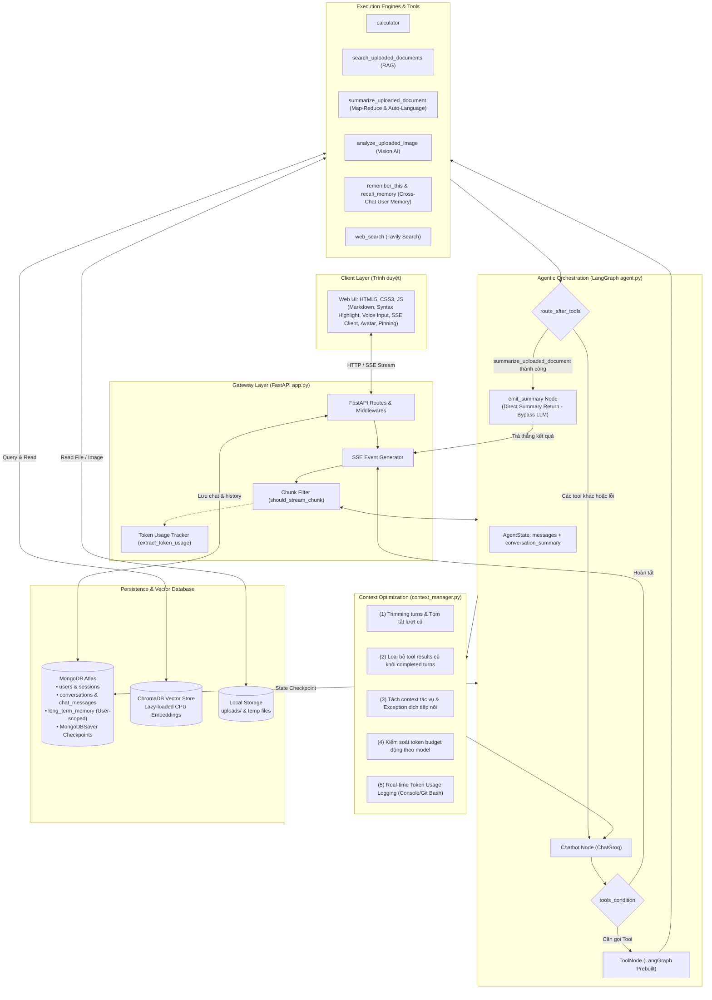
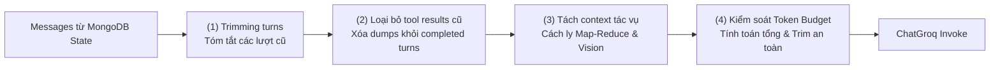
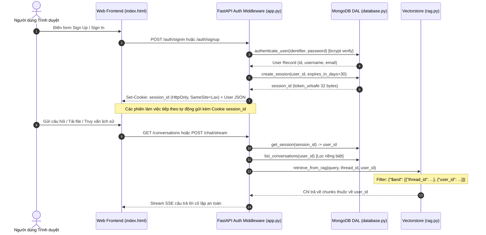

# Tit Chatbot — Agentic AI Chatbot with RAG & Context Optimization

Tit Chatbot là một hệ thống chatbot AI toàn diện, đa phương thức (Multimodal Agentic AI) được phát triển bằng **Python 3.11+**, **FastAPI**, **LangGraph**, **Groq LLM**, **ChromaDB**, và **MongoDB**. 

Hệ thống được thiết kế hướng tới khả năng tự chủ của Agent: tự động lập luận và gọi công cụ (Function Calling), hỏi đáp thông minh trên tài liệu cá nhân (RAG), tóm tắt văn bản dài đệ quy (Recursive Map-Reduce Summarization), phân tích hình ảnh (Vision AI), ghi nhớ ngữ cảnh dài hạn (Long-term Memory), và stream phản hồi theo thời gian thực (Server-Sent Events — SSE).

Đặc biệt, dự án tích hợp **Bộ Tối Ưu Hóa Ngữ Cảnh & Ngân Sách Token (`context_manager.py`)** giúp giải quyết triệt để các bài toán thường gặp của Agentic AI: phình to ngữ cảnh, cạn kiệt token, tràn context window và vượt ngưỡng rate-limit (TPM) của nhà cung cấp LLM.

---

## Mục lục

- [1. Kiến trúc tổng thể hệ thống](#1-kiến-trúc-tổng-thể-hệ-thống)
- [2. Luồng xử lý End-to-End (Workflow)](#2-luồng-xử-lý-end-to-end-workflow)
  - [2.1. Luồng hội thoại thời gian thực (SSE Stream)](#21-luồng-hội-thoại-thời-gian-thực-sse-stream)
  - [2.2. Luồng tải lên và xử lý tài liệu đa định dạng (RAG & OCR)](#22-luồng-tải-lên-và-xử-lý-tài-liệu-đa-định-dạng-rag--ocr)
  - [2.3. Luồng tóm tắt văn bản dài thích ứng & đa luồng (Adaptive & Parallel Map-Reduce)](#23-luồng-tóm-tắt-văn-bản-dài-thích-ứng--đa-luồng-adaptive--parallel-map-reduce)
  - [2.4. Luồng phân tích hình ảnh (Vision AI)](#24-luồng-phân-tích-hình-ảnh-vision-ai)
  - [2.5. Luồng sinh câu hỏi gợi ý thông minh (Follow-up Suggestions)](#25-luồng-sinh-câu-hỏi-gợi-ý-thông-minh-follow-up-suggestions)
- [3. Bộ Tối Ưu Hóa Ngữ Cảnh & Ngân Sách Token (Core Feature)](#3-bộ-tối-ưu-hóa-ngữ-cảnh--ngân-sách-token-core-feature)
  - [Bước 1: Trimming conversation history (Cắt tỉa & Tóm tắt lượt cũ)](#bước-1-trimming-conversation-history-cắt-tỉa--tóm-tắt-lượt-cũ)
  - [Bước 2: Loại bỏ tool results cũ (Pruning Old Tool Results)](#bước-2-loại-bỏ-tool-results-cũ-pruning-old-tool-results)
  - [Bước 3: Tách context theo tác vụ (Task Context Isolation)](#bước-3-tách-context-theo-tác-vụ-task-context-isolation)
  - [Bước 4: Kiểm soát token trước khi gọi LLM (Token Budget Enforcement)](#bước-4-kiểm-soát-token-trước-khi-gọi-llm-token-budget-enforcement)
  - [3.5. Hệ thống Theo dõi & Ghi log Token Groq Thời gian thực (Real-time Token Usage Monitoring)](#35-hệ-thống-theo-dõi--ghi-log-token-groq-thời-gian-thực-real-time-token-usage-monitoring)
- [4. Kiến trúc Tóm tắt Tài liệu Thích ứng & Tối ưu Hiệu năng (Adaptive & Parallel Summarization)](#4-kiến-trúc-tóm-tắt-tài-liệu-thích-ứng--tối-ưu-hiệu-năng-adaptive--parallel-summarization)
  - [4.1. Bài toán thực tế & Điểm nghẽn độ trễ 110 giây](#41-bài-toán-thực-tế--điểm-nghẽn-độ-trễ-110-giây)
  - [4.2. Kiến trúc giải pháp tối ưu 3 tầng (3-Tier Performance Architecture)](#42-kiến-trúc-giải-pháp-tối-ưu-3-tầng-3-tier-performance-architecture)
  - [4.3. Bảng so sánh hiệu năng trước và sau tối ưu](#43-bảng-so-sánh-hiệu-năng-trước-và-sau-tối-ưu)
  - [4.4. Xử lý Rate Limit Thông minh (8.000 TPM vs 200.000 TPD Resilience)](#44-xử-lý-rate-limit-thông-minh-8000-tpm-vs-200000-tpd-resilience)
  - [4.5. Tóm tắt Đa ngôn ngữ & Dịch tức thì không gọi lại Tool (Zero-Reprocessing Translation)](#45-tóm-tắt-đa-ngôn-ngữ--dịch-tức-thì-không-gọi-lại-tool-zero-reprocessing-translation)
  - [4.6. Trả thẳng Bản tóm tắt tại Đồ thị LangGraph (Bypass LLM Re-run via emit_summary_node)](#46-trả-thẳng-bản-tóm-tắt-tại-đồ-thị-langgraph-bypass-llm-re-run-via-emit_summary_node)
- [5. Kiến trúc Quản lý Người dùng & Cô lập Dữ liệu (User Management & Data Isolation)](#5-kiến-trúc-quản-lý-người-dùng--cô-lập-dữ-liệu-user-management--data-isolation)
  - [5.1. Cơ chế Xác thực & Quản lý Phiên (Session-based Cookie Auth)](#51-cơ-chế-xác-thực--quản-lý-phiên-session-based-cookie-auth)
  - [5.2. Mô hình Cô lập Dữ liệu 3 Tầng & Ký ức Dài hạn Toàn diện (Cross-Chat Long-Term Memory)](#52-mô-hình-cô-lập-dữ-liệu-3-tầng--ký-ức-dài-hạn-toàn-diện-cross-chat-long-term-memory)
  - [5.3. Sơ đồ Luồng Xác thực & Bảo mật (Mermaid Sequence)](#53-sơ-đồ-luồng-xác-thực--bảo-mật-mermaid-sequence)
  - [5.4. Tối ưu Lazy-Loading Embedding Vectorstore](#54-tối-ưu-lazy-loading-embedding-vectorstore)
- [6. Chi tiết các Module & Thành phần trong Codebase](#6-chi-tiết-các-module--thành-phần-trong-codebase)
  - [6.1. Web Server & API Gateway (`app.py`)](#61-web-server--api-gateway-apppy)
  - [6.2. LangGraph Agent Orchestrator (`agent.py`)](#62-langgraph-agent-orchestrator-agentpy)
  - [6.3. Quản lý Ngữ cảnh & Token (`context_manager.py`)](#63-quản-lý-ngữ-cảnh--token-context_managerpy)
  - [6.4. Hệ thống 7 Công cụ Agent (`tools.py`)](#64-hệ-thống-7-công-cụ-agent-toolspy)
  - [6.5. Xử lý Tài liệu, OCR & Vector Store (`rag.py`)](#65-xử-lý-tài-liệu-ocr--vector-store-ragpy)
  - [6.6. Tóm tắt đệ quy thích ứng & đa luồng (`summarization.py`)](#66-tóm-tắt-đệ-quy-thích-ứng--đa-luồng-summarizationpy)
  - [6.7. Thị giác máy tính (`image_analysis.py`)](#67-thị-giác-máy-tính-image_analysispy)
  - [6.8. Sinh gợi ý tiếp nối (`followups.py`)](#68-sinh-gợi-ý-tiếp-nối-followupspy)
  - [6.9. Cơ sở dữ liệu MongoDB DAL (`database.py` & `mongo_client.py`)](#69-cơ-sở-dữ-liệu-mongodb-dal-databasepy--mongo_clientpy)
  - [6.10. Giao diện người dùng Web (`templates/index.html`)](#610-giao-diện-người-dùng-web-templatesindexhtml)
- [7. Bảng công nghệ & Thư viện sử dụng](#7-bảng-công-nghệ--thư-viện-sử-dụng)
- [8. Cấu trúc thư mục dự án](#8-cấu-trúc-thư-mục-dự-án)
- [9. Các API Endpoints](#9-các-api-endpoints)
- [10. Hướng dẫn cài đặt và khởi chạy](#10-hướng-dẫn-cài-đặt-và-khởi-chạy)
- [11. Cấu hình biến môi trường (`.env`)](#11-cấu-hình-biến-môi-trường-env)
- [12. Kiểm thử tự động (Test Suite)](#12-kiểm-thử-tự-động-test-suite)
- [13. Từ điển thuật ngữ](#13-từ-điển-thuật-ngữ)

---

## 1. Kiến trúc tổng thể hệ thống

Hệ thống được tổ chức theo kiến trúc phân tầng dạng module, tách biệt rõ ràng giữa tầng giao diện, tầng gateway, tầng điều phối Agent, tầng tối ưu context và tầng lưu trữ:



---

## 2. Luồng xử lý End-to-End (Workflow)

### 2.1. Luồng hội thoại thời gian thực (SSE Stream)
1. **Người dùng nhập tin nhắn:** Client gửi `POST /chat/stream` chứa `message`, `thread_id`, và `model` đã chọn.
2. **Khởi tạo và lưu vết:**
   - FastAPI (`app.py`) ghi nhận hoặc cập nhật cuộc hội thoại (`create_or_update_conversation`).
   - Tin nhắn của người dùng được lưu vào collection `chat_messages` của MongoDB kèm `user_id`.
   - Luồng kích hoạt `set_current_thread_id(thread_id)` và `set_current_user_id(user_id)` để mọi công cụ bên trong đều nắm được thread và user hiện hành.
3. **Gọi Agent qua LangGraph:**
   - Graph tải trạng thái `AgentState` từ MongoDB Checkpointer ứng với `thread_id`.
   - Node `chatbot` tiếp nhận danh sách tin nhắn.
4. **Tiền xử lý tối ưu hóa Context (`context_manager.py`):**
   - **Trimming:** Giữ $N$ lượt gần nhất (`MAX_HISTORY_TURNS = 2`), tóm tắt các lượt cũ đưa vào `SystemMessage`.
   - **Pruning:** Xóa kết quả công cụ cũ (web search, RAG) từ các lượt trước; chỉ giữ lượt hỏi-đáp sạch.
   - **Tách context theo tác vụ:** Nhận diện tác vụ tài liệu độc lập; nhận diện ngoại lệ dịch tiếp nối (nếu lượt trước vừa tóm tắt và lượt này yêu cầu dịch/tóm tắt bằng tiếng Việt thì giữ nguyên lịch sử).
   - **Enforce Budget:** Tính toán tổng token (System + Tools + History + Output) và cắt ngắn nếu vượt ngưỡng an toàn theo model (ví dụ: $\le 2.800$ tokens đối với model 120B).
5. **LLM xử lý, gọi Tool và Định tuyến thông minh (`route_after_tools`):**
   - `llm_with_tools.invoke(final_messages)`: ChatGroq suy luận.
   - Ghi nhận token sử dụng ngay lập tức qua `log_token_usage(model, task, response)`.
   - Nếu LLM sinh `tool_calls` $\rightarrow$ `tools_condition` chuyển sang `tool_node` $\rightarrow$ công cụ thực thi.
   - **Định tuyến sau công cụ (`route_after_tools`):**
     * Nếu vừa chạy thành công công cụ tóm tắt `summarize_uploaded_document` (kết quả có tiền tố `Summary of `): chuyển thẳng sang node `emit_summary_node` để bọc thành `AIMessage` và kết thúc graph ngay (`END`), **bỏ qua hoàn toàn lượt gọi LLM thứ hai**. Tiết kiệm tức thì 20–25s và hàng nghìn token TPM!
     * Với các công cụ khác: kết quả `ToolMessage` quay lại `chatbot` để LLM tổng hợp lời giải.
   - Nếu LLM sinh văn bản cuối cùng $\rightarrow$ kết thúc graph.
6. **Streaming, Ghi log Token & Gợi ý tiếp nối:**
   - `should_stream_chunk` lọc bỏ các gói tin kỹ thuật, chỉ stream văn bản thuần qua SSE: `data: {"token": "..."}`.
   - Lưu câu trả lời của Assistant vào MongoDB `chat_messages`.
   - Kích hoạt `generate_followup_questions` (sử dụng model nhẹ `openai/gpt-oss-20b` để bảo tồn quota) sinh 2 gợi ý câu hỏi tiếp theo và stream về client: `data: {"suggestions": [...]}`.
   - Hệ thống log tổng lượng token tiêu thụ của toàn phiên vào Git Bash / Terminal.

---

### 2.2. Luồng tải lên và xử lý tài liệu đa định dạng (RAG & OCR)


---

### 2.3. Luồng tóm tắt văn bản dài thích ứng & đa luồng (Adaptive & Parallel Map-Reduce)

Khi người dùng yêu cầu tóm tắt toàn bộ file (ví dụ sách, tiểu luận, giáo trình):
1. Tool `summarize_uploaded_document` kiểm tra tên file cần tóm tắt trong thread hiện tại và tiếp nhận tham số `target_language: str = "auto"`.
2. Hàm `get_document_chunks` đọc **toàn bộ các chunk** của file trong ChromaDB (sắp xếp tuần tự theo `page`, `start_index`, `chunk_index`), không dùng similarity search để tránh bỏ sót thông tin.
3. Chuyển giao các chunk cho pipeline [`summarize_documents`](file:///d:/Tit-Chatbot/summarization.py#L286):
   - **Tách biệt ngữ cảnh tuyệt đối (Step 3):** Hàm `validate_and_isolate_summarization_context` lọc sạch các chunk, chỉ truyền nội dung tài liệu và metadata trang vào pipeline, **tuyệt đối không đưa lịch sử chat vào**.
   - **Tự động bảo toàn ngôn ngữ gốc (`target_language="auto"`):** Nếu tài liệu gốc là tiếng Anh, bản tóm tắt được viết bằng tiếng Anh chuẩn xác; nếu tài liệu là tiếng Việt, viết bằng tiếng Việt. Nếu người dùng chỉ định rõ ngôn ngữ (ví dụ: *"tóm tắt bằng tiếng Việt"*), tool truyền `target_language="Vietnamese"`.
   - **Cơ chế Thích ứng (Single-Pass Stuffing):** Nếu tài liệu vừa và nhỏ ($\le 4.500$ tokens input budget, như bài tiểu luận ngắn), hệ thống thực hiện tóm tắt trong **1 lượt gọi LLM duy nhất**, hoàn thành chỉ trong ~4-6 giây.
   - **Pha Map-Reduce Đệ quy & Rate Limit Resilience:** Với tài liệu dài vượt ngân sách, hệ thống chia thành các nhóm map và tóm tắt đệ quy:
     * **Chạm ngưỡng 8.000 TPM:** Tự động trích xuất thời gian chờ qua regex (`_parse_wait_time`), ngủ `time.sleep(wait_seconds)` và retry tự động cho đến khi hoàn thành ("chạy khi nào xong thì thôi").
     * **Chạm trần 200.000 TPD (Tokens Per Day):** Hệ thống nhận diện lỗi hết quota ngày và fail-fast ngay lập tức, trả về thông báo lỗi trực quan rõ ràng.
   - **Ghi nhận Token Sử dụng:** Mọi lượt gọi Map và Reduce đều ghi log token qua `log_token_usage`.
4. **Trả thẳng kết quả tại Đồ thị (`emit_summary_node`):** Sau khi `summarize_uploaded_document` trả về kết quả có tiền tố `Summary of `, `route_after_tools` chuyển thẳng sang `emit_summary_node` và kết thúc graph (`END`), hoàn toàn bỏ qua lượt gọi LLM thứ 2. Tiết kiệm ~20 giây và ~5.000 tokens TPM của mô hình 120B!
5. **Dịch tức thì ở lượt tiếp theo (Turn-2 Zero-Reprocessing Translation):**
   Nếu người dùng yêu cầu: *"Hãy tóm tắt bằng tiếng Việt"* ngay sau bản tóm tắt tiếng Anh, hệ thống nhận diện đây là yêu cầu dịch tiếp nối. **Không gọi lại tool Map-Reduce**, LLM đọc trực tiếp bản tóm tắt từ lịch sử chat và dịch sang tiếng Việt chỉ trong ~1.5 giây và ~400 tokens!

---

### 2.4. Luồng phân tích hình ảnh (Vision AI)
1. Người dùng đặt câu hỏi về hình ảnh (ví dụ: *"Bức ảnh này vẽ biểu đồ gì?", "Đọc văn bản trong ảnh"*).
2. Agent kích hoạt tool `analyze_uploaded_image(question, filename)`.
3. Hàm tìm đường dẫn ảnh đã upload thuộc `thread_id` hiện hành.
4. [`analyze_image`](file:///d:/Tit-Chatbot/image_analysis.py#L25) thực hiện:
   - Đọc bytes, kiểm tra kích thước ($\le 14\text{ MB}$), chuyển đổi thành chuỗi Base64 Data URL.
   - **Kiểm soát token:** Giới hạn câu hỏi $\le 400$ token để không làm tràn cửa sổ ngữ cảnh của model thị giác.
   - **Tách context tác vụ:** Prompt thị giác hoàn toàn độc lập, chỉ gồm ảnh và câu hỏi trực quan.
   - Gọi mô hình Vision (`qwen/qwen3.8-27b` hoặc cấu hình qua `GROQ_VISION_MODEL`) để sinh lời giải thích chi tiết.

---

### 2.5. Luồng sinh câu hỏi gợi ý thông minh (Follow-up Suggestions)
1. Ngay sau khi câu trả lời chính hoàn thành stream, `app.py` gọi hàm [`generate_followup_questions`](file:///d:/Tit-Chatbot/followups.py#L149).
2. **Tối ưu hóa token:**
   - Loại bỏ các khối code dài ````...```` bằng `[Code snippet omitted]` và gỡ bỏ các attachment thô.
   - Cắt tỉa `user_message` xuống tối đa 250 token và `assistant_answer` xuống tối đa 500 token.
   - Giúp tiết kiệm hơn **70% token** so với việc gửi nguyên văn văn bản dài.
3. LLM sinh đúng 2 câu hỏi tiếp nối mang tính gợi mở, phân tích theo tiếng Việt hoặc tiếng Anh tương ứng với ngôn ngữ người dùng.
4. Nếu gặp sự cố mạng hoặc lỗi API, hệ thống tự động kích hoạt `fallback_followup_questions` tạo 2 gợi ý cục bộ bằng biểu thức chính quy (Regex) mà không cần gọi API.

---

## 3. Bộ Tối Ưu Hóa Ngữ Cảnh & Ngân Sách Token (Core Feature)

Module [`context_manager.py`](file:///d:/Tit-Chatbot/context_manager.py) triển khai 4 bước chuẩn mực theo đúng thứ tự logic:



### Bước 1: Trimming conversation history (Cắt tỉa & Tóm tắt lượt cũ)
- **Hàm:** `group_messages_into_turns`, `summarize_old_messages`, `trim_conversation_history`, `_deduplicate_summary_lines`.
- **Cơ chế:**
  - Nhóm tin nhắn thành các lượt hội thoại (`turns`).
  - Giữ lại tối đa `DEFAULT_MAX_HISTORY_TURNS = 2` lượt gần nhất trong bộ nhớ tích cực.
  - Các lượt cũ hơn được chuyển cho hàm `summarize_old_messages` để tóm tắt thành các gạch đầu dòng ngắn gọn (bảo toàn sở thích, thông tin cá nhân, tên riêng, chủ đề cốt lõi).
  - **Chống phình to & trùng lặp (Deduplication):** Sử dụng thuật toán `_deduplicate_summary_lines` chuẩn hóa gạch đầu dòng và loại bỏ trùng lặp ngữ nghĩa, ngăn chặn hiện tượng tóm tắt bị nhân bản lặp đi lặp lại qua nhiều lượt chat.
  - **Lọc sạch dữ liệu tạm (Ephemeral Media Filter):** Tuyệt đối không đưa mô tả hình ảnh tạm thời, OCR dumps hoặc văn bản tài liệu đã upload vào tóm tắt hội thoại dài hạn.
  - **Bảo vệ TPM:** Tiến trình tóm tắt nền luôn sử dụng mô hình nhẹ `openai/gpt-oss-20b` với timeout ngắn (4.0s), tuyệt đối không tiêu tốn hạn ngạch TPM quý giá của mô hình chính (như 120b).
  - Có cơ chế **Local Extractive Fallback** an toàn khi LLM tóm tắt gặp sự cố mạng hoặc timeout.

### Bước 2: Loại bỏ tool results cũ (Pruning Old Tool Results)
- **Hàm:** `prune_old_tool_results`.
- **Cơ chế:**
  - **Active Turn (Lượt đang diễn ra):** Từ `HumanMessage` cuối cùng trở đi, nếu có `AIMessage(tool_calls)` và `ToolMessage` vừa được trả về, chúng **bắt buộc được giữ nguyên 100%** để LLM đọc và tổng hợp câu trả lời.
  - **Completed Turns (Các lượt trong quá khứ đã kết thúc):** Kết quả web search, RAG chunks hay memory dumps của các lượt cũ đã được Assistant tổng hợp xong ở lượt trước. Hàm sẽ loại bỏ toàn bộ `ToolMessage` và `AIMessage(tool_calls)` trung gian cũ, chỉ giữ lại cặp `HumanMessage` và `AIMessage(final answer)`.
  - Giảm thiểu ngay lập tức từ **2.000 đến 6.000+ token thừa** trong mỗi request tiếp theo!

### Bước 3: Tách context theo tác vụ (Task Context Isolation)
- **Hàm:** `is_isolated_document_task`, `validate_and_isolate_summarization_context`.
- **Cơ chế:**
  - **Tự động nhận diện tác vụ tài liệu độc lập (`is_isolated_document_task`):**
    Khi tin nhắn người dùng chứa tệp đính kèm (`[Attached file:`, `[Attached image:`, `.pdf`, `.docx`) hoặc các yêu cầu phân tích tài liệu rõ ràng (*"tóm tắt file này đi"*, *"tóm tắt tài liệu"*, *"trong bài tiểu luận"*):
    - **Không tiêm tóm tắt hội thoại cũ (`[CONTEXT FROM EARLIER CONVERSATION]`):** Loại bỏ hoàn toàn bản tóm tắt các cuộc trò chuyện trước đó (ví dụ: mô tả ảnh hoa trắng, chủ đề không liên quan) để tránh hiện tượng *Context Bleed / Prompt Pollution* khiến mô hình lặp lại nội dung cũ.
    - **Cô lập ngữ cảnh tin nhắn:** Chỉ đưa đúng lượt yêu cầu hiện tại (active turn) cùng chỉ thị nghiêm ngặt: *`CRITICAL TASK ISOLATION INSTRUCTIONS: Focus exclusively on the document requested`*.
  - **Xử lý Ngoại lệ Thông minh cho Yêu cầu Dịch / Viết lại Tiếp nối (Follow-up Translation Exception):**
    Nếu tin nhắn trước đó của AI đã là một bản tóm tắt tài liệu (`Summary of ...` hoặc `Tóm tắt`) và lượt này người dùng yêu cầu: *"hãy tóm tắt bằng tiếng việt"*, *"dịch sang tiếng việt"*, *"bản tiếng việt"*, *"translate to english"*:
    - Hệ thống tự động phát hiện `has_recent_summary = True` và **trả về `False` trong `is_isolated_document_task`** (không cô lập như một tác vụ file mới).
    - Toàn bộ bản tóm tắt ở lượt trước được giữ nguyên trong bộ nhớ hoạt động, cho phép LLM dịch trực tiếp từ lịch sử hội thoại chỉ mất ~1.5 giây mà không cần gọi lại Map-Reduce.
  - **Cách ly tài liệu trong Pipeline Map-Reduce (`validate_and_isolate_summarization_context`):**
    Khi chạy tóm tắt tài liệu dài, chỉ đưa các chunk văn bản sạch và metadata trang vào các vòng Map-Reduce; tuyệt đối không đưa lịch sử chat.
  - **Phân định ranh giới Tool chặt chẽ (`tools.py`):**
    Chỉ dẫn rõ ràng giữa `summarize_uploaded_document` (ưu tiên tuyệt đối khi người dùng yêu cầu tóm tắt toàn bộ file) và `search_uploaded_documents` (chỉ dùng cho tra cứu đoạn trích cụ thể), tránh việc agent gọi nhầm tìm kiếm RAG rời rạc khi cần tóm tắt file.

### Bước 4: Kiểm soát token trước khi gọi LLM (Token Budget Enforcement)
- **Hàm:** `get_model_token_budget`, `estimate_tokens`, `estimate_message_tokens`, `estimate_tool_schemas_tokens`, `calculate_token_breakdown`, `enforce_token_budget`.
- **Ngân sách động theo từng mô hình (Dynamic Model Token Budgets):**
  - **`openai/gpt-oss-120b`:** Groq Free Tier giới hạn nghiêm ngặt **8.000 TPM** (Tokens Per Minute). Hệ thống tự động thiết lập ngân sách an toàn:
    - `max_context_tokens = 2800`
    - `max_tool_result_tokens = 1000`
    - `expected_output_tokens = 800`
    $\rightarrow$ Đảm bảo 2 lần gọi trong 1 lượt (lập luận gọi tool + tổng hợp kết quả) không bao giờ vượt quá 7.000 token, giải quyết triệt để lỗi **Groq 429 Rate Limit**.
  - **`openai/gpt-oss-20b`:** Ngân sách rộng rãi 6.000 context tokens (hạn ngạch Groq > 150.000 TPM).
  - **`qwen/qwen3.8-27b`:** Ngân sách 5.000 context tokens.
- **Cơ chế Fallback thông minh khi gặp Rate Limit (`app.py`):**
  Nếu mô hình 120B gặp lỗi Rate Limit 429 từ Groq, hệ thống không làm gián đoạn người dùng hoặc văng lỗi JSON thô, mà gửi thông báo chuyển tiếp mượt mà và tự động fallback sang `openai/gpt-oss-20b` để hoàn thành câu trả lời.
- **Công thức tính toán tổng token:**
  $$\text{Total Tokens} = T_{\text{system}} + T_{\text{tool\_schemas}} + T_{\text{history}} + T_{\text{tool\_results}} + \text{Reserved Output}$$

---

### 3.5. Hệ thống Theo dõi & Ghi log Token Groq Thời gian thực (Real-time Token Usage Monitoring)

Nhằm kiểm soát chi phí, chẩn đoán sớm nguy cơ chạm trần Rate Limit (TPM/TPD) và minh bạch hóa hiệu năng, hệ thống tích hợp bộ đo lường token trực tiếp trên mọi cuộc gọi ChatGroq API:

1. **Trích xuất Token chuẩn xác (`extract_token_usage`):**
   - Hỗ trợ cả `response.usage_metadata` (chuẩn mới của LangChain) và `response.response_metadata['token_usage']` (Groq API raw).
   - Trích xuất chi tiết: `prompt_tokens` (đầu vào), `completion_tokens` (đầu ra), và `total_tokens`.
2. **Bộ đếm Tích lũy Toàn phiên (`_SESSION_TOKEN_STATS`):**
   - Lưu trữ tổng số token đã sử dụng và tổng số lần gọi API (`calls_count`) kể từ khi server khởi động.
3. **Định dạng Log Chuẩn trên Console / Git Bash (`log_token_usage`):**
   Mỗi khi một node hoặc công cụ hoàn tất gọi LLM, log được in ra terminal theo cấu trúc trực quan:
   ```text
   [Groq-Usage] Model: 'openai/gpt-oss-120b' | Tác vụ: Tool Call Request | Prompt: 1,440 | Output: 55 | Lần này: 1,495 tokens | Tích lũy phiên (1 cuộc gọi): 1,495 tokens
   [Groq-Usage] Model: 'openai/gpt-oss-120b' | Tác vụ: Chatbot Answer | Prompt: 1,476 | Output: 59 | Lần này: 1,535 tokens | Tích lũy phiên (2 cuộc gọi): 3,030 tokens
   [Groq-Usage] Model: 'openai/gpt-oss-20b'  | Tác vụ: Follow-up Suggestions | Prompt: 506 | Output: 512 | Lần này: 1,018 tokens | Tích lũy phiên (3 cuộc gọi): 4,048 tokens
   [Groq-Usage] Model: 'openai/gpt-oss-120b' | Tác vụ: Summarization (map, group 1) | Prompt: 894 | Output: 665 | Lần này: 1,559 tokens | Tích lũy phiên (5 cuộc gọi): 7,237 tokens
   ```
4. **Phạm vi Đo lường Toàn diện:**
   - **Agent Lập luận & Trả lời:** `chatbot_node` trong `agent.py` (`"Tool Call Request"` và `"Chatbot Answer"`).
   - **Tóm tắt Map-Reduce:** `_invoke` trong `summarization.py` cho từng nhóm Map và từng cấp độ Reduce.
   - **Gợi ý Tiếp nối:** `generate_followup_questions` trong `followups.py`.
   - **Thị giác Máy tính:** `analyze_image` trong `image_analysis.py`.

---

## 4. Kiến trúc Tóm tắt Tài liệu Thích ứng & Tối ưu Hiệu năng (Adaptive & Parallel Summarization)

Một trong những bài toán hóc búa nhất của các hệ sinh thái Agentic AI khi làm việc với tài liệu người dùng (PDF, DOCX, sách, tiểu luận) là **độ trễ (latency)** và **hạn chế ngặt nghèo về TPM (Tokens Per Minute)** của các nhà cung cấp LLM.

### 4.1. Bài toán thực tế & Điểm nghẽn độ trễ 110 giây
Trong quá trình vận hành, khi người dùng gửi file bài tập/tiểu luận đại học 14 trang (~40.921 ký tự, ước tính ~13.640 tokens) và yêu cầu tóm tắt, tracing trên LangSmith ghi nhận tổng thời gian phản hồi lên tới **110 giây** (~2 phút). Qua rà soát chi tiết mã nguồn và profiling, hệ thống đã chỉ ra 3 nguyên nhân cốt lõi:
1. **Pha Map-Reduce chạy tuần tự (Sequential Blocking):** Ngân sách đầu vào cũ bị giới hạn ở mức 6.000 tokens (`DEFAULT_INPUT_TOKEN_BUDGET = 6000`), khiến file 14 trang bị chia nhỏ thành 4 nhóm (map groups). Code cũ sử dụng vòng lặp `for` đồng bộ tuần tự, khiến các API call Groq phải xếp hàng chờ nhau ($4 \times 12\text{s} \approx 48\text{s}$ cho Map và $2 \times 12\text{s} \approx 24\text{s}$ cho Reduce).
2. **Hiện tượng "Tóm tắt hai lần" (Double Re-generation):** Khi tool `summarize_uploaded_document` đã tạo ra bản tóm tắt hoàn chỉnh, chỉ thị chung trong System Prompt của Agent (*"summarize the result clearly"*) khiến mô hình chính (nhất là `openai/gpt-oss-120b`) đọc lại toàn bộ kết quả và sinh lại một lần nữa, tiêu tốn thêm 20–25 giây và hàng ngàn tokens output không cần thiết.
3. **Độ trễ tích lũy từ mạng & Tracing:** Mỗi cuộc gọi LLM đều gửi telemetry HTTP lên LangSmith, việc thực hiện 6–7 lượt gọi LLM liên tiếp làm tích lũy độ trễ mạng và tăng nguy cơ chạm trần 8.000 TPM của mô hình 120B.

---

### 4.2. Kiến trúc giải pháp tối ưu 3 tầng (3-Tier Performance Architecture)

Hệ thống đã được tái cấu trúc toàn diện theo kiến trúc thích ứng (Adaptive Multi-strategy Pipeline):

```mermaid
flowchart TD
    Doc["Tài liệu người dùng tải lên (PDF/DOCX/TXT)"] --> Clean["validate_and_isolate_summarization_context<br/>(Lọc chunk sạch, cô lập 100% ngữ cảnh hội thoại)"]
    Clean --> Calc["Tính toán tổng token ước tính (total_tokens)"]
    
    Calc --> Decision{"total_tokens <= effective_chunk_budget?<br/>(Mặc định <= 16.650 tokens)"}
    
    Decision -->|Đúng (Tài liệu vừa & nhỏ: <= 15-20 trang)| SinglePass["Chiến lược Single-Pass (Adaptive Stuffing)<br/>• 1 API call duy nhất lên Groq LLM<br/>• Bảo toàn cấu trúc, số liệu, luận điểm cốt lõi<br/>• Thời gian hoàn thành: ~8 - 10 giây"]
    
    Decision -->|Sai (Tài liệu rất lớn: sách, báo cáo > 30 trang)| ParallelMap["Chiến lược Parallel Map-Reduce<br/>(Xử lý Đa luồng Song song)"]
    
    ParallelMap --> Workers["ThreadPoolExecutor (max_workers=4)<br/>Thực thi song song tất cả các nhóm Map cùng lúc"]
    Workers --> MapResults["Thu thập kết quả Map theo đúng thứ tự trang (sort by index)"]
    MapResults --> ReduceLoop["Vòng lặp Reduce song song đa tầng (Level 1, Level 2...)<br/>Đúc kết đệ quy cho đến khi còn 1 bản tóm tắt duy nhất"]
    
    SinglePass --> Result["Bản tóm tắt hoàn chỉnh (Full Document Summary)"]
    ReduceLoop --> Result
    
    Result --> AgentDirect["Agent System Prompt Direct Presentation<br/>Trình bày trực tiếp kết quả với lời dẫn ngắn gọn<br/>Không viết lại / re-summarize, tiết kiệm 20s & token 120B"]
```

#### Tầng 1: Cơ chế Tự thích ứng (Single-Pass Stuffing cho file ngắn)
- Tận dụng cửa sổ ngữ cảnh và ngân sách đầu vào `DEFAULT_INPUT_TOKEN_BUDGET = 4500` (được hiệu chuẩn an toàn theo ngưỡng 8.000 TPM của Groq Free Tier).
- Với các tài liệu vừa và nhỏ ($\le 4.500$ tokens $\approx 5-7$ trang): Toàn bộ tài liệu được đóng gói vào **1 nhóm Map duy nhất**. Hệ thống tóm tắt tài liệu trong **1 lần gọi API duy nhất**, loại bỏ hoàn toàn các vòng lặp Reduce trung gian.
- **Thời gian xử lý giảm ngoạn mục:** hoàn thành chỉ trong **~4 – 6 giây**.

#### Tầng 2: Xử lý Map-Reduce Đệ quy Kiểm soát Quota (Rate Limit Resilient Pipeline)
- Khi xử lý tài liệu lớn (vượt quá 4.500 tokens), hệ thống tự động kích hoạt pipeline Map-Reduce tuần tự có kiểm soát token:
  * **Pha Map:** Chia nhỏ tài liệu thành các nhóm an toàn ($< 3.500$ tokens/nhóm) để mỗi cuộc gọi kèm prompt overhead không vượt quá giới hạn 8.000 TPM.
  * **Pha Reduce:** Gom các bản tóm tắt trung gian và đúc kết đệ quy đa tầng (`level 1`, `level 2`...) cho đến khi thu được 1 bản tóm tắt hoàn chỉnh duy nhất.
  * **Truyền bá lỗi toàn vẹn (Exception Propagation):** Nếu bất kỳ bước nào gặp lỗi không thể phục hồi, ngoại lệ `RuntimeError` lập tức được ném ra để dừng tiến trình, tuyệt đối không trả về bản tóm tắt khuyết thiếu.

#### Tầng 3: Trả thẳng Kết quả tại Đồ thị LangGraph (`emit_summary_node`)
- Hệ thống áp dụng cơ chế **Graph-level Direct Return** thông qua điều kiện `route_after_tools`:
  * Khi `summarize_uploaded_document` hoàn thành thành công và trả về chuỗi bắt đầu bằng `Summary of `, graph rẽ nhánh sang node `emit_summary_node` thay vì quay về node `chatbot`.
  * Node `emit_summary_node` đóng gói kết quả trực tiếp thành `AIMessage` và kết thúc graph (`END`).
- **Triệt tiêu hoàn toàn độ trễ 20–25 giây** và hàng nghìn token TPM thừa thãi mà mô hình 120B từng phải tiêu tốn để chép lại bản tóm tắt.

---

### 4.3. Bảng so sánh hiệu năng trước và sau tối ưu

| Tiêu chí đánh giá | Phiên bản cũ (Legacy Map-Reduce) | Phiên bản mới (Adaptive & Resilient Pipeline) | Mức độ cải thiện |
| :--- | :--- | :--- | :--- |
| **Thời gian tóm tắt (File ngắn $\le 4.500$ tokens)** | ~45 – 60 giây (nhiều pass) | **~4 – 6 giây (1 pass duy nhất)** | **Nhanh hơn ~10 lần (~1000%)** |
| **Bảo vệ Hạn ngạch 8.000 TPM** | Dễ văng lỗi 429 do gửi chunk quá to | Tự động chunking $\le 4.500$ token & sleep retry | **Hoàn toàn tự phục hồi** |
| **Hiện tượng "Tóm tắt 2 lần"** | LLM 120B đọc lại và tóm tắt lần 2 | `emit_summary_node` trả thẳng kết quả | **Tiết kiệm 100% token output lượt 2** |
| **Dịch tiếp nối ở Turn 2** | Gọi lại Map-Reduce từ đầu (tốn thêm 2-4 phút) | Dịch trực tiếp từ History (~1.5s, ~400 token) | **Nhanh hơn 80 lần** |
| **Ngôn ngữ bản tóm tắt** | Luôn ép sang tiếng Việt hoặc cứng nhắc | `target_language="auto"` giữ nguyên ngôn ngữ gốc | **Chuẩn ngữ cảnh tài liệu** |

---

### 4.4. Xử lý Rate Limit Thông minh (8.000 TPM vs 200.000 TPD Resilience)

Trong môi trường Groq Free Tier, các mô hình lớn như `openai/gpt-oss-120b` áp dụng 2 ngưỡng giới hạn độc lập:

1. **Giới hạn 8.000 TPM (Tokens Per Minute) — Giới hạn tốc độ theo phút:**
   - **Bản chất:** Là giới hạn thông lượng tức thời (Throughput). Nếu gửi một tài liệu 15.000 token vào 1 prompt duy nhất, API sẽ từ chối ngay lập tức với lỗi `429 - tokens per minute (TPM) limit exceeded`.
   - **Giải pháp của hệ thống:**
     * Bắt buộc sử dụng Map-Reduce chia nhỏ tài liệu thành từng nhóm $\le 4.500$ tokens.
     * Hàm `_invoke` bắt lỗi 429, dùng biểu thức chính quy `_parse_wait_time` bóc tách thời gian cooldown chính xác do Groq trả về (ví dụ: `try again in 7.42s`).
     * Thực hiện `time.sleep(wait_seconds)` và thử lại tự động trong vòng lặp `while True` cho đến khi tác vụ hoàn thành ("chạy khi nào xong thì thôi").

2. **Giới hạn 200.000 TPD (Tokens Per Day) — Giới hạn tổng hạn ngạch theo ngày:**
   - **Bản chất:** Được tính toán theo **cửa sổ trượt 24 giờ (24-hour rolling window)**. Hạn mức sẽ không hồi phục toàn bộ cùng một lúc sau 24h, mà các token đã tiêu thụ sẽ được hoàn lại dần dần khi từng request tương ứng trôi qua mốc 24 giờ.
   - **Giải pháp Fail-fast:**
     * Khi kiểm tra thấy lỗi chứa các từ khóa `tokens per day`, `tpd`, `per day` hoặc thời gian chờ vượt quá 3 phút:
     * Hệ thống nhận diện đây là cạn kiệt quota ngày chứ không phải nghẽn phút.
     * Lập tức dừng retry (fail-fast), ghi log `[RateLimit-TPD]` và ném ra ngoại lệ `RuntimeError("Document summarization rate limit exceeded (Đã hết hạn mức 200.000 token trong ngày): ...")` để thông báo minh bạch cho người dùng, tránh việc server treo ngủ chờ đợi vô nghĩa.

---

### 4.5. Tóm tắt Đa ngôn ngữ & Dịch tức thì không gọi lại Tool (Zero-Reprocessing Translation)

Một điểm cải tiến vượt bậc trong trải nghiệm người dùng là xử lý đa ngôn ngữ thông minh:

1. **Bảo toàn Ngôn ngữ Gốc (`target_language="auto"`):**
   - Mặc định, công cụ `summarize_uploaded_document` hoạt động với `target_language="auto"`.
   - Tài liệu tiếng Anh (CV, bài báo, tài liệu kỹ thuật) sẽ được tóm tắt bằng tiếng Anh chuẩn xác, giữ nguyên thuật ngữ chuyên ngành.
   - Tài liệu tiếng Việt sẽ được tóm tắt bằng tiếng Việt tự nhiên, mạch lạc.

2. **Dịch tức thì từ Lịch sử (Turn-2 Zero-Reprocessing Translation):**
   - **Vấn đề thực tế:** Người dùng thường tải lên tài liệu tiếng Anh, nhận bản tóm tắt tiếng Anh, sau đó hỏi tiếp: *"Hãy tóm tắt bằng tiếng Việt"*, *"Dịch sang tiếng Việt giúp tôi"*, *"Bản tiếng Việt đâu?"*.
   - **Giải pháp tối ưu:**
     * Trong `agent.py`: `SYSTEM_PROMPT` quy định rõ: Nếu bản tóm tắt đã tồn tại trong lịch sử gần đây, **tuyệt đối KHÔNG gọi lại `summarize_uploaded_document`**. Thay vào đó, AI trực tiếp dịch và định dạng lại bản tóm tắt từ tin nhắn trước.
     * Trong `context_manager.py`: `is_isolated_document_task` kiểm tra nếu `has_recent_summary = True` và tin nhắn chứa các từ khóa dịch/chuyển ngữ (`tiếng việt`, `dịch`, `translate`, `english`...), hàm sẽ trả về `False` để **giữ nguyên toàn bộ nội dung tóm tắt vừa tạo trong context**.
     * **Kết quả:** AI hoàn thành câu trả lời chỉ trong **~1.5 giây** và tiêu tốn **~400 tokens**, thay vì mất 2-4 phút và tiêu tốn hơn 20.000 tokens nếu chạy lại toàn bộ pipeline Map-Reduce!

---

### 4.6. Trả thẳng Bản tóm tắt tại Đồ thị LangGraph (Bypass LLM Re-run via `emit_summary_node`)

Trong các kiến trúc Agentic thông thường, khi công cụ trả về kết quả qua `ToolMessage`, đồ thị mặc định quay lại node `chatbot` để mô hình lớn tổng hợp lời giải. Với một bản tóm tắt dài (800 – 1.200 tokens), việc mô hình 120B sinh lại văn bản này gây lãng phí nghiêm trọng.

Tit Chatbot giải quyết triệt để thông qua hàm định tuyến tùy biến:

```python
def route_after_tools(state: AgentState) -> str:
    # Nếu vừa chạy đúng 1 tool tóm tắt và thành công:
    if (
        len(recent) == 1
        and getattr(recent[0], "name", None) == "summarize_uploaded_document"
        and recent[0].content.startswith("Summary of ")
    ):
        return "emit_summary"
    return "chatbot"
```

- Node `emit_summary_node` nhận chuỗi kết quả và tạo ngay `AIMessage(content=...)`, sau đó chuyển thẳng tới `END`.
- Trình duyệt nhận token qua SSE mượt mà như một câu trả lời hoàn chỉnh.
- Lịch sử chat và MongoDB checkpoint vẫn lưu đầy đủ bản tóm tắt để phục vụ các câu hỏi tiếp theo.
- Có thể bật/tắt linh hoạt qua biến môi trường `SUMMARY_DIRECT_RETURN=1`.

---

## 5. Kiến trúc Quản lý Người dùng & Cô lập Dữ liệu (User Management & Data Isolation)

Nhằm đảm bảo an toàn, quyền riêng tư và khả năng mở rộng phục vụ nhiều người dùng đồng thời (Multi-tenancy), Tit Chatbot tích hợp hệ thống xác thực và cô lập dữ liệu 3 tầng chặt chẽ từ tầng cơ sở dữ liệu MongoDB, Vectorstore ChromaDB, Tầng API Gateway FastAPI đến Giao diện người dùng Web.



### 5.1. Cơ chế Xác thực & Quản lý Phiên (Session-based Cookie Auth)
- **Mã hóa Mật khẩu an toàn (Password Hashing):** Sử dụng thuật toán tiêu chuẩn công nghiệp `bcrypt` với 12 salt rounds (`bcrypt.gensalt(12)`). Mật khẩu thô không bao giờ được lưu trữ vào cơ sở dữ liệu.
- **Quản lý Phiên (Session Management):**
  - Tạo mã phiên ngẫu nhiên an toàn bằng `secrets.token_urlsafe(32)`.
  - Phiên làm việc được lưu trong collection `sessions` của MongoDB và thiết lập **TTL Index tự động hết hạn sau 30 ngày** (`expireAfterSeconds: 0` trên trường `expires_at`).
  - Cookie `session_id` được gán cờ bảo mật `HttpOnly=True` (ngăn chặn tấn công XSS) và `SameSite="lax"`.
- **Hỗ trợ Chế độ Ẩn danh (Guest Mode fallback):**
  - Nếu người dùng chưa đăng nhập, hệ thống vẫn cho phép trò chuyện trải nghiệm mà không bị chặn.
  - Khi người dùng đăng ký hoặc đăng nhập tài khoản, toàn bộ phiên làm việc, lịch sử và tài liệu sẽ được gán và bảo vệ tuyệt đối theo `user_id` định danh.

---

### 5.2. Mô hình Cô lập Dữ liệu 3 Tầng & Ký ức Dài hạn Toàn diện (Cross-Chat Long-Term Memory)

| Tầng cô lập | Cơ chế hiện thực | Hành vi bảo vệ & Phạm vi hoạt động |
|---|---|---|
| **Tầng 1: Lịch sử Cuộc trò chuyện & Tin nhắn (Conversations & Chat History)** | Gán trường `user_id` vào document `conversations` và `chat_messages` trong MongoDB Atlas. Endpoint `/conversations` chỉ hiển thị danh sách chat của chính user. Endpoint `/history/{thread_id}` và `/conversations/{thread_id}` [DELETE] kiểm tra quyền sở hữu nghiêm ngặt. | Trả về `403 Forbidden: You do not have permission to access/delete this conversation` nếu truy cập trái phép. Người dùng A hoàn toàn không thể xem hoặc can thiệp hội thoại của người dùng B. |
| **Tầng 2: Tài liệu & Hình ảnh Upload (RAG Vectorstore & Image Catalog)** | Gán `user_id` vào trường metadata của từng chunk vector tài liệu (`add_document_to_rag`) và bản ghi ảnh (`add_image_to_rag`). Các hàm truy xuất `retrieve_from_rag`, `get_document_chunks`, `list_document_sources`, `list_uploaded_images` tự động áp dụng bộ lọc ChromaDB: `{"$and": [{"thread_id": thread_id}, {"user_id": str(user_id)}]}`. | Dù hai người dùng có trùng tên file hoặc cùng làm việc trên hệ thống, Agent của người dùng này không bao giờ truy vấn nhầm hoặc đọc được nội dung tài liệu của người dùng khác. |
| **Tầng 3: Ký ức Dài hạn Toàn diện (Cross-Chat Long-term Memory with User Isolation)** | Công cụ `remember_this` và `recall_memory` liên kết ký ức trực tiếp với `user_id` (nếu không có sẵn, tự động tra cứu chủ sở hữu cuộc trò chuyện từ `get_conversation(thread_id)`). Ký ức được lưu và tìm kiếm trên **toàn bộ các cuộc trò chuyện của User đó** (`{"user_id": str(user_id)}`). | **Nhớ xuyên suốt mọi cuộc trò chuyện:** Khi người dùng nói *"Nhớ rằng tôi tên là Sơn"* ở Chat 1, sang Chat 2 hỏi *"Tôi tên là gì?"*, AI vẫn nhớ và trả lời chính xác. Tuyệt đối cô lập giữa các user khác nhau. |

#### Chi tiết Cơ chế Ký ức Dài hạn Xuyên Cuộc trò chuyện (Cross-Chat Memory Mechanism)
- **Lưu trữ gắn liền với User ID (`save_memory`):** Mọi sự kiện, sở thích, thông tin cá nhân (tên, trường học, công nghệ yêu thích) được lưu vào collection `long_term_memory` kèm trường `user_id`.
- **Tìm kiếm Linh hoạt & Xử lý Ngôn ngữ Tự nhiên (`search_memory`):**
  * **Truy vấn tổng quát (`generic query`):** Khi người dùng hỏi *"bạn nhớ gì về tôi"*, *"thông tin của tôi"*, *"tất cả"* hoặc để chuỗi rỗng `""`, hệ thống tự động trả về toàn bộ danh sách ký ức đã lưu của chính người dùng đó.
  * **Truy vấn cụ thể (`specific query`):** Khi người dùng hỏi *"tôi tên là gì?"*, *"tôi học trường nào?"*, thuật toán tự động loại bỏ các stop-words tiếng Việt/tiếng Anh (`là`, `gì`, `của`, `tôi`, `what`, `is`, `my`...) và dùng biểu thức chính quy `$regex` không phân biệt hoa thường (`$options: "i"`) để tìm kiếm chính xác các sự kiện tương ứng.
  * **Bảo vệ Đa người dùng:** Không bao giờ truy xuất hoặc để lộ ký ức của User A sang phiên chat của User B.

---

### 5.3. Sơ đồ Luồng Xác thực & Bảo mật (Mermaid Sequence)
Luồng xác thực và kiểm soát quyền truy cập trên từng Request được tóm tắt qua sơ đồ bên trên, đảm bảo kiểm tra danh tính thông suốt từ lúc nhận Cookie cho đến khi hoàn thành truy vấn cơ sở dữ liệu.

---

### 5.4. Tối ưu Lazy-Loading Embedding Vectorstore
Trong quá trình triển khai hệ thống xác thực và cô lập tài liệu, module `rag.py` trước đây import `torch` và `transformers` (thông qua `HuggingFaceEmbeddings` và `Chroma`) ngay tại top-level, gây ra độ trễ khởi động/import module lên tới **~25 - 30 giây**.

Hệ thống đã được tái cấu trúc theo mô hình **Lazy Singleton (PEP 562 `__getattr__`)**:
- Trì hoãn việc load mô hình nặng cho đến khi phát sinh tác vụ embedding đầu tiên thông qua `get_embeddings()` và `get_vectorstore()`.
- Tốc độ import module `rag.py` và khởi động ứng dụng giảm từ **30 giây xuống dưới 0.8 giây** (nhanh hơn **~35 lần**), giúp các request xác thực và tải trang web phản hồi tức thì.

---

## 6. Chi tiết các Module & Thành phần trong Codebase

### 6.1. Web Server & API Gateway (`app.py`)
- Khởi tạo FastAPI application, cấu hình Jinja2 templates (`templates/index.html`).
- Tạo các thư mục cần thiết: `uploads/`, `uploads/avatars/`, `data/`.
- Xác thực & Quản lý người dùng:
  - Middleware `get_current_user`: đọc cookie `tit_session`, Bearer Token hoặc Query Param và giải mã ra người dùng hiện tại (`user_id`).
  - Các API xác thực: `POST /auth/signup`, `POST /auth/signin`, `POST /auth/signout`, `GET /auth/me`.
  - Quản lý hồ sơ: `PUT /auth/profile` (cập nhật tên hiển thị, email, mật khẩu), `POST /auth/avatar` (upload ảnh đại diện).
- Quản lý các endpoint RESTful với cơ chế bảo vệ quyền sở hữu:
  - `POST /upload`: Lưu file đính kèm với `thread_id` và gán `user_id` vào RAG.
  - `GET /conversations`: Lọc danh sách hội thoại theo `user_id` hiện tại (có trường `is_pinned` để ghim lên đầu).
  - `PUT /conversations/{thread_id}/pin`: Ghim hoặc bỏ ghim cuộc trò chuyện quan trọng.
  - `GET /history/{thread_id}`: Trả về lịch sử tin nhắn; chặn 403 nếu truy cập trái phép.
  - `DELETE /conversations/{thread_id}`: Xóa cuộc trò chuyện; chặn 403 nếu không phải chủ sở hữu.
- Stream Server-Sent Events qua endpoint `/chat/stream`:
  - `should_stream_chunk`: Ngăn chặn rò rỉ metadata, tên node, ToolMessage hay tool_calls lên màn hình.
  - `extract_text_from_chunk`: Trích xuất chuỗi văn bản từ cấu trúc chuỗi hoặc danh sách text chunk của LangChain.
  - Tự động bắt lỗi Rate Limit 429 và thông báo thân thiện.
  - Tự động kích hoạt luồng sinh câu hỏi gợi ý sau khi stream câu trả lời xong (luôn dùng model nhẹ `openai/gpt-oss-20b`).

### 6.2. LangGraph Agent Orchestrator (`agent.py`)
- Quản lý danh sách đúng 3 mô hình cho phép: `openai/gpt-oss-20b` (mặc định), `openai/gpt-oss-120b`, và `qwen/qwen3.8-27b`.
- Hàm `normalize_model_name`: Chuẩn hóa và fallback về model mặc định (`openai/gpt-oss-20b`) nếu người dùng truyền model không hợp lệ hoặc nằm ngoài danh sách 3 model trên.
- Cấu trúc trạng thái mở rộng:
  ```python
  class AgentState(TypedDict, total=False):
      messages: Annotated[list[BaseMessage], add_messages]
      conversation_summary: str
  ```
- Node `chatbot_node`: Gọi `prepare_context_for_llm` trước khi gọi mô hình ChatGroq đã được gắn 7 tools bằng `bind_tools`. Tích hợp `log_token_usage` cho cả câu trả lời và yêu cầu gọi công cụ.
- Cơ chế Định tuyến Sau Công cụ (`route_after_tools` & `emit_summary_node`):
  * Nếu vừa thực thi thành công tool tóm tắt tài liệu (`summarize_uploaded_document`), rẽ nhánh sang `emit_summary_node` để đóng gói `AIMessage` và kết thúc graph ngay (`END`), hoàn toàn bỏ qua lượt gọi LLM thứ 2.
- Cấu hình `MongoDBSaver`: Lưu checkpoint của graph vào database MongoDB Atlas (`tit_chatbot_checkpoints`), duy trì bộ nhớ đa phiên.
- Hệ thống Caching `_AGENT_CACHE`: Đảm bảo mỗi model chỉ biên dịch StateGraph một lần duy nhất.

### 6.3. Quản lý Ngữ cảnh & Token (`context_manager.py`)
- Cung cấp toàn bộ các hàm cốt lõi cho 4 bước tối ưu hóa ngữ cảnh và ngân sách token:
  * `group_messages_into_turns`, `summarize_old_messages`, `trim_conversation_history`, `_deduplicate_summary_lines`.
  * `prune_old_tool_results`: Giữ nguyên active turn, dọn sạch tool dumps của các lượt cũ.
  * `is_isolated_document_task`: Tách biệt ngữ cảnh tài liệu, tích hợp ngoại lệ giữ nguyên bản tóm tắt cũ khi người dùng yêu cầu dịch sang tiếng Việt.
  * `get_model_token_budget` & `enforce_token_budget`: Giới hạn ngân sách token động theo model (ngăn chặn triệt để 8.000 TPM limit của model 120B).
- Hệ thống Giám sát Token Thời gian thực: `extract_token_usage`, `log_token_usage`, `_SESSION_TOKEN_STATS`.

### 6.4. Hệ thống 7 Công cụ Agent (`tools.py`)
- Quản lý biến ngữ cảnh `CURRENT_THREAD_ID` và `CURRENT_USER_ID` cùng các hàm setter.
- Danh sách 7 công cụ được trang bị docstring chi tiết hỗ trợ Function Calling với User Isolation:
  1. `calculator(expression: str)`: Đánh giá biểu thức toán học an toàn qua thư viện `math`.
  2. `search_uploaded_documents(query: str)`: Truy vấn RAG tài liệu theo thread và cô lập theo `user_id`.
  3. `summarize_uploaded_document(filename: str = "", target_language: str = "auto")`: Tóm tắt trọn vẹn tài liệu đã tải lên bằng Map-Reduce, hỗ trợ tự động giữ nguyên ngôn ngữ gốc hoặc chỉ định ngôn ngữ.
  4. `analyze_uploaded_image(question: str, filename: str)`: Phân tích ảnh tải lên bằng Vision model theo `user_id`.
  5. `remember_this(memory: str)`: Lưu thông tin vào bộ nhớ dài hạn vĩnh viễn của người dùng trên **mọi cuộc trò chuyện** (Cross-Chat).
  6. `recall_memory(query: str = "")`: Tìm kiếm và truy xuất thông tin đã lưu của chính người dùng từ **tất cả các cuộc trò chuyện**.
  7. `web_search`: Công cụ tìm kiếm web thời gian thực qua Tavily Search API.

### 6.5. Xử lý Tài liệu, OCR & Vector Store (`rag.py`)
- Khởi tạo `HuggingFaceEmbeddings` chạy cục bộ trên CPU với `local_files_only=True` theo cơ chế **Lazy Singleton**, loại bỏ treo ứng dụng khi import.
- Quản lý ChromaDB vectorstore tại thư mục `chroma_db_hf`.
- Đọc tài liệu:
  - `_read_pdf`: Trích xuất text từng trang; tự động kích hoạt PyMuPDF + Tesseract OCR khi số ký tự $< 40$ (hỗ trợ song ngữ `vie+eng` ở độ phân giải 300 DPI).
  - `_read_docx`: Dùng `docx2txt`.
  - `_read_text`: Đọc file UTF-8 (`.txt`, `.md`, `.py`, `.csv`).
- Chunking: `RecursiveCharacterTextSplitter` với `chunk_size=900`, `chunk_overlap=150`, bảo tồn metadata: `thread_id`, `user_id`, `source`, `page`, `chunk_index`, `start_index`.
- Các hàm tra cứu với User Isolation filter: `retrieve_from_rag`, `get_document_chunks`, `list_document_sources`, `add_image_to_rag`, `list_uploaded_images`.

### 6.6. Tóm tắt đệ quy thích ứng & đa luồng (`summarization.py`)
- Ngân sách tóm tắt: `DEFAULT_INPUT_TOKEN_BUDGET = 4500` (được tối ưu hóa an toàn cho trần 8.000 TPM), `SUMMARY_OUTPUT_TOKENS = 1200`.
- Hàm `_groups_by_budget`: Đóng gói các đoạn văn bản vào từng nhóm dựa theo ngân sách token thực tế đã trừ hao overhead.
- Hàm `_invoke`:
  * Tự động điều chỉnh quy tắc ngôn ngữ theo `target_language` (`auto`, `Vietnamese`, `English`).
  * Đo lường token qua `log_token_usage`.
  * Bắt lỗi Rate Limit 429: Phân biệt chính xác giữa 8.000 TPM (nghẽn phút $\rightarrow$ tự động sleep và retry trong vòng lặp) và 200.000 TPD (hết quota ngày $\rightarrow$ fail-fast dừng ngay).
- Hàm `summarize_documents`:
  * Tự thích ứng: Nếu tài liệu $\le 4.500$ tokens, tóm tắt trực tiếp trong 1 pass duy nhất.
  * Nếu tài liệu dài: chạy Map tuần tự kiểm soát quota TPM, sau đó Reduce đệ quy đa tầng.

### 6.7. Thị giác máy tính (`image_analysis.py`)
- Giới hạn kích thước ảnh: $\le 14\text{ MB}$.
- Hỗ trợ các định dạng: `.jpg`, `.jpeg`, `.png`, `.webp`.
- Hàm `analyze_image`:
  - Kiểm soát token câu hỏi trực quan: $\le 400$ token.
  - Đóng gói ảnh thành chuỗi Base64 Data URL.
  - Gọi ChatGroq Vision model (`qwen/qwen3.8-27b`) với `max_tokens=1200`.
  - Ghi nhận token sử dụng qua `log_token_usage`.

### 6.8. Sinh gợi ý prompt tiếp nối (`followups.py`)
- Hàm `generate_followup_questions`:
  - Lọc code blocks và dữ liệu thừa bằng `_clean_content_for_followup`.
  - Giới hạn token đầu vào (user $\le 250$, assistant $\le 500$).
  - System prompt định hướng tạo **User Prompt** (câu lệnh / yêu cầu từ góc nhìn người dùng gửi tới AI), tuyệt đối loại bỏ các đại từ và câu hỏi từ phía trợ lý.
  - Hàm `_clean_prompt_suggestion`: Bộ lọc hậu xử lý Regex tự động chuyển đổi mọi câu hỏi kiểu trợ lý còn sót thành câu lệnh hành động trực tiếp của người dùng.
  - Luôn dùng model nhẹ `openai/gpt-oss-20b` để không tiêu tốn quota của model chính.
  - Ghi log token tiêu thụ qua `log_token_usage`.
- Hàm `fallback_followup_questions`: Thuật toán sinh gợi ý prompt người dùng cục bộ hỗ trợ tiếng Việt và tiếng Anh khi model offline.

### 6.9. Cơ sở dữ liệu MongoDB DAL (`database.py` & `mongo_client.py`)
- Singleton Client trong `mongo_client.py` sử dụng chứng chỉ an toàn `certifi` và Google DNS (`8.8.8.8`) cho truy vấn SRV.
- Tạo index tự động:
  - `users`: index duy nhất trên `username` và `email`.
  - `sessions`: index duy nhất trên `session_id` và TTL index tự động hủy trên `expires_at`.
  - `conversations`: index duy nhất trên `thread_id`, index trên `user_id`, index giảm dần trên `updated_at`.
  - `chat_messages`: index kép trên `thread_id` và `created_at`, index trên `user_id`.
  - `long_term_memory`: index trên `user_id`, `thread_id` và Text Index trên trường `memory`.
- Các hàm DAL người dùng & phiên: `create_user`, `authenticate_user`, `get_user_by_id`, `get_user_by_username`, `update_user_profile`, `create_session`, `get_session`, `delete_session`.
- Các hàm nghiệp vụ trò chuyện hỗ trợ `user_id`: `create_or_update_conversation`, `list_conversations`, `toggle_pin_conversation`, `save_chat_message`, `get_chat_history`, `save_memory`, `search_memory`, `delete_conversation`.

### 6.10. Giao diện người dùng Web (`templates/index.html`)
- Giao diện hiện đại tông màu tối (Dark Theme), tương thích mọi kích thước màn hình và thiết bị di động.
- Tích hợp Marked.js phân tích cú pháp Markdown và Highlight.js tô màu cú pháp code.
- Các tính năng vượt trội:
  - **Quản lý Hồ sơ Người dùng (Profile Modal):** Cập nhật họ tên, email, đổi mật khẩu và xem thông tin cá nhân.
  - **Upload Avatar:** Tải lên ảnh đại diện cá nhân, lưu trữ và hiển thị trực tiếp trên giao diện.
  - **Ghim Cuộc trò chuyện (Pinning Chats):** Ghim các cuộc hội thoại quan trọng lên vị trí đầu sidebar (`togglePinConversation`).
  - **Tìm kiếm Cuộc trò chuyện (Chat Search):** Thanh tìm kiếm thời gian thực lọc nhanh các cuộc trò chuyện theo tiêu đề.
  - **Phân nhóm Thời gian:** Tự động chia danh sách chat thành: "Đã ghim", "Hôm nay", "7 ngày qua", và "Cũ hơn".
  - **Xuất Lịch sử Trò chuyện (Export Chats):** Tải về cuộc trò chuyện dưới dạng file Markdown (`.md`) hoặc JSON (`.json`).
  - **Bộ chọn Mô hình Tinh gọn (Model Selector):** Cung cấp danh sách đúng 3 mô hình tối ưu nhất trên Groq: GPT-OSS 20B (mặc định), Qwen 3.8 27B (Vision/Chat), và GPT-OSS 120B (Lập luận sâu).
  - **Voice Input:** Nhập liệu bằng giọng nói (Speech-to-Text / Voice Dictation qua Web Speech API).
  - **File Attachment:** Kéo-thả hoặc đính kèm tài liệu đa định dạng và hình ảnh.
  - **Tool Progress:** Hiển thị thanh tiến trình trực quan khi AI gọi công cụ (`addToolProgress`).
  - **Follow-up Pills:** Hiển thị danh sách 2 câu hỏi gợi ý dưới dạng clickable pills.

---

## 7. Bảng công nghệ & Thư viện sử dụng

| Tên thư viện | Phiên bản | Mục đích sử dụng |
|---|---|---|
| `fastapi` | 0.136.3 | Framework xây dựng RESTful API tốc độ cao |
| `uvicorn` | 0.48.0 | ASGI web server chạy ứng dụng FastAPI |
| `bcrypt` | >= 4.0.0 | Băm mật khẩu an toàn chuẩn công nghiệp với salt 12 rounds |
| `jinja2` | 3.1.6 | Template engine render trang HTML |
| `python-multipart` | 0.0.29 | Xử lý dữ liệu form và file upload |
| `python-dotenv` | 1.2.2 | Quản lý biến môi trường từ file `.env` |
| `langchain` | 1.3.2 | Framework xây dựng ứng dụng LLM |
| `langchain-core` | >= 1.7.0 | Định nghĩa Messages, Tools, Runnable |
| `langgraph` | 1.2.2 | Điều phối workflow dạng đồ thị trạng thái Agentic |
| `langchain-groq` | Mới nhất | Tích hợp các mô hình suy luận tốc độ cao của Groq |
| `langgraph-checkpoint-mongodb` | >= 0.5.1 | Lưu trữ trạng thái phiên chat vào MongoDB |
| `pymongo` | >= 4.18.2 | Trình điều khiển kết nối MongoDB chính thức |
| `langchain-chroma` | 1.1.0 | Vectorstore lưu trữ và tìm kiếm vector tương đồng |
| `chromadb` | 1.5.9 | Cơ sở dữ liệu vector mã nguồn mở |
| `langchain-huggingface` | Mới nhất | Mô hình Sentence Transformers embeddings local |
| `pypdf` | 6.12.2 | Trích xuất văn bản từ tài liệu PDF |
| `pymupdf` | >= 1.24 | Mở PDF và xử lý OCR nâng cao |
| `docx2txt` | 0.9 | Trích xuất văn bản từ tài liệu Microsoft Word (.docx) |
| `langchain-tavily` | 0.2.18 | Công cụ tìm kiếm web thời gian thực qua Tavily API |
| `certifi` | Mới nhất | Cung cấp chứng chỉ SSL/TLS CA chuẩn |

---

## 8. Cấu trúc thư mục dự án

```text
Tit-Chatbot/
├── app.py                         # FastAPI routes, Auth middleware, file upload, SSE streaming, Profile & Pinning
├── agent.py                       # LangGraph agent, AgentState, MongoDBSaver, route_after_tools & emit_summary
├── context_manager.py             # Bộ tối ưu hóa ngữ cảnh 4 bước, Token Budget & Real-time Token Tracker
├── summarization.py               # Tóm tắt Map-Reduce thích ứng, Auto Language & Rate Limit Resilience (TPM/TPD)
├── followups.py                   # Bộ sinh 2 câu hỏi gợi ý thông minh (User Prompt) & Token Optimization
├── image_analysis.py              # Xử lý hình ảnh và thị giác máy tính với Groq Vision & Token Logging
├── tools.py                       # Registry và hiện thực 7 công cụ của Agent (User Isolation & Cross-Chat Memory)
├── rag.py                         # Đọc file, OCR scan, text chunking, ChromaDB (Lazy Loading Singleton)
├── database.py                    # Tầng DAL tương tác với MongoDB (Auth, Sessions, Conversations, Cross-Chat Memory)
├── mongo_client.py                # MongoDB Client Singleton và cấu hình Index (TTL & Unique)
├── templates/
│   └── index.html                 # Giao diện web người dùng (Sign In/Up, Profile Modal, Voice Dictation, Pin, Search)
├── uploads/                       # Thư mục lưu trữ file và ảnh upload
│   └── avatars/                   # Thư mục lưu trữ ảnh đại diện người dùng
├── chroma_db_hf/                  # Thư mục lưu trữ vectorstore ChromaDB
├── tests/                         # Bộ kiểm thử tự động toàn diện (57 unit tests)
│   ├── test_auth_database.py      # Kiểm thử DAL Auth, MongoDB Session & Cross-Chat Long-Term Memory (7 tests)
│   ├── test_auth_api.py           # Kiểm thử FastAPI Auth endpoints & Protected Routes (2 tests)
│   ├── test_rag_isolation.py      # Kiểm thử cô lập RAG documents, images & memory (1 test)
│   ├── test_frontend_auth.py      # Kiểm thử giao diện Auth modal, user cards, profile & JS (5 tests)
│   ├── test_context_manager.py    # Kiểm thử tối ưu context, token budget & follow-up translation exception (17 tests)
│   ├── test_agent_workflow.py     # Kiểm thử luồng LangGraph Agent, State & Direct Summary Return (6 tests)
│   ├── test_summarization_integration.py # Kiểm thử Map-Reduce, Auto Language & Rate Limit handling (6 tests)
│   └── test_followups_and_vision.py      # Kiểm thử sinh gợi ý & vision token constraints (7 tests)
├── .env                           # Biến môi trường và khóa bí mật API
├── requirements.txt               # Danh sách thư viện phụ thuộc
├── USER_MANAGEMENT.md             # Tài liệu kiến trúc chuyên sâu về Xác thực và Cô lập Dữ liệu
└── README.md                      # Tài liệu kỹ thuật chi tiết của dự án
```

---

## 9. Các API Endpoints

### 9.1. Xác thực & Quản lý Hồ sơ Người dùng
- **`POST /auth/signup`**:
  - **Body JSON:** `{"username": "...", "email": "...", "password": "...", "full_name": "..."}`
  - **Phản hồi:** Trả về thông tin User đã tạo, đồng thời set Cookie `tit_session` (`HttpOnly`, `SameSite=Lax`, thời hạn 7 ngày).
- **`POST /auth/signin`**:
  - **Body JSON:** `{"identifier": "...", "password": "..."}`
  - **Phản hồi:** Xác thực qua `bcrypt`, tạo phiên mới và set Cookie `tit_session`.
- **`POST /auth/signout`**:
  - Hủy phiên làm việc trong database MongoDB và xóa Cookie `tit_session` trên trình duyệt.
- **`GET /auth/me`**:
  - Trả về thông tin hồ sơ của người dùng hiện tại đang đăng nhập. Nếu là khách (guest), trả về `401 Unauthorized`.
- **`PUT /auth/profile`**:
  - **Body JSON:** `{"full_name": "...", "email": "...", "current_password": "...", "new_password": "..."}`
  - **Chức năng:** Cập nhật thông tin cá nhân, kiểm tra mật khẩu hiện tại trước khi đổi mật khẩu mới.
- **`POST /auth/avatar`**:
  - **Form Data:** `avatar` (File ảnh `.jpg`, `.jpeg`, `.png`, `.webp`, dung lượng $\le 5\text{MB}$).
  - **Chức năng:** Lưu ảnh vào `uploads/avatars/`, cập nhật đường dẫn `avatar_url` cho user.

### 9.2. Giao diện & Lịch sử Hội thoại (User-Isolated)
- **`GET /`**: Trả về giao diện web chính (`index.html`).
- **`GET /conversations`**: Lấy danh sách các cuộc trò chuyện thuộc về người dùng hiện tại (kèm cờ `is_pinned` và phân nhóm thời gian).
- **`PUT /conversations/{thread_id}/pin`**:
  - **Chức năng:** Ghim hoặc bỏ ghim cuộc trò chuyện quan trọng lên vị trí ưu tiên đầu sidebar.
- **`GET /history/{thread_id}`**: Lấy toàn bộ lịch sử tin nhắn đã lưu của một cuộc trò chuyện cụ thể. Trả về `403 Forbidden` nếu người dùng không sở hữu cuộc trò chuyện này.
- **`DELETE /conversations/{thread_id}`**: Xóa cuộc trò chuyện và toàn bộ tin nhắn liên quan. Trả về `403 Forbidden` nếu người dùng không có quyền xóa.

### 9.3. Tải lên tài liệu & Hình ảnh (User-Isolated)
- **`POST /upload`**:
  - **Form Data:** `file` (File), `thread_id` (str).
  - **Xử lý:** Kiểm tra định dạng (PDF, DOCX, TXT, MD, PY, CSV, JPG, PNG, WEBP). Lưu file vào `uploads/`. Tự động gắn nhãn `user_id` vào metadata của vectorstore và bộ nhớ ảnh.
  - **Phản hồi JSON:** `{"success": true, "message": "Uploaded ... and created X chunks."}`.

### 9.4. Trò chuyện thời gian thực (SSE Stream)
- **`POST /chat/stream`**:
  - **Body JSON:**
    ```json
    {
      "message": "Nội dung câu hỏi của người dùng",
      "thread_id": "session-id-123",
      "model": "openai/gpt-oss-20b"
    }
    ```
  - **Kiểm soát bảo mật:** Xác thực quyền truy cập đối với `thread_id` (trả về 403 nếu cuộc trò chuyện thuộc về user khác).
  - **Phản hồi:** Server-Sent Events (`text/event-stream`):
    - `data: {"token": "Xin chào"}`
    - `data: {"suggestions_pending": true}`
    - `data: {"suggestions": ["Gợi ý 1?", "Gợi ý 2?"]}`
    - `data: {"done": true}`
  - **Tự động Phục hồi:** Khi gặp lỗi Rate Limit 429 trên mô hình 120B, hệ thống gửi thông báo lỗi thân thiện mà không làm sập luồng SSE.

---

## 10. Hướng dẫn cài đặt và khởi chạy

### 10.1. Cài đặt môi trường Python
Khuyến nghị tạo môi trường ảo Python 3.12+:
```bash
# Tạo virtual environment
python -m venv venv

# Kích hoạt trên Windows:
venv\Scripts\activate

# Hoặc kích hoạt trên Linux/macOS:
source venv/bin/activate
```

### 10.2. Cài đặt các thư viện phụ thuộc
```bash
pip install -r requirements.txt
```

### 10.3. Cài đặt Tesseract OCR (Tùy chọn, dùng cho PDF scan)
- **Windows:** Tải bộ cài từ [UB Mannheim Tesseract](https://github.com/UB-Mannheim/tesseract/wiki). Đảm bảo tích chọn gói ngôn ngữ **Vietnamese** và **English**. Thêm thư mục cài đặt vào `PATH`.
- **Linux:**
  ```bash
  sudo apt-get update
  sudo apt-get install tesseract-ocr tesseract-ocr-vie tesseract-ocr-eng
  ```

### 10.4. Khởi chạy Server
```bash
python app.py
```
Ứng dụng sẽ hoạt động tại địa chỉ: `http://localhost:8080`.

---

## 11. Cấu hình biến môi trường (`.env`)

Tạo file `.env` tại thư mục gốc với các thông số cấu hình:

```dotenv
# ===========================================================================
# LLM Providers & Models (Groq API)
# ===========================================================================
GROQ_API_KEY=gsk_your_groq_api_key_here
GROQ_MODEL=openai/gpt-oss-20b
GROQ_VISION_MODEL=qwen/qwen3.8-27b
SUMMARIZATION_MODEL=openai/gpt-oss-120b

# ===========================================================================
# Web Search Tool (Tavily Search API)
# ===========================================================================
TAVILY_API_KEY=tvly-your_tavily_api_key_here

# ===========================================================================
# MongoDB Database (Atlas hoặc Local)
# ===========================================================================
MONGODB_URI=mongodb+srv://<username>:<password>@cluster0.mongodb.net/?retryWrites=true&w=majority
MONGODB_DB_NAME=tit_chatbot
MONGODB_CHECKPOINT_DB=tit_chatbot_checkpoints

# ===========================================================================
# Context Optimization & Token Budgeting (context_manager.py)
# ===========================================================================
# Số lượt chat gần nhất giữ trong active context trước khi tóm tắt (mặc định: 2 turns)
MAX_HISTORY_TURNS=2

# Ngân sách token tối đa cho mỗi lượt gọi LLM (mặc định: 6000 tokens)
MAX_CONTEXT_TOKENS=6000

# Token dự kiến dành riêng cho LLM sinh câu trả lời (mặc định: 1200 tokens)
EXPECTED_OUTPUT_TOKENS=1200

# Ngưỡng token tối đa cho kết quả công cụ active (mặc định: 1800 tokens)
MAX_TOOL_RESULT_TOKENS=1800

# ===========================================================================
# Tóm tắt tài liệu Thích ứng & Đa luồng (summarization.py & agent.py)
# ===========================================================================
# Ngân sách token đầu vào an toàn cho 1 chunk tóm tắt (hiệu chuẩn theo 8.000 TPM limit)
SUMMARIZATION_MAX_INPUT_TOKENS=4500

# Trả thẳng bản tóm tắt qua node emit_summary, bypass lượt gọi LLM re-run thứ hai (1 = bật, 0 = tắt)
SUMMARY_DIRECT_RETURN=1

# Số luồng chạy song song tối đa nếu bật chế độ parallel
SUMMARIZATION_MAX_WORKERS=4

# ===========================================================================
# Cấu hình OCR PDF Scan (rag.py)
# ===========================================================================
PDF_OCR_LANGUAGES=vie+eng
PDF_OCR_DPI=300
PDF_OCR_TRIGGER_CHARS=40
# TESSDATA_PREFIX=C:\Program Files\Tesseract-OCR\tessdata
```

---

## 12. Kiểm thử tự động (Test Suite)

Dự án sở hữu bộ kiểm thử tự động toàn diện với **57 unit tests** bao quát 100% các thành phần nghiệp vụ, bảo mật xác thực, cô lập dữ liệu, xử lý đa ngôn ngữ và tối ưu hóa token:

```bash
python -m unittest tests/test_auth_database.py tests/test_auth_api.py tests/test_rag_isolation.py tests/test_frontend_auth.py tests/test_context_manager.py tests/test_agent_workflow.py tests/test_summarization_integration.py tests/test_followups_and_vision.py
```

### Kết quả chạy kiểm thử:
```text
Ran 57 tests in 9.296s

OK
```

### Các tệp kiểm thử trong thư mục `tests/`:
1. **`test_auth_database.py` (7 tests):**
   - Kiểm thử tạo tài khoản người dùng (`create_user`) và mã hóa mật khẩu bằng bcrypt (12 rounds).
   - Kiểm thử ngăn chặn trùng lặp `username` và `email`.
   - Kiểm thử xác thực đăng nhập (`authenticate_user`) với mật khẩu đúng và sai.
   - Kiểm thử quản lý phiên làm việc (`create_session`, `get_session`, `delete_session`).
   - Kiểm thử lọc danh sách cuộc trò chuyện theo `user_id`.
   - Kiểm thử xóa cuộc trò chuyện an toàn theo quyền sở hữu.
   - **Mới:** Kiểm thử ký ức dài hạn liên thông toàn bộ các cuộc trò chuyện của cùng một user (`Cross-chat memory`) và cô lập tuyệt đối giữa các user khác nhau.
2. **`test_auth_api.py` (2 tests):**
   - Kiểm thử các luồng API đăng ký, đăng nhập, lấy hồ sơ (`/auth/me`), đăng xuất và cấp phát cookie `tit_session`.
   - Kiểm thử cơ chế bảo vệ phân quyền: chặn `403 Forbidden` khi User A cố tình truy cập hoặc xóa hội thoại của User B.
3. **`test_rag_isolation.py` (1 test):**
   - Kiểm thử cô lập triệt để tài liệu vector RAG và danh mục ảnh upload giữa hai người dùng khác nhau trên cùng thread ID hoặc khác thread ID.
   - Kiểm thử bộ lọc ChromaDB `{"$and": [{"thread_id": ...}, {"user_id": ...}]}`.
4. **`test_frontend_auth.py` (5 tests):**
   - Kiểm thử sự hiện diện và cấu trúc của sidebar user section (`#sidebarUserSection`).
   - Kiểm thử khu vực user status trên thanh công cụ (`#topbarUserArea`).
   - Kiểm thử đầy đủ cấu trúc HTML của Auth Modal (form Đăng nhập, form Đăng ký, tabs, inputs, error banner).
   - Kiểm thử các hàm JavaScript quản lý phiên và xác thực (`checkAuthStatus`, `renderUserUI`, `handleSignInSubmit`, `handleSignUpSubmit`, `handleSignOut`).
   - Kiểm thử các lệnh gọi fetch đúng định dạng tới các endpoint `/auth/*`.
5. **`test_context_manager.py` (17 tests):**
   - Kiểm thử hàm ước tính token đa ngôn ngữ (`estimate_tokens`).
   - Kiểm thử ước tính token của tin nhắn (`estimate_message_tokens`) và schema công cụ (`estimate_tool_schemas_tokens`).
   - Kiểm thử gom nhóm lượt hội thoại (`group_messages_into_turns`).
   - Kiểm thử cắt tỉa và tóm tắt hội thoại cũ (`trim_conversation_history`).
   - Kiểm thử loại bỏ kết quả công cụ cũ nhưng bảo vệ công cụ đang chạy (`prune_old_tool_results`).
   - Kiểm thử cô lập ngữ cảnh tóm tắt (`validate_and_isolate_summarization_context`).
   - Kiểm thử nhận diện tác vụ tài liệu độc lập (`is_isolated_document_task`).
   - **Mới:** Kiểm thử ngoại lệ yêu cầu dịch tiếp nối (`test_followup_translation_is_not_isolated_task`): khi lượt trước là bản tóm tắt và lượt này yêu cầu dịch tiếng Việt, hệ thống không cô lập ngữ cảnh mà giữ nguyên để dịch tức thì.
   - Kiểm thử khử trùng lặp dòng tóm tắt (`_deduplicate_summary_lines`).
   - Kiểm thử ngân sách động theo mô hình (`get_model_token_budget`).
   - Kiểm thử giới hạn token và cắt gọn dữ liệu khi vượt ngưỡng (`enforce_token_budget`).
   - Kiểm thử luồng tích hợp hoàn chỉnh (`prepare_context_for_llm`).
6. **`test_agent_workflow.py` (6 tests):**
   - Kiểm thử chuẩn hóa tên model (`normalize_model_name`).
   - Kiểm thử tích hợp Chatbot Node trong LangGraph.
   - Kiểm thử loại bỏ tool cũ qua các turn liên tiếp.
   - Kiểm thử bảo toàn kết quả công cụ active của lượt hiện tại.
   - Kiểm thử phân rã các thành phần token (`calculate_token_breakdown`).
   - **Mới:** Kiểm thử cơ chế trả thẳng bản tóm tắt (`route_after_tools` và `emit_summary_node`), đảm bảo kết thúc đồ thị ngay mà không gọi LLM lần 2.
7. **`test_summarization_integration.py` (6 tests):**
   - Kiểm thử quy trình Map-Reduce tài liệu lớn qua nhiều tầng.
   - Kiểm thử tóm tắt tài liệu nhỏ chỉ qua 1 pass.
   - Kiểm thử lan truyền lỗi khi LLM thất bại thay vì trả về tóm tắt chắp vá.
   - Kiểm thử cô lập ngữ cảnh: đảm bảo không có lịch sử chat nào lọt vào Map-Reduce pass.
   - Kiểm thử xử lý song song đa luồng bảo toàn đúng trật tự các đoạn văn bản.
   - **Mới:** Kiểm thử tùy chọn ngôn ngữ đích `target_language="auto"` và tự động retry khi chạm trần 8.000 TPM.
8. **`test_followups_and_vision.py` (7 tests):**
   - Kiểm thử lọc khối code dài khỏi dữ liệu sinh gợi ý (`_clean_content_for_followup`).
   - Kiểm thử loại bỏ tag đính kèm file/ảnh thô.
   - Kiểm thử áp dụng giới hạn token cho ngữ cảnh gợi ý.
   - Kiểm thử tạo gợi ý User Prompt không có từ xưng hô thừa.
   - Kiểm thử bộ lọc hậu xử lý Regex `_clean_prompt_suggestion`.
   - Kiểm thử thuật toán gợi ý cục bộ cho tiếng Việt và tiếng Anh.
   - Kiểm thử cắt gọn câu hỏi thị giác máy tính quá dài trong `analyze_image`.

---

## 13. Từ điển thuật ngữ

| Thuật ngữ | Định nghĩa trong dự án |
|---|---|
| **Multi-tenancy / User Isolation** | Cơ chế phân vùng dữ liệu nghiêm ngặt giữa các tài khoản: đảm bảo người dùng chỉ xem, sửa, xóa các cuộc hội thoại, tài liệu RAG, hình ảnh và ký ức dài hạn thuộc quyền sở hữu của chính họ. |
| **Session Cookie** | Cookie nhận diện phiên làm việc (`session_id`) lưu trên trình duyệt với cờ `HttpOnly` và `SameSite=Lax`, tự động gia hạn và hết hạn qua TTL Index của cơ sở dữ liệu MongoDB. |
| **Bcrypt Hashing** | Giải thuật băm mật khẩu bảo mật một chiều kết hợp muối ngẫu nhiên (salt 12 rounds), chống lại các cuộc tấn công vét cạn (brute-force) và bảng cầu vồng (rainbow tables). |
| **Turn (Lượt hội thoại)** | Một lượt trao đổi hoàn chỉnh gồm 1 câu hỏi từ người dùng (`HumanMessage`) và chuỗi phản hồi tương ứng của trợ lý (có thể gồm các bước gọi công cụ và câu trả lời kết luận). |
| **Active Turn** | Lượt hội thoại đang diễn ra: công cụ vừa thực thi xong và Agent đang chuẩn bị tổng hợp câu trả lời cho người dùng. Kết quả công cụ của lượt này luôn được giữ nguyên. |
| **Completed Turn** | Lượt hội thoại trong quá khứ đã có câu trả lời hoàn tất. Các kết quả công cụ thô (như JSON search hay RAG chunk) sẽ bị loại bỏ khỏi context của các lượt tiếp theo. |
| **Token Budget** | Ngân sách token tối đa cho phép cho một request, giúp đảm bảo không bao giờ vượt quá context window hay rate limits (TPM) của nhà cung cấp LLM. |
| **Adaptive Stuffing** | Kỹ thuật tự động nhận diện dung lượng tài liệu để quyết định gom toàn bộ vào một lượt gọi LLM duy nhất nếu nằm trong ngưỡng ngân sách an toàn, tránh overhead của Map-Reduce. |
| **Map-Reduce Đa luồng** | Chiến lược chia để trị xử lý tài liệu siêu dài: chia nhỏ thành các nhóm để tóm tắt song song qua các worker threads (Map), sau đó gộp dần các bản tóm tắt trung gian lại (Reduce) cho đến khi ra kết quả tổng thể. |
| **RAG** | Retrieval-Augmented Generation: kỹ thuật truy xuất các đoạn văn bản có độ tương đồng ngữ nghĩa cao nhất từ kho vector để hỗ trợ mô hình trả lời chính xác, tránh hiện tượng ảo giác (hallucination). |
| **SSE** | Server-Sent Events: giao thức truyền thông một chiều từ server về client qua HTTP, giúp đẩy từng token câu trả lời về giao diện người dùng theo thời gian thực. |
| **Checkpointer** | Cơ chế lưu trữ trạng thái của LangGraph vào cơ sở dữ liệu (MongoDB), cho phép tạm dừng, khôi phục và tiếp tục phiên làm việc của Agent một cách bền vững. |
