# Báo Cáo Kỹ Thuật: Pipeline & Vị Trí Code Các Cơ Chế Tit-Chatbot 3.0

> **Nội dung:** Tổng hợp sơ đồ trực quan (Pipeline) của từng cơ chế hệ thống và vị trí file/dòng code tương ứng.

---

# PHẦN I: CÁC CƠ CHẾ MONGODB

## 1. Pipeline Kết nối Singleton & Khởi tạo Index

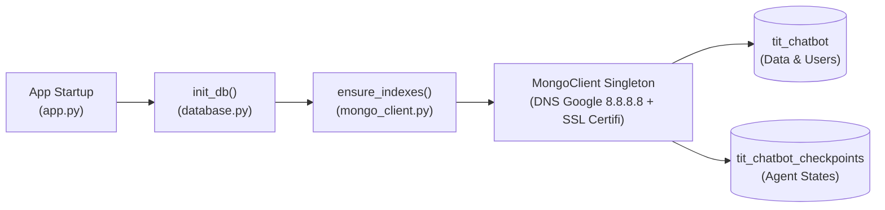

* **Vị trí code:**
  * Khởi tạo Singleton, cấu hình DNS & SSL: [`mongo_client.py` (Dòng 28–65)](file:///d:/Tit-Chatbot/mongo_client.py#L28-L65)
  * Thiết lập B-Tree, Compound & TTL Indexes: [`mongo_client.py` (Dòng 93–143)](file:///d:/Tit-Chatbot/mongo_client.py#L93-L143)
  * Kích hoạt khi Server chạy: [`app.py` (Dòng 63–71)](file:///d:/Tit-Chatbot/app.py#L63-L71)

---

## 2. Pipeline Xác thực & Vòng đời Phiên (Session TTL)

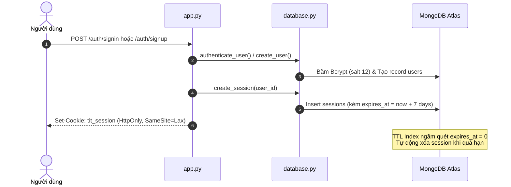

* **Vị trí code:**
  * Băm và xác thực mật khẩu Bcrypt: [`database.py` (Dòng 34–50)](file:///d:/Tit-Chatbot/database.py#L34-L50)
  * Đăng ký, đăng nhập & cập nhật user: [`database.py` (Dòng 85–289)](file:///d:/Tit-Chatbot/database.py#L85-L289)
  * Tạo, kiểm tra & hủy phiên làm việc: [`database.py` (Dòng 295–342)](file:///d:/Tit-Chatbot/database.py#L295-L342)
  * Endpoint API & Set-Cookie: [`app.py` (Dòng 85–204)](file:///d:/Tit-Chatbot/app.py#L85-L204)

---

## 3. Pipeline Phân quyền & Cô lập Hội thoại (Conversation Isolation)

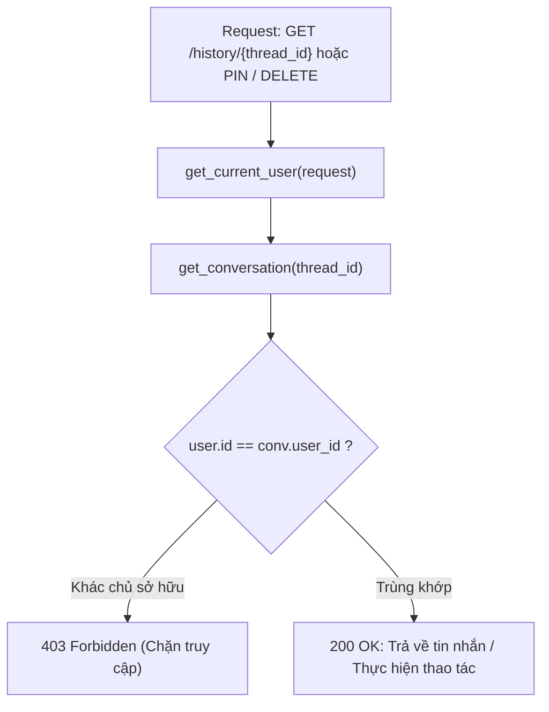

* **Vị trí code:**
  * Kiểm tra quyền sở hữu và chặn 403: [`app.py` (Dòng 342–421)](file:///d:/Tit-Chatbot/app.py#L342-L421)
  * Upsert hội thoại (`thread_id`, `user_id`): [`database.py` (Dòng 348–392)](file:///d:/Tit-Chatbot/database.py#L348-L392)
  * Danh sách hội thoại lọc theo user & ưu tiên ghim: [`database.py` (Dòng 402–439)](file:///d:/Tit-Chatbot/database.py#L402-L439)

---

## 4. Pipeline Bộ nhớ Dài hạn Xuyên Suốt (Cross-Chat Memory)

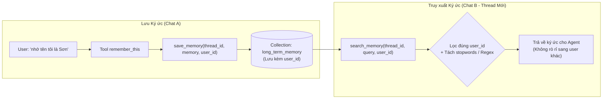

* **Vị trí code:**
  * Hàm lưu và tìm kiếm ký ức theo user: [`database.py` (Dòng 552–665)](file:///d:/Tit-Chatbot/database.py#L552-L665)
  * Gắn định danh user vào luồng tool: [`tools.py` (Dòng 28–36, 137–138)](file:///d:/Tit-Chatbot/tools.py#L28-L36)

---

## 5. Pipeline Xóa Thác Đổ Liên Hoàn (Cascading Deletion)

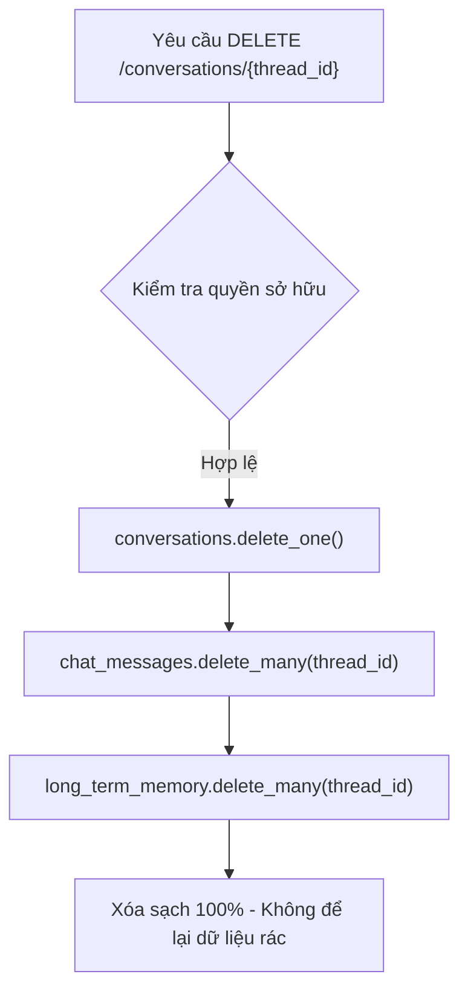

* **Vị trí code:**
  * Logic xóa thác đổ liên hoàn: [`database.py` (Dòng 463–480)](file:///d:/Tit-Chatbot/database.py#L463-L480)
  * Endpoint tiếp nhận yêu cầu xóa: [`app.py` (Dòng 401–421)](file:///d:/Tit-Chatbot/app.py#L401-L421)

---

## 6. Pipeline Lưu Vết Trạng Thái Agent (LangGraph Checkpoint State)

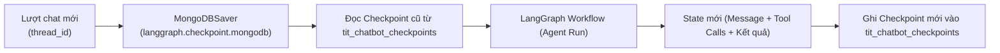

* **Vị trí code:**
  * Khởi tạo `MongoDBSaver` với client singleton: [`agent.py` (Dòng 226–240)](file:///d:/Tit-Chatbot/agent.py#L226-L240)
  * Truyền cấu hình `configurable: {thread_id}` khi stream: [`app.py` (Dòng 622–645)](file:///d:/Tit-Chatbot/app.py#L622-L645)

---

# PHẦN II: CƠ CHẾ XỬ LÝ & NHẬN DẠNG TÀI LIỆU PDF SCAN BẰNG OCR

## 1. Pipeline Tiếp nhận File & Kích hoạt Tự Động (Upload & Dispatcher)

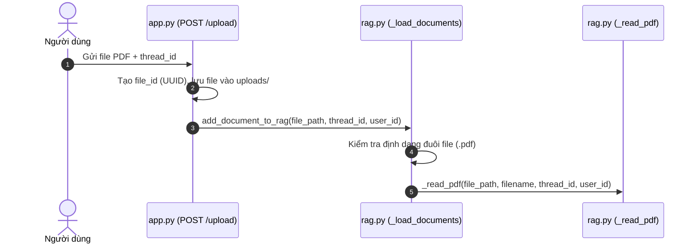

* **Vị trí code:**
  * Endpoint tiếp nhận upload và lưu trữ file: [`app.py` (Dòng 423–494)](file:///d:/Tit-Chatbot/app.py#L423-L494)
  * Bộ phân phối định dạng file (`_load_documents`): [`rag.py` (Dòng 190–204)](file:///d:/Tit-Chatbot/rag.py#L190-L204)
  * Hàm điều phối nạp RAG (`add_document_to_rag`): [`rag.py` (Dòng 236–266)](file:///d:/Tit-Chatbot/rag.py#L236-L266)

---

## 2. Pipeline Quyết định Kích hoạt OCR Tự động (Native vs OCR Trigger)

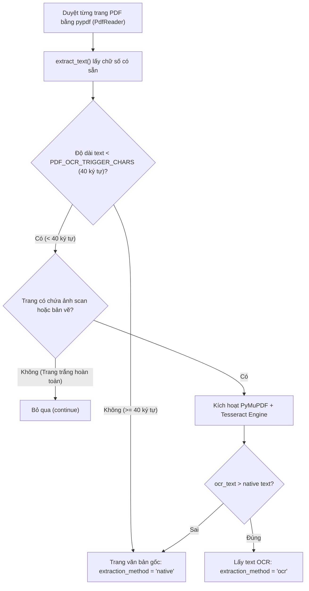

* **Vị trí code:**
  * Khởi tạo pypdf và đọc cấu hình ngưỡng ký tự (`PDF_OCR_TRIGGER_CHARS`): [`rag.py` (Dòng 71–94)](file:///d:/Tit-Chatbot/rag.py#L71-L94)
  * Kiểm tra trang trắng và chuyển nhánh OCR: [`rag.py` (Dòng 94–114, 130–136)](file:///d:/Tit-Chatbot/rag.py#L94-L114)

---

## 3. Pipeline Động cơ Nhận dạng Ký tự (PyMuPDF + Tesseract Engine)

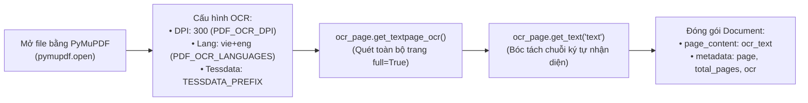

* **Vị trí code:**
  * Mở tài liệu PyMuPDF và khởi tạo tham số OCR: [`rag.py` (Dòng 82–87, 95–104)](file:///d:/Tit-Chatbot/rag.py#L82-L87)
  * Chạy `get_textpage_ocr` với Tesseract: [`rag.py` (Dòng 115–129)](file:///d:/Tit-Chatbot/rag.py#L115-L129)
  * Đóng đối tượng PyMuPDF an toàn trong `finally`: [`rag.py` (Dòng 149–153)](file:///d:/Tit-Chatbot/rag.py#L149-L153)

---

## 4. Pipeline Phân đoạn (Chunking) & Indexing vào ChromaDB

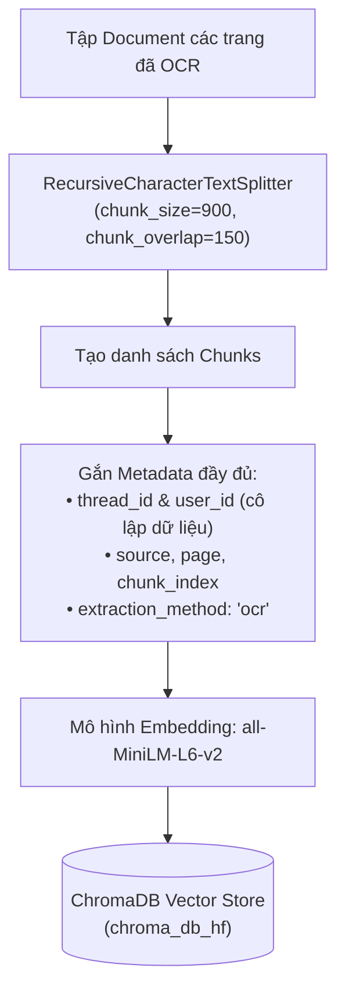

* **Vị trí code:**
  * Phân đoạn văn bản (`_split_documents`): [`rag.py` (Dòng 210–230)](file:///d:/Tit-Chatbot/rag.py#L210-L230)
  * Nhúng vector và lưu vào ChromaDB: [`rag.py` (Dòng 257–266)](file:///d:/Tit-Chatbot/rag.py#L257-L266)
  * Khởi tạo ChromaDB và HuggingFace Embedding lazy: [`rag.py` (Dòng 35–68)](file:///d:/Tit-Chatbot/rag.py#L35-L68)

---

## 5. Pipeline AI Agent Truy vấn & Đọc Dữ liệu OCR (Search vs Summarize)

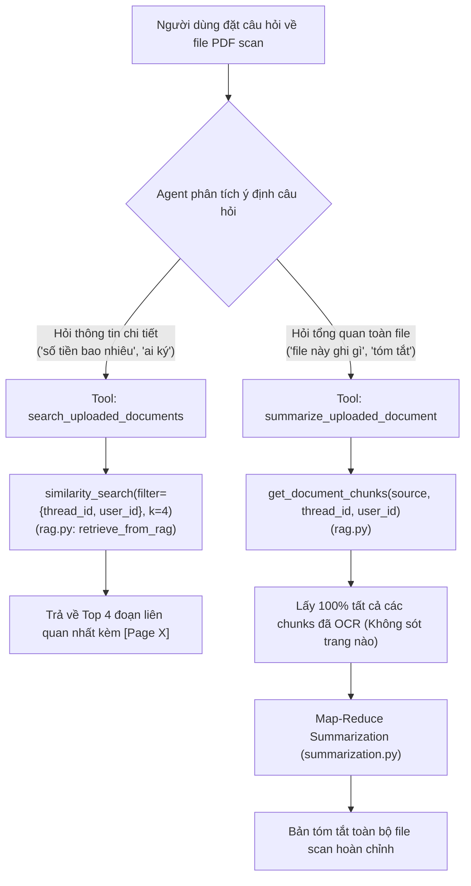

* **Vị trí code:**
  * Tool tra cứu vector tương đồng (`search_uploaded_documents`): [`tools.py` (Dòng 94–110)](file:///d:/Tit-Chatbot/tools.py#L94-L110)
  * Hàm truy xuất RAG lọc đa điều kiện (`retrieve_from_rag`): [`rag.py` (Dòng 268–313)](file:///d:/Tit-Chatbot/rag.py#L268-L313)
  * Tool tóm tắt toàn bộ file scan (`summarize_uploaded_document`): [`tools.py` (Dòng 118–178)](file:///d:/Tit-Chatbot/tools.py#L118-L178)
  * Hàm lấy 100% chunks từ ChromaDB (`get_document_chunks`): [`rag.py` (Dòng 315–375)](file:///d:/Tit-Chatbot/rag.py#L315-L375)

---

# PHẦN III: CƠ CHẾ PHÂN TÍCH & XỬ LÝ HÌNH ẢNH (VISION AI)

## 1. Pipeline Tiếp nhận File & Kiểm tra Bảo mật Magic Bytes (Upload & Validation)

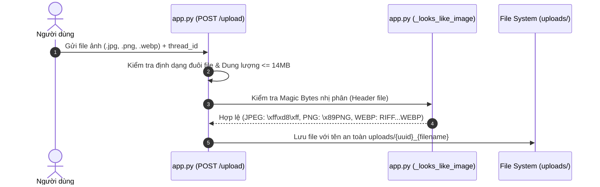

* **Vị trí code:**
  * Giới hạn kích thước và định dạng ảnh: [`image_analysis.py` (Dòng 15–21)](file:///d:/Tit-Chatbot/image_analysis.py#L15-L21)
  * Kiểm tra nhị phân Magic Bytes (`_looks_like_image`): [`app.py` (Dòng 496–504)](file:///d:/Tit-Chatbot/app.py#L496-L504)
  * Tiếp nhận upload và lưu trữ file ảnh: [`app.py` (Dòng 448–463)](file:///d:/Tit-Chatbot/app.py#L448-L463)

---

## 2. Pipeline Đăng ký Ảnh & Cô lập Dữ liệu theo User (Image Registry & Isolation)

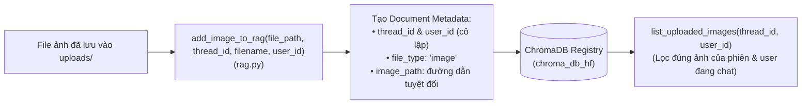

* **Vị trí code:**
  * Đăng ký metadata ảnh vào vector store (`add_image_to_rag`): [`rag.py` (Dòng 385–402)](file:///d:/Tit-Chatbot/rag.py#L385-L402)
  * Truy vấn danh sách ảnh cô lập theo user (`list_uploaded_images`): [`rag.py` (Dòng 404–423)](file:///d:/Tit-Chatbot/rag.py#L404-L423)

---

## 3. Pipeline Điều phối Tool & Lựa chọn Ảnh của AI Agent (Tool Resolution)

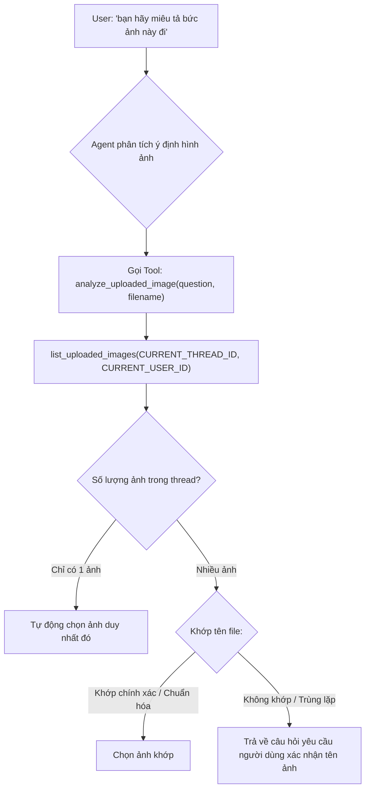

* **Vị trí code:**
  * Định nghĩa Tool và thuật toán chọn ảnh (`analyze_uploaded_image`): [`tools.py` (Dòng 180–225)](file:///d:/Tit-Chatbot/tools.py#L180-L225)
  * Thiết lập ngữ cảnh phiên và user cho Tool: [`tools.py` (Dòng 28–36)](file:///d:/Tit-Chatbot/tools.py#L28-L36)

---

## 4. Pipeline Cô lập Ngữ cảnh, Mã hóa Base64 & Phân tích Thị giác (Vision Execution)

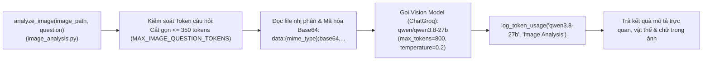

* **Vị trí code:**
  * Kiểm soát token & cô lập context hình ảnh: [`image_analysis.py` (Dòng 26–55)](file:///d:/Tit-Chatbot/image_analysis.py#L26-L55)
  * Mã hóa Base64 và invoke Vision Model: [`image_analysis.py` (Dòng 56–79)](file:///d:/Tit-Chatbot/image_analysis.py#L56-L79)
  * Trích xuất nội dung và bắt lỗi rỗng: [`image_analysis.py` (Dòng 80–93)](file:///d:/Tit-Chatbot/image_analysis.py#L80-L93)

---

## 5. Pipeline Trả Kết Quả Tool & Tổng hợp Câu Trả Lời Cuối (Tool-to-Answer)

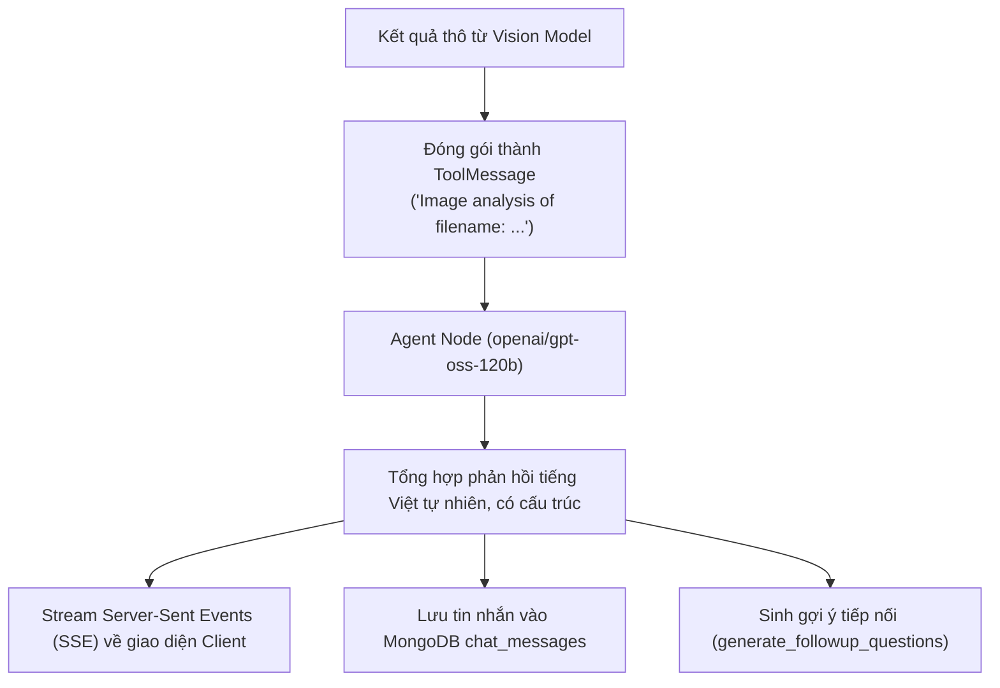

* **Vị trí code:**
  * Chu trình luồng LangGraph xử lý tool message: [`agent.py` (Dòng 190–224)](file:///d:/Tit-Chatbot/agent.py#L190-L224)
  * Stream SSE về trình duyệt và lưu tin nhắn: [`app.py` (Dòng 633–660)](file:///d:/Tit-Chatbot/app.py#L633-L660)
  * Kích hoạt sinh câu hỏi gợi ý tiếp nối: [`app.py` (Dòng 693–710)](file:///d:/Tit-Chatbot/app.py#L693-L710)

---

# PHẦN IV: CƠ CHẾ GỢI Ý 2 CÂU HỎI TIẾP NỐI (FOLLOW-UP SUGGESTIONS)

## 1. Pipeline Kích hoạt Ngầm Sau Khi Phản Hồi (Post-Answer Streaming)

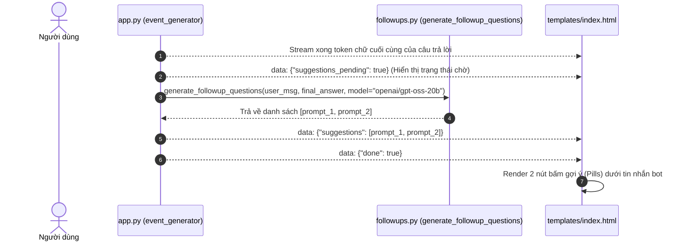

* **Vị trí code:**
  * Kích hoạt sinh gợi ý sau stream: [`app.py` (Dòng 685–703)](file:///d:/Tit-Chatbot/app.py#L685-L703)
  * Luồng chính sinh câu hỏi tiếp nối: [`followups.py` (Dòng 183–205)](file:///d:/Tit-Chatbot/followups.py#L183-L205)

---

## 2. Pipeline Lọc Dữ liệu Thô & Kiểm soát Ngân sách Token (Context Sanitization)

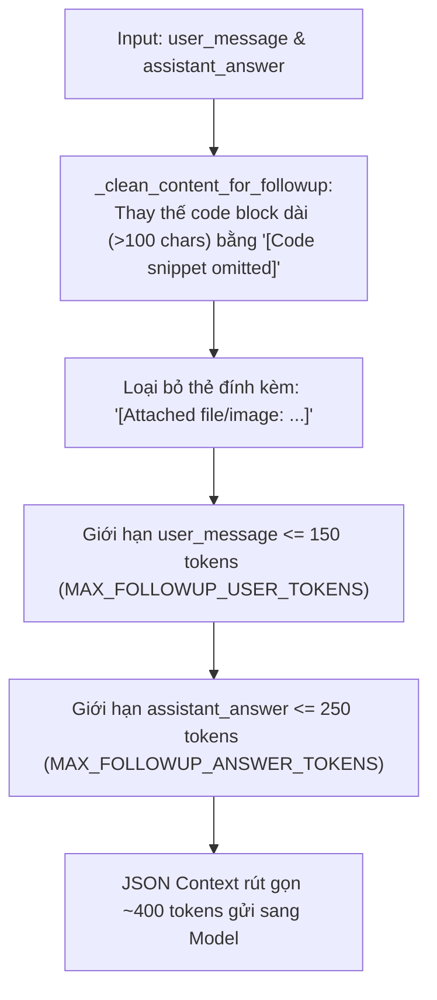

* **Vị trí code:**
  * Ngưỡng giới hạn token follow-up: [`followups.py` (Dòng 17–19)](file:///d:/Tit-Chatbot/followups.py#L17-L19)
  * Hàm lọc code và cắt token (`_clean_content_for_followup`): [`followups.py` (Dòng 22–35)](file:///d:/Tit-Chatbot/followups.py#L22-L35)

---

## 3. Pipeline Chuyển đổi Góc nhìn Người Dùng & Gọi Model (Perspective & Model Call)

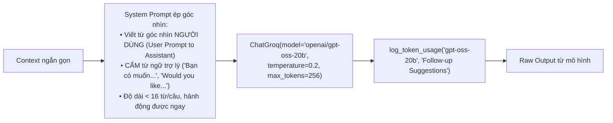

* **Vị trí code:**
  * Quy tắc System Prompt góc nhìn người dùng: [`followups.py` (Dòng 208–236)](file:///d:/Tit-Chatbot/followups.py#L208-L236)
  * Thiết lập ChatGroq và ghi log token: [`followups.py` (Dòng 206–207, 237)](file:///d:/Tit-Chatbot/followups.py#L206-L207)

---

## 4. Pipeline Chuẩn hóa, Làm sạch & Dự phòng Cục bộ (Parsing & Fallback)

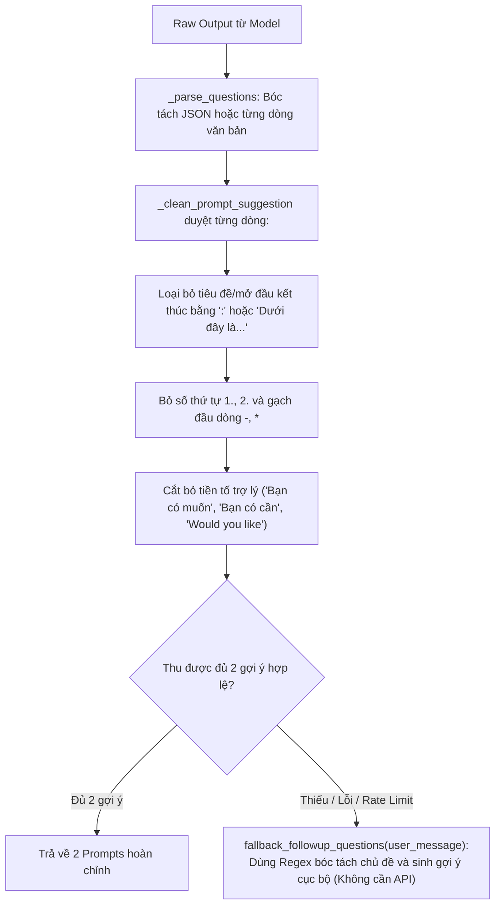

* **Vị trí code:**
  * Chuẩn hóa và làm sạch câu từ (`_clean_prompt_suggestion`): [`followups.py` (Dòng 51–90)](file:///d:/Tit-Chatbot/followups.py#L51-L90)
  * Bóc tách câu hỏi và kiểm tra độ dài (`_parse_questions`): [`followups.py` (Dòng 93–133)](file:///d:/Tit-Chatbot/followups.py#L93-L133)
  * Thuật toán dự phòng cục bộ không tốn API (`fallback_followup_questions`): [`followups.py` (Dòng 138–180)](file:///d:/Tit-Chatbot/followups.py#L138-L180)

---

## 5. Pipeline Hiển thị Giao diện & Tương tác 1-Click (Frontend Rendering)

```mermaid
flowchart LR
    SSEData["Nhận SSE data.suggestions"] --> RenderFn["addFollowupSuggestions(questions, botElement)\n(index.html)"]
    RenderFn --> BuildPills["Tạo container .followup-suggestions\nkèm 2 nút bấm .followup-chip"]
    BuildPills --> UserClick["Người dùng click vào chip gợi ý"]
    UserClick --> AutoSend["Tự động điền text vào input và submit tin nhắn mới ngay lập tức"]
```

* **Vị trí code:**
  * CSS định dạng nút chip gợi ý: [`templates/index.html` (Dòng 911–940)](file:///d:/Tit-Chatbot/templates/index.html#L911-L940)
  * Hàm dựng giao diện gợi ý (`addFollowupSuggestions`): [`templates/index.html` (Dòng 2818–2855)](file:///d:/Tit-Chatbot/templates/index.html#L2818-L2855)
  * Xử lý nhận gói tin SSE: [`templates/index.html` (Dòng 3353–3365)](file:///d:/Tit-Chatbot/templates/index.html#L3353-L3365)

---

# PHẦN V: CƠ CHẾ TỐI ƯU HÓA NGỮ CẢNH & NGÂN SÁCH TOKEN (CONTEXT MANAGER)

## 1. Pipeline Tổng Thể 4 Bước Chuẩn Bị Context Cho LLM (`prepare_context_for_llm`)

```mermaid
flowchart TD
    RawState["State: messages[], system_prompt, tools, summary"] --> Step3Check{"Bước 1: Tác vụ tài liệu độc lập\n(is_isolated_document_task)?"}
    
    Step3Check -- "Đúng (Upload PDF/Ảnh mới)" --> Isolate["Cô lập 100% ngữ cảnh:\nChỉ lấy lượt active hiện tại, KHÔNG kèm chat summary"]
    
    Step3Check -- "Sai (Hội thoại bình thường)" --> Step1["Bước 2: Cắt gọt lượt chat (Sliding Window)\ntrim_conversation_history(max_turns=2) + Tóm tắt lượt cũ"]
    Step1 --> Step2["Bước 3: Dọn dẹp kết quả Tool cũ\nprune_old_tool_results (Xóa ToolMessage các lượt đã xong)"]
    Step2 --> InjectSys["Ghép System Prompt + Long-term Memory + Summary"]
    
    Isolate --> Step4["Bước 4: Ép ngân sách Token cứng\nenforce_token_budget(budget=2800 tokens)"]
    InjectSys --> Step4
    
    Step4 --> InvokeLLM["Gọi LLM ChatGroq với final_messages an toàn tuyệt đối (Không tràn TPM)"]
```

* **Vị trí code:**
  * Hàm điều phối trung tâm (`prepare_context_for_llm`): [`context_manager.py` (Dòng 651–755)](file:///d:/Tit-Chatbot/context_manager.py#L651-L755)
  * Node gọi điều phối trong LangGraph Agent: [`agent.py` (Dòng 183–201)](file:///d:/Tit-Chatbot/agent.py#L183-L201)

---

## 2. Pipeline Cắt Gọt Cửa Sổ Trượt & Tóm Tắt Lũy Tiến (Sliding Window Trimming)

```mermaid
flowchart LR
    AllMsgs["Toàn bộ lịch sử tin nhắn"] --> GroupTurns["group_messages_into_turns:\nGom thành các Turn [User + Tools + AI]"]
    GroupTurns --> SplitTurns{"Tổng số Turns > MAX_HISTORY_TURNS (2)?"}
    
    SplitTurns -- "Không" --> KeepAll["Giữ nguyên tin nhắn hiện tại"]
    SplitTurns -- "Có" --> Slice["Giữ lại 2 lượt mới nhất\n(Active Turn + 1 lượt liền trước)"]
    
    Slice --> ExtractText["_extract_dialogue_text: Trích xuất hội thoại cũ bỏ qua tool dumps"]
    ExtractText --> Summarize["summarize_old_messages: Gọi model nhẹ openai/gpt-oss-20b tóm tắt cốt lõi"]
    Summarize --> Deduplicate["_deduplicate_summary_lines: Khử trùng lặp dòng tóm tắt"]
    Deduplicate --> UpdateSum["Cập nhật conversation_summary đưa vào System Message"]
```

* **Vị trí code:**
  * Nhóm lượt tin nhắn (`group_messages_into_turns`): [`context_manager.py` (Dòng 189–211)](file:///d:/Tit-Chatbot/context_manager.py#L189-L211)
  * Trích xuất hội thoại text sạch (`_extract_dialogue_text`): [`context_manager.py` (Dòng 213–228)](file:///d:/Tit-Chatbot/context_manager.py#L213-L228)
  * Khử trùng lặp dòng tóm tắt (`_deduplicate_summary_lines`): [`context_manager.py` (Dòng 230–244)](file:///d:/Tit-Chatbot/context_manager.py#L230-L244)
  * Tóm tắt lượt cũ và cắt gọt (`trim_conversation_history`): [`context_manager.py` (Dòng 246–360)](file:///d:/Tit-Chatbot/context_manager.py#L246-L360)

---

## 3. Pipeline Dọn Dẹp Kết Quả Tool Lượt Cũ (Tool Result Pruning)

```mermaid
flowchart TD
    Msgs["Danh sách tin nhắn sau khi trim"] --> FindLastHuman["Xác định HumanMessage cuối cùng"]
    FindLastHuman --> SplitPastActive["Chia thành: Past Messages (Cũ) và Active Messages (Hiện tại)"]
    
    subgraph Active_Turn["Lượt Đang Hoạt Động (Active Turn)"]
        ActiveMsgs["BẮT BUỘC GIỮ NGUYÊN:\nToolMessage + AIMessage(tool_calls)\nđể LLM đọc dữ liệu và sinh câu trả lời"]
    end
    
    subgraph Past_Turns["Các Lượt Đã Hoàn Thành (Past Turns)"]
        Filter["Lọc bỏ triệt để:\n• Xóa toàn bộ ToolMessage (RAG/Web Search thô)\n• Xóa AIMessage chỉ chứa tool_calls rỗng\n• Chỉ giữ lại HumanMessage và AIMessage câu trả lời hoàn chỉnh"]
    end
    
    Past_Turns --> Combine["Ghép lại: Tiết kiệm ngay 2.000 - 6.000+ token rác"]
    Active_Turn --> Combine
```

* **Vị trí code:**
  * Logic dọn dẹp ToolMessage lượt cũ (`prune_old_tool_results`): [`context_manager.py` (Dòng 364–423)](file:///d:/Tit-Chatbot/context_manager.py#L364-L423)

---

## 4. Pipeline Cách Ly Ngữ Cảnh & Ngoại Lệ Dịch Tiếp Nối (Task Isolation & Translation Exception)

```mermaid
flowchart TD
    CheckTask["Kiểm tra yêu cầu mới của người dùng"] --> CheckUpload{"Có đính kèm file hoặc ảnh\n([attached file/image], uploads/, .pdf, .docx)?"}
    
    CheckUpload -- "Có" --> Isolated["TÁC VỤ ĐỘC LẬP:\nCô lập 100% ngữ cảnh, cấm LLM nhắc lại các câu chuyện cũ"]
    
    CheckUpload -- "Không" --> CheckRecentSum{"Lượt trước có phải là bản tóm tắt vừa tạo\n('Summary of ...' hoặc 'Tóm tắt')?"}
    CheckRecentSum -- "Có" --> CheckTrans{"User yêu cầu dịch / viết lại\n('tiếng việt', 'dịch', 'translate')?"}
    
    CheckTrans -- "Đúng" --> PreserveContext["NGOẠI LỆ THÔNG MINH (Follow-up Translation Exception):\nKHÔNG cô lập, giữ nguyên bản tóm tắt cũ để dịch tức thì!"]
    CheckTrans -- "Sai" --> NormalChat["Hội thoại thông thường"]
    CheckRecentSum -- "Không" --> NormalChat
```

* **Vị trí code:**
  * Kiểm tra cô lập tác vụ tài liệu (`is_isolated_document_task`): [`context_manager.py` (Dòng 464–550)](file:///d:/Tit-Chatbot/context_manager.py#L464-L550)
  * Chuẩn hóa và cô lập Document Map-Reduce (`validate_and_isolate_summarization_context`): [`context_manager.py` (Dòng 429–460)](file:///d:/Tit-Chatbot/context_manager.py#L429-L460)

---

## 5. Pipeline Ép Ngân Sách Token Cứng (Hard Token Budget Enforcement)

```mermaid
flowchart TD
    InputState["Tin nhắn chuẩn bị gửi sang LLM"] --> CalcToken["Tính toán chi tiết Token Breakdown:\nSystem + Tool Schemas + Active Tool Results + History + Expected Output (800)"]
    CalcToken --> BudgetCheck{"Tổng Token > max_context_tokens (2800)?"}
    
    BudgetCheck -- "Không vượt" --> Pass["Chuyển thẳng sang ChatGroq"]
    
    BudgetCheck -- "Vượt ngân sách" --> StepA["Bước A: Cắt ngắn ToolMessage nếu vượt max_tool_result_tokens (1000)"]
    StepA --> CheckAgain{"Vẫn còn vượt?"}
    CheckAgain -- "Không" --> Pass
    CheckAgain -- "Có" --> StepB["Bước B: Cắt tỉa dần các tin nhắn lịch sử cũ từ xa đến gần\n(LUÔN BẢO TOÀN tin nhắn mới nhất của người dùng)"]
    StepB --> Pass
```

* **Vị trí code:**
  * Bảng ngân sách cấu hình Model (`MODEL_TOKEN_BUDGETS`): [`context_manager.py` (Dòng 30–65)](file:///d:/Tit-Chatbot/context_manager.py#L30-L65)
  * Ước lượng Token phân rã (`calculate_token_breakdown`): [`context_manager.py` (Dòng 147–185)](file:///d:/Tit-Chatbot/context_manager.py#L147-L185)
  * Thuật toán ép ngân sách token cứng (`enforce_token_budget`): [`context_manager.py` (Dòng 561–650)](file:///d:/Tit-Chatbot/context_manager.py#L561-L650)

---

## 6. Pipeline Giám Sát & Ghi Log Token Toàn Phiên (Token Usage Logger)

```mermaid
flowchart LR
    Response["Response từ ChatGroq"] --> Extract["extract_token_usage:\nTrích xuất input_tokens & output_tokens từ response.usage_metadata"]
    Extract --> Accumulate["Cộng dồn vào biến toàn cục _SESSION_TOKEN_STATS:\n• prompt_tokens += prompt\n• completion_tokens += completion\n• total_tokens += total\n• calls_count += 1"]
    Accumulate --> PrintLog["In log chuẩn Console / Git Bash:\n[Groq-Usage] Model | Tác vụ | Prompt | Output | Lần này | Tích lũy phiên\n(Giúp theo dõi sát mốc 200.000 TPD)"]
```

* **Vị trí code:**
  * Trích xuất thông số token (`extract_token_usage`): [`context_manager.py` (Dòng 768–801)](file:///d:/Tit-Chatbot/context_manager.py#L768-L801)
  * Cập nhật số liệu phiên và in log (`log_token_usage`): [`context_manager.py` (Dòng 803–834)](file:///d:/Tit-Chatbot/context_manager.py#L803-L834)

---

# PHẦN VI: CƠ CHẾ TÓM TẮT ĐỆ QUY MAP-REDUCE (RECURSIVE SUMMARIZATION)

## 1. Pipeline Khởi Động & Cô Lập Tài Liệu Tóm Tắt (Doc Isolation & Chunk Retrieval)

```mermaid
flowchart TD
    Prompt["User yêu cầu: 'tóm tắt tài liệu này'"] --> ToolSum["Tool: summarize_uploaded_document(filename, target_language)\n(tools.py)"]
    ToolSum --> GetChunks["get_document_chunks(filename, thread_id, user_id)\n(Lấy 100% tất cả chunks đã index từ ChromaDB)"]
    GetChunks --> IsolateContext["validate_and_isolate_summarization_context\n(context_manager.py:\nChỉ giữ lại text và metadata trang, cô lập 100% khỏi lịch sử chat)"]
    IsolateContext --> StartMR["summarize_documents(clean_documents, target_language)\n(summarization.py)"]
```

* **Vị trí code:**
  * Điểm kích hoạt Tool tóm tắt: [`tools.py` (Dòng 118–178)](file:///d:/Tit-Chatbot/tools.py#L118-L178)
  * Đọc 100% chunks từ ChromaDB: [`rag.py` (Dòng 315–375)](file:///d:/Tit-Chatbot/rag.py#L315-L375)
  * Xác thực & cô lập tài liệu tóm tắt: [`context_manager.py` (Dòng 429–460)](file:///d:/Tit-Chatbot/context_manager.py#L429-L460)
  * Hàm điều phối tóm tắt chính (`summarize_documents`): [`summarization.py` (Dòng 286–311)](file:///d:/Tit-Chatbot/summarization.py#L286-L311)

---

## 2. Pipeline Thuật Toán Đóng Gói Nhóm Theo Ngân Sách (Token Budget Packing)

```mermaid
flowchart TD
    CleanDocs["Danh sách các đoạn văn bản (chunks)"] --> Format["_format_document: Thêm nhãn [Page X] vào từng đoạn"]
    Format --> BudgetPacking["_groups_by_budget(units, effective_chunk_budget ~ 2450 tokens):"]
    
    BudgetPacking --> Estimate["estimate_tokens(chunk) (hệ số 2.5 ký tự/token cho tiếng Việt)"]
    Estimate --> FitCheck{"Đoạn hiện tại có vừa ngân sách nhóm đang mở?"}
    
    FitCheck -- "Vừa" --> AddToGroup["Thêm đoạn vào nhóm hiện tại"]
    FitCheck -- "Vượt ngân sách" --> CloseGroup["Đóng nhóm hiện tại -> Mở nhóm mới"]
    
    AddToGroup --> ReturnGroups["Danh sách map_groups: [Group 1, Group 2, ...]"]
    CloseGroup --> ReturnGroups
```

* **Vị trí code:**
  * Hàm ước tính token bảo thủ tiếng Việt (`estimate_tokens`): [`summarization.py` (Dòng 25–33)](file:///d:/Tit-Chatbot/summarization.py#L25-L33)
  * Định dạng nhãn trang (`_format_document`): [`summarization.py` (Dòng 45–48)](file:///d:/Tit-Chatbot/summarization.py#L45-L48)
  * Thuật toán đóng gói nhóm (`_groups_by_budget`): [`summarization.py` (Dòng 51–80)](file:///d:/Tit-Chatbot/summarization.py#L51-L80)

---

## 3. Pipeline Phân Nhánh: Tài Liệu Ngắn vs Tài Liệu Dài

```mermaid
flowchart TD
    Groups["Tập danh sách nhóm: map_groups"] --> CountCheck{"len(map_groups) == 1\n(Tài liệu ngắn vừa 1 nhóm)?"}
    
    CountCheck -- "ĐÚNG: Tài liệu ngắn" --> SinglePass["BỎ QUA Map-Reduce!\nGọi LLM đúng 1 lần duy nhất (Single Pass Map)"]
    SinglePass --> FinalDirect["Trả về bản tóm tắt hoàn chỉnh ngay lập tức"]
    
    CountCheck -- "SAI: Tài liệu dài" --> MapPhase["Bắt buộc kích hoạt chu trình Map-Reduce 2 pha đệ quy"]
```

* **Vị trí code:**
  * Xử lý tài liệu ngắn chạy 1 lần: [`summarization.py` (Dòng 233–242)](file:///d:/Tit-Chatbot/summarization.py#L233-L242)
  * Kích hoạt Map-Reduce tài liệu dài: [`summarization.py` (Dòng 244–284)](file:///d:/Tit-Chatbot/summarization.py#L244-L284)

---

## 4. Pipeline Pha Map Tuần Tự & Tự Động Chờ Rate Limit (Sequential Map & Auto-Sleep)

```mermaid
sequenceDiagram
    autonumber
    participant MR as summarization.py (_execute_map_reduce)
    participant Invoker as summarization.py (_invoke)
    participant Groq as Groq API (gpt-oss-120b)

    loop Chạy tuần tự từng Group (Tránh nghẽn TPM)
        MR->>Invoker: _invoke(prompt, stage="map", group_number=i)
        Invoker->>Groq: POST /chat/completions (max_tokens=900)
        alt Thành công
            Groq-->>Invoker: 200 OK + Tóm tắt nhóm i
            Invoker-->>MR: summaries.append(tóm_tắt_i)
        else Chạm trần 8.000 TPM (Error 429)
            Groq-->>Invoker: 429 Rate Limit ('try again in Xs')
            Invoker->>Invoker: _parse_wait_time đọc số giây X -> time.sleep(X + 0.5s)
            Invoker->>Groq: Tự động Retry lại khi hết thời gian chờ
        else Chạm trần 200.000 TPD (Tokens Per Day)
            Groq-->>Invoker: 429 Daily Limit
            Invoker-->>MR: Ném lỗi dừng ngay (Fail-fast báo hết quota ngày)
        end
    end
```

* **Vị trí code:**
  * Vòng lặp pha Map tuần tự: [`summarization.py` (Dòng 248–255)](file:///d:/Tit-Chatbot/summarization.py#L248-L255)
  * Trích xuất thời gian chờ rate limit (`_parse_wait_time`): [`summarization.py` (Dòng 96–103)](file:///d:/Tit-Chatbot/summarization.py#L96-L103)
  * Cơ chế tự động ngủ và retry chống vượt 8.000 TPM (`_invoke`): [`summarization.py` (Dòng 105–208)](file:///d:/Tit-Chatbot/summarization.py#L105-L208)

---

## 5. Pipeline Pha Reduce Đệ Quy Nhiều Tầng (Recursive Reduction)

```mermaid
flowchart TD
    Summaries["Tập các bản tóm tắt trung gian (summaries)"] --> Loop{"len(summaries) > 1 ?"}
    
    Loop -- "Có (> 1 bản)" --> PackReduce["Gom summaries thành các nhóm mới bằng _groups_by_budget"]
    PackReduce --> LevelInvoke["Gọi LLM tổng hợp từng nhóm:\n'Combine these summaries into one faithful summary...'"]
    LevelInvoke --> NewSummaries["Thu được tập summaries ở Level cao hơn (ngắn hơn)"]
    NewSummaries --> Loop
    
    Loop -- "Không (Còn đúng 1 bản)" --> DoneMR["Bản tóm tắt duy nhất cuối cùng (Final Combined Summary)"]
```

* **Vị trí code:**
  * Vòng lặp đệ quy pha Reduce: [`summarization.py` (Dòng 257–284)](file:///d:/Tit-Chatbot/summarization.py#L257-L284)
  * Giảm một nửa ngân sách khi nhóm tóm tắt quá dày: [`summarization.py` (Dòng 261–265)](file:///d:/Tit-Chatbot/summarization.py#L261-L265)

---

## 6. Pipeline Đường Tắt Trả Kết Quả Cắt Giảm Chi Phí (Zero-Overhead Shortcut)

```mermaid
flowchart LR
    DoneMR["Bản tóm tắt cuối cùng từ summarization.py"] --> ReturnTool["summarize_uploaded_document trả kết quả:\n'Summary of filename (all N chunks): ...'"]
    ReturnTool --> RouteCheck{"LangGraph route_after_tools:\ncontent.startswith('Summary of ')?"}
    
    RouteCheck -- "ĐÚNG (Đường tắt)" --> EmitNode["Node: emit_summary\n(agent.py)"]
    EmitNode --> EndStream["Trả thẳng bản tóm tắt cho User qua SSE -> KẾT THÚC (END)"]
    
    RouteCheck -- "SAI (Các tool khác)" --> ChatbotNode["Node: chatbot (Gọi LLM lần 2 để trả lời)"]
```

* **Vị trí code:**
  * Tiền tố nhận diện kết quả tóm tắt (`SUMMARY_RESULT_PREFIX`): [`tools.py` (Dòng 25–26, 177)](file:///d:/Tit-Chatbot/tools.py#L25-L26)
  * Đường tắt định tuyến bỏ qua lượt LLM thứ 2 (`route_after_tools`): [`agent.py` (Dòng 209–225)](file:///d:/Tit-Chatbot/agent.py#L209-L225)

---

# PHẦN VII: CƠ CHẾ QUẢN LÝ NGƯỜI DÙNG & BỘ NHỚ DÀI HẠN (USER MANAGEMENT & LONG-TERM MEMORY)

## 1. Pipeline Đăng Ký, Đăng Nhập & Băm Mật Khẩu An Toàn (Registration, Auth & Bcrypt)

```mermaid
flowchart TD
    Client["Client / Trình duyệt gửi Request JSON\n(username, email, password, full_name)"] --> RouteAuth{"Router Authentication:\n/auth/signup hoặc /auth/signin"}
    
    subgraph SignUp ["Pha Đăng Ký (/auth/signup)"]
        ValRegex["Kiểm tra Regex & Ràng buộc:\n- Username >= 3 ký tự (chữ, số, _, -, .)\n- Email hợp lệ (@ và .)\n- Password >= 6 ký tự"]
        CheckDup{"users.find_one:\nĐã tồn tại username/email?"}
        BcryptHash["Băm mật khẩu an toàn:\nbcrypt.hashpw(password, salt=12 rounds)"]
        InsertUser["users.insert_one:\nLưu User Document vào MongoDB"]
    end
    
    subgraph SignIn ["Pha Đăng Nhập (/auth/signin)"]
        FindUser{"users.find_one:\nKhớp identifier = username HOẶC email"}
        BcryptVerify{"bcrypt.checkpw(password, hashed_password)?"}
    end
    
    RouteAuth -- "Đăng ký" --> ValRegex
    ValRegex --> CheckDup
    CheckDup -- "Chưa tồn tại" --> BcryptHash --> InsertUser
    CheckDup -- "Đã có" --> ErrDup["Trả HTTP 400 (Trùng username/email)"]
    
    RouteAuth -- "Đăng nhập" --> FindUser
    FindUser -- "Tìm thấy User" --> BcryptVerify
    FindUser -- "Không tìm thấy" --> ErrAuth["Trả HTTP 401 (Sai tài khoản/mật khẩu)"]
    BcryptVerify -- "Không khớp" --> ErrAuth
    
    subgraph IssueSession ["Cấp Phiên Làm Việc (Session)"]
        GenToken["secrets.token_urlsafe(32)\nTạo Session ID ngẫu nhiên an toàn"]
        SaveSession["sessions.insert_one:\nsession_id, user_id, expires_at (7 ngày)"]
        SetCookie["response.set_cookie:\ntit_session, HttpOnly=True, SameSite=Lax, Max-Age=7 ngày"]
        RespOK["Trả về User Profile + Token đăng nhập thành công"]
    end
    
    InsertUser --> GenToken
    BcryptVerify -- "Khớp mật khẩu" --> GenToken
    GenToken --> SaveSession --> SetCookie --> RespOK
```

* **Vị trí code:**
  * Băm và kiểm tra mật khẩu Bcrypt với Salt 12 rounds: [`database.py` (Dòng 34–49)](file:///d:/Tit-Chatbot/database.py#L34-L49)
  * Đăng ký người dùng mới & kiểm tra trùng lặp (`create_user`): [`database.py` (Dòng 85–144)](file:///d:/Tit-Chatbot/database.py#L85-L144)
  * Xác thực người dùng bằng username/email (`authenticate_user`): [`database.py` (Dòng 147–178)](file:///d:/Tit-Chatbot/database.py#L147-L178)
  * API Endpoint Đăng ký & Set Cookie HttpOnly (`/auth/signup`): [`app.py` (Dòng 108–144)](file:///d:/Tit-Chatbot/app.py#L108-L144)
  * API Endpoint Đăng nhập & Tạo phiên (`/auth/signin`): [`app.py` (Dòng 146–185)](file:///d:/Tit-Chatbot/app.py#L146-L185)

---

## 2. Pipeline Xác Thực Phiên 3 Tầng & Phân Quyền Hội Thoại (Session Verification & Access Control)

```mermaid
flowchart TD
    Req["Request gửi đến Endpoint được bảo vệ\n(/history, /conversations, /chat/stream, ...)"] --> ExtractUser["get_current_user(request)\nTrích xuất thông tin người dùng 3 tầng"]
    
    subgraph ExtractLayers ["Trích xuất Session ID 3 Tầng"]
        L1{"1. request.cookies\n['tit_session']?"}
        L2{"2. Header Authorization:\n'Bearer <token>'?"}
        L3{"3. Query Param:\n'?session_id=...'?"}
        L1 -- "Có" --> FoundID["Session ID"]
        L1 -- "Không" --> L2
        L2 -- "Có" --> FoundID
        L2 -- "Không" --> L3
        L3 -- "Có" --> FoundID
        L3 -- "Không" --> Anon["User = None (Ẩn danh / Chưa đăng nhập)"]
    end
    
    ExtractUser --> ExtractLayers
    FoundID --> QuerySession{"sessions.find_one(session_id)\nKiểm tra thời hạn expires_at"}
    QuerySession -- "Hết hạn" --> DelExpired["Xóa session quá hạn\n(sessions.delete_one)"] --> Anon
    QuerySession -- "Hợp lệ" --> GetUser["users.find_one(_id = session.user_id)"] --> AuthedUser["User Profile Context\n(id, username, email, full_name, avatar_url)"]
    
    subgraph AccessCheck ["Kiểm soát Phân quyền (Conversation Ownership)"]
        CheckOwner{"Cuộc trò chuyện có conv.user_id?"}
        MatchUser{"str(user.id) == str(conv.user_id)?"}
        Allow["Cho phép truy cập / Thực thi Request"]
        Deny["Từ chối truy cập: HTTP 403 Forbidden"]
    end
    
    AuthedUser --> CheckOwner
    Anon --> CheckOwner
    CheckOwner -- "Không có (Thread chung/vô chủ)" --> Allow
    CheckOwner -- "Có user_id" --> MatchUser
    MatchUser -- "ĐÚNG (Chính chủ)" --> Allow
    MatchUser -- "SAI (Người khác)" --> Deny
```

* **Vị trí code:**
  * Hàm trích xuất người dùng 3 tầng (`get_current_user`): [`app.py` (Dòng 85–102)](file:///d:/Tit-Chatbot/app.py#L85-L102)
  * Tạo, kiểm tra & xóa phiên làm việc (`create_session`, `get_session`, `delete_session`): [`database.py` (Dòng 295–340)](file:///d:/Tit-Chatbot/database.py#L295-L340)
  * TTL Index tự động dọn dẹp phiên hết hạn trong MongoDB: [`mongo_client.py` (Dòng 108–112)](file:///d:/Tit-Chatbot/mongo_client.py#L108-L112)
  * Phân quyền truy cập lịch sử tin nhắn (`/history/{thread_id}`): [`app.py` (Dòng 376–387)](file:///d:/Tit-Chatbot/app.py#L376-L387)
  * Phân quyền xóa cuộc trò chuyện (`DELETE /conversations/{thread_id}`): [`app.py` (Dòng 401–412)](file:///d:/Tit-Chatbot/app.py#L401-L412)
  * Phân quyền ghim cuộc trò chuyện (`POST /conversations/{thread_id}/pin`): [`app.py` (Dòng 342–359)](file:///d:/Tit-Chatbot/app.py#L342-L359)
  * Phân quyền gửi tin nhắn chat stream (`POST /chat/stream`): [`app.py` (Dòng 603–611)](file:///d:/Tit-Chatbot/app.py#L603-L611)

---

## 3. Pipeline Quản Lý Hồ Sơ & Cập Nhật Ảnh Đại Diện (Profile & Avatar Management)

```mermaid
flowchart TD
    ReqProf["Client gửi Request cập nhật\n(/auth/profile hoặc /auth/avatar)"] --> CheckAuth{"get_current_user(request)\nĐã đăng nhập?"}
    CheckAuth -- "Chưa" --> Ret401["Trả HTTP 401 Unauthorized"]
    
    subgraph UpdateInfo ["Cập nhật Thông tin & Mật khẩu (/auth/profile)"]
        ValFields["Kiểm tra trường cần cập nhật:\n- full_name\n- email (kiểm tra trùng lặp tài khoản khác)\n- new_password (yêu cầu verify current_password)"]
        UpdateDB["users.update_one(_id = user_id):\n$set: full_name, email, hashed_password, updated_at"]
    end
    
    subgraph UploadAvatar ["Tải Lên Ảnh Đại Diện (/auth/avatar)"]
        ValFile["Kiểm tra File Upload:\n- Extension: png, jpg, jpeg, webp, gif\n- Kích thước <= 5MB"]
        GenName["Đặt tên an toàn duy nhất:\n{user_id}_{uuid.hex[:8]}{ext}"]
        SaveDisk["Ghi file ảnh vào đĩa:\nuploads/avatars/safe_filename"]
        UpdateAvatarURL["users.update_one:\n$set: avatar_url = '/uploads/avatars/safe_filename'"]
    end
    
    CheckAuth -- "Đã đăng nhập" --> RouteAction{"Hành động"}
    RouteAction -- "Profile/Password" --> ValFields --> UpdateDB
    RouteAction -- "Upload Avatar" --> ValFile --> GenName --> SaveDisk --> UpdateAvatarURL
    
    UpdateDB --> SyncFrontend["Phản hồi JSON User Profile mới -> Frontend render đồng bộ"]
    UpdateAvatarURL --> SyncFrontend
```

* **Vị trí code:**
  * Cập nhật thông tin cá nhân & đổi mật khẩu (`update_user_profile`): [`database.py` (Dòng 227–288)](file:///d:/Tit-Chatbot/database.py#L227-L288)
  * Endpoint cập nhật thông tin cá nhân (`/auth/profile`): [`app.py` (Dòng 215–250)](file:///d:/Tit-Chatbot/app.py#L215-L250)
  * Endpoint upload ảnh đại diện (`/auth/avatar`): [`app.py` (Dòng 252–287)](file:///d:/Tit-Chatbot/app.py#L252-L287)
  * Endpoint phục vụ tệp ảnh đại diện tĩnh (`/uploads/avatars/{filename}`): [`app.py` (Dòng 289–305)](file:///d:/Tit-Chatbot/app.py#L289-L305)
  * Giao diện Modal cập nhật Profile & Avatar Preview: [`templates/index.html` (Dòng 3964–4065, 4407–4430)](file:///d:/Tit-Chatbot/templates/index.html#L3964-L4065)

---

## 4. Pipeline Lưu Trữ Bộ Nhớ Dài Hạn (Long-term Memory Persistence - `remember_this`)

```mermaid
flowchart TD
    UserMsg["Người dùng gửi tin nhắn yêu cầu ghi nhớ:\n'Nhớ rằng tôi tên là Sơn', 'Lưu lại: tôi học UET', ..."] --> StreamChat["FastAPI /chat/stream:\n- Trích xuất user_id từ session\n- set_current_thread_id(thread_id)\n- set_current_user_id(user_id)"]
    
    StreamChat --> LangGraphAgent["LangGraph Agent (node chatbot)\nNhận diện yêu cầu theo System Prompt Instructions"]
    
    subgraph AgentToolCall ["Kích hoạt Tool remember_this"]
        DecideRem["LLM phát hiện thông tin cá nhân/sở thích -> Gọi Tool remember_this(memory)"]
        ExtractArgs["Trích xuất câu khẳng định độc lập ngắn gọn:\nmemory = 'Tên người dùng là Sơn'"]
    end
    
    LangGraphAgent --> DecideRem --> ExtractArgs
    
    subgraph SaveMemoryPipeline ["Pipeline Lưu Memory vào MongoDB"]
        ResolveUID["Lấy CURRENT_USER_ID trong context tools.py\n(Nếu thiếu: fallback get_conversation(thread_id).user_id)"]
        MakeDoc["Tạo Document:\n{\n  thread_id: thread_id,\n  user_id: user_id,\n  memory: memory,\n  created_at: UTC now\n}"]
        InsertMem["long_term_memory.insert_one(doc)"]
        ConfirmMsg["Trả về: 'Memory saved successfully.'"]
    end
    
    ExtractArgs --> ResolveUID --> MakeDoc --> InsertMem --> ConfirmMsg
    ConfirmMsg --> LLMAnswer["Agent phản hồi xác nhận tự nhiên cho người dùng:\n'Mình đã ghi nhớ bạn tên là Sơn rồi nhé!'"]
```

* **Vị trí code:**
  * Chỉ thị System Prompt về ghi nhớ thông tin cá nhân: [`agent.py` (Dòng 104–107)](file:///d:/Tit-Chatbot/agent.py#L104-L107)
  * Tiêm `user_id` và `thread_id` vào bối cảnh thực thi của request: [`app.py` (Dòng 619–620)](file:///d:/Tit-Chatbot/app.py#L619-L620)
  * Định nghĩa Tool `remember_this`: [`tools.py` (Dòng 230–251)](file:///d:/Tit-Chatbot/tools.py#L230-L251)
  * Hàm lưu trữ bộ nhớ vào collection `long_term_memory` (`save_memory`): [`database.py` (Dòng 552–580)](file:///d:/Tit-Chatbot/database.py#L552-L580)
  * Index MongoDB cho bộ nhớ dài hạn: [`mongo_client.py` (Dòng 130–137)](file:///d:/Tit-Chatbot/mongo_client.py#L130-L137)

---

## 5. Pipeline Truy Xuất & Tìm Kiếm Bộ Nhớ Xuyên Cuộc Trò Chuyện (Cross-Chat Memory Recall - `recall_memory`)

```mermaid
flowchart TD
    UserQ["Người dùng hỏi thông tin cá nhân ở BẤT KỲ cuộc trò chuyện nào:\n'Tôi tên là gì?', 'Bạn nhớ gì về tôi?', 'Tôi học trường nào?'"] --> AgentNode["LangGraph Agent (node chatbot)\nNhận diện câu hỏi cần truy hồi ký ức"]
    
    AgentNode --> CallRecall["Agent gọi Tool recall_memory(query='tên' hoặc query='')"]
    
    subgraph RecallEngine ["Động cơ Tìm kiếm Ký ức Thông minh (database.py)"]
        ResolveOwner["Xác định user_id hiện tại -> base_filter = {'user_id': user_id}\n(Cô lập hoàn toàn với user khác)"]
        
        CheckGeneric{"clean_query có thuộc generic_markers?\n('', 'all', 'về tôi', 'nhớ gì', 'bạn nhớ gì', ...)"}
        
        FilterGeneric["Lấy TOÀN BỘ ký ức của user:\nsearch_filter = base_filter"]
        
        FilterSpecific["Tách từ & Lọc 21 stop words (là, gì, của, tôi, what, is, my...)\n-> Tạo biểu thức regex kết hợp: combined = '|'.join([query] + words)\n-> search_filter = {**base_filter, 'memory': {'$regex': combined, '$options': 'i'}}"]
        
        ExecuteQuery["long_term_memory.find(search_filter)\n.sort('created_at', -1).limit(20)"]
    end
    
    CallRecall --> ResolveOwner --> CheckGeneric
    CheckGeneric -- "ĐÚNG (Câu hỏi chung)" --> FilterGeneric --> ExecuteQuery
    CheckGeneric -- "SAI (Câu hỏi cụ thể)" --> FilterSpecific --> ExecuteQuery
    
    subgraph ReturnFormat ["Định dạng & Tổng hợp Phản hồi"]
        CheckFound{"Có tìm thấy doc nào?"}
        FoundList["Trả danh sách bullet-points:\n- Tên người dùng là Sơn\n- Người dùng học tại UET"]
        NotFound["Trả về: 'No saved memory found.'"]
        AgentSynthesize["Agent tổng hợp mượt mà, trả lời thân thiện:\n'Bạn tên là Sơn và hiện đang học tại Đại học Công nghệ (UET) nhé!'"]
    end
    
    ExecuteQuery --> CheckFound
    CheckFound -- "Có" --> FoundList --> AgentSynthesize
    CheckFound -- "Không" --> NotFound --> AgentSynthesize
```

* **Vị trí code:**
  * Chỉ thị System Prompt về gọi `recall_memory`: [`agent.py` (Dòng 106–107)](file:///d:/Tit-Chatbot/agent.py#L106-L107)
  * Định nghĩa Tool `recall_memory`: [`tools.py` (Dòng 256–274)](file:///d:/Tit-Chatbot/tools.py#L256-L274)
  * Hàm tìm kiếm & lọc stopwords, truy vấn Regex đa từ khóa (`search_memory`): [`database.py` (Dòng 583–665)](file:///d:/Tit-Chatbot/database.py#L583-L665)
  * Text Index dự phòng trên trường `memory`: [`mongo_client.py` (Dòng 133–137)](file:///d:/Tit-Chatbot/mongo_client.py#L133-L137)

---

## 6. Pipeline Đồng Bộ Luồng & Biên Giới Cách Ly Bộ Nhớ Đa Người Dùng (Per-Request Threading & Isolation)

```mermaid
flowchart TD
    subgraph UserA ["NGƯỜI DÙNG A (user_id = 'user_A')"]
        ThreadA1["Cuộc trò chuyện 1:\n'Nhớ rằng tôi tên là Sơn' -> remember_this\n-> Lưu vào long_term_memory: user_id='user_A'"]
        ThreadA2["Cuộc trò chuyện 2:\n'Tôi tên là gì?' -> recall_memory\n-> Lọc user_id='user_A' -> TÌM THẤY 'Sơn'"]
        ThreadAN["Cuộc trò chuyện N:\n'Thông tin về tôi?' -> recall_memory\n-> Lọc user_id='user_A' -> TÌM THẤY toàn bộ ký ức"]
    end
    
    subgraph Wall ["BỨC TƯỜNG CÁCH LY TUYỆT ĐỐI (ISOLATION BOUNDARY)"]
        BaseFilterRule["Quy tắc lọc dữ liệu ở database.py:\nbase_filter = {'user_id': user_id}\nKHÔNG BAO GIỜ query ký ức của user khác"]
        RouteGuardRule["Quy tắc kiểm tra HTTP 403 ở app.py:\nNếu conv.user_id != user.id -> Chặn truy cập"]
    end
    
    subgraph UserB ["NGƯỜI DÙNG B (user_id = 'user_B')"]
        ThreadB1["Cuộc trò chuyện 1:\n'Tôi tên là gì?' -> recall_memory\n-> Lọc user_id='user_B' -> KHÔNG THẤY 'Sơn'"]
        ThreadB2["Cố truy cập /history/{Thread_A1}\n-> Server trả HTTP 403 Forbidden"]
    end
    
    subgraph CascadeDel ["Cơ Chế Xóa Thác Đổ (delete_conversation)"]
        DelConv["Người dùng xóa Thread_A1 (conversations.delete_one)"]
        DelMsg["Tự động dọn dẹp chat_messages thuộc Thread_A1"]
        DelMemThread["Dọn dẹp các memory gắn riêng với Thread_A1\n(Các memory lưu ở Thread_A2, Thread_AN của User A vẫn giữ nguyên)"]
    end
    
    ThreadA1 -.-> BaseFilterRule
    ThreadB1 -.-> BaseFilterRule
    ThreadB2 -.-> RouteGuardRule
    DelConv --> DelMsg --> DelMemThread
```

* **Vị trí code:**
  * Thiết lập bối cảnh theo luồng request trong FastAPI (`chat_stream`): [`app.py` (Dòng 600–627)](file:///d:/Tit-Chatbot/app.py#L600-L627)
  * Thiết lập và phân tách bộ nhớ theo `user_id`: [`tools.py` (Dòng 20–36)](file:///d:/Tit-Chatbot/tools.py#L20-L36)
  * Ràng buộc cô lập dữ liệu theo `user_id` trong `save_memory`: [`database.py` (Dòng 566–579)](file:///d:/Tit-Chatbot/database.py#L566-L579)
  * Ràng buộc cô lập dữ liệu theo `user_id` trong `search_memory`: [`database.py` (Dòng 601–614)](file:///d:/Tit-Chatbot/database.py#L601-L614)
  * Xóa thác đổ an toàn có kiểm tra quyền sở hữu (`delete_conversation`): [`database.py` (Dòng 463–479)](file:///d:/Tit-Chatbot/database.py#L463-L479)


