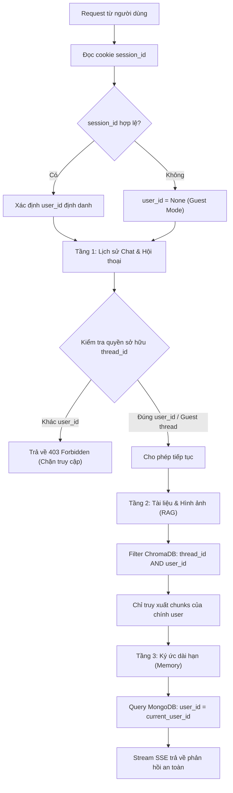
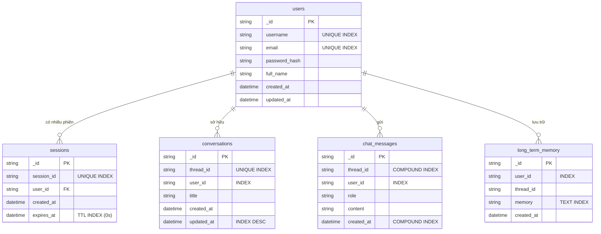

# Kiến trúc Quản lý Người dùng & Cô lập Dữ liệu (User Management & Multi-User Isolation)

Tài liệu kỹ thuật chuyên sâu về hệ thống xác thực (Authentication), phân quyền (Authorization) và mô hình cô lập dữ liệu 3 tầng (Multi-tenancy Data Isolation) của dự án **Tit Chatbot**.

---

## 1. Tổng quan cơ chế

Hệ thống được thiết kế nhằm phục vụ nhiều người dùng đồng thời trên cùng một nền tảng Agentic Chatbot với các yêu cầu cốt lõi:
- **Bảo mật tuyệt đối:** Mật khẩu được mã hóa một chiều; phiên làm việc được bảo vệ bằng HttpOnly Cookie chống tấn công XSS; kiểm tra quyền sở hữu nghiêm ngặt trước mọi thao tác đọc/ghi dữ liệu.
- **Cô lập triệt để (Zero-leaks Multi-tenancy):** Người dùng này không thể nhìn thấy, can thiệp hoặc truy xuất hội thoại, tài liệu tải lên (PDF, DOCX, ảnh) và ký ức dài hạn của người dùng khác.
- **Trải nghiệm mượt mà:** Hỗ trợ chế độ khách (Guest mode) cho người dùng trải nghiệm ngay mà không bắt buộc đăng nhập; khi đăng nhập/đăng ký, hệ thống tự động đồng bộ và bảo vệ dữ liệu theo tài khoản đó.

---

## 2. Các thành phần & Công nghệ yêu cầu

| Thành phần | Công nghệ / Thư viện | Vai trò |
|---|---|---|
| **Mã hóa mật khẩu** | `bcrypt` (12 salt rounds) | Băm mật khẩu người dùng một chiều, chống brute-force và rainbow table. |
| **Sinh mã phiên** | `secrets.token_urlsafe(32)` | Tạo token phiên ngẫu nhiên bảo mật cao (256-bit entropy). |
| **Truyền nhận phiên** | Session Cookie (`session_id`) | Cờ `HttpOnly=True` (chặn JavaScript truy cập), `SameSite="lax"`, thời hạn 30 ngày. |
| **Cơ sở dữ liệu NoSQL** | MongoDB Atlas (`tit_chatbot`) | Lưu trữ bảng người dùng, phiên làm việc, lịch sử chat và ký ức. |
| **Cơ chế tự dọn dẹp** | MongoDB TTL Index (`expireAfterSeconds: 0`) | Tự động hủy phiên trong MongoDB khi hết hạn 30 ngày mà không cần cronjob. |
| **Vector Store** | ChromaDB (`chroma_db_hf`) | Lưu trữ vector nhúng tài liệu RAG kèm metadata `user_id` để lọc dữ liệu. |
| **Tối ưu Lazy Loading** | Python PEP 562 (`__getattr__`) | Nạp trễ `HuggingFaceEmbeddings` và `Chroma` giúp giảm thời gian khởi động từ 30s xuống 0.8s. |
| **Giao diện người dùng** | HTML5 / CSS3 / Vanilla JS | Form Modal Đăng nhập/Đăng ký, thẻ User Profile sidebar, User pill topbar. |

---

## 3. Dữ liệu lưu trữ (Data Catalog)

Hệ thống quản lý 6 loại dữ liệu phân vùng theo người dùng:

### 3.1. Thông tin người dùng (`users`)
Lưu trữ hồ sơ tài khoản:
- `id` / `_id`: Định danh duy nhất (MongoDB ObjectId dạng chuỗi).
- `username`: Tên đăng nhập duy nhất (3-30 ký tự).
- `email`: Email duy nhất của người dùng.
- `password_hash`: Chuỗi băm bcrypt của mật khẩu (không bao giờ lưu mật khẩu gốc).
- `full_name`: Họ và tên hiển thị (tùy chọn).
- `created_at`: Thời gian tạo tài khoản.
- `updated_at`: Thời gian cập nhật gần nhất.

### 3.2. Phiên làm việc (`sessions`)
Lưu trữ trạng thái đăng nhập:
- `id` / `_id`: ObjectId phiên.
- `session_id`: Chuỗi token ngẫu nhiên bảo mật cao gửi qua cookie trình duyệt.
- `user_id`: ID người dùng sở hữu phiên.
- `created_at`: Thời điểm khởi tạo phiên.
- `expires_at`: Thời điểm hết hạn phiên (mặc định: `created_at + 30 days`).

### 3.3. Cuộc trò chuyện (`conversations`)
- `thread_id`: UUID duy nhất của cuộc hội thoại.
- `user_id`: ID người dùng sở hữu cuộc trò chuyện (hoặc `None` nếu là khách vãng lai).
- `title`: Tiêu đề tóm tắt cuộc hội thoại.
- `created_at`, `updated_at`: Thời gian khởi tạo và cập nhật.

### 3.4. Lịch sử tin nhắn (`chat_messages`)
- `thread_id`: UUID cuộc hội thoại chứa tin nhắn.
- `user_id`: ID người dùng gửi/nhận tin nhắn.
- `role`: `"user"` hoặc `"assistant"`.
- `content`: Nội dung tin nhắn (hỗ trợ Markdown, code block, hình ảnh).
- `created_at`: Thời gian lưu tin nhắn.

### 3.5. Dữ liệu tri thức RAG & Ảnh (ChromaDB Vectorstore)
Mỗi đoạn văn bản (chunk) sau khi cắt nhỏ từ tài liệu và mỗi file ảnh upload được lưu kèm metadata:
```json
{
  "source": "Nguyễn Thái Sơn - Tiểu luận CNXHKH.pdf",
  "page": 1,
  "chunk_index": 0,
  "thread_id": "9b1deb4d-3b7d-4bad-9bdd-2b0d7b3dcb6d",
  "user_id": "672f8a4e12ab34cd56ef7890"
}
```

### 3.6. Ký ức dài hạn (`long_term_memory`)
- `memory`: Nội dung thông tin cần ghi nhớ (ví dụ: *"Người dùng tên là Sơn, đang làm đồ án tốt nghiệp"*).
- `user_id`: ID người dùng sở hữu ký ức.
- `thread_id`: ID cuộc trò chuyện khi thông tin được ghi nhớ.
- `created_at`: Thời gian lưu ký ức.

---

## 4. Cơ chế Phân quyền & Cô lập Dữ liệu 3 Tầng



### Chi tiết 3 tầng cô lập:
1. **Tầng 1: Hội thoại & Tin nhắn (`conversations`, `chat_messages`):**
   - Khi gọi `GET /conversations`: Hệ thống chỉ trả về danh sách hội thoại của `user_id` hiện tại.
   - Khi gọi `GET /history/{thread_id}`, `DELETE /conversations/{thread_id}`, `POST /chat/stream`: Kiểm tra nếu cuộc trò chuyện thuộc về `user_id` khác thì lập tức ném lỗi `HTTP 403 Forbidden: You do not have permission to access this conversation`.
2. **Tầng 2: Tài liệu RAG & Hình ảnh (ChromaDB Collection):**
   - Hàm `retrieve_from_rag`, `get_document_chunks`, `list_document_sources`, `list_uploaded_images` tự động áp dụng bộ lọc kép:
     ```python
     filter = {"$and": [{"thread_id": thread_id}, {"user_id": str(user_id)}]}
     ```
   - Ngay cả khi hai người dùng upload cùng một tên file, Agent của User A tuyệt đối không thể đọc hay tóm tắt nội dung file của User B.
3. **Tầng 3: Ký ức dài hạn (`long_term_memory`):**
   - Công cụ `remember_this` và `recall_memory` nhận `user_id` được inject trực tiếp từ ngữ cảnh của request. Ký ức được tìm kiếm bằng Text Index kết hợp điều kiện `{"user_id": user_id}`.

---

## 5. Thiết kế Cơ sở Dữ liệu (Database Schema & Indexes)



### Các chỉ mục (Indexes) bắt buộc trong MongoDB:

| Collection | Tên trường Index | Loại Index | Tác dụng |
|---|---|---|---|
| `users` | `username` | **Unique** | Chống trùng lặp username ở cấp độ database. |
| `users` | `email` | **Unique** | Chống đăng ký trùng email. |
| `sessions` | `session_id` | **Unique** | Tra cứu phiên siêu tốc (O(1)). |
| `sessions` | `expires_at` | **TTL Index (`expireAfterSeconds: 0`)** | MongoDB tự động xóa bản ghi khi `current_time >= expires_at`. |
| `conversations` | `thread_id` | **Unique** | Định danh duy nhất cho mỗi cuộc trò chuyện. |
| `conversations` | `user_id` | **Single** | Lọc danh sách chat theo người dùng cực nhanh. |
| `conversations` | `updated_at` | **Descending (-1)** | Sắp xếp cuộc trò chuyện mới nhất lên đầu sidebar. |
| `chat_messages` | `thread_id, created_at` | **Compound (Kép)** | Tải toàn bộ lịch sử tin nhắn đúng thứ tự thời gian. |
| `chat_messages` | `user_id` | **Single** | Phân vùng quyền truy cập tin nhắn theo user. |
| `long_term_memory` | `user_id` | **Single** | Cô lập phạm vi tìm kiếm ký ức cho từng tài khoản. |
| `long_term_memory` | `memory` | **Text Index** | Hỗ trợ tìm kiếm toàn văn bản (Full-text search) cho công cụ `recall_memory`. |

---

## 6. Luồng hoạt động tuần tự (End-to-End Sequence Flow)

```mermaid
sequenceDiagram
    autonumber
    actor User as Người dùng Trình duyệt
    participant UI as Web Frontend (index.html)
    participant API as FastAPI Auth Middleware (app.py)
    participant DAL as MongoDB DAL (database.py)
    participant Chroma as ChromaDB Vectorstore (rag.py)

    rect rgb(25, 30, 45)
    Note over User, DAL: Luồng Đăng nhập (Sign In)
    User->>UI: Điền username/email và mật khẩu
    UI->>API: POST /auth/signin {identifier, password}
    API->>DAL: authenticate_user(identifier, password)
    DAL->>DAL: Kiểm tra username/email -> verify bcrypt
    DAL-->>API: Trả về User Record (id, username, email)
    API->>DAL: create_session(user_id, expires_in_days=30)
    DAL-->>API: session_id ngẫu nhiên (32 bytes)
    API-->>UI: Set-Cookie: session_id (HttpOnly, SameSite=Lax) + User Info JSON
    UI->>UI: Cập nhật User Card sidebar & Topbar pill
    end

    rect rgb(20, 35, 30)
    Note over User, Chroma: Luồng Tải file & Hỏi đáp RAG an toàn
    User->>UI: Upload file PDF + Gửi câu hỏi
    UI->>API: POST /upload (file, thread_id) [Kèm Cookie session_id]
    API->>API: get_current_user_from_request -> user_id
    API->>Chroma: add_document_to_rag(..., thread_id, user_id)
    Chroma-->>API: Đã lưu vector chunks kèm metadata user_id
    API-->>UI: Upload thành công

    UI->>API: POST /chat/stream {message, thread_id, model}
    API->>DAL: get_conversation(thread_id)
    API->>API: Kiểm tra conv["user_id"] == user["id"] (Nếu sai chặn 403)
    API->>Chroma: retrieve_from_rag(query, thread_id, user_id)
    Chroma-->>API: Chỉ trả về chunks thuộc về user_id này
    API-->>UI: Stream từng token câu trả lời qua SSE
    end

    rect rgb(35, 20, 25)
    Note over User, DAL: Luồng Đăng xuất (Sign Out)
    User->>UI: Bấm nút Đăng xuất trên User Profile card
    UI->>API: POST /auth/signout
    API->>DAL: delete_session(session_id)
    DAL-->>API: Xóa bản ghi session trong MongoDB
    API-->>UI: Xóa cookie session_id (Max-Age=0)
    UI->>UI: Reset chat container, xóa threadId, hiển thị nút Đăng nhập
    end
```



---

## 7. Danh mục API Endpoints

### 7.1. API Xác thực Người dùng
| Endpoint | Method | Input Body | Mô tả |
|---|:---:|---|---|
| `/auth/signup` | `POST` | `{"username", "email", "password", "full_name"}` | Đăng ký tài khoản mới, mã hóa mật khẩu và tự động đăng nhập. |
| `/auth/signin` | `POST` | `{"identifier", "password"}` | Đăng nhập bằng `username` hoặc `email`. Trả về cookie `session_id`. |
| `/auth/signout` | `POST` | Không | Xóa phiên đăng nhập ở database và xóa cookie trên trình duyệt. |
| `/auth/me` | `GET` | Không | Lấy thông tin user đang đăng nhập (trả về `401 Unauthorized` nếu chưa đăng nhập). |

### 7.2. API Dữ liệu có bảo vệ quyền sở hữu
| Endpoint | Method | Hành vi phân quyền |
|---|:---:|---|
| `/conversations` | `GET` | Chỉ liệt kê danh sách hội thoại của chính `user_id` hiện tại. |
| `/history/{thread_id}` | `GET` | Trả về `403 Forbidden` nếu người dùng không sở hữu `thread_id` này. |
| `/conversations/{thread_id}` | `DELETE` | Trả về `403 Forbidden` nếu người dùng cố xóa hội thoại của người khác. |
| `/upload` | `POST` | Tự động đóng dấu `user_id` vào metadata của vectorstore và bộ nhớ ảnh. |
| `/chat/stream` | `POST` | Chặn `403 Forbidden` nếu `thread_id` thuộc tài khoản khác; cô lập RAG và Memory theo `user_id`. |

---

## 8. Kiểm thử tự động (Automated Verification)

Toàn bộ hệ thống quản lý người dùng và cô lập dữ liệu được bảo vệ bởi **14 bài test tự động chuyên biệt** (nằm trong tổng thể 47 tests của dự án):

```bash
# Chạy riêng các bài test xác thực và cô lập người dùng:
python -m unittest tests/test_auth_database.py
python -m unittest tests/test_auth_api.py
python -m unittest tests/test_rag_isolation.py
python -m unittest tests/test_frontend_auth.py
```

### Các kịch bản kiểm thử trọng yếu:
1. **`test_auth_database.py`:**
   - Tạo user và xác nhận mật khẩu được băm bằng `bcrypt` (không lưu plaintext).
   - Kiểm tra ràng buộc duy nhất (Unique) trên `username` và `email`.
   - Kiểm tra xác thực đăng nhập: thành công khi đúng mật khẩu, thất bại khi sai mật khẩu.
   - Quản lý phiên làm việc: tạo session, lấy session theo ID, xóa session.
   - Lọc cuộc trò chuyện theo đúng `user_id` và xóa an toàn.
2. **`test_auth_api.py`:**
   - Đăng ký, đăng nhập và kiểm tra cấp phát cookie `session_id`.
   - **Kịch bản tấn công chéo (Cross-user Access):** User A cố ý truy cập hoặc xóa cuộc trò chuyện của User B $\rightarrow$ Hệ thống phản hồi chính xác `403 Forbidden`.
3. **`test_rag_isolation.py`:**
   - Hai người dùng cùng tải tài liệu lên cùng hoặc khác `thread_id`.
   - Kiểm tra bộ lọc ChromaDB đảm bảo User A chỉ search thấy tài liệu của User A, User B chỉ search thấy tài liệu của User B.
   - Kiểm tra danh mục hình ảnh upload không bị nhìn chéo giữa các tài khoản.
4. **`test_frontend_auth.py`:**
   - Kiểm tra đầy đủ cấu trúc HTML (Modal Sign In / Sign Up, thẻ User Card ở Sidebar, Topbar User Pill).
   - Kiểm tra các hàm JavaScript xử lý sự kiện form, đổi tab, hiển thị banner lỗi và gọi API xác thực.
