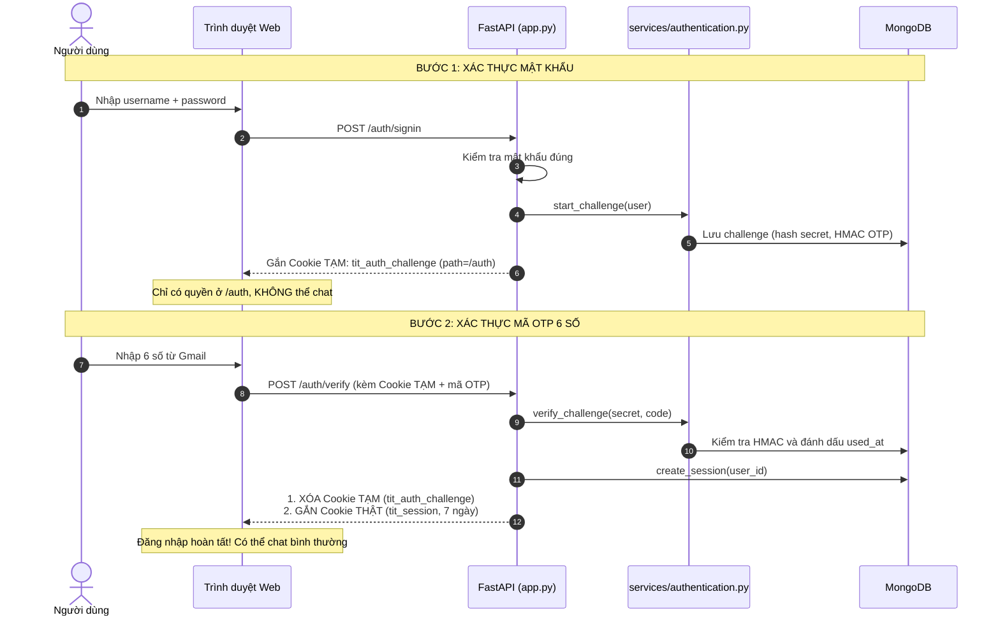

# So sánh Cơ chế Xác thực 2 bước: Cookie Tạm thời vs Session Chính thức

Tài liệu này giải thích chi tiết vị trí trong mã nguồn (file và số dòng code) và sự khác biệt giữa hai loại Token/Cookie được sử dụng trong hệ thống Tit Chatbot: **`tit_auth_challenge`** (Vé tạm thời) và **`tit_session`** (Phiên đăng nhập chính thức).

---

## 1. Bảng so sánh tổng quan

| Tiêu chí | 1. Cookie Tạm thời (`tit_auth_challenge`) | 2. Session Chính thức (`tit_session`) |
| :--- | :--- | :--- |
| **Bản chất** | Thẻ khách tạm thời (Challenge Secret) chờ xác minh OTP | Phiên đăng nhập thật sự (Authenticated Session Token) |
| **Sinh ra khi nào?** | Ngay khi nhập **đúng mật khẩu** ở Bước 1 | Chỉ sinh ra sau khi nhập **đúng mã OTP 6 số** ở Bước 2 |
| **Quyền hạn** | **Cực kỳ hạn chế**: Chỉ được gửi trong phạm vi `/auth` (xác minh hoặc xin gửi lại mã). Không thể chat, không thể xem tin nhắn | **Toàn quyền**: Được chat, lưu hội thoại, upload tài liệu, sử dụng mọi tính năng chatbot |
| **Thời hạn** | Tối đa **15 phút** (chờ nhập OTP) | **7 ngày** |
| **Khi xác thực xong?** | **Bị xóa sổ ngay lập tức** khỏi trình duyệt | Được lưu lại trên trình duyệt trong suốt 7 ngày |

---

## 2. Vị trí chính xác trong Code cho từng tiêu chí

### Tiêu chí 1: Sinh ra khi nào?

#### Cookie Tạm (`tit_auth_challenge`):
- **Vị trí**: [`app.py`](../app.py) (Dòng 203–208 & 220–237)
- **Cách hoạt động**:
  - Khi người dùng đăng nhập mật khẩu đúng tại `POST /auth/signin` (dòng 259) hoặc đăng ký tại `POST /auth/signup` (dòng 239), hàm `_begin_email_verification()` được gọi.
  - Hàm `start_challenge(user)` trong [`services/authentication.py`](../services/authentication.py#L34) tạo chuỗi ngẫu nhiên 32 bytes (`secret`) và lưu hash vào MongoDB.
  - Server gắn secret này vào cookie thông qua:
    ```python
    # app.py (dòng 203)
    def _set_challenge_cookie(response: JSONResponse, secret: str, request: Request) -> None:
        response.set_cookie(
            key="tit_auth_challenge", value=secret, httponly=True,
            secure=request.url.scheme == "https", samesite="lax",
            max_age=15 * 60, path="/auth",
        )
    ```

#### Session Thật (`tit_session`):
- **Vị trí**: [`app.py`](../app.py) (Dòng 308–319) & [`storage/database.py`](../storage/database.py#L405–L430)
- **Cách hoạt động**:
  - Tại endpoint `POST /auth/verify` (dòng 283), sau khi `verify_challenge()` trả về `"valid"`, server mới chính thức tạo phiên:
    ```python
    # app.py (dòng 308-319)
    session_id = create_session(user["id"])
    response.set_cookie(
        key="tit_session", value=session_id, httponly=True,
        secure=request.url.scheme == "https", samesite="lax",
        max_age=7 * 24 * 3600, path="/",
    )
    ```

---

### Tiêu chí 2: Quyền hạn được kiểm soát như thế nào?

#### Cookie Tạm (`tit_auth_challenge`):
- **Phạm vi URL (`path="/auth"`)**: Trong [`app.py`](../app.py#L207), cookie này chỉ được cấp cho đường dẫn `/auth`. Trình duyệt theo chuẩn RFC 6265 sẽ **tuyệt đối không gửi** cookie này khi người dùng gọi các API chat như `/chat/send`, `/conversations`, `/upload`.
- **Hệ thống phân quyền**: Hàm xác thực danh tính [`get_current_user(request)`](../app.py#L85) **chỉ tìm kiếm `tit_session`**. Nếu chỉ có `tit_auth_challenge`, người dùng vẫn là khách (Unauthenticated) và bị chặn toàn bộ chức năng.

#### Session Thật (`tit_session`):
- **Phạm vi URL (`path="/"`)**: Có hiệu lực trên toàn bộ trang web.
- **Hệ thống phân quyền**: [`get_current_user()`](../app.py#L85) đọc `tit_session`, tra cứu trong MongoDB collection `sessions` để nạp thông tin user và cấp quyền sử dụng toàn bộ hệ thống chatbot.

---

### Tiêu chí 3: Thời hạn được quy định ở đâu?

#### Cookie Tạm (`tit_auth_challenge`):
- **Trình duyệt**: `max_age=15 * 60` (15 phút) tại [`app.py`](../app.py#L207).
- **Mã OTP trong Database**: `OTP_TTL = timedelta(minutes=5)` tại [`services/authentication.py`](../services/authentication.py#L12) (Mã 6 số hết hạn sau 5 phút).
- **Tự động dọn dẹp MongoDB (TTL Index)**: Collection `auth_challenges` được đánh chỉ mục tự xóa sau 1 giờ tại [`storage/mongo_client.py`](../storage/mongo_client.py#L116):
  ```python
  challenges.create_index([("expires_at", ASCENDING)], expireAfterSeconds=3600, background=True)
  ```

#### Session Thật (`tit_session`):
- **Trình duyệt**: `max_age=7 * 24 * 3600` (7 ngày) tại [`app.py`](../app.py#L316).
- **Database**: `expires_at = now + timedelta(days=duration_days)` (7 ngày) tại [`storage/database.py`](../storage/database.py#L411).
- **Tự động dọn dẹp MongoDB (TTL Index)**: Tự xóa ngay khi hết hạn tại [`storage/mongo_client.py`](../storage/mongo_client.py#L111):
  ```python
  sessions.create_index([("expires_at", ASCENDING)], expireAfterSeconds=0, background=True)
  ```

---

### Tiêu chí 4: Xóa bỏ và Tiêu hủy (Cleanup)?

#### Cookie Tạm (`tit_auth_challenge`):
- Ngay khi người dùng nhập đúng OTP tại `POST /auth/verify` (dòng 318):
  ```python
  # app.py (dòng 318)
  _clear_challenge_cookie(response)  # Xóa sạch cookie tạm khỏi trình duyệt
  ```
- Trong MongoDB, bản ghi được cập nhật `used_at = now` tại [`services/authentication.py`](../services/authentication.py#L118) để không thể tái sử dụng.
- Nếu người dùng bấm "Back to Login", endpoint `POST /auth/cancel-challenge` (dòng 342) sẽ xóa luôn bản ghi trong MongoDB và xóa cookie.

#### Session Thật (`tit_session`):
- Chỉ bị xóa khi người dùng chủ động bấm **"Đăng xuất"** tại `POST /auth/signout` ([`app.py`](../app.py#L350)):
  ```python
  delete_session(session_id)
  response.delete_cookie(key="tit_session", path="/")
  ```

---

## 3. Sơ đồ tuần tự trực quan (Sequence Diagram)


