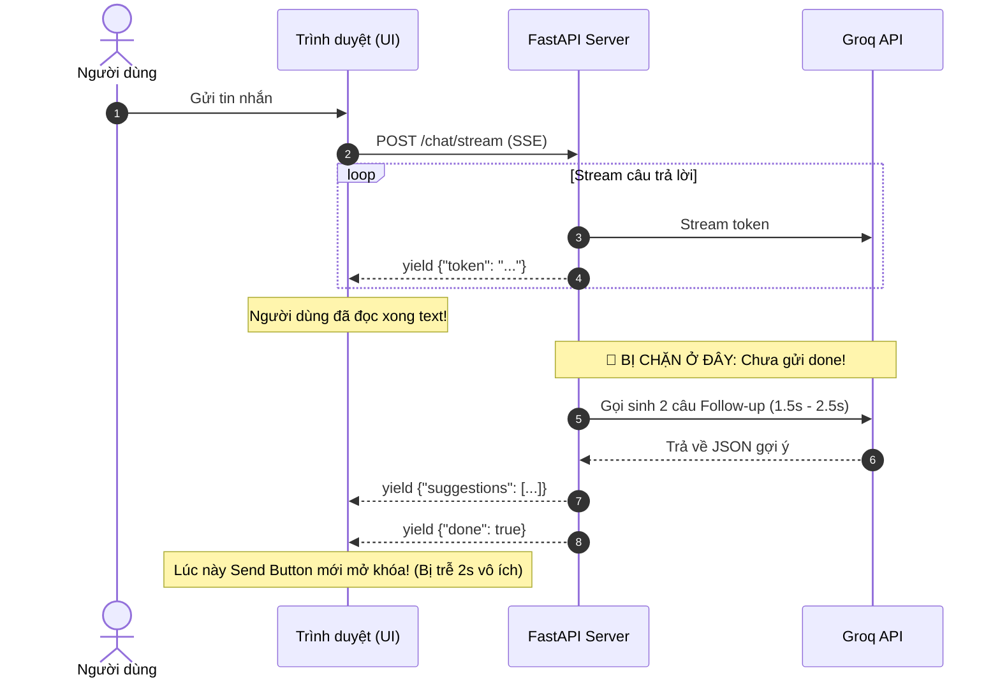
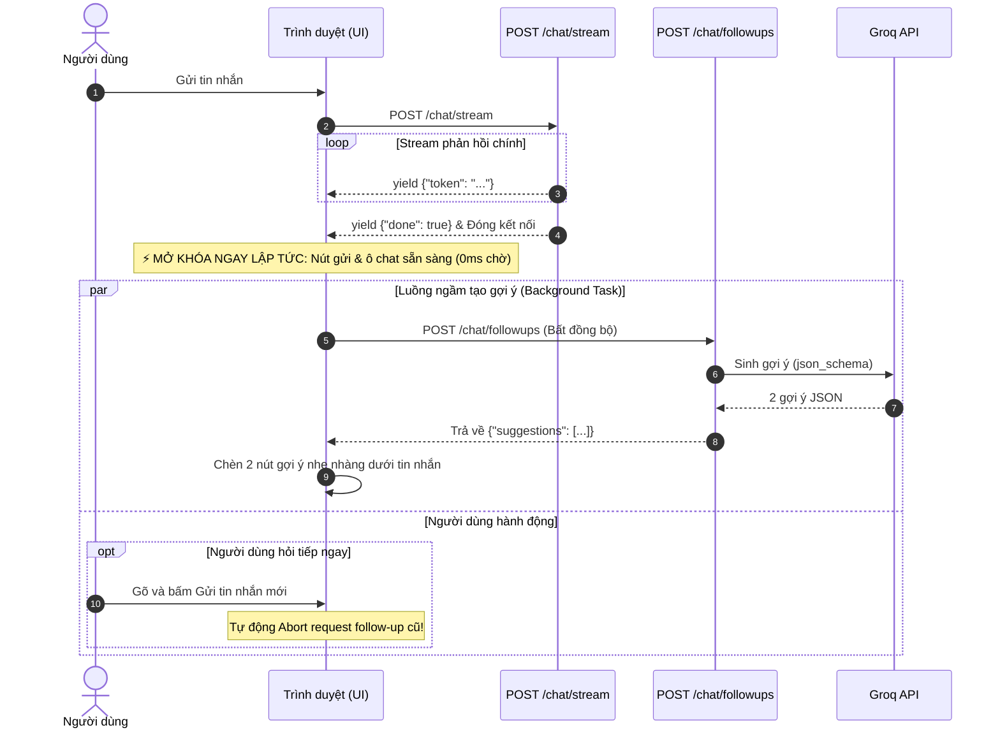

# Thiết Kế Kiến Trúc: Luồng Gợi Ý Follow-up Chạy Song Song (Parallel Asynchronous Architecture)

> **Mục tiêu**: Tách rời hoàn toàn luồng sinh câu hỏi gợi ý (**Follow-up Suggestions**) khỏi luồng stream chính của Chatbot để **thời gian chờ của người dùng giảm về 0ms**. Ngay khi chatbot stream xong chữ cuối cùng, ô nhập tin nhắn và nút gửi sẽ được mở khóa tức thì.

---

## 1. Vấn Đề Của Kiến Trúc Tuần Tự (Trước Đây)

Trong mô hình tuần tự cũ, toàn bộ quá trình trả lời và tạo gợi ý bị gom chung vào một kết nối SSE (`/chat/stream`):



### Điểm nghẽn:
1. **Trải nghiệm bị ngắt quãng (UX Lag):** Người dùng đã đọc xong câu trả lời nhưng nút gửi và ô nhập vẫn bị khóa (disabled) trong 1.5 – 2.5 giây chỉ để chờ 2 nút gợi ý.
2. **Ghép đôi quá chặt (Tight Coupling):** Nếu bước sinh gợi ý gặp lỗi hoặc phản hồi chậm, luồng chat chính bị ảnh hưởng theo.
3. **Lãng phí tài nguyên:** Nếu người dùng chỉ muốn hỏi tiếp ngay, họ vẫn bị ép phải đợi follow-up sinh xong.

---

## 2. Kiến Trúc Mới: Chạy Song Song Bất Đồng Bộ (Decoupled Parallel)

Tách biệt trách nhiệm theo chuẩn thiết kế của các sản phẩm AI hàng đầu (ChatGPT, Perplexity):



---

## 3. Các Thành Phần Triển Khai Chi Tiết

### A. Tối ưu hóa `/chat/stream` (`app.py`)
- Loại bỏ toàn bộ lời gọi `generate_followup_questions` bên trong `event_generator()`.
- Ngay khi vòng lặp `agent.stream()` hoàn tất và lưu tin nhắn vào MongoDB:
  - Bắn sự kiện kết thúc: `yield sse_data({"done": True})`.
  - Đóng luồng stream.
- **Hiệu năng:** Tốc độ phản hồi đạt mức tối đa của mô hình, không còn bất kỳ mili-giây trễ nào.

### B. Endpoint Độc Lập Mới `POST /chat/followups` (`app.py`)
- Định tuyến nhận request:
  - Input: `user_message`, `assistant_answer`, `model`.
  - Chạy ngầm trong Thread Pool của FastAPI (`asyncio.to_thread`) để không block Event Loop của server.
  - Sử dụng hàm `generate_followup_questions` với cơ chế `json_schema` đã tối ưu:
    - `FOLLOWUP_OUTPUT_TOKENS = 500` (đủ cho reasoning tokens).
    - `FOLLOWUP_TIMEOUT_SECONDS = 5.0`.
  - Output: `{"suggestions": ["câu 1", "câu 2"]}` hoặc `{"suggestions": []}`.

### C. Quản lý ở Frontend (`templates/index.html`)
- Khi vòng lặp đọc SSE kết thúc (khối `finally`):
  1. Mở khóa giao diện ngay lập tức:
     - `sendBtn.disabled = false`
     - `statusText.textContent = "Ready"`
     - `messageInput.focus()`
  2. Kích hoạt hàm nền `fetchParallelFollowups(userMessage, assistantAnswer, botElement, model)`:
     - Sử dụng `AbortController`: Nếu người dùng gửi tin nhắn mới trước khi gợi ý cũ kịp trả về, request cũ sẽ tự động bị `abort()` để tiết kiệm băng thông và token.
     - Khi nhận được dữ liệu, gọi `addFollowupSuggestions(suggestions, botElement)` để gắn 2 nút bấm tương tác.

---

## 4. Bảng So Sánh Trước & Sau Khi Cải Tiến

| Tiêu chí | Trước khi tối ưu (Tuần tự) | Sau khi tối ưu (Song song) |
| :--- | :--- | :--- |
| **Độ trễ mở khóa ô chat** | 1.5s – 3.0s sau khi đọc xong | **0 ms (Tức thì)** |
| **Tính độc lập** | Chat và Followup dính chặt vào nhau | Tách rời hoàn toàn (Decoupled) |
| **Hủy tác vụ thừa** | Không thể hủy khi người dùng chat tiếp | Hủy tức thì bằng `AbortController` |
| **Khả năng chịu lỗi** | Lỗi follow-up có thể làm treo SSE | Lỗi follow-up hoàn toàn vô hại với chat |
| **Trải nghiệm UX** | Có cảm giác giật cục, phải chờ đợi | Mượt mà, chuyên nghiệp như ChatGPT |

---

## 5. Cơ Chế Tự Động Kích Hoạt Follow-Up Cho Mọi Prompt

### "Làm thế nào để hệ thống biết prompt nào cũng tự động chạy luồng này?"

Trong kiến trúc phần mềm hiện đại, việc này được thực hiện theo nguyên lý **Client-Side Orchestration (Phía giao diện chủ động điều phối)** thay vì ép Agent phải tự nhớ gọi:

1. **Nguyên lý Đơn Nhiệm (Single Responsibility Principle):**
   - **Agent (`agent.py`)**: Chỉ chuyên tâm làm 1 việc duy nhất là suy nghĩ, sử dụng tool (nếu cần), và trả lời câu hỏi của người dùng (`Chatbot Answer`). Agent không cần và không nên biết về tính năng gợi ý follow-up để tránh tốn token TPM và tránh làm phức tạp đồ thị LangGraph.
2. **Kích hoạt tự động ở tầng Frontend (`templates/index.html`):**
   - Trong hàm gửi tin nhắn `sendMessage()`, bất kể người dùng gửi prompt gì (câu hỏi thông thường, tính toán toán học, tóm tắt tài liệu PDF/Word, hỏi về ảnh, hay lưu/tìm ký ức cá nhân):
   - Ngay khi stream câu trả lời kết thúc, khối `finally` **LUÔN LUÔN được thực thi tự động 100%**:
     ```javascript
     const finalAnswer = (botElement.dataset.raw || "").trim();
     if (finalAnswer && !finalAnswer.startsWith("**Something went wrong:**")) {
         fetchParallelFollowups(submittedMessage, finalAnswer, botElement, selectedModel);
     }
     ```
   - Frontend gửi cặp `(user_message, assistant_answer)` lên endpoint `/chat/followups`.
   - Backend nhận dữ liệu và sinh 2 câu gợi ý sát với ngữ cảnh vừa trả lời.
   - Do đó, **mọi prompt đều được tự động tạo câu hỏi gợi ý** mà không cần cấu hình thủ công ở từng tool hay prompt của Agent.

---

## 6. Bản Chất Kỹ Thuật: `asyncio.to_thread` vs Từ Khóa `async def`

### "Tôi tưởng chỉ cần từ khóa `async def` đã là bất đồng bộ rồi, tại sao lại cần `await asyncio.to_thread`?"

Đây là một trong những hiểu lầm phổ biến nhất trong lập trình bất đồng bộ với Python.

### A. Ngộ nhận về `async def`:
Nhiều người nghĩ chỉ cần gắn `async def` vào hàm FastAPI:
```python
# ⚠️ CÁCH VIẾT NGUY HIỂM:
@app.post("/chat/followups")
async def chat_followups(request: Request):
    # generate_followup_questions là hàm ĐỒNG BỘ (chờ mạng Groq 1.5s - 2.5s)
    questions = generate_followup_questions(...) 
    return {"suggestions": questions}
```
Thực chất:
- `async def` chỉ định nghĩa hàm là một **Coroutine**. Hàm này chạy trên **Duy nhất 1 luồng chính (Main Thread)** nơi chứa **Event Loop** của FastAPI.
- Từ khóa `async def` **KHÔNG TỰ ĐỘNG BIẾN một hàm đồng bộ thành bất đồng bộ**!
- Hàm `generate_followup_questions` bên trong gọi `llm.invoke(...)`. Thư viện LangChain/Groq thực hiện lệnh gọi HTTP đồng bộ (**Blocking I/O**).
- **Hậu quả nghiêm trọng:** Trong suốt 2 giây chờ Groq trả lời, **toàn bộ Event Loop của FastAPI bị đóng băng (Blocked)**! Server không thể phục vụ bất kỳ ai khác: các luồng stream của user khác bị dừng hình, các request gửi tin nhắn mới bị nghẽn lại!

### B. Giải pháp của `await asyncio.to_thread`:
Từ Python 3.9, Python cung cấp `asyncio.to_thread()` để giải quyết triệt để vấn đề này:
```python
# ✅ CÁCH VIẾT CHUẨN XÁC:
questions = await asyncio.to_thread(
    generate_followup_questions,
    user_message=user_message,
    assistant_answer=assistant_answer,
    model_name=selected_model,
)
```

**Cơ chế hoạt động bên dưới:**
1. `asyncio.to_thread` mang hàm đồng bộ `generate_followup_questions` giao cho một **Worker Thread riêng biệt** (nằm trong `ThreadPoolExecutor` ngầm của hệ điều hành).
2. Khi Worker Thread này đang bận chờ mạng từ máy chủ Groq, **Main Thread của FastAPI hoàn toàn rảnh tay**!
3. Event Loop tiếp tục xử lý mượt mà hàng trăm request khác, tiếp tục stream từng token cho các cuộc trò chuyện khác.
4. Khi Worker Thread nhận xong kết quả từ Groq, nó gửi tín hiệu đánh thức `await` trên Main Thread để gói dữ liệu trả về JSON cho Client.

> **Tóm lại:**
> - `async def` tạo khung làm việc không đồng bộ cho hàm.
> - `asyncio.to_thread` là "cây cầu" đưa công việc đồng bộ nặng/chờ mạng sang một luồng khác để **giữ cho Event Loop của FastAPI luôn thông suốt, không bao giờ bị nghẽn**.
