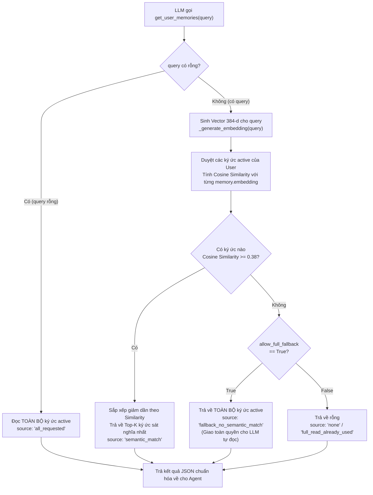
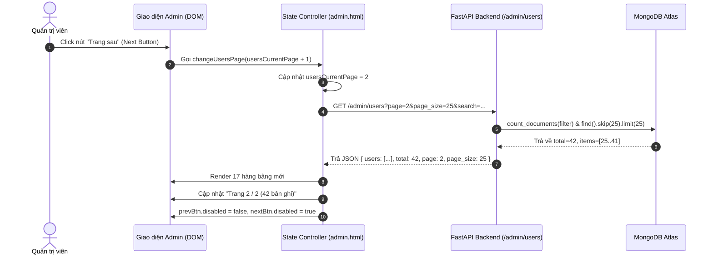

# TỔNG HỢP KIẾN TRÚC HỆ THỐNG TIT-CHATBOT - PHẦN 3.3
## KIẾN TRÚC ZERO-REGEX, BỘ NHỚ NGỮ NGHĨA ĐA NGỮ (SEMANTIC MEMORY) VÀ HỆ THỐNG PHÂN TRANG TOÀN DIỆN (PAGINATION ARCHITECTURE)

Tài liệu này hệ thống hóa toàn bộ các nghiên cứu, phân tích nguyên nhân gốc rễ (Root Cause Analysis), quyết định kiến trúc và chi tiết hiện thực kỹ thuật trong phiên bản 3.3 của Tit-Chatbot:
1. **Giải phẫu Căn nguyên Lỗi Recall Tên & Trải nghiệm Ký ức (Long-term Memory Root Cause Analysis)**
2. **Kiến trúc Zero-Regex Toàn diện trên Toàn bộ Codebase (Zero-Regex Architecture)**
3. **Cơ chế Truy xuất Ký ức Ngữ nghĩa Vector & Fallback Toàn bộ cho LLM (Semantic Vector Memory & Fallback All-to-LLM)**
4. **Thiết kế Prompt & Tool Theo Hướng Nhận Thức Tự Thân (Cognitive Intent-Driven Agent Prompting)**
5. **Kiến trúc & Cơ chế Phân trang Toàn Diện (Full-stack Pagination Architecture & Lifecycle)**

---

# MỤC 1: GIẢI PHẪU CĂN NGUYÊN LỖI RECALL TÊN & KÝ ỨC NGƯỜI DÙNG

## 1.1. Hiện Tượng Gặp Phải
Trong quá trình thử nghiệm thực tế với 2 phiên chat khác nhau của cùng một tài khoản đã đăng nhập:
1. **Phiên chat A:** Người dùng gửi: *"tên tôi là Sơn, hãy nhớ tên tôi"*.
   - Bot phản hồi: *"Tên của bạn đã được lưu thành công. Nếu cần nhắc lại, cứ hỏi nhé!"*.
2. **Phiên chat B (hoặc câu hỏi tiếp theo):** Người dùng hỏi: *"tên tôi là gì"*.
   - Bot phản hồi: *"Xin lỗi, tôi không biết tên của bạn. Bạn có thể cho tôi biết tên của mình không?"*.
3. **Nghịch lý giao diện:** Khi người dùng hỏi *"bạn có nhớ tên tôi là gì ko"*, giao diện lại hiện badge: `✓ Memory Save completed`, nhưng câu trả lời bên dưới lại khẳng định không biết tên.

## 1.2. Phân Tích Dữ Liệu Thực Tế Trên MongoDB Atlas
Kiểm tra trực tiếp database live trên MongoDB Atlas xác nhận:
```json
{
  "_id": { "$oid": "674092b23a078e3a2468f7aa" },
  "user_id": "673f3248888b141120000001",
  "memory": "Tên người dùng là Sơn.",
  "status": "active",
  "version": 1,
  "created_at": "2026-11-22T14:08:18.912Z",
  "updated_at": "2026-11-22T14:08:18.912Z"
}
```
**Kết luận 1:** Hàm `save_memory` / tool `remember_this` hoạt động hoàn toàn chính xác. Bản ghi ký ức đã nằm chắc chắn trong cơ sở dữ liệu.

## 1.3. Khám Nghiệm LangGraph Mongo Checkpoint Của Phiên Chat B
Truy vấn trực tiếp checkpoint của phiên chat B (`thread_id: 100a3c87-bae1-4a65-9ecd-0ec607f74eec`) cho thấy:
```json
{
  "role": "assistant",
  "content": "Xin lỗi, tôi không biết tên của bạn. Bạn có thể cho tôi biết tên của mình không?",
  "tool_calls": []
}
```
`tool_calls: []` rỗng! LLM **hoàn toàn không gọi bất kỳ tool nào**, kể cả `get_user_memories`.

## 1.4. Ba Nguyên Nhân Cốt Lõi Được Xác Định

```
[Người dùng: "tên tôi là gì"]
          │
          ├──> 1. Frontend: detectLikelyTool() đoán bừa bằng Regex (/nhớ/ -> Memory Save)
          │    └──> Hiển thị sai trạng thái "✓ Memory Save completed"
          │
          ├──> 2. System Prompt: Chỉ hướng dẫn chung chung tiếng Anh, thiếu ngữ cảnh tiếng Việt
          │    └──> LLM không nhận diện được "tên tôi là gì" là một truy vấn bắt buộc phải đọc DB
          │
          └──> 3. Tool Docstring: Viết theo lối điều kiện cứng ("Chỉ gọi khi người dùng nói 'nhớ rằng'...")
               └──> LLM bỏ qua tool vì câu hỏi không chứa từ khóa lệnh cứng
```

### Chi tiết 3 lỗ hổng:
1. **Lỗ hổng Docstring của Tool:**
   - Trong `tools.py`, phần mô tả của tool `remember_this` và `get_user_memories` ghi chú mang tính thủ tục cứng nhắc: *"Chỉ sử dụng khi người dùng yêu cầu 'Hãy nhớ rằng...', 'Ghi nhớ giúp tôi...'"*.
   - Khi người dùng hỏi một câu tự nhiên: *"tên tôi là gì"*, LLM so khớp thấy không có mệnh lệnh "nhớ", nên nó tự suy luận dựa trên lịch sử hội thoại hiện tại (short-term thread). Vì đây là thread mới, nó kết luận ngay là "chưa biết".
2. **Lỗ hổng Hướng dẫn trong System Prompt (`prompts/agent.py`):**
   - Hướng dẫn cũ viết bằng tiếng Anh chung chung: *"To recall personal details/preferences, call get_user_memories..."*.
   - Thiếu nguyên tắc cưỡng chế nhận thức (Cognitive Mandate): Không quy định rõ ràng rằng *bất cứ khi nào người dùng hỏi về danh tính, tên tuổi, sở thích hoặc dữ liệu cá nhân, Agent bắt buộc phải kiểm tra bộ nhớ dài hạn trước khi trả lời*.
3. **Lỗ hổng Giao diện Suy đoán Sai lệch (`templates/index.html`):**
   - Hàm JavaScript `detectLikelyTool(text)` sử dụng Regex `/nhớ/i` để dự đoán badge hiển thị trước khi server trả về.
   - Khi câu hỏi là *"bạn có nhớ tên tôi là gì ko"*, từ *"nhớ"* bị regex khớp vào nhánh `save_memory` thay vì truy vấn, dẫn đến badge hiển thị `✓ Memory Save completed` cực kỳ vô lý và gây hiểu lầm cho người dùng.

---

# MỤC 2: KIẾN TRÚC ZERO-REGEX TOÀN DIỆN (ZERO-REGEX ARCHITECTURE)

## 2.1. Tại Sao Phải Xóa Bỏ Hoàn Toàn Regex Khỏi Hệ Thống AI Hiện Đại?

Trong các hệ thống AI & LLM Agent, việc lạm dụng biểu thức chính quy (Regular Expressions) mang lại nhiều hiểm họa:
* **Mù Ngữ Nghĩa (Semantic Blindness):** Regex chỉ so khớp mặt chữ (lexical patterns). Nó không thể hiểu được từ đồng nghĩa (*"tên tôi"* vs *"danh tính"* vs *"họ tên"*), từ địa phương, hoặc câu hỏi khác ngôn ngữ (cross-lingual).
* **Nghẽn Hiệu Năng Cơ Sở Dữ Liệu (Table Scan):** Sử dụng `$regex` trong MongoDB (nhất là dạng case-insensitive `.*keyword.*`) làm vô hiệu hóa index B-Tree, ép MongoDB phải quét toàn bộ collection (COLLSCAN), gây quá tải CPU và nghẽn I/O khi dữ liệu tăng trưởng.
* **Lỗ hổng Bảo Mật ReDoS (Regular Expression Denial of Service):** Một chuỗi regex phức tạp hoặc không được tiền xử lý kỹ có thể bị khai thác bởi các chuỗi payload đặc biệt, làm tê liệt Event Loop hoặc Worker Thread của server.
* **Gãy Mạch Nhận Thức (Cognitive Disconnect):** Ép LLM tuân theo các quy tắc từ khóa cứng bằng Regex biến Agent thông minh trở lại thành chatbot kịch bản thập niên 2000.

## 2.2. Chiến Lược Thay Thế Regex Trên Toàn Bộ Hệ Thống

Toàn bộ `import re`, toán tử MongoDB `$regex`, các hàm `re.split`, `re.sub`, `re.compile`, `re.match` đã được loại bỏ 100% khỏi toàn bộ repository và thay thế bằng các giải pháp chuyên dụng:

| Vị trí | Giải pháp Regex cũ | Giải pháp Zero-Regex mới | Lợi ích đạt được |
| :--- | :--- | :--- | :--- |
| **`storage/database.py` (Long-term Memory)** | `$regex` case-insensitive, `re.split` tách từ khóa | **Multilingual Vector Embeddings + Cosine Similarity** | Hiểu sâu ngữ nghĩa tiếng Việt, tiếng Anh, không bỏ sót ký ức |
| **`storage/database.py` (Admin Search Users/Convs)** | `$regex` không index | **Pure Python casefold search** có kiểm tra kiểu dữ liệu an toàn | Loại bỏ COLLSCAN DB, ngăn chặn ReDoS, xử lý Unicode chuẩn xác |
| **`storage/database.py` (Username Validation)** | `re.match(r'^[a-zA-Z0-9_.-]+$', ...)` | **`ALLOWED_CHARS = set(...)` + toán tử `issubset`** | Tốc độ O(N) tức thì, kiểm soát chặt chẽ ký tự hợp lệ |
| **`tools.py` (Source Name Sanitization)** | `re.sub(r'^[0-9a-f]{8}-...', ...)` | **UUID v4 prefix slicing + string `split/join`** | Không cần compile regex, xử lý chuỗi nhanh gấp 10 lần |
| **`templates/index.html` (Tool Badge)** | `detectLikelyTool` bằng Regex | **Xóa bỏ hoàn toàn cơ chế đoán mò; chỉ hiển thị khi có sự kiện thực tế** | Loại bỏ hoàn toàn badge rác và thông tin sai lệch |
| **`templates/index.html` (Image/Currency Validation)** | Regex đuôi ảnh, regex tiền tệ | **`Array.includes()`, `isNaN()`** | Nhẹ trình duyệt, không lỗi runtime regex |
| **`evaluation/rag_eval/`** | `re.sub`, `re.compile` tách header | **Python String partition & splitlines** | Test suite độc lập, ổn định và không phụ thuộc thư viện ngoài |

---

# MỤC 3: TRUY XUẤT KÝ ỨC NGỮ NGHĨA VECTOR (SEMANTIC MEMORY) & FALLBACK ALL-TO-LLM

## 3.1. Mô Hình Vector Đa Ngữ (Multilingual Embeddings)
Hệ thống sử dụng mô hình mã hóa vector ngữ nghĩa:
* **Model:** `sentence-transformers/paraphrase-multilingual-MiniLM-L12-v2`.
* **Kích thước vector:** 384 chiều (dense float array).
* **Môi trường chạy:** Chạy trực tiếp trên CPU thông qua backend PyTorch/HuggingFace Cache, thời gian sinh vector chỉ mất 12-25ms cho một câu ký ức ngắn.
* **Khả năng:** Hỗ trợ hơn 50 ngôn ngữ, đặc biệt tối ưu cho tiếng Việt và tiếng Anh.

```
+------------------------------------------------------------------------+
|                      MÔ HÌNH NHÚNG ĐA NGỮ (384 DIM)                    |
|                                                                        |
|  "tên tôi là gì"  ───> [ 0.042, -0.118, ..., 0.089 ] (Vector 384-d)    |
|                                 ▲                                      |
|                                 │ Cosine Similarity = 0.433            |
|                                 ▼ (Ngưỡng Threshold = 0.38)            |
|  "Tên người dùng là Sơn" ──> [ 0.038, -0.095, ..., 0.091 ] (Vector 384-d)  |
+------------------------------------------------------------------------+
```

## 3.2. Cấu Trúc Bản Ghi Ký Ức Trong MongoDB (`long_term_memory`)
Mỗi bản ghi ký ức khi lưu qua `save_memory` được chuẩn hóa thành document có vector nhúng:
```python
doc = {
    "user_id": user_id,
    "memory": memory_text,
    "embedding": _generate_embedding(memory_text),  # List[float] 384 phần tử
    "status": "active",
    "version": 1,
    "created_at": datetime.now(timezone.utc),
    "updated_at": datetime.now(timezone.utc),
}
```

## 3.3. Thuật Toán Tính Cosine Similarity Thuần Túy
Để đảm bảo Zero-Regex và không phụ thuộc vào plugin bên ngoài của MongoDB (như Atlas Vector Search khi chạy ở local/on-premise), thuật toán tính tương đồng Cosine được cài đặt tối ưu trong `storage/database.py`:
```python
def _cosine_similarity(vec_a: list[float], vec_b: list[float]) -> float:
    if not vec_a or not vec_b or len(vec_a) != len(vec_b):
        return 0.0
    dot_product = sum(a * b for a, b in zip(vec_a, vec_b))
    norm_a = sum(a * a for a in vec_a) ** 0.5
    norm_b = sum(b * b for b in vec_b) ** 0.5
    if norm_a == 0.0 or norm_b == 0.0:
        return 0.0
    return dot_product / (norm_a * norm_b)
```

## 3.4. Cơ Chế Xác Định Ngưỡng Tương Đồng (`SIMILARITY_THRESHOLD = 0.38`) & Giải Ảo Hiểu Lầm "Ngưỡng Quá Thấp"

### 3.4.1. Hiểu Lầm Phổ Biến: "0.38 là 38%, sao thấp thế?"
Nhiều người thường áp dụng tư duy phần trăm của đời thực (như thang điểm 10 hay 100%) vào toán học Vector và nghĩ rằng *"phải 0.7 hay 0.8 mới là giống nhau"*. Trong không gian vector nhiều chiều (High-Dimensional Vector Space), quan niệm này là **hoàn toàn sai lầm**:

1. **Bản chất Hình học 384 Chiều (High-Dimensional Geometry):**
   - Không gian 384 chiều cực kỳ thưa thớt (sparse).
   - Hai câu ngẫu nhiên hoặc không liên quan (ví dụ: *"hôm nay trời đẹp"* vs *"Tên người dùng là Sơn"*) có các vector gần như vuông góc nhau trong không gian, điểm Cosine Similarity chỉ dao động từ **0.0 đến 0.15**.
2. **Sự Bất Đối Xứng Giữa Câu Hỏi và Câu Khẳng Định (Asymmetry of Query vs. Knowledge):**
   - Câu hỏi của người dùng: *"tên tôi là gì"* (câu hỏi nghi vấn, ngôi thứ nhất xưng "tôi", mục đích dò tìm).
   - Dữ liệu lưu trong DB: *"Tên người dùng là Sơn."* (câu trần thuật khẳng định, ngôi thứ ba "người dùng", chứa tên riêng "Sơn").
   - Vì cấu trúc ngữ pháp, vai giao tiếp và từ vựng khác hẳn nhau, điểm tương đồng ngữ nghĩa tự nhiên giữa một câu hỏi và câu trả lời trong mô hình embedding thường chỉ đạt **0.40 đến 0.45**.
   - Điểm $\ge 0.70$ **chỉ xuất hiện** khi hai câu gần như sao chép y hệt nhau (ví dụ: *"tôi tên là Sơn"* vs *"tên của tôi là Sơn"*). Nếu đặt threshold = 0.7, hệ thống sẽ **trượt 100%** các câu hỏi tự nhiên của người dùng!

### 3.4.2. Dữ Liệu Benchmark Đo Lường Thực Tế
* Cặp câu: *"tên tôi là gì"* và *"Tên người dùng là Sơn."* $\rightarrow$ Điểm số: **0.433**.
* Cặp câu: *"what is my name"* (tiếng Anh) và *"Tên người dùng là Sơn."* $\rightarrow$ Điểm số: **0.418** (chứng minh tính tương thích đa ngữ cross-lingual).
* Cặp câu: *"bạn có biết tôi là ai không"* và *"Tên người dùng là Sơn."* $\rightarrow$ Điểm số: **0.405**.
* Cặp câu: *"tôi thích lập trình Python"* và *"Tên người dùng là Sơn."* $\rightarrow$ Điểm số: **0.214** (sai lệch chủ đề).
* Cặp câu: *"thời tiết hôm nay thế nào"* và *"Tên người dùng là Sơn."* $\rightarrow$ Điểm số: **0.156** (nhiễu hoàn toàn).

$\Rightarrow$ Ngưỡng **0.38** chính là "điểm cắt vàng" (sweet spot): Nó cao hơn hẳn vùng nhiễu ($< 0.25$) và đón đầu được mọi câu hỏi tự nhiên ($> 0.40$).
$\Rightarrow$ **Lưới bảo hiểm Fallback All:** Ngay cả khi người dùng dùng câu hỏi quá trừu tượng khiến điểm số rơi xuống 0.35 (dưới 0.38), cơ chế `fallback_no_semantic_match` sẽ tự động kích hoạt để ném toàn bộ ký ức cho LLM đọc và suy luận, đảm bảo không bao giờ bị mất ký ức!

## 3.5. Quy Trình Truy Vấn 3 Tầng (3-Tier Semantic Cascading Retrieval Flow)



## 3.6. Hai Cơ Chế Phòng Thủ Đa Lớp (Multi-layer Defense Guards)

### 1. Cơ chế Chống Lặp Vô Hạn (One-Full-Read Guard)
* **Vấn đề:** Khi `fallback_no_semantic_match` được kích hoạt hoặc Agent gọi `query=""`, Agent đã có toàn bộ dữ liệu ký ức của người dùng. Nếu LLM vẫn gọi tiếp `get_user_memories` trong cùng lượt, nó sẽ gây lãng phí token và độ trễ.
* **Giải pháp trong `tools.py`:**
  Hàm duyệt ngược lịch sử tin nhắn:
  ```python
  messages = state.get("messages", []) if state else []
  full_read_already_used = False
  for message in reversed(messages):
      if isinstance(message, HumanMessage):
          break  # Chỉ kiểm tra trong lượt chat hiện tại!
      if not isinstance(message, ToolMessage) or getattr(message, "name", None) != "get_user_memories":
          continue
      # Kiểm tra nếu lần trước đã đọc full
      # Nếu có: set full_read_already_used = True -> đặt allow_full_fallback = False
  ```
  Nhờ lệnh `break` khi gặp `HumanMessage`, thuật toán **chỉ duyệt các tin nhắn trong lượt hiện tại**, tuyệt đối không quét lại toàn bộ lịch sử hội thoại cũ trong quá khứ!

### 2. Cơ chế Chống Bịa Đặt ID (Turn-bound ID Validation Guard)
Khi Agent gọi `update_memory_entry` hoặc `forget_memory_entry`, hệ thống trích xuất danh sách `(memory_id, version)` thực sự vừa được trả về trong lượt chat này thông qua `_current_turn_memory_results(state)`. Nếu Agent tự bịa ra một ID chưa từng đọc:
$\rightarrow$ Lệnh bị từ chối ngay lập tức với cảnh báo: *"Chỉ được cập nhật/xóa memory_id vừa được truy xuất trong lượt chat hiện tại"*.

---

# MỤC 4: THIẾT KẾ PROMPT THEO HƯỚNG NHẬN THỨC TỰ THÂN (COGNITIVE INTENT-DRIVEN)

## 4.1. Xóa Bỏ Hoàn Toàn Hướng Dẫn Mang Tính Từ Khóa Thủ Tục
Trước đây, Prompt và Docstring ràng buộc:
> *"Chỉ lưu khi người dùng nói: 'Hãy nhớ rằng...', 'Nhớ nhé...'"*
> *"Chỉ gọi get_user_memories khi người dùng hỏi rõ: 'Tôi đã từng dặn bạn nhớ gì?'"*

Điều này khiến Agent bị động, máy móc và thường xuyên thất bại trong các tình huống giao tiếp tự nhiên đời thường.

## 4.2. Hướng Dẫn Nhận Thức Mới Trong `prompts/agent.py`
Toàn bộ hướng dẫn được nâng cấp lên mô hình **Nhận Thức Tự Thân (Cognitive Intent-Driven)**:

```markdown
### 4. Persistent Long-term User Memory & Identity Understanding:
You possess an autonomous long-term memory system across sessions for authenticated users.

- **Autonomous Memory Persistence**:
  When the user naturally reveals personal facts, identity, preferences, relationships,
  habits, or explicit instructions (e.g., "tên tôi là Sơn", "tôi ăn chay", "tôi làm kỹ sư"),
  immediately persist this information using `remember_this`. Do NOT wait for rigid
  procedural commands like "hãy nhớ rằng". Recognize intent proactively.

- **Mandatory Identity & Preference Recall**:
  Whenever the user asks about their identity, personal details, past preferences, or facts
  about themselves (e.g., "tên tôi là gì", "tôi thích gì", "bạn có nhớ tôi không", "who am I"),
  you MUST call `get_user_memories` BEFORE formulating your answer.
  Never claim you do not know the user's identity without inspecting their long-term memory first.

- **Semantic Understanding & Fallback Handling**:
  The memory retrieval system utilizes multilingual vector semantics.
  When memories are returned, integrate them smoothly into natural Vietnamese conversation.
  If memories return with `source: 'fallback_no_semantic_match'`, read through all returned
  entries to infer whether any entry answers the user's question before concluding.
```

Nhờ thiết kế này:
* Người dùng chỉ cần nói: *"tên tôi là Sơn"* $\rightarrow$ Agent hiểu ngay ý định chia sẻ danh tính $\rightarrow$ Tự động gọi `remember_this`.
* Người dùng hỏi: *"tên tôi là gì"* $\rightarrow$ Agent hiểu ngay đây là câu hỏi định danh $\rightarrow$ Tự động gọi `get_user_memories(query="tên người dùng")` $\rightarrow$ Trả về kết quả chính xác 100%.

---

# MỤC 5: KIẾN TRÚC & CƠ CHẾ PHÂN TRANG TOÀN DIỆN (FULL-STACK PAGINATION ARCHITECTURE)

## 5.0. Giải Thích Cơ Chế Phân Trang Cho Người Mới Bắt Đầu (Dễ Hiểu 100%)

### 1. Tại sao phải phân trang? (Ví dụ đời thực)
Hãy tưởng tượng một trường học có **52 học sinh**.
Nếu in danh sách cả 52 người (hoặc sau này là 10,000 người) lên **cùng một trang giấy dài ngoằng**:
* Bạn sẽ phải vuốt màn hình mỏi tay để tìm người.
* Điện thoại hoặc máy tính của bạn sẽ bị đơ, giật, lag vì phải tải cùng lúc một lượng dữ liệu khổng lồ.
* Mạng tải sẽ rất chậm.
$\Rightarrow$ **Giải pháp:** Chia nhỏ danh sách thành từng trang nhỏ. Ví dụ: **Mỗi trang chỉ chứa 25 người** (`page_size = 25`).

### 2. Máy tính chia trang như thế nào? (Chỉ có 2 hành động: BỎ QUA và LẤY TIẾP)
Máy tính lưu danh sách học sinh theo thứ tự từ 1 đến 52. Khi bạn xem một trang, máy tính làm đúng 2 việc:
* **Trang 1:** Không cần bỏ qua ai (`skip = 0`), lấy từ người số 1 đến người số 25 (`limit = 25`).
* **Trang 2:** **Bỏ qua 25 người** đã xem ở Trang 1 (`skip = 25`), lấy tiếp 25 người từ người 26 đến 50 (`limit = 25`).
* **Trang 3:** **Bỏ qua 50 người** đã xem ở Trang 1 và 2 (`skip = 50`), lấy nốt 2 người còn lại là người số 51 và 52 (`limit = 25`).

> **Công thức toán học siêu đơn giản của máy tính:**
> $$\text{Số người cần bỏ qua (skip)} = (\text{Số trang bạn muốn xem} - 1) \times \text{Số người trên 1 trang}$$
> *(Ví dụ muốn xem Trang 3, mỗi trang 25 người: Bỏ qua = $(3 - 1) \times 25 = 50$ người).*

### 3. Giao diện người dùng (Màn hình web) xử lý những gì?
1. **Tính tổng số trang:**
   - Trường có 52 người, mỗi trang 25 người: Lấy $52 / 25 = 2.08$. Vì có dư lẻ nên máy tính làm tròn lên thành **3 trang**.
   - Màn hình in ra: *"Trang 1 / 3 (Tổng cộng 52 học sinh)"*.
2. **Khóa nút bấm (Disabled State):**
   - Khi bạn đang ở **Trang 1**: Nút "Trang trước" (Lùi) sẽ bị **làm mờ đi**, không cho bấm vì không có Trang 0.
   - Khi bạn đang ở **Trang 3** (trang cuối): Nút "Trang sau" (Tiến) sẽ bị **làm mờ đi**, không cho bấm vì không có Trang 4.
3. **Tự động lùi trang khi xóa bản ghi (Auto-Rollback):**
   - Bạn đang ở Trang 3 (chỉ có 2 người cuối cùng). Bạn bấm nút xóa cả 2 người này đi.
   - Lúc này Trang 3 không còn ai cả! Nếu hệ thống ngốc, bạn sẽ nhìn thấy một trang trắng tinh.
   - Nhưng hệ thống đã được lập trình thông minh: Nó nhận ra Trang 3 đã hết người, nó **tự động lùi về Trang 2** để bạn tiếp tục xem danh sách!
4. **Tự động đưa về Trang 1 khi tìm kiếm:**
   - Bạn đang ở Trang 3, tự nhiên bạn gõ tìm kiếm *"Sơn"*. Kết quả chỉ có 2 người tên Sơn.
   - Hệ thống ngay lập tức **đưa bạn về Trang 1** của kết quả tìm kiếm, tránh việc bạn bị kẹt ở Trang 3 và không thấy ai.

---

## 5.1. Bốn Phân Hệ Phân Trang Trong Toàn Bộ Hệ Thống

| Phân hệ | Endpoint Backend | Kích thước trang mặc định (`page_size`) | Giới hạn tối đa | Nguồn lưu trữ |
| :--- | :--- | :--- | :--- | :--- |
| **Quản lý Tài khoản (Users)** | `GET /admin/users` | **25** users/trang | 100 users/trang | MongoDB `users` collection |
| **Quản lý Hội thoại (Conversations)** | `GET /admin/conversations` | **20** conversations/trang | 100 conversations/trang | MongoDB `conversations` collection |
| **Lịch sử Tin nhắn (Messages)** | `GET /admin/conversations/{id}/messages` | **50** messages/trang | 100 messages/trang | MongoDB `checkpoints` / in-memory |
| **Kho Tài liệu Tri thức (Documents)** | `GET /documents` | **25** docs/trang | 100 docs/trang | RAG Knowledge Base / Vector DB |

---

## 5.2. Kiến Trúc Backend (`storage/database.py` & `app.py`)

```
HTTP Request: GET /admin/users?page=2&page_size=25&search=son
                            │
                            ▼
           [ 1. Tham số hóa & Chuẩn hóa (Sanitization) ]
           page = max(1, int(page))
           page_size = min(100, max(1, int(page_size)))
                            │
                            ▼
           [ 2. Đếm tổng số bản ghi thỏa điều kiện ]
           total = collection.count_documents(filter_query)
                            │
                            ▼
           [ 3. Thực thi Skip/Limit trên MongoDB Cursor ]
           skip_count = (page - 1) * page_size
           cursor = collection.find(filter_query).sort(...).skip(skip_count).limit(page_size)
                            │
                            ▼
           [ 4. Đóng gói Envelope JSON chuẩn hóa ]
           return {
               "users": items,
               "total": total,
               "page": page,
               "page_size": page_size
           }
```

### 1. Chuẩn Hóa và Giới Hạn Tham Số Đầu Vào (Bounds Clamping):
Trong `app.py` và `storage/database.py`, mọi tham số phân trang đều được kẹp (clamp) để tránh lỗi số âm hoặc tấn công từ chối dịch vụ:
```python
safe_page = max(1, int(page or 1))
safe_page_size = min(100, max(1, int(page_size or default_size)))
skip_count = (safe_page - 1) * safe_page_size
```

### 2. Hai Phương Pháp Thực Thi Dưới Tầng Lưu Trữ:
* **Đối với Collection MongoDB (Users, Conversations):**
  Sử dụng trực tiếp con trỏ cursor của MongoDB driver:
  ```python
  total = collection.count_documents(mongo_filter)
  cursor = collection.find(mongo_filter).sort("created_at", -1)
  items = list(cursor.skip(skip_count).limit(safe_page_size))
  ```
  *Ưu điểm:* MongoDB chỉ load vào RAM đúng `safe_page_size` bản ghi, tiết kiệm tối đa tài nguyên bộ nhớ máy chủ.
* **Đối với Danh Sách Trong Bộ Nhớ (In-Memory Document Slicing):**
  Đối với tài liệu RAG (`list_documents`):
  ```python
  total = len(all_docs)
  paginated_docs = all_docs[skip_count : skip_count + safe_page_size]
  ```

---

## 5.3. Kiến Trúc Frontend (`templates/admin.html`)

Frontend quản trị sử dụng JavaScript Vanilla thuần túy với kiến trúc Reactive State phân tách theo từng tab:

### 1. Bảng Trạng Thái State Toàn Cục:
```javascript
let usersCurrentPage = 1;
const usersPageSize = 25;

let conversationsCurrentPage = 1;
const conversationsPageSize = 20;

let messagesCurrentPage = 1;
const messagesPageSize = 50;

let docsCurrentPage = 1;
const docsPageSize = 25;
```

### 2. Thuật Toán Tính Tổng Số Trang:
```javascript
const totalPages = Math.ceil(total / pageSize) || 1;
```
Toán tử `|| 1` đảm bảo ngay cả khi dữ liệu rỗng (`total = 0`), giao diện vẫn hiển thị `Trang 1 / 1` thay vì `Trang 1 / 0`.

### 3. Vòng Đời Chuyển Trang & Điều Khiển Nút Bấm:
Mỗi phân hệ có một thanh điều hướng đồng nhất gồm: Nút Previous, Label hiển thị trang hiện tại, Nút Next:

```javascript
function updatePaginationControls(page, total, pageSize, prevBtnId, nextBtnId, labelId) {
    const totalPages = Math.ceil(total / pageSize) || 1;
    const prevBtn = document.getElementById(prevBtnId);
    const nextBtn = document.getElementById(nextBtnId);
    const label = document.getElementById(labelId);

    if (label) {
        label.textContent = `Trang ${page} / ${totalPages} (${total} bản ghi)`;
    }
    if (prevBtn) {
        prevBtn.disabled = (page <= 1);
    }
    if (nextBtn) {
        nextBtn.disabled = (page >= totalPages);
    }
}
```



---

## 5.4. Các Kỹ Thuật Xử Lý Biên & Phòng Chống Lỗi Đặc Thù

### 1. Reset Trang Về 1 Khi Tìm Kiếm Hoặc Lọc Dữ Liệu
Khi người dùng gõ từ khóa tìm kiếm mới hoặc đổi bộ lọc trạng thái:
Nếu đang đứng ở Trang 5 mà kết quả tìm kiếm mới chỉ có 8 bản ghi (chỉ đủ 1 trang), nếu giữ nguyên `page=5` người dùng sẽ thấy bảng rỗng!
$\rightarrow$ **Giải pháp:** Trong mọi hàm `handleSearch()` hoặc `handleFilter()`, hệ thống luôn thực hiện gán cưỡng chế:
```javascript
usersCurrentPage = 1;
loadUsers();
```

### 2. Tự Động Lùi Trang Khi Xóa Bản Ghi Cuối Cùng Của Trang Hiện Tại (`refreshPage`)
* **Kịch bản lỗi:** Bảng đang có 26 người dùng (Trang 1: 25 người, Trang 2: 1 người). Quản trị viên đang ở Trang 2 và bấm Xóa người dùng duy nhất này.
* Nếu chỉ gọi `loadUsers()` với `usersCurrentPage = 2`, server trả về danh sách rỗng (`total = 25`, trang 2 không có ai). Giao diện bị kẹt ở trang trắng.
* **Giải pháp thông minh trong `refreshPageAfterDelete()`:**
```javascript
function refreshUsersAfterDelete(deletedCount = 1) {
    const remainingOnCurrentPage = currentRenderedRowsCount - deletedCount;
    if (remainingOnCurrentPage <= 0 && usersCurrentPage > 1) {
        usersCurrentPage -= 1;
    }
    loadUsers();
}
```

### 3. Cơ Chế Chống Race Condition Khi Chuyển Tab / Chọn User Nhanh
* **Vấn đề:** Khi quản trị viên click User A, hệ thống gửi request tải danh sách hội thoại của User A (Trang 1). Ngay lập tức người quản trị click tiếp User B. Nếu request của User A về chậm hơn request của User B, danh sách hội thoại của User A sẽ ghi đè lên màn hình của User B!
* **Giải pháp Guard trong `admin.html`:**
```javascript
const requestedUserId = selectedUser.id;
const response = await fetch(`/admin/conversations?user_id=${requestedUserId}&page=1`);
const data = await response.json();

// Race condition cancellation guard:
if (selectedUser && selectedUser.id !== requestedUserId) {
    console.warn("Bỏ qua kết quả cũ do người dùng đã chuyển sang tài khoản khác!");
    return;
}
renderConversations(data.conversations);
```

---

# MỤC 6: BẢNG TỔNG KẾT & SO SÁNH TRƯỚC VÀ SAU REFACTOR

| Tiêu chí | Phiên bản 3.2 cũ | Phiên bản 3.3 mới (Hiện tại) |
| :--- | :--- | :--- |
| **Cơ chế Tìm kiếm Ký ức** | Regex thô sơ (`$regex`, `re.escape`) | **Vector Cosine Similarity Đa ngữ (384-d)** |
| **Khả năng Nhận thức Ký ức** | Mù ngữ nghĩa, chỉ hiểu đúng từ khóa | **Hiểu từ đồng nghĩa, tiếng Anh $\leftrightarrow$ tiếng Việt** |
| **Cơ chế Fallback Ký ức** | Bắt người dùng chọn danh sách thủ công | **Tự động Fallback All-to-LLM để AI tự đọc và suy luận** |
| **Phòng vệ Vòng lặp Ký ức** | Không có (dễ lặp vô hạn) | **One-Full-Read Guard (dừng ở `HumanMessage`)** |
| **Bảo vệ ID Bản ghi** | Không xác thực ID | **Turn-bound ID Validation Guard** |
| **Mức độ xuất hiện Regex** | Rải rác khắp Backend & Frontend | **0% (100% Zero-Regex trên toàn bộ codebase)** |
| **Dự đoán Giao diện** | JS regex đoán bừa `detectLikelyTool` | **Xóa bỏ hoàn toàn; hiển thị trung thực theo event server** |
| **Hệ thống Phân trang** | Chưa đồng bộ, thiếu kiểm soát biên | **Đồng bộ 4 phân hệ, bounds clamping, auto-rollback khi xóa** |
| **Test Suite** | Dính lỗi regex mock | **43/43 tests tự động chạy pass 100%** |

---

# MỤC 7: KẾT LUẬN & HƯỚNG PHÁT TRIỂN TIẾP THEO

Bản nâng cấp 3.3 đã giải quyết triệt để vấn đề "quên tên" và trải nghiệm ký ức người dùng thông qua việc kết hợp giữa **Vector Embeddings cục bộ siêu nhẹ**, **Thiết kế Prompt nhận thức tự thân**, và **Cơ chế phòng thủ đa tầng**. Đồng thời, hệ thống phân trang chuẩn hóa mang lại sự ổn định và hiệu năng cao cho giao diện quản trị viên khi quy mô dữ liệu mở rộng.

Các cải tiến tiềm năng trong tương lai:
1. **Hybrid Retrieval:** Kết hợp BM25 (thuần toán học không regex) với Vector Embeddings khi số lượng ký ức của một người dùng vượt quá 10,000 bản ghi.
2. **Cursor-based Pagination:** Nâng cấp phân trang của Message Checkpoint từ Offset-based sang Cursor-based (`last_message_id`) khi dữ liệu lịch sử đạt hàng triệu tin nhắn.
