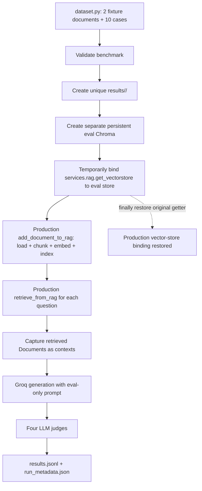

# Phân tích RAG Evaluation

**Ngày khảo sát:** 14-11-2026  
**Phạm vi:** `evaluation/rag_eval/` và các điểm tích hợp RAG hiện có  
**Mục đích:** Ghi lại cấu trúc, cách chạy, dữ liệu, kiểm soát an toàn, kết quả thực tế và các giới hạn của evaluation.

## 1. Tóm tắt

Repository hiện có một evaluation package độc lập tại `evaluation/rag_eval/`. Package dùng benchmark tiếng Việt nhỏ, tự khai báo trong `dataset.py`, đưa hai tài liệu fixture vào một ChromaDB riêng theo từng run, gọi hàm ingestion và retrieval thật của `services/rag.py`, sinh câu trả lời bằng Groq, rồi chấm bốn metric bằng LLM judge.

Điểm cần hiểu đúng về phạm vi “pipeline RAG thật”: ingestion, chunking, embedding, vector store interface và retrieval được tái sử dụng từ dự án. Phần generation hiện gọi Groq trực tiếp với prompt riêng cho eval; target không khởi tạo LangGraph agent, không chạy toàn bộ chatbot flow/tools và không dùng prompt generation của agent production. Vì vậy kết quả đánh giá retrieval + generation theo target eval, chưa phải kiểm thử end-to-end toàn bộ hội thoại chatbot.

Evaluation Chroma được tạo riêng bên dưới `evaluation/rag_eval/results/<run_id>/chroma`. Trong lúc gọi các hàm RAG, `services.rag.get_vectorstore` tạm thời được bind sang store này và được khôi phục trong `finally`. Dataset sync LangSmith, chạy LangSmith và ghi Chroma là các hành động tường minh qua cờ CLI. Local mode tắt LangSmith tracing trong thời gian chạy.

## 2. Bản đồ code liên quan

| Khu vực | File | Vai trò |
|---|---|---|
| Benchmark | `evaluation/rag_eval/dataset.py` | Khai báo 2 tài liệu fixture, 10 câu hỏi, reference answer, supporting documents/evidence, nhãn answerable và metadata; validate dữ liệu; helper đồng bộ LangSmith khi được gọi rõ ràng. |
| Target | `evaluation/rag_eval/target.py` | Tạo run directory; tạo Chroma riêng; tạm bind store eval; nạp tài liệu qua hàm RAG hiện có; gọi retrieval; ghi lại các Document được retrieve; gọi generation client. |
| Retry | `evaluation/rag_eval/retry.py` | Retry lỗi tạm thời, đọc thời gian retry do provider báo và áp trần thời gian chờ. |
| Metric chung | `evaluation/rag_eval/evaluators/common.py` | Pydantic output schemas, khởi tạo judge Groq, structured output, chuyển kết quả sang định dạng LangSmith. |
| Retrieval relevance | `evaluation/rag_eval/evaluators/retrieval.py` | Chấm độ liên quan từng retrieved context với câu hỏi; tổng hợp score. |
| Answer relevance | `evaluation/rag_eval/evaluators/answer.py` | Chấm câu trả lời có giải quyết đúng câu hỏi và phạm vi được hỏi không. |
| Groundedness | `evaluation/rag_eval/evaluators/groundedness.py` | Tách câu trả lời thành factual claims, gán nhãn supported/contradicted/not_found và tính điểm. |
| Correctness | `evaluation/rag_eval/evaluators/correctness.py` | So sánh ngữ nghĩa generated answer với reference answer. |
| Điều phối | `evaluation/rag_eval/runner.py` | Validate-only, local run, tùy chọn sync/run LangSmith, lưu JSONL/metadata và giới hạn số case. |
| Kiểm thử | `evaluation/rag_eval/tests/test_evaluation.py` | Kiểm tra dataset, metric, retry, runner, khôi phục store và cô lập khỏi production store. |
| Hướng dẫn | `evaluation/rag_eval/README.md` | Safety defaults, groundedness formula, lệnh chạy test và mô tả artifacts. |
| RAG production | `services/rag.py` | Embedding, khởi tạo production Chroma, đọc tài liệu, chunking, ingestion, retrieval và thao tác tài liệu. |
| RAG tool | `tools.py` | `search_uploaded_documents()` gọi `retrieve_from_rag()` và cung cấp thread/user context từ chatbot. |
| Agent | `agent.py` | LangGraph agent, model production, tools và MongoDB checkpoint integration. Không được target eval sử dụng trực tiếp. |
| Dependencies | `requirements.txt` | Bao gồm LangChain/Groq, Chroma và LangSmith dependencies. Không có thay đổi cấu hình chatbot được yêu cầu để chạy eval. |

### Luồng production được tái sử dụng

- `services/rag.py:get_embeddings()` khởi tạo embedding model `sentence-transformers/paraphrase-multilingual-MiniLM-L12-v2` trên CPU.
- `services/rag.py:get_vectorstore()` là factory của Chroma production, collection `agentic_chatbot_docs_hf`, persistence path `chroma_db_hf`.
- `_split_documents()` chia chunk với `chunk_size=900`, `chunk_overlap=150`, `add_start_index=True`.
- `add_document_to_rag()` đọc, chia chunk và thêm vào store mà `get_vectorstore()` trả về.
- `retrieve_from_rag(query, thread_id, user_id, k=4)` tìm theo thread; logic hiện tại có fallback tìm theo user khi được cung cấp user ID và không có kết quả theo thread. Hàm trả về chuỗi đã format; eval dùng wrapper trong suốt để lưu lại Document kết quả cho metric.
- `tools.py:search_uploaded_documents()` là điểm gọi retrieval từ tool của chatbot.
- `agent.py` dùng LangGraph và MongoDBSaver; các thành phần này không nằm trong target eval hiện tại.

## 3. Dữ liệu thực tế và khoảng trống

### Nguồn dữ liệu hiện có

| Dữ liệu | Nguồn hiện tại | Schema/ý nghĩa |
|---|---|---|
| Tài liệu cho eval | `RAG_TEST_DOCUMENTS` trong `evaluation/rag_eval/dataset.py` | `document_id`, `filename`, `raw_text`. Hai tài liệu fixture được target ghi thành file tạm trong run rồi nạp qua `add_document_to_rag()`. Chưa có `corpus_v1.jsonl` riêng. |
| Câu hỏi và GT | `RAG_EXAMPLES` trong cùng file | `case_id`, `inputs.question`, `outputs.reference_answer`, `outputs.supporting_documents`, `outputs.supporting_evidence`, `outputs.answerable`, `metadata` (split, language, question_type). |
| Retrieved contexts | Kết quả thực tế từ Chroma eval trong target | Danh sách item gồm `context_id`, `text`, `source`, `page`, `rank`, `document_id`; tạo mới theo từng câu hỏi/run, không lấy từ tập GT. |
| Generated answer | Đầu ra target | `outputs.answer`, sinh bằng Groq dựa trên retrieved contexts và prompt của evaluation. |
| Kết quả metric | Evaluators + runner | Một dòng JSONL cho mỗi case, có metric scores/comments/status và kết quả target; metadata run riêng. |

Benchmark hiện gồm 10 câu hỏi được gắn `split=calibration`, `language=vi`, có loại single-hop/list/yes-no/multi-step/policy/unanswerable. Hai tài liệu là nội dung helpdesk giả lập do benchmark tự khai báo, không phải corpus tài liệu thật của người dùng hay tài liệu đã được domain expert duyệt. GT là hand-authored reference answer và evidence; chưa có nhãn gold độc lập cho retrieval relevance, answer relevance hay groundedness.

### Khoảng trống cần giải quyết trước khi dùng điểm làm căn cứ chất lượng

1. **Tính đại diện:** Fixture helpdesk nhỏ chưa phản ánh domain, độ dài/tạp chất, ngôn ngữ pha trộn và loại câu hỏi thực tế của chatbot.
2. **Rà soát GT:** Reference answer và evidence cần người hiểu nghiệp vụ kiểm tra. Hiện chưa có quy trình adjudication hay người duyệt thứ hai.
3. **Định nghĩa câu hỏi không trả lời được:** `case_010` có reference mô tả thiếu thông tin, nhưng cần xác nhận đây là hành vi mong muốn của sản phẩm, đặc biệt khi retrieval trả context rỗng.
4. **Nhãn retrieval gold:** `supporting_documents`/`supporting_evidence` cung cấp tín hiệu đánh giá thủ công, nhưng evaluator hiện chấm LLM context-level và không tính recall/precision trực tiếp trên nhãn supporting docs.
5. **Tách calibration/test:** 10 case hiện đều mang nhãn calibration. Chưa có tập holdout để đo sau khi điều chỉnh prompt/model.
6. **Lỗi judge:** Run đầy đủ gần nhất có hai lỗi groundedness; mean metric tương ứng chỉ tính trên các case chấm được. Cần báo cáo số mẫu hợp lệ và số lỗi cùng điểm trung bình.
7. **Reproducibility:** Cần lưu rõ model/version thực tế, cấu hình embedding, prompt revision, dataset fingerprint và package versions trong metadata để so sánh run chính xác hơn.

## 4. Sơ đồ evaluation pipeline



Local evaluation không sync dataset LangSmith và không phụ thuộc MongoDB checkpoint. LangSmith tracing bị tắt trong local runner. Chroma eval và kết quả nằm trong run directory riêng, không ghi đè dữ liệu benchmark hoặc artifacts run trước.

## 5. Metric và hợp đồng dữ liệu

Tất cả scalar metrics dùng thang **0–4**. Judge cần trả lý do ngắn và evidence; input được đóng gói như dữ liệu không đáng tin cậy để prompt yêu cầu bỏ qua chỉ dẫn bên trong câu hỏi/context/answer.

### 5.1 Retrieval Relevance

- **Input:** `question` và danh sách retrieved contexts, mỗi context có ID, text, rank và metadata nguồn nếu có.
- **Rubric:** 0 không liên quan; 1 chỉ liên quan rất ít; 2 liên quan một phần; 3 liên quan tốt nhưng thiếu một khía cạnh; 4 trực tiếp hữu ích để trả lời.
- **Cách tổng hợp hiện tại:** Judge cho điểm từng context; aggregate là trung bình điểm contexts. Khi không có context, trả trạng thái thiếu dữ liệu thay vì cho điểm trung bình giả.
- **Output chính:** điểm theo context (context ID, score, reason, evidence), aggregate score, reason/status.
- **Thiếu dữ liệu:** Không có câu hỏi hoặc thiếu trường contexts thì `missing_input`/score null; retrieval rỗng (`contexts = []`) thì trả score 0.0 (`status: "scored"`) vì không có ngữ cảnh nào được truy xuất để cung cấp bằng chứng. Nếu judge lỗi hoặc bỏ sót context, metric ghi nhận `status: "partial"` hoặc `status: "error"` chứ không tự biến lỗi judge thành score 0.

### 5.2 Answer Relevance

- **Input:** `question` và generated `answer`; không dùng reference answer để tránh trộn với correctness.
- **Rubric:** 0 lạc đề/không trả lời; 1 chỉ chạm một phần nhỏ; 2 trả lời một phần; 3 trả lời trực tiếp còn thiếu ý đáng kể; 4 trả lời trực tiếp và đủ phạm vi.
- **Output chính:** `score` 0–4, `reason`, `evidence` ngắn, `status`.
- **Thiếu dữ liệu:** Answer rỗng được chấm là không có câu trả lời theo rubric (score 0 nếu judge trả hợp lệ); input question thiếu hoặc judge lỗi thì status invalid/error, không tạo điểm hợp lệ.

### 5.3 Groundedness / Faithfulness

- **Input:** generated answer và toàn bộ retrieved contexts. Judge chia answer thành factual claims nguyên tử; mỗi claim nhận một nhãn: `supported`, `contradicted`, hoặc `not_found`, kèm context IDs và trích dẫn ngắn làm bằng chứng.
- **Rubric nhãn:** `supported` nếu context trực tiếp hỗ trợ/entails claim; `contradicted` nếu context mâu thuẫn claim; `not_found` nếu context không hỗ trợ cũng không bác bỏ claim. Không dùng kiến thức ngoài context.
- **Công thức:** Với `S`, `C`, `U` lần lượt là số claim supported, contradicted và not_found:

  `score_0_to_4 = round(4 * S / (S + C + U), 2)`

  `normalized_score = score_0_to_4 / 4`

  Contradicted và not_found đều đóng góp 0 vào tử số. Nếu không có factual claim thì mẫu số 0; output là `status=no_claims`, `score=null`, không quy đổi thành 4.
- **Output chính:** danh sách claims (claim, label, context_ids, evidence), bộ đếm theo nhãn, `score`, `normalized_score`, `reason`, `status`.
- **Thiếu dữ liệu:** Context rỗng nhưng answer có claim thì các claim được xem là not_found nếu judge có thể chấm; answer rỗng/no claims trả `no_claims`; judge/schema error trả `error` và score null.

### 5.4 Correctness

- **Input:** question, generated answer, reference answer.
- **Rubric:** 0 sai đáng kể/mâu thuẫn; 1 chỉ đúng một phần nhỏ; 2 đúng một phần nhưng có thiếu sót/lỗi quan trọng; 3 phần lớn đúng, thiếu nhỏ; 4 đúng về ngữ nghĩa và đủ các ý chính. Chấp nhận cách diễn đạt khác.
- **Output chính:** `score` 0–4, `reason`, `evidence` ngắn từ answer/reference, `status`.
- **Thiếu dữ liệu:** Không có reference thì `missing_reference`/score null; không đánh đồng với 0. Answer rỗng có thể nhận 0 nếu reference tồn tại và judge chấm thành công. Judge lỗi thì status error.

### JSON mẫu cho kết quả một case

Ví dụ minh họa hợp đồng mong muốn, không phải bản sao nguyên văn một dòng artifact:

```json
{
  "case_id": "case_001",
  "inputs": {"question": "Yêu cầu ưu tiên được phản hồi trong bao lâu?"},
  "outputs": {
    "answer": "Trong vòng tám giờ làm việc.",
    "contexts": [
      {
        "context_id": "eval_manual:1:1",
        "text": "Yêu cầu ưu tiên được phản hồi trong vòng tám giờ làm việc.",
        "source": "evaluation_manual.txt",
        "page": 1,
        "rank": 1,
        "document_id": "eval_manual"
      }
    ]
  },
  "reference": {
    "reference_answer": "Yêu cầu ưu tiên được phản hồi trong vòng tám giờ làm việc.",
    "supporting_documents": ["eval_manual"],
    "supporting_evidence": ["tám giờ làm việc"],
    "answerable": true
  },
  "evaluations": {
    "retrieval_relevance": {"score": 4.0, "status": "scored", "contexts": [{"context_id": "eval_manual:1:1", "score": 4, "reason": "...", "evidence": ["..."]}]},
    "answer_relevance": {"score": 4, "status": "scored", "reason": "...", "evidence": ["..."]},
    "groundedness": {"score": 4.0, "normalized_score": 1.0, "status": "scored", "counts": {"supported": 1, "contradicted": 0, "not_found": 0}, "claims": [{"claim": "Thời hạn là tám giờ làm việc", "label": "supported", "context_ids": ["eval_manual:1:1"], "evidence": ["tám giờ làm việc"]}]},
    "correctness": {"score": 4, "status": "scored", "reason": "...", "evidence": ["..."]}
  }
}
```

Runner thực tế ghi `results.jsonl` và `run_metadata.json` bên trong thư mục run. Trường lồng nhau có thể được tuần tự hóa theo định dạng trả về evaluator; schema trên mô tả các trường cần đọc và không khẳng định mỗi chi tiết là khóa cấp cao nhất hiện có trong artifact.

## 6. Cô lập, lỗi và giới hạn chi phí

- Mỗi run cần `run_id` duy nhất; helper từ chối dùng lại thư mục đã tồn tại.
- Chroma persistence path bị giới hạn dưới `evaluation/rag_eval/results/`; collection có tên riêng theo run.
- `use_eval_vectorstore()` tạm thay factory trong module `services.rag`; khôi phục factory gốc trong `finally`, kể cả khi ingestion/retrieval/generation phát sinh exception. Do monkeypatch theo process, các run phải chạy tuần tự trong cùng process.
- Unit tests dùng fake store để xác nhận `add_documents` và `similarity_search` đi vào eval binding, factory được khôi phục sau lỗi, và không gọi production store.
- Không gọi MongoDB checkpoint vì target không xây LangGraph agent.
- Không sync LangSmith trừ khi dùng `--sync-langsmith`; LangSmith evaluation là cờ riêng. `--validate-only` chỉ validate benchmark. Local model run đòi cờ `--run-eval --allow-eval-chroma-write`.
- Dataset 10 case, hard cap 20 case/run; generation cap mặc định 512 tokens, judge cap mặc định 700 tokens. Retry tối đa 4 lần, tôn trọng retry-after nhưng chờ không quá 30 giây.
- Hạn chế chi phí hiện tại dựa trên cap số case/token và explicit execution flags; chưa có ngân sách USD/token toàn run hoặc ước tính chi phí trước chạy. Retry nhiều lần có thể tăng latency/chi phí.
- Kết quả metric lỗi phải được xem là missing/error, không phải zero; aggregate báo cả coverage/số case hợp lệ để tránh điểm trung bình gây hiểu nhầm.

## 7. Thay đổi và file trong phạm vi eval

Các file implementation của evaluation hiện nằm trong `evaluation/rag_eval/`:

- `__init__.py`, `dataset.py`, `target.py`, `retry.py`, `runner.py`, `README.md`
- `evaluators/__init__.py`, `evaluators/common.py`, `evaluators/retrieval.py`, `evaluators/answer.py`, `evaluators/groundedness.py`, `evaluators/correctness.py`
- `tests/__init__.py`, `tests/test_evaluation.py`
- `results/.gitignore`, `results/.gitkeep`, cùng các thư mục run/artifact đã tạo khi kiểm chứng.

Trong lần lập báo cáo này chỉ tạo mới file research hiện tại; không chỉnh các file implementation, chatbot, cấu hình hay dữ liệu hiện hữu.

## 8. Kiểm chứng đã chạy và kết quả quan sát được

### Kiểm thử

- `python -B -m unittest discover -s evaluation\rag_eval\tests -v`: **17/17 test pass** sau thay đổi retry và suppress tracing.
- `python -B -m evaluation.rag_eval.runner --validate-only`: validate thành công **10 cases và 2 documents**.
- AST syntax parse: **13 Python files** parse thành công.
- Không tuyên bố suite kiểm thử fake tương đương với xác minh toàn bộ chatbot production.

### Các run Chroma eval đã phát sinh

| Run ID | Kết quả xác minh |
|---|---|
| `20261114T094601Z-929139ce` | Tạo được Chroma eval trống, sau đó lỗi validation do fixture `raw_text` bị khai báo thành tuple. Đây là run lỗi, không dùng kết luận metric. |
| `20261114T094738Z-6855595f` | Sau sửa fixture, ingestion eval Chroma chạy được; gọi Groq bị chặn outbound trong sandbox, nên 10 target case không sinh answer. Lần chạy này còn phát sinh nỗ lực LangSmith auto-tracing do env tracing kế thừa; request không thành công. Local runner sau đó được cập nhật để suppress tracing trong local mode và restore env. |
| `20261114T101028Z-1a575f96` | Kết nối provider được cho phép; run có 6 case hoàn thành, 6 answers và 12 contexts trước khi dừng do lỗi rate limit/TPM lặp lại. Đây là kết quả partial. |
| `20261114T101437Z-72da1316` | Run đầy đủ 10 case; xác minh 10 answers và 20 contexts được tạo. Eval Chroma persisted riêng. Không có xác nhận sync LangSmith; local tracing đã bị tắt trong run này. Retrieval: 10/10 scored, mean **1.95/4**. Answer relevance: 10/10, mean **4.0/4**. Groundedness: 8/10 scored, mean **3.5/4**, 2 judge errors. Correctness: 10/10, mean **3.8/4**. |

Ở run cuối, lỗi groundedness ghi nhận cho `case_003` là structured-output/JSON BadRequest; `case_009` gặp Groq 429 dù đã retry. Mean Groundedness vì vậy chỉ dựa trên 8 mẫu thành công. Chưa có human review/calibration để xem các mean scores là ground truth. Retrieval mean thấp cần được điều tra thủ công trên câu hỏi, context, GT và rank trước khi kết luận retrieval production có vấn đề.

Không có lần ghi dữ liệu production Chroma hoặc MongoDB được xác nhận. Các test isolation và eval routing hướng dữ liệu vào store eval; không có LangGraph/checkpoint path trong target. Dataset không được chủ động sync LangSmith trong các lệnh local cuối.

## 9. Đề xuất công việc tiếp theo

1. Duyệt nội dung fixture/reference answer và thêm người domain review cho benchmark; sửa/duyệt benchmark chỉ trong `evaluation/rag_eval/dataset.py` nếu được giao.
2. Điều tra từng case retrieval score thấp bằng retrieved contexts/rank và supporting evidence; giữ việc này ở mức phân tích trước khi cân nhắc thay RAG production.
3. Lưu trạng thái từng metric, số lỗi và số mẫu hợp lệ trong artifact để aggregate không bỏ qua coverage.
4. Cải thiện khả năng xử lý lỗi JSON/schema và rate limits trong evaluator; đặt ngân sách run và log token/attempts nếu provider hỗ trợ metadata mà không làm lộ thông tin nhạy cảm.
5. Đánh giá độ ổn định judge trên một tập con cố định bằng nhiều lần chấm, so sánh cùng model/prompt và kiểm tra agreement với người chấm. Báo mean/median, độ lệch, tỷ lệ bất đồng và interval; không chỉ chọn kết quả thuận lợi.
6. Đánh giá chất lượng rubric bằng mẫu có score anchor do người đánh giá gán; đo agreement theo metric, phân tích lỗi theo loại câu hỏi/ngôn ngữ, rồi mới mở rộng vượt 10–20 case.
7. Khi cần đánh giá đúng production generation, đề xuất trước thiết kế adapter cho prompt/agent production và phân tích rủi ro side effect. Hiện target intentionally không tích hợp agent/Mongo checkpoint; không nên tự ý mở rộng ra ngoài eval.

## 10. Thay đổi ngoài eval có thể cần thiết

**Hiện tại không cần thay đổi ngoài `evaluation/rag_eval/` để chạy target như đang thiết kế.** Các thay đổi dưới đây chỉ là khả năng cho các yêu cầu đánh giá nâng cao, và phải xin phê duyệt rõ trước khi đụng tới:

- Muốn target gọi chính xác generation prompt/logic của LangGraph production có thể cần một interface/entry point trong `agent.py` hoặc `tools.py`. Khi đó phải xem xét checkpoint, session/thread state, tool side effects và nguy cơ ghi MongoDB; không nên giả lập bằng cách tự gọi agent có state.
- Muốn đánh giá bằng documents thật của người dùng cần có nguồn export an toàn, quyền truy cập và quy tắc ẩn danh; không nên đọc trực tiếp production Chroma bằng evaluation.
- Muốn kiểm tra nội dung Unicode của fixture hoặc production parsing nếu phát hiện encoding issue cần khảo sát file encoding gốc trước. Terminal output có thể làm sai hiển thị, vì vậy chưa kết luận source fixture bị hỏng chỉ từ output console.
- Nếu dependencies hiện tại không cung cấp API cần thiết có thể phải thay đổi `requirements.txt`; trước tiên nên kiểm tra khả năng tái sử dụng thư viện đã cài, và mọi sửa ngoài eval cần xin duyệt.

Không có mục nào trong phần này được xem là sự cho phép sửa code ngoài evaluation.
