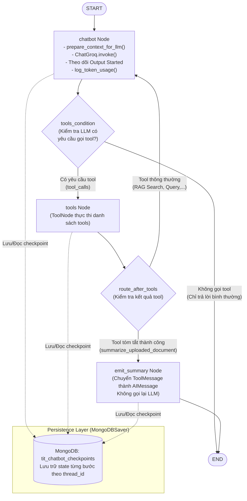

# KIẾN TRÚC & TOÀN BỘ CƠ CHẾ HOẠT ĐỘNG TRONG AGENT.PY

Tài liệu này phân tích chi tiết, toàn diện về mặt kiến trúc, luồng xử lý, các giải pháp kỹ thuật tối ưu và từng khối mã nguồn bên trong [agent.py](file:///d:/Tit-Chatbot/agent.py) - trung tâm điều phối (Core Orchestration Engine) của hệ thống **Tit-Chatbot**.

---

## MỤC LỤC
1. [Tổng Quan & Vai Trò Của agent.py](#1-tổng-quan--vai-trò-của-agentpy)
2. [Sơ Đồ Đồ Thị Hoạt Động (StateGraph Execution Flow)](#2-sơ-đồ-đồ-thị-hoạt-động-stategraph-execution-flow)
3. [Cơ Chế 1: Quản Trị Trạng Thái Hội Thoại (AgentState & Message Reducer)](#3-cơ-chế-1-quản-trị-trạng-thái-hội-thoại-agentstate--message-reducer)
4. [Cơ Chế 2: Vòng Đời Đồ Thị Trạng Thái (StateGraph Construction & Routing)](#4-cơ-chế-2-vòng-đời-đồ-thị-trạng-thái-stategraph-construction--routing)
5. [Cơ Chế 3: Tối Ưu Hóa Phản Hồi Tóm Tắt Trực Tiếp (Direct Summary Return)](#5-cơ-chế-3-tối-ưu-hóa-phản-hồi-tóm-tắt-trực-tiếp-direct-summary-return)
6. [Cơ Chế 4: Quản Lý & Tối Ưu Ngữ Cảnh Token (Context & Pruning Management)](#6-cơ-chế-4-quản-lý--tối-ưu-ngữ-cảnh-token-context--pruning-management)
7. [Cơ Chế 5: Chống Lặp Token Khi Stream & Tự Động Thử Lại (Output Tracker & Rate Limit Retry)](#7-cơ-chế-5-chống-lặp-token-khi-stream--tự-động-thử-lại-output-tracker--rate-limit-retry)
8. [Cơ Chế 6: Giám Sát & Thống Kê Chi Phí Token (Usage Logging)](#8-cơ-chế-6-giám-sát--thống-kê-chi-phí-token-usage-logging)
9. [Cơ Chế 7: Bộ Nhớ Trạng Thái Phân Tán (Distributed Persistence với MongoDBSaver)](#9-cơ-chế-7-bộ-nhớ-trạng-thái-phân-tán-distributed-persistence-với-mongodbsaver)
10. [Cơ Chế 8: Chuẩn Hóa & Cơ Chế Dự Phòng Mô Hình (Model Normalization & Fallback)](#10-cơ-chế-8-chuẩn-hóa--cơ-chế-dự-phòng-mô-hình-model-normalization--fallback)
11. [Cơ Chế 9: Khởi Tạo Theo Mẫu Singleton & Cache (Agent Lifecycle Caching)](#11-cơ-chế-9-khởi-tạo-theo-mẫu-singleton--cache-agent-lifecycle-caching)
12. [Cơ Chế 10: Xử Lý Bảo Mật Môi Trường & Chứng Chỉ SSL (Environment & SSL Handling)](#12-cơ-chế-10-xử-lý-bảo-mật-môi-trường--chứng-chỉ-ssl-environment--ssl-handling)
13. [Bảng Tra Cứu Vị Trí Code Chi Tiết (Code Reference Map)](#13-bảng-tra-cứu-vị-trí-code-chi-tiết-code-reference-map)

---

## 1. TỔNG QUAN & VAI TRÒ CỦA AGENT.PY

Trong kiến trúc tổng thể của Tit-Chatbot:
* **Tầng Giao tiếp (Frontend):** Gửi yêu cầu qua SSE (`/api/chat/stream`).
* **Tầng Định tuyến (API Layer):** `api/chat.py` tiếp nhận request, trích xuất thông tin người dùng và session.
* **Tầng Điều phối Cốt lõi (agent.py):** Là nơi quyết định:
  - Mô hình ngôn ngữ lớn (LLM - thông qua Groq Cloud) nào được gọi.
  - Khi nào LLM cần gọi công cụ ngoại vi (Tools / Function Calling) như tìm kiếm tài liệu (RAG), truy vấn thông tin, hay tóm tắt văn bản.
  - Cách thức lưu giữ và phục hồi trạng thái hội thoại nhiều lượt (Multi-turn conversations) thông qua MongoDB Checkpoints.
  - Xử lý các rào cản kỹ thuật thực tế: Giới hạn tần suất gọi API (Rate Limit), nghẽn Token per Minute (TPM), lỗi đứt kết nối mạng giữa chừng, và khóa file SSL.

---

## 2. SƠ ĐỒ ĐỒ THỊ HOẠT ĐỘNG (STATEGRAPH EXECUTION FLOW)

Đồ thị điều phối hội thoại trong `agent.py` được xây dựng bằng **LangGraph**, gồm 3 Nodes và 2 Conditional Edges (cạnh rẽ nhánh có điều kiện):



---

## 3. CƠ CHẾ 1: QUẢN TRỊ TRẠNG THÁI HỘI THOẠI (AGENTSTATE & MESSAGE REDUCER)

* **Vị trí code:** [agent.py dòng 33-42](file:///d:/Tit-Chatbot/agent.py#L33-L42)

```python
class AgentState(TypedDict, total=False):
    messages: Annotated[list[BaseMessage], add_messages]
    conversation_summary: str
```

### Chi tiết kỹ thuật:
1. **`messages: Annotated[list[BaseMessage], add_messages]`**:
   - Sử dụng cơ chế **Reducer** `add_messages` chuẩn của LangGraph.
   - Khi một node trả về `{"messages": [new_message]}`, LangGraph không ghi đè toàn bộ mảng mà sẽ tự động ghép nối (append) tin nhắn mới vào danh sách hiện tại.
   - Nếu `new_message` có cùng `id` với một tin nhắn đã có trong danh sách, LangGraph sẽ cập nhật tin nhắn đó (upsert).
2. **`conversation_summary: str`**:
   - Lưu trữ bản tóm tắt tích lũy của cuộc trò chuyện trong trường hợp ngữ cảnh vượt quá độ dài tối đa cho phép.
   - Giúp mô hình duy trì trí nhớ về các trao đổi lâu đời mà không làm bùng nổ số lượng token cần nạp vào Prompt.

---

## 4. CƠ CHẾ 2: VÒNG ĐỜI ĐỒ THỊ TRẠNG THÁI (STATEGRAPH CONSTRUCTION & ROUTING)

* **Vị trí code:** [agent.py dòng 146-245](file:///d:/Tit-Chatbot/agent.py#L146-L245) trong hàm `build_agent()`

### Các bước biên dịch Agent:
1. **Khởi tạo ChatGroq:**
   ```python
   llm = ChatGroq(
       model=selected_model,
       temperature=0.3,   # Ưu tiên tính chuẩn xác, tránh ảo giác
       streaming=True      # Bật stream token về SSE handler
   )
   ```
2. **Ràng buộc công cụ (Bind Tools):**
   ```python
   llm_with_tools = llm.bind_tools(tools)
   ```
   Chuyển đổi danh sách hàm Python khai báo trong `tools/` thành định dạng JSON Schema mà mô hình hỗ trợ Function Calling (như `gpt-oss-20b`, `qwen3.8-27b`) hiểu được.
3. **Đăng ký Nodes:**
   - `"chatbot"`: Tiếp nhận ngữ cảnh, gọi LLM.
   - `"tools"`: Node `ToolNode(tools)` chuyên trách thực thi các hàm tool khi LLM sinh lệnh `tool_calls`.
   - `"emit_summary"`: Node đặc biệt xử lý tối ưu tóm tắt.
4. **Thiết lập luồng rẽ nhánh (Conditional Edges):**
   - Từ `START` dẫn trực tiếp vào `"chatbot"`.
   - Từ `"chatbot"` sử dụng hàm điều kiện chuẩn `tools_condition`: Nếu LLM trả về tin nhắn có trường `tool_calls`, luồng sẽ chuyển sang `"tools"`. Ngược lại, kết thúc (`END`).
   - Từ `"tools"` sử dụng bộ định tuyến tùy biến `route_after_tools` để quyết định quay lại `"chatbot"` hay đi thẳng sang `"emit_summary"`.

---

## 5. CƠ CHẾ 3: TỐI ƯU HÓA PHẢN HỒI TÓM TẮT TRỰC TIẾP (DIRECT SUMMARY RETURN)

* **Vị trí code:** [agent.py dòng 70-103](file:///d:/Tit-Chatbot/agent.py#L70-L103)

### Vấn đề thực tế (Problem):
Theo chu trình chuẩn của LangGraph / ReAct Agent:
$$\text{User} \xrightarrow{} \text{chatbot} \xrightarrow{\text{call tool}} \text{tools} \xrightarrow{\text{tool result}} \text{chatbot} \xrightarrow{\text{final answer}} \text{User}$$
Khi người dùng tải lên tài liệu và yêu cầu tóm tắt:
1. LLM gọi tool `summarize_uploaded_document`.
2. Tool này phân tích tài liệu và sinh ra văn bản tóm tắt rất chi tiết (khoảng 1.000 đến 3.000 từ, tương đương 2.000 - 5.000 tokens).
3. Kết quả đó được đặt vào `ToolMessage` và đưa lại node `chatbot`.
4. Node `chatbot` lại gọi LLM lần thứ 2 **chỉ để chép lại (echo/paraphrase) nguyên văn bản tóm tắt đó** cho người dùng.

> [!WARNING]
> Việc gọi LLM vòng 2 này làm lãng phí khoảng **3.000 - 5.000 tokens TPM** (Tokens Per Minute của gói Groq API) và khiến người dùng phải chờ thêm **3 - 6 giây** hoàn toàn vô ích!

### Giải pháp kỹ thuật (Solution):
`agent.py` thiết kế cơ chế Bypass thông minh thông qua biến `SUMMARY_DIRECT_RETURN`, hàm định tuyến `route_after_tools` và node `emit_summary_node`:

```python
SUMMARY_DIRECT_RETURN = os.getenv("SUMMARY_DIRECT_RETURN", "1").lower() not in ("0", "false", "no")
SUMMARY_TOOL_NAME = "summarize_uploaded_document"

def route_after_tools(state: AgentState) -> str:
    if not SUMMARY_DIRECT_RETURN:
        return "chatbot"
    recent: list[ToolMessage] = []
    for msg in reversed(state.get("messages", [])):
        if not isinstance(msg, ToolMessage):
            break
        recent.append(msg)
    if (
        len(recent) == 1
        and getattr(recent[0], "name", None) == SUMMARY_TOOL_NAME
        and isinstance(recent[0].content, str)
        and (
            recent[0].content.startswith(SUMMARY_RESULT_PREFIX)
            or recent[0].content.startswith(SUMMARY_RESULT_PREFIX_VI)
        )
    ):
        return "emit_summary"
    return "chatbot"

def emit_summary_node(state: AgentState) -> dict[str, list[AIMessage]]:
    # Chuyển trực tiếp nội dung ToolMessage thành AIMessage mà không cần gọi LLM
    return {"messages": [AIMessage(content=str(state["messages"][-1].content))]}
```

### Lợi ích:
* Tiết kiệm **100% token** của lượt gọi LLM thứ 2.
* Phản hồi người dùng xuất hiện **ngay lập tức** sau khi tóm tắt xong.
* Lịch sử hội thoại vẫn lưu tin nhắn này dưới dạng `AIMessage`, giúp các câu hỏi tiếp theo của người dùng vẫn có đầy đủ ngữ cảnh để tra cứu.

---

## 6. CƠ CHẾ 4: QUẢN LÝ & TỐI ƯU NGỮ CẢNH TOKEN (CONTEXT & PRUNING MANAGEMENT)

* **Vị trí code:** [agent.py dòng 174-188](file:///d:/Tit-Chatbot/agent.py#L174-L188)

Trước khi thực hiện `llm_with_tools.invoke()`, `chatbot_node` kích hoạt cơ chế chuẩn bị ngữ cảnh:

```python
final_messages, updated_summary = prepare_context_for_llm(
    messages=state.get("messages", []),
    system_prompt=SYSTEM_PROMPT,
    tools=tools,
    existing_summary=existing_summary,
    model_name=selected_model,
)
```

### Trách nhiệm của bước này:
1. **Lược bỏ Tool Output cũ (Tool Output Pruning):** Trong các lượt hội thoại trước, những kết quả tìm kiếm RAG hoặc dữ liệu thô từ các tool không còn giá trị ở lượt chat hiện tại sẽ được loại bỏ hoặc rút gọn để tiết kiệm không gian context.
2. **Kiểm soát Ngân sách Token (Token Budgeting):** Cắt tỉa lịch sử theo ngân sách token tối đa của từng mô hình (tránh lỗi vượt quá 8k/32k/128k context window).
3. **Đồng bộ System Prompt:** Luôn đảm bảo `SYSTEM_PROMPT` nằm ở đầu danh sách tin nhắn gửi sang LLM.

---

## 7. CƠ CHẾ 5: CHỐNG LẶP TOKEN KHI STREAM & TỰ ĐỘNG THỬ LẠI (OUTPUT TRACKER & RATE LIMIT RETRY)

* **Vị trí code:** [agent.py dòng 44-53](file:///d:/Tit-Chatbot/agent.py#L44-L53) và [dòng 189-198](file:///d:/Tit-Chatbot/agent.py#L189-L198)

### Vấn đề (The Race Condition Problem):
Hệ thống sử dụng Server-Sent Events (SSE) để stream câu trả lời theo thời gian thực tới trình duyệt của người dùng.
Nếu đang stream giữa chừng (người dùng đã nhìn thấy các chữ đầu tiên trên màn hình) mà API Groq gặp sự cố mạng hoặc chạm Rate Limit:
* Nếu hệ thống tự động **Retry (thử lại từ đầu)**: LLM sẽ sinh ra một câu trả lời hoàn toàn mới từ đầu, dẫn đến việc chữ mới bị ghép đè hoặc lặp lại câu từ trên giao diện, tạo ra trải nghiệm người dùng rất xấu và gây sai lệch nội dung.

### Giải pháp kỹ thuật:
`agent.py` sử dụng một Callback Handler chuyên trách:

```python
class _OutputStartedTracker(BaseCallbackHandler):
    """Theo dõi xem LLM đã phát token nào ra ngoài chưa."""
    def __init__(self) -> None:
        self.output_started = False

    def on_llm_new_token(self, token: str, **kwargs: Any) -> None:
        if token:
            self.output_started = True
```

Và tích hợp vào cơ chế gọi LLM có kiểm tra:

```python
output_tracker = _OutputStartedTracker()
response = invoke_with_rate_limit_retry(
    lambda: llm_with_tools.invoke(
        final_messages,
        config={"callbacks": [output_tracker]},
    ),
    max_retries=CHAT_RATE_LIMIT_MAX_RETRIES,
    operation=f"Chatbot ({selected_model})",
    can_retry=lambda: not output_tracker.output_started,  # Chỉ retry khi CHƯA có token nào phát ra
)
```

### Nguyên lý hoạt động:
* Nếu lỗi xảy ra **trước khi** sinh ra token nào: `can_retry()` trả về `True` $\rightarrow$ Tiến hành retry theo thuật toán Exponential Backoff.
* Nếu lỗi xảy ra **sau khi** đã stream ít nhất 1 token: `can_retry()` trả về `False` $\rightarrow$ Dừng ngay lập tức, không retry để tránh làm hỏng luồng hiển thị trên frontend.

---

## 8. CƠ CHẾ 6: GIÁM SÁT & THỐNG KÊ CHI PHÍ TOKEN (USAGE LOGGING)

* **Vị trí code:** [agent.py dòng 200-201](file:///d:/Tit-Chatbot/agent.py#L200-L201)

```python
task_desc = "Tool Call Request" if getattr(response, "tool_calls", None) else "Chatbot Answer"
log_token_usage(selected_model, task_desc, response)
```

### Chức năng:
* Phân loại chính xác mục đích của lượt gọi LLM:
  - `"Tool Call Request"`: Lượt gọi mà LLM quyết định sinh lệnh kích hoạt công cụ.
  - `"Chatbot Answer"`: Lượt gọi mà LLM sinh câu trả lời trực tiếp cho người dùng.
* Trích xuất thông tin `usage_metadata` (bao gồm `prompt_tokens`, `completion_tokens`, `total_tokens`) từ đối tượng phản hồi của Groq và ghi vào hệ thống log để quản trị viên theo dõi mức tiêu thụ chi phí.

---

## 9. CƠ CHẾ 7: BỘ NHỚ TRẠNG THÁI PHÂN TÁN (DISTRIBUTED PERSISTENCE VỚI MONGODBSAVER)

* **Vị trí code:** [agent.py dòng 55-68](file:///d:/Tit-Chatbot/agent.py#L55-L68) và [dòng 231-244](file:///d:/Tit-Chatbot/agent.py#L231-L244)

### So sánh kiến trúc:

| Tiêu Chí | In-Memory Checkpointer (`MemorySaver`) | Distributed Checkpointer (`MongoDBSaver`) |
| :--- | :--- | :--- |
| **Lưu trữ** | RAM của tiến trình Python | Collection trong cơ sở dữ liệu MongoDB |
| **Khi khởi động lại Server** | Toàn bộ trạng thái phiên chat bị mất | Dữ liệu được bảo toàn vĩnh viễn |
| **Khả năng Scale-out** | Chỉ chạy được 1 worker đơn lẻ | Hỗ trợ nhiều worker/node chạy song song |
| **Quản lý dữ liệu** | Khó dọn dẹp | Dễ dàng truy vấn, backup hoặc xóa theo thread |

### Cài đặt trong `agent.py`:
1. **Tách biệt Database Checkpoint:**
   Checkpoint được lưu trong database riêng biệt `tit_chatbot_checkpoints` (cấu hình qua biến môi trường `MONGODB_CHECKPOINT_DB`), tách biệt khỏi cơ sở dữ liệu chính để không làm phân mảnh collection nghiệp vụ.
2. **Dọn dẹp Checkpoint người dùng (`delete_user_checkpoints`):**
   ```python
   def delete_user_checkpoints(thread_ids: Iterable[str]) -> int:
       """Xóa toàn bộ checkpoint LangGraph khi người dùng xóa tài khoản hoặc xóa thread."""
       unique_thread_ids = dict.fromkeys(thread_id for thread_id in thread_ids if thread_id)
       if not unique_thread_ids:
           return 0
       checkpointer = MongoDBSaver(
           client=get_client(),
           db_name=os.getenv("MONGODB_CHECKPOINT_DB", "tit_chatbot_checkpoints"),
       )
       for thread_id in unique_thread_ids:
           checkpointer.delete_thread(thread_id)
       return len(unique_thread_ids)
   ```
   Hàm này đảm bảo khi người dùng yêu cầu xóa dữ liệu cá nhân (GDPR compliance), toàn bộ dấu vết lịch sử trong LangGraph checkpoints cũng được dọn sạch.

---

## 10. CƠ CHẾ 8: CHUẨN HÓA & CƠ CHẾ DỰ PHÒNG MÔ HÌNH (MODEL NORMALIZATION & FALLBACK)

* **Vị trí code:** [agent.py dòng 107-141](file:///d:/Tit-Chatbot/agent.py#L107-L141)

```python
DEFAULT_MODEL = os.getenv("GROQ_MODEL", "openai/gpt-oss-20b")
ALLOWED_MODELS = {
    "openai/gpt-oss-20b",
    "qwen/qwen3.8-27b",
    "openai/gpt-oss-120b",
}

def normalize_model_name(model_name: str | None) -> str:
    if not model_name:
        return DEFAULT_MODEL
    model_name = model_name.strip()
    if model_name not in ALLOWED_MODELS:
        return DEFAULT_MODEL
    return model_name
```

### Tác dụng:
* **Bảo vệ hệ thống (Whitelisting):** Chỉ cho phép các mô hình đã được kiểm thử về khả năng hỗ trợ gọi công cụ (tool calling) và hiệu năng ổn định.
* **Tự động phòng vệ (Graceful Fallback):** Nếu frontend gửi lên giá trị `null`, rỗng, hoặc model không tồn tại (do client cũ chưa cập nhật), hệ thống tự động đưa về `DEFAULT_MODEL` thay vì ném lỗi `500 Internal Server Error`.

---

## 11. CƠ CHẾ 9: KHỞI TẠO THEO MẪU SINGLETON & CACHE (AGENT LIFECYCLE CACHING)

* **Vị trí code:** [agent.py dòng 248-268](file:///d:/Tit-Chatbot/agent.py#L248-L268)

Việc khởi tạo một agent gồm nhiều bước nặng nề:
* Kết nối Groq API và khởi tạo metadata `ChatGroq`.
* Khai báo Schema và bind công cụ `bind_tools`.
* Xây dựng đồ thị `StateGraph` và thiết lập các edge.
* Kết nối `MongoDBSaver` và biên dịch (`compile()`) đồ thị.

Nếu mỗi tin nhắn của người dùng lại gọi `build_agent()` một lần thì độ trễ sẽ tăng cao và lãng phí tài nguyên CPU/RAM.

```python
_AGENT_CACHE: dict[str, Any] = {}

def get_agent(model_name: str | None = None) -> Any:
    selected_model = normalize_model_name(model_name)
    if selected_model not in _AGENT_CACHE:
        _AGENT_CACHE[selected_model] = build_agent(selected_model)
    return _AGENT_CACHE[selected_model]
```

### Cơ chế Factory & Cache:
* Mỗi model chỉ được compile đúng **1 lần duy nhất** trong suốt vòng đời của ứng dụng.
* Các request tiếp theo chỉ cần lấy đối tượng đã biên dịch từ `_AGENT_CACHE` để thực thi, đảm bảo tốc độ phản hồi nhanh nhất.

---

## 12. CƠ CHẾ 10: XỬ LÝ BẢO MẬT MÔI TRƯỜNG & CHỨNG CHỈ SSL (ENVIRONMENT & SSL HANDLING)

* **Vị trí code:** [agent.py dòng 6-13](file:///d:/Tit-Chatbot/agent.py#L6-L13)

```python
from dotenv import load_dotenv
import certifi

load_dotenv()

os.environ["SSL_CERT_FILE"] = certifi.where()
os.environ["REQUESTS_CA_BUNDLE"] = certifi.where()
```

### Mục đích:
* Trên một số môi trường Windows Server hoặc các máy trạm có tường lửa/antivirus can thiệp vào gói tin HTTPS, thư viện SSL mặc định của hệ điều hành có thể báo lỗi `SSLCertVerificationError` khi Python kết nối ra ngoài (Groq API, HuggingFace, MongoDB Atlas).
* Việc trỏ trực tiếp biến môi sinh `SSL_CERT_FILE` và `REQUESTS_CA_BUNDLE` vào gói chứng chỉ chuẩn `certifi.where()` đảm bảo mọi kết nối bảo mật HTTPS đều diễn ra ổn định và thông suốt.

---

## 13. BẢNG TRA CỨU VỊ TRÍ CODE CHI TIẾT (CODE REFERENCE MAP)

| STT | Khối Chức Năng / Thành Phần | Vị Trí Dòng | Hàm / Đối Tượng | Ý Nghĩa Kỹ Thuật |
| :---: | :--- | :--- | :--- | :--- |
| 1 | **SSL Configuration** | [L6-L13](file:///d:/Tit-Chatbot/agent.py#L6-L13) | `certifi.where()` | Thiết lập chứng chỉ CA chuẩn, chống lỗi SSL trên Windows |
| 2 | **State Definition** | [L33-L42](file:///d:/Tit-Chatbot/agent.py#L33-L42) | `AgentState` | Khai báo cấu trúc bộ nhớ với `add_messages` reducer |
| 3 | **Output Tracker** | [L44-L53](file:///d:/Tit-Chatbot/agent.py#L44-L53) | `_OutputStartedTracker` | Theo dõi token đã stream, chống replay câu trả lời lỗi |
| 4 | **Checkpoint Cleaner** | [L55-L68](file:///d:/Tit-Chatbot/agent.py#L55-L68) | `delete_user_checkpoints()` | Dọn sạch checkpoint trong MongoDB khi xóa user/thread |
| 5 | **Summary Router** | [L76-L96](file:///d:/Tit-Chatbot/agent.py#L76-L96) | `route_after_tools()` | Bỏ qua lượt gọi LLM thứ 2 khi tóm tắt văn bản thành công |
| 6 | **Emit Summary Node** | [L99-L103](file:///d:/Tit-Chatbot/agent.py#L99-L103) | `emit_summary_node()` | Đóng gói kết quả tóm tắt thành AIMessage trực tiếp |
| 7 | **Model Whitelist** | [L107-L117](file:///d:/Tit-Chatbot/agent.py#L107-L117) | `ALLOWED_MODELS`, `DEFAULT_MODEL` | Whitelist danh sách các mô hình Groq được phép dùng |
| 8 | **Model Normalizer** | [L123-L141](file:///d:/Tit-Chatbot/agent.py#L123-L141) | `normalize_model_name()` | Làm sạch tên model và tự động fallback về model mặc định |
| 9 | **Agent Builder** | [L146-L245](file:///d:/Tit-Chatbot/agent.py#L146-L245) | `build_agent()` | Khởi tạo ChatGroq, gắn tool, dựng đồ thị và compile |
| 10 | **Chatbot Node** | [L174-L206](file:///d:/Tit-Chatbot/agent.py#L174-L206) | `chatbot_node()` | Cắt tỉa ngữ cảnh, gọi LLM qua cơ chế retry và log token |
| 11 | **Graph Edges** | [L220-L229](file:///d:/Tit-Chatbot/agent.py#L220-L229) | `workflow.add_conditional_edges()` | Định tuyến luồng rẽ nhánh giữa chatbot, tools và emit_summary |
| 12 | **MongoDB Checkpointer** | [L231-L244](file:///d:/Tit-Chatbot/agent.py#L231-L244) | `MongoDBSaver` | Lưu trữ checkpoint phân tán vào database `tit_chatbot_checkpoints` |
| 13 | **Agent Cache & Factory** | [L248-L268](file:///d:/Tit-Chatbot/agent.py#L248-L268) | `_AGENT_CACHE`, `get_agent()` | Singleton Cache lưu trữ Runnable Agent đã biên dịch |
