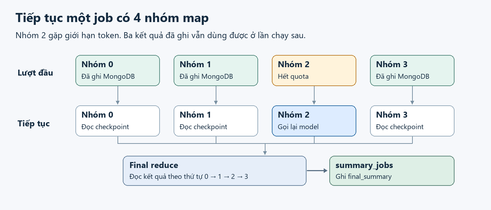
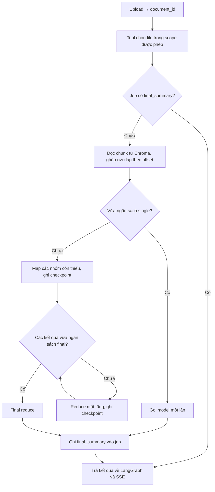

# Map–reduce cho tài liệu upload

Một **job** trả lời yêu cầu tóm tắt trọn một tài liệu trong một phạm vi hội thoại và một ngôn ngữ. Một **checkpoint** lưu đầu ra của một nhóm mà pipeline còn cần để tổng hợp. Nếu người dùng yêu cầu tiếp tục, server dựng lại cùng cách chia nhóm, đọc các kết quả đã lưu và chỉ gọi model cho phần còn thiếu.



## 1. Từ upload đến câu trả lời



| Thành phần | Trách nhiệm |
|---|---|
| [Upload](../api/documents.py) và [giao diện chat](../static/js/chat.js) | Cấp UUID cho lần upload và gửi ID tài liệu đính kèm ở lượt chat. |
| [Tool tài liệu](../agent_tools/documents.py) và [RAG](../services/rag.py) | Chọn đúng file trong thread, tài khoản hoặc Project. Ảnh đi qua tool xử lý ảnh. File được yêu cầu rõ ràng có ưu tiên trước gợi ý từ file đính kèm. |
| [Lập kế hoạch](../services/summary_planning.py) | Ghép văn bản theo vị trí, tính ngân sách và tạo các nhóm xác định. |
| [Điều phối](../services/summarization.py) và [gọi model](../services/summary_model.py) | Chạy single, map, reduce, xử lý quota và dùng model dự phòng theo cấu hình. |
| [Repository MongoDB](../services/summary_jobs.py) | Tìm job, lưu kết quả từng nhóm, chốt bản cuối và dọn dữ liệu. |
| [Agent](../agent.py) và [API chat](../api/chat.py) | Định tuyến theo artifact của tool. Theo cấu hình mặc định, node `emit_summary` phát câu trả lời. `_chat_event_generator` gửi SSE và lưu nội dung hiển thị vào lịch sử. |

## 2. Hai collection trong MongoDB

Ví dụ dưới đây minh họa **một job đang làm dở và nhóm map thứ ba của job đó**. Các ID rút gọn trong phần giải thích đều trỏ đến giá trị BSON ở ví dụ.

```javascript
// summary_jobs
{
  _id: ObjectId("650000000000000000000001"),
  context: { thread_id: "thread-01", user_id: "user-01", project_id: null },
  document_id: "uuid-cua-lan-upload",
  target_language: "Vietnamese",
  final_summary: null
}

// summary_job_checkpoints
{
  _id: ObjectId("650000000000000000000002"),
  job_id: ObjectId("650000000000000000000001"),
  stage: "map",
  group_index: 2,
  content: "Các ý chính của nhóm thứ ba."
}
```

MongoDB sinh cả hai `_id`. Khi tìm các nhóm đã làm, code lấy `_id` của job làm `job_id` trong truy vấn checkpoint. `document_id` là UUID do API cấp cho lần upload. Hai file cùng tên vẫn có thể tạo hai job riêng.

| Trường hoặc index | Ý nghĩa khi chạy |
|---|---|
| Unique trên `context.thread_id, context.user_id, context.project_id, document_id, target_language` | Cùng phạm vi hội thoại, lần upload và ngôn ngữ đầu ra sẽ dùng lại cùng job. Ngôn ngữ được chuẩn hóa trước khi tra cứu. |
| Unique trên `job_id, stage, group_index` | Mỗi vị trí trong một tầng có một kết quả. Ví dụ `("map", 0)` và `("reduce:1", 0)` là hai vị trí khác nhau của cùng job. |
| `final_summary` | `null` nghĩa là job chưa có bản cuối. Khi có nội dung, server trả bản này cho yêu cầu trùng. |
| `expires_at` và TTL index | Khi conversation có hạn lưu, job lấy hạn tại thời điểm tạo. Mỗi checkpoint nhận cùng hạn với job. |
| Index trên `document_id` | Hỗ trợ dọn các job dùng cùng file, kể cả job tạo từ một thread khác qua fallback của tài khoản. |

Bộ trường trên đủ để tìm job và xác định vị trí của một nhóm. Tên model thuộc lượt thực thi nên người dùng có thể đổi model giữa chừng. Một bản cuối vì thế có thể tổng hợp các nhóm do nhiều model khác nhau xử lý. [Code tạo index và job](../services/summary_jobs.py)

## 3. Vì sao cache hit không cần đọc text?

```python
if job_context:
    store = SummaryJobStore.open(job_context, language)
    if store.final_summary:
        return SummaryResult(store.final_summary)

settings = SummarySettings.from_env(input_token_budget)
chunks = documents() if callable(documents) else documents
```

Tool đã tra metadata Chroma để kiểm tra scope và chọn `document_id`. Nó truyền một hàm đọc chunk cho service. Đoạn trên chỉ gọi hàm đó sau khi đã kiểm tra bản cuối. Vì vậy lượt đọc cache vẫn kiểm tra được tài liệu nào đang được phép truy cập, đồng thời tiết kiệm việc tải text và gọi model summary. [Tool chọn file](../agent_tools/documents.py) · [Điểm vào pipeline](../services/summarization.py)

## 4. Chia nhóm như thế nào?

`page_texts()` duyệt chunk theo thứ tự trang và offset do RAG trả về. Ví dụ cùng trang có `abc123` ở offset 0 và `123xyz` ở offset 3. Offset trỏ vào đúng đoạn `123` và nội dung hai phía khớp, nên kết quả là `abc123xyz`. Cùng cụm `123` ở vị trí khác vẫn được giữ.

```python
instruction = template.format(language=language_phrase(language), documents="")
overhead = estimate_prompt_tokens(summary_system_prompt(language) + instruction)
return limit - output_tokens - overhead - 32
```

`text_budget()` tính số token ước lượng còn dành cho dữ liệu sau khi dành chỗ cho hướng dẫn, ngôn ngữ, output và biên an toàn 32 token. Mặc định tổng ngân sách single/map là 3.200, reduce là 5.500. Output trung gian dành 350 token, output cuối dành 900. Đây là ước lượng theo ký tự nên chi phí provider đo được có thể khác. Cả việc chọn single lẫn quyết định gộp thêm một tầng đều dùng ngân sách của prompt tương ứng. [Lập kế hoạch](../services/summary_planning.py) · [Giới hạn output và prompt hệ thống](../services/summary_model.py)

## 5. Lưu ngay khi một nhóm hoàn thành

```python
results = job_store.get_results(stage) if job_store else {}
missing = (i for i in range(len(prompts)) if i not in results)
```

Ở đầu mỗi tầng, `results` ánh xạ chỉ số nhóm sang text đã ghi. Ví dụ có bốn prompt và các chỉ số đã lưu là `0, 1, 3`, hàng đợi chỉ còn `2`. Chỉ số trong DB bắt đầu từ 0. Số nhóm hiển thị trong bản nháp và log bắt đầu từ 1.

```python
text = future.result()
results[group] = job_store.save_result(stage, group, text) if job_store else text
```

Executor mặc định giữ tối đa hai tác vụ đang chạy. Khi một future trả kết quả, vòng điều phối ghi MongoDB rồi mới cấp tiếp việc trong chỗ trống. `copy_context()` mang ngữ cảnh request sang worker. Khi thấy một lỗi, vòng điều phối dừng cấp nhóm mới và thu nốt kết quả của tác vụ đã gửi. Cuối tầng, `[results[i] for i in range(len(prompts))]` khôi phục thứ tự tài liệu, kể cả khi nhóm sau hoàn thành sớm hơn. [Vòng thực thi nhóm](../services/summarization.py)

```python
key = {"job_id": self.job_id, "stage": stage, "group_index": index}
checkpoints = get_collection(CHECKPOINTS)
row = _get_or_insert(checkpoints, key, {"content": content, **self.expiry})
```

`_get_or_insert()` dùng upsert với `$setOnInsert` và trả lại bản ghi thực tế từ MongoDB. Hai request có thể cùng tiêu token cho một nhóm. Unique index và quy tắc ghi đầu tiên khiến cả hai dùng cùng `row["content"]` khi reduce. Nếu process dừng sau khi provider trả lời nhưng trước khi MongoDB xác nhận ghi, lần resume phải gọi lại nhóm đó. [Ghi checkpoint](../services/summary_jobs.py)

## 6. Reduce, kết quả dở và bản cuối

```python
stage = f"reduce:{level}"
groups = groups_by_budget(summaries, reduce_budget)
if len(groups) >= len(summaries):
    raise ValueError("Reduce budget cannot combine summaries safely.")
summaries = run_groups(groups, REDUCE_PROMPT, stage)
```

Khi toàn bộ kết quả map vừa ngân sách tổng hợp cuối, pipeline gọi final reduce ngay. Nếu cần một tầng trung gian, đoạn trên tạo `reduce:1`, rồi `reduce:2` nếu cần. Kiểm tra số nhóm bảo đảm mỗi tầng có tiến triển. `single` và `final` ghi trực tiếp kết quả cuối vào job. Chỉ `map` và những tầng `reduce:N` trung gian tạo checkpoint.

| Điểm dừng | Người dùng nhận gì? | Lượt tiếp tục chạy gì? |
|---|---|---|
| Trước khi có kết quả single | Thông báo đã xử lý 0/1 nhóm nếu hết quota ngày | Chạy lại single |
| Giữa map | Bản nháp của các nhóm đã lưu, kèm số nhóm đã làm | Chạy nhóm map còn thiếu |
| Giữa reduce trung gian | Bản nháp từ tầng gần nhất đã hoàn thành, thông báo còn bước tổng hợp | Dùng lại các checkpoint đã ghi ở tầng đang dở |
| Ở final reduce | Thông báo đã đọc đủ nhóm nhưng còn tổng hợp cuối | Gọi lại final reduce |
| Gặp lỗi DB hoặc cấu hình | Tool trả trạng thái `error`. Checkpoint đã ghi vẫn dùng được | Sửa nguyên nhân rồi gọi lại |
| Đã hoàn thành | Bản cuối được lưu vào lịch sử chat | Đọc cache |

Việc chốt bản cuối dùng điều kiện `{"_id": self.job_id, "final_summary": None}`. Nếu một request khác đã ghi trước, request hiện tại đọc và trả bản cuối đó. Khi xóa job, repository xóa parent rồi dọn checkpoint. Worker trả về sau khi parent đã bị xóa sẽ dọn checkpoint vừa ghi và báo lỗi. [Điều phối](../services/summarization.py) · [Repository](../services/summary_jobs.py) · [Thông báo quota](../services/token_limit_handler.py)

## 7. Kiểm chứng

Chạy unit test từ thư mục gốc của repo:

```powershell
python -B -m unittest discover -s tests
```

Để chạy cả kiểm thử MongoDB, đặt biến sau trỏ đến executable MongoDB cục bộ rồi chạy cùng lệnh. Test tự mở server trên loopback, chọn cổng trống và dùng thư mục dữ liệu tạm.

```powershell
$env:SUMMARY_TEST_MONGOD = (Get-Command mongod).Source
python -B -m unittest discover -s tests
```

- **Cạnh tranh ghi và xóa.** Hai writer cùng tạo job, ghi một nhóm và chốt bản cuối. Kiểm tra số record, kiểu BSON, TTL và hành vi của worker trả kết quả muộn. [Test MongoDB](../tests/test_summary_mongo.py)
- **Resume bốn nhóm.** Ép lỗi quota ở map, tiếp tục bằng model khác, ép lỗi ở final và tiếp tục lần nữa. Đếm chính xác các lần gọi model, gồm cả lượt đọc cache. [Test MongoDB](../tests/test_summary_mongo.py)
- **Đường đi qua HTTP.** Upload TXT vào temporary chat, gửi `/chat/stream`, đọc SSE, kiểm tra bản cuối trong MongoDB và lịch sử chat. Ca này dùng Chroma/MongoDB thật cùng model và embedding giả lập để kết quả lặp lại được. [Test HTTP](../tests/test_summary_mongo.py)
- **Thuật toán độc lập.** Kiểm tra overlap, thứ tự kết quả, ngân sách, reduce nhiều tầng và giữ nguyên ngữ cảnh worker. [Test pipeline](../tests/test_summary_pipeline.py)

