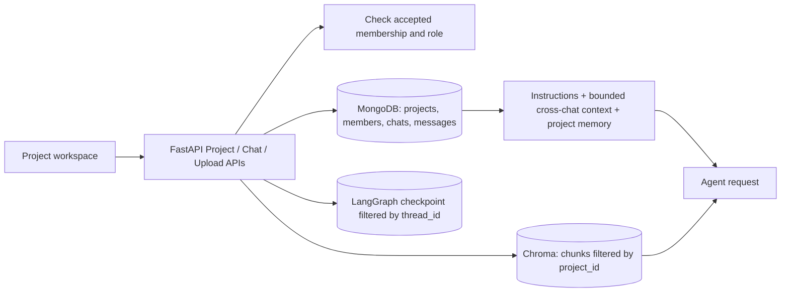
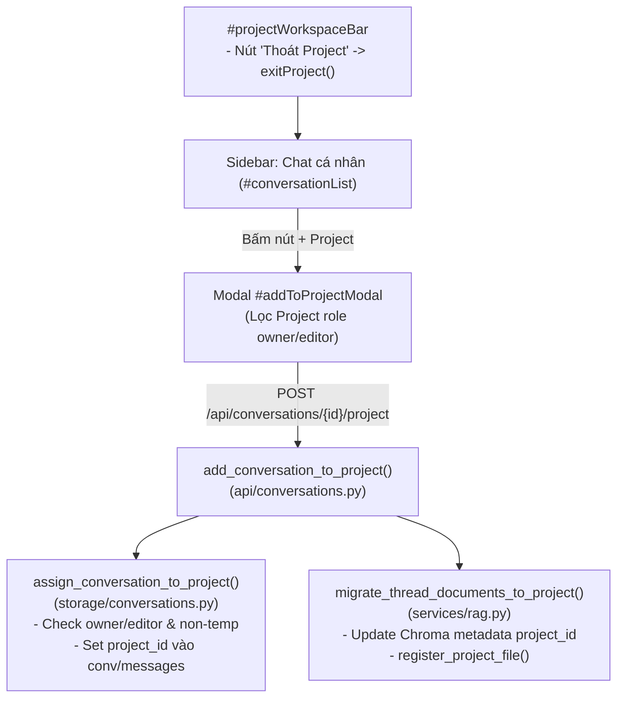
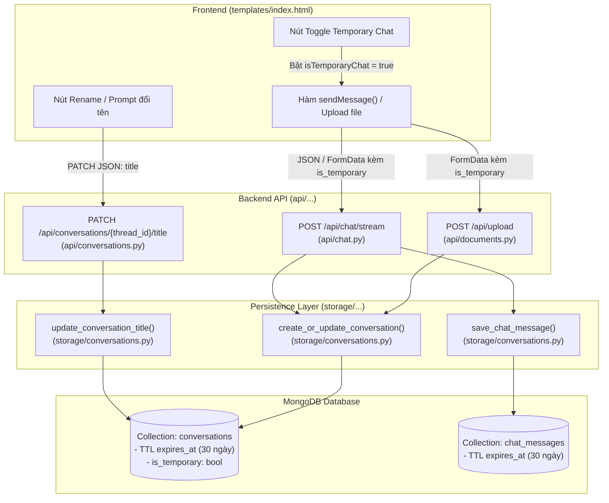

# HƯỚNG DẪN TÍNH NĂNG PROJECTS

Tài liệu này ghi lại kế hoạch, thiết kế dữ liệu và cách triển khai Projects trong **Tit-Chatbot**, kèm đường dẫn file và đoạn code đại diện. Các phần Rename Conversation và Temporary Chat đã có trong repo được giữ lại ở cuối file như phụ lục.

## MỤC LỤC — PROJECTS
- [A. Plan triển khai](#a-plan-triển-khai)
- [B. Thiết kế dữ liệu](#b-thiết-kế-dữ-liệu-mongodb)
- [C. Cách implement](#c-cách-implement-theo-từng-lớp)
- [D. Quyền share và memory mode](#d-quyền-share-và-memory-mode)
- [E. Luồng chạy hoàn chỉnh](#e-luồng-chạy-hoàn-chỉnh)
- [F. Kiểm thử và giới hạn hiện tại](#f-kiểm-thử-và-giới-hạn-hiện-tại)
- [G. Phase 2 — Cải tiến Workspace, Giữ Chat Cá Nhân & Thêm Chat Vào Project](#g-phase-2--cải-tiến-workspace-giữ-chat-cá-nhân--thêm-chat-vào-project)

---

## A. Plan triển khai

### Mục tiêu

Project là một không gian làm việc riêng cho một chủ đề. Project gom nhiều cuộc trò chuyện, file dùng chung, Project Instructions và Project memory. Thành viên được mời có thể đọc và làm việc theo vai trò được cấp.

### Các bước trong plan

1. **Tạo data model trong MongoDB.** Tạo các collection cho Project, thành viên, file và memory. Project ID là `_id` của document trong collection `projects`.
2. **Gắn chat vào Project.** Mỗi chat tiếp tục có `thread_id` riêng để LangGraph checkpoint và lịch sử hiện tại tiếp tục hoạt động. Bổ sung `project_id` để nhiều `thread_id` cùng thuộc một Project.
3. **Tách chủ chat khỏi người gửi tin.** `conversations.user_id` và `created_by` xác định người tạo chat; `chat_messages.sender_id` xác định người gửi từng tin nhắn. Không đổi chủ chat theo người nhắn gần nhất.
4. **Bắt buộc kiểm tra quyền ở backend.** Mọi API chat, history, file và Project phải xác nhận thành viên đang ở trạng thái `accepted`. Không dựa vào việc ẩn nút ở frontend.
5. **Đưa Project file vào RAG theo Project ID.** Mọi chunk của file Project mang metadata `project_id`. Chat trong Project tìm file theo `project_id`; chat cá nhân không được lẫn file Project vào fallback tìm kiếm theo user.
6. **Thêm Project Instructions và Project memory.** Instructions được đọc từ document Project ở mỗi request. Memory cá nhân và Project dùng chung collection `long_term_memory`, lần lượt truy vấn bằng `user_id` và `project_id` để scope không giao nhau.
7. **Thêm chia sẻ theo vai trò.** Owner mời thành viên; người được mời phải accept. `editor` được chỉnh sửa nội dung Project; `chat_only` chỉ trò chuyện và đọc/tải file.
8. **Thêm giao diện và dọn dữ liệu.** Sidebar quản lý Project/chat; workspace quản lý files, instructions và thành viên. Xóa Project sẽ dọn chats, messages, files, vectors, memory, memberships và LangGraph checkpoints.
9. **Kiểm thử các luồng RAG và quyền truy cập.** Kiểm tra Project scope, private scope, thành viên bị từ chối, và dọn dữ liệu. Repo hiện chưa có test riêng cho toàn bộ API Project; kết quả suite hiện có nằm ở mục F.

### Quyết định kiến trúc



---

## B. Thiết kế dữ liệu MongoDB

MongoDB là nơi giữ dữ liệu Project và quan hệ quyền truy cập. Chroma giữ vector của file. `_id` của Project được gửi xuống các collection khác dưới trường `project_id`.

| Collection | Nội dung | Các trường chính |
|---|---|---|
| `projects` | Một document cho mỗi Project | `_id`, `owner_id`, `name`, `description`, `instructions`, `memory_mode`, timestamps |
| `project_members` | Thành viên và lời mời | `project_id`, `user_id`, `role`, `status`, `invited_by`, `accepted_at` |
| `project_files` | Danh sách file trong workspace và đường dẫn tải xuống | `project_id`, `document_id`, `thread_id`, `filename`, `path`, `file_type`, `uploaded_by` |
| `long_term_memory` | Memory cá nhân hoặc fact dùng chung trong Project | Personal record có `user_id`; Project record có `project_id`, `created_by`; cả hai dùng `thread_id`, `memory`, `embedding`, `is_deleted`, `version`, timestamps |
| `conversations` | Một chat/thread | `thread_id`, `project_id`, `user_id` creator, `created_by`, `last_actor_id` |
| `chat_messages` | Tin nhắn theo thread | `thread_id`, `project_id`, `role`, `content`, `sender_id`, `user_id` |

Owner được lưu tại `projects.owner_id`; không cần tạo một membership row riêng cho owner. `get_membership()` trả về quyền `owner` khi user ID khớp với `owner_id`. Các thành viên được mời có row trong `project_members`.

Project Instructions là **riêng từng Project**, không phải một instruction chung toàn chatbot. Ví dụ document được lưu tương tự:

```python
{
    "owner_id": ObjectId("..."),
    "name": "Tit-Chatbot",
    "instructions": "Luôn trả lời bằng tiếng Việt...",
    "memory_mode": "project_only",
}
```

Code tạo document: [storage/projects.py](../storage/projects.py#L44). Index cho Projects, memberships, files, memory, conversations và messages: [storage/mongo_client.py](../storage/mongo_client.py#L153).

---

## C. Cách implement theo từng lớp

### 1. Storage: Project, membership, file, memory

File chính: [storage/projects.py](../storage/projects.py).

`create_project()` tạo document Project và mặc định đặt `memory_mode` là `project_only`. Hàm `get_membership()` xác định owner hoặc trả về membership đã accept.

```python
doc = {
    "owner_id": owner_oid,
    "name": clean_name,
    "description": (description or "").strip()[:500],
    "instructions": "",
    "memory_mode": "project_only",
    "created_at": now,
    "updated_at": now,
}
get_collection("projects").insert_one(doc)
```

Mỗi member có một row duy nhất cho một Project. Trạng thái `invited` chưa cấp quyền; chỉ `accepted` được dùng Project:

```python
{
    "project_id": project_oid,
    "user_id": invited_user_oid,
    "role": "editor",        # hoặc chat_only
    "status": "invited",     # accepted sau khi người nhận accept
    "invited_by": owner_oid,
}
```

Các thao tác create/list/update/delete/invite/accept, Project memory và file được gom ở `storage/projects.py`. `storage/database.py` re-export các hàm để code hiện tại có thể dùng chung storage facade.

### 2. Conversation: `thread_id` riêng, `project_id` dùng chung

File: [storage/conversations.py](../storage/conversations.py#L28).

Ví dụ hai chat trong cùng Project:

```text
projects._id = P1
conversations: { thread_id: T1, project_id: P1, ... }
conversations: { thread_id: T2, project_id: P1, ... }
```

Hai thread vẫn có checkpoint/history độc lập. Truy vấn Project context hoặc tài liệu dùng `project_id=P1` để gom dữ liệu của T1, T2 và các thread khác trong cùng Project.

Khi tạo chat trong Project, `project_id` và creator được đặt lúc insert. Các lượt chat sau không ghi đè owner:

```python
if project_oid:
    set_on_insert["project_id"] = project_oid

if oid:
    if project_oid:
        set_on_insert["user_id"] = oid
    else:
        set_fields["user_id"] = oid
    set_on_insert["created_by"] = oid
```

Mỗi message user được ghi riêng người gửi; conversation giữ creator ổn định:

```python
if oid:
    doc["user_id"] = oid
    if role == "user":
        doc["sender_id"] = oid

if conv_doc and conv_doc.get("project_id"):
    update_fields["last_actor_id"] = oid  # không thay conversation.user_id
```

### 3. API: tạo Project, chat, share, file

Router: [api/projects.py](../api/projects.py), được đăng ký trong [app.py](../app.py).

| Method + endpoint | Chức năng |
|---|---|
| `GET /api/projects` | Danh sách Project user sở hữu hoặc đã accept |
| `POST /api/projects` | Tạo Project |
| `GET /api/projects/{project_id}` | Đọc Project và role hiện tại |
| `PATCH /api/projects/{project_id}` | Sửa tên, mô tả, instructions, memory mode; owner/editor |
| `DELETE /api/projects/{project_id}` | Xóa toàn bộ Project; chỉ owner |
| `GET /api/projects/{project_id}/conversations` | Liệt kê các thread thuộc Project |
| `GET/POST /api/projects/{project_id}/members` | Xem thành viên / mời user đã đăng ký |
| `PATCH/DELETE /api/projects/{project_id}/members/{member_id}` | Đổi role / thu hồi thành viên; chỉ owner |
| `GET /api/projects/{project_id}/files` | Liệt kê file; mọi member accepted |
| `GET /api/projects/{project_id}/files/{document_id}/download` | Tải file; mọi member accepted |
| `DELETE /api/projects/{project_id}/files/{document_id}` | Xóa file khỏi Project; owner/editor |
| `GET /api/projects/invitations` | Lời mời đang chờ của user hiện tại |
| `POST /api/projects/invitations/{id}/accept` | Chấp nhận lời mời |
| `POST /api/projects/invitations/{id}/decline` | Từ chối lời mời |

Chat stream vẫn dùng endpoint hiện tại `POST /api/chat/stream`, bổ sung `project_id` trong JSON. Backend kiểm tra quyền membership, lấy instructions và context trước khi gọi agent:

```python
membership = get_membership(project_id, user_id)
project = get_project(project_id)
if not membership or not project:
    return JSONResponse({"error": "Project access denied."}, status_code=404)

instructions = project.get("instructions", "")
context = build_project_context(project_id, thread_id, user_message, memory_mode)
create_or_update_conversation(..., project_id=project_id)
```

Upload tiếp tục dùng `POST /api/upload`; FormData có thêm `project_id`. Backend kiểm tra membership và `can_edit_project()` trước khi ghi file, sau đó thêm chunks vào Chroma và tạo row `project_files`.

Không dùng `conversation.user_id` để quyết định ai được vào một chat Project. Quyền đọc chat Project được kiểm tra theo accepted membership:

```python
if conversation.get("project_id"):
    if not user:
        return False
    return get_membership(
        str(conversation["project_id"]),
        str(user["id"]),
    ) is not None
```

Quyền sửa tài nguyên được kiểm tra riêng bằng `can_edit_project()`, chỉ trả true cho owner/editor. Route Project invitation và role management kiểm tra owner ở storage layer.

### 4. RAG: mọi chat trong Project tìm file theo Project ID

Files: [services/rag.py](../services/rag.py#L257), [agent_tools/documents.py](../agent_tools/documents.py).

Metadata của mỗi chunk Project có `project_id` và `scope="project"`:

```python
if project_id:
    doc.metadata["project_id"] = str(project_id)
    doc.metadata["scope"] = "project"
```

Truy vấn Project mặc định lọc theo Project ID, không fallback sang user documents. Ở chế độ `current_chat_only`, truy vấn thêm `thread_id`:

```python
if project_id and current_chat_only:
    filter_dict = {"$and": [
        {"project_id": str(project_id)},
        {"thread_id": thread_id},
    ]}
elif project_id:
    filter_dict = {"project_id": str(project_id)}
```

Các hàm tìm chunk, liệt kê file và lấy ảnh dùng cùng quy tắc scope. Chiều ngược lại, fallback RAG của chat cá nhân lọc `scope != project`, để file Project không xuất hiện trong chat cá nhân của người tải lên.

### 5. Project Instructions và Project memory

Instructions được đọc từ Mongo mỗi request, rồi thêm vào system prompt động trong [agent.py](../agent.py#L199). Chúng không ghi vào checkpoint, nên sửa instructions sẽ áp dụng cho lượt chat kế tiếp trong tất cả thread của Project.

```python
if instructions:
    dynamic_system_prompt += (
        "\n\n[Instructions for this project]\n"
        f"{instructions}\n"
        "[End project instructions]"
    )
```

Ngữ cảnh chat Project được dựng bởi [services/project_context.py](../services/project_context.py#L19): lấy tối đa 12 chat gần đây, 24 message gần nhất và giới hạn tổng context 9.000 ký tự; project facts được tìm semantic và lấy tối đa 5 kết quả. Đây là context có giới hạn, không nạp toàn bộ lịch sử vô hạn vào mỗi request.

Project facts lưu trong collection `long_term_memory`, cùng cách lưu text, embedding, version và xóa mềm như memory cá nhân. Hai loại record được cô lập bằng scope riêng: memory cá nhân lọc theo `user_id`, Project memory lọc theo `project_id`; Project record không mang `user_id` nên thao tác xóa tài khoản cá nhân không xóa memory dùng chung. `remember_project_fact`, `search_project_facts`, `update_project_fact` và `forget_project_fact` trong [agent_tools/project_memory.py](../agent_tools/project_memory.py) gọi lại các hàm lưu, semantic search, sửa và xóa của [storage/memories.py](../storage/memories.py). Chỉ owner/editor được ghi, sửa hoặc xóa; mọi thành viên đã chấp nhận lời mời có thể tìm/đọc.

Để sửa hoặc xóa một fact, agent phải gọi `search_project_facts` trước trong cùng lượt chat, rồi truyền đúng `memory_id` và `version` tool trả về. Backend xác minh lại quyền owner/editor và dùng `project_id + _id + version` trong điều kiện MongoDB; sửa sẽ cập nhật embedding và tăng version, xóa sẽ đặt `is_deleted=true` và tăng version. Vì vậy Project fact dùng chung chính cơ chế optimistic versioning và soft-delete của memory cá nhân nhưng không thể bị truy xuất nhầm qua scope `user_id`.

```python
@tool
def remember_project_fact(fact: str) -> str:
    project_id = get_current_project_id()
    if not project_id:
        return "Project memory is available only inside a project chat."
    return create_project_memory(
        project_id=project_id,
        user_id=get_current_user_id(),
        memory=fact,
        thread_id=get_current_thread_id(),
    )
```

Các tool personal memory trong [agent_tools/memory.py](../agent_tools/memory.py) bị chặn theo `memory_mode`, tránh tự động trộn dữ liệu cá nhân vào Project-only.

### 6. Frontend workspace

File: [templates/index.html](../templates/index.html).

Sidebar có danh sách Project và lời mời. Workspace có Files, Instructions/Settings, Share và New chat. Chọn Project sẽ tạo thread mới nhưng giữ `active_project_id`; mọi lần gửi tin nhắn và upload gửi Project ID lên backend.

```javascript
body: JSON.stringify({
    message: submittedMessage,
    thread_id: targetThreadId,
    model: selectedModel,
    project_id: activeProjectId || null
})
```

History Project hiển thị tên người gửi lấy từ `chat_messages.sender_id`. File được upload qua attachment của chat hiện tại, nhưng vì metadata có Project ID nên thread khác trong cùng Project vẫn tìm được file.

### 7. Xóa Project và xóa tài khoản

`delete_project()` xóa conversations, messages, summary jobs/checkpoints, LangGraph checkpoints, vectors/files, `project_files`, các record `long_term_memory` có `project_id` tương ứng, `project_members` và document Project. Xóa một chat Project riêng lẻ thì giữ file và memory Project dùng chung.

Khi xóa user:

- Nếu user là owner, Project và dữ liệu của Project bị xóa theo.
- Nếu user chỉ là member, membership bị thu hồi; Project và các chat dùng chung vẫn còn.
- Chat Project không bị xóa như chat cá nhân chỉ vì creator account bị xóa.
- File Project không bị `delete_user_documents()` xóa cùng file cá nhân.

---

## D. Quyền share và memory mode

### Vai trò

| Hành động | Owner | Editor | Chat-only |
|---|---:|---:|---:|
| Xem chat/file và gửi tin nhắn trong Project | Có | Có | Có |
| Tạo chat mới trong Project | Có | Có | Có |
| Tải file Project | Có | Có | Có |
| Sửa tên/mô tả/instructions/memory mode | Có | Có | Không |
| Upload/xóa file và lưu/sửa/xóa Project memory | Có | Có | Không |
| Mời, đổi role, xóa thành viên | Có | Không | Không |
| Xóa Project | Có | Không | Không |

Người được mời chỉ có quyền sau khi accept. Khi bị xóa khỏi `project_members`, API chat/history/files từ chối quyền ngay ở request tiếp theo.

### Memory mode

| Giá trị Mongo | Hành vi |
|---|---|
| `project_only` | Dùng context chat gần đây, Project memory và toàn bộ file thuộc Project; không đọc/ghi personal memory trong chat Project. |
| `project_and_personal` | Dùng context Project và cho phép agent dùng personal memory riêng của người đang chat. |
| `current_chat_only` | Chỉ dùng thread hiện tại và file gắn với thread; không nạp chat khác, Project memory hoặc personal memory. |

File được upload vào Project vẫn là dữ liệu dùng chung cho các thành viên. `current_chat_only` chỉ thu hẹp retrieval của agent vào thread hiện tại; nó không xóa file khỏi Project.

---

## E. Luồng chạy hoàn chỉnh

1. Owner tạo Project; Mongo tạo `projects._id=P1`.
2. Owner mời user theo email/username đã đăng ký; row `project_members` bắt đầu với `status="invited"`.
3. Người được mời accept; từ đây backend coi membership là hợp lệ.
4. User chọn Project và tạo chat mới; server sinh `thread_id=T1`, lưu conversation với `project_id=P1`.
5. Khi gửi tin, server xác thực membership, lưu `sender_id` vào user message, nạp instructions/context Project và gọi LangGraph bằng `thread_id=T1`.
6. Khi upload file, server kiểm tra role editor/owner, lưu file, ghi vector metadata `project_id=P1`, rồi đăng ký `project_files`.
7. Chat thứ hai dùng `thread_id=T2` nhưng cùng `project_id=P1`; RAG có thể tìm file của T1 và Project context có thể dùng các chat gần đây khác.
8. Owner/editor có thể đổi instructions; lượt request kế tiếp của bất kỳ thread nào trong P1 sẽ đọc instructions mới.

---

## F. Kiểm thử và giới hạn hiện tại

Lệnh đã chạy:

```powershell
py -3.14 -m unittest evaluation.rag_eval.tests.test_evaluation -v
```

Kết quả: **28 test passed**. Suite này có các test ingestion/retrieval RAG hiện có, nhưng chưa bao phủ riêng API Project, membership roles, invitation lifecycle hoặc deletion cascade. Repo không có thư mục `tests/` như README cũ mô tả. Đã compile cú pháp 20 module Python liên quan Projects bằng Python 3.14.

Giới hạn implementation hiện tại:

- Chỉ mời được email/username đã có tài khoản; lời mời hiển thị trong chatbot, chưa gửi email.
- Cross-chat context được giới hạn theo số chat/message và kích thước để tránh đưa toàn bộ lịch sử vào prompt.
- Không có test integration với MongoDB/Chroma thật cho Project permission và cleanup.

---

## G. Phase 2 — Cải tiến Workspace, Giữ Chat Cá Nhân & Thêm Chat Vào Project

Phần này bổ sung 3 cải tiến trải nghiệm và nghiệp vụ cho hệ thống Projects:

1. **Nút thoát Project trực quan:** Đặt nút **`Thoát Project`** ngay trên thanh workspace (`#projectWorkspaceBar` trong [static/css/chat.css](../static/css/chat.css#L2521)) gọi `exitProject()` để quay lại màn hình chat cá nhân bình thường.
2. **Giữ song song 2 danh sách ở sidebar (kiểu ChatGPT):** Khi đang mở một Project, sidebar hiển thị đồng thời:
   - `#projectChatSection` (`#projectConversationList`): Các cuộc trò chuyện thuộc Project đang mở (`GET /api/projects/{id}/conversations`).
   - `#personalChatSection` (`#conversationList`): Danh sách các cuộc trò chuyện cá nhân (`GET /api/conversations`) luôn hiển thị để người dùng mở lại hoặc bấm **Thêm vào Project** bất kỳ lúc nào.
3. **Tính năng Add cuộc trò chuyện cá nhân vào Project (chỉ `owner` / `editor`):**
   - **Backend Storage:** `assign_conversation_to_project()` trong [storage/conversations.py](../storage/conversations.py#L319) kiểm tra thread thuộc sở hữu của user hiện tại, không phải guest/temporary chat, chưa thuộc Project nào khác, và xác thực `can_edit_project(project_id, user_id)` (chặn hoàn toàn `chat_only`) trước khi gắn `project_id` vào `conversations`, `chat_messages`, `summary_jobs` và cập nhật `projects.updated_at`.
   - **Đồng bộ RAG & File dùng chung:** `migrate_thread_documents_to_project()` trong [services/rag.py](../services/rag.py#L820) cập nhật metadata `project_id` và `scope="project"` cho toàn bộ chunks ChromaDB của thread đó, rồi API đăng ký vào collection `project_files` qua `register_project_file()` để các thành viên khác có thể tìm, tóm tắt và tải file đính kèm.
   - **Backend Endpoint:** `POST /api/conversations/{thread_id}/project` trong [api/conversations.py](../api/conversations.py#L242) nhận `{"project_id": "..."}` và trả về số lượng file đã đồng bộ (`files_migrated`).
   - **Frontend Modal:** Nút **`+ Project`** trên mỗi item chat cá nhân mở `#addToProjectModal`, chỉ liệt kê các Project mà user giữ vai trò `owner` hoặc `editor`, mặc định chọn sẵn Project đang mở (nếu đủ quyền) và chuyển ngữ cảnh sang Project đích sau khi thêm thành công.



---

## PHỤ LỤC: HƯỚNG DẪN TRIỂN KHAI RENAME CONVERSATION & TEMPORARY CHAT

Phần dưới đây giữ nguyên hướng dẫn trước đây cho hai tính năng Rename Conversation và Temporary Chat.

---

## MỤC LỤC
- [A. Kiến Trúc & Luồng Dữ Liệu Tổng Quan](#a-kiến-trúc--luồng-dữ-liệu-tổng-quan)
- [B. Tính Năng 1: Đổi Tên Cuộc Trò Chuyện (Rename Conversation)](#b-tính-năng-1-đổi-tên-cuộc-trò-chuyện-rename-conversation)
  - [Bước 1: Tầng Cơ Sở Dữ Liệu (Database / Storage Layer)](#b1-tầng-cơ-sở-dữ-liệu-storageconversationspy)
  - [Bước 2: Tầng API Backend (FastAPI Endpoint)](#b2-tầng-api-backend-apiconversationspy)
  - [Bước 3: Tầng Giao Diện Người Dùng (Frontend JavaScript & HTML)](#b3-tầng-giao-diện-templatesindexhtml)
- [C. Tính Năng 2: Trò Chuyện Tạm Thời (Temporary Chat)](#c-tính-năng-2-trò-chuyện-tạm-thời-temporary-chat)
  - [Bước 1: Cấu hình TTL Index tự hủy trên MongoDB](#c1-cấu-hình-ttl-index-tự-hủy-storagemongo_clientpy)
  - [Bước 2: Logic Lưu Trữ & Lọc Dữ Liệu Tạm Thời](#c2-logic-lưu-trữ--lọc-dữ-liệu-storageconversationspy)
  - [Bước 3: Tầng API Tiếp Nhận & Kế Thừa Cờ is_temporary](#c3-tầng-api-tiếp-nhận-apichatpy--apidocumentspy)
  - [Bước 4: Giao Diện Người Dùng & Quản Lý Trạng Thái UI](#c4-giao-diện-người-dùng--trạng-thái-ui-templatesindexhtml)
- [D. Cơ Chế Dọn Dẹp Tài Liệu & Vector Khi Xóa (Document & Vector Cleanup)](#d-cơ-chế-dọn-dẹp-tài-liệu--vector-khi-xóa-document--vector-cleanup)
  - [1. Khi người dùng xóa cuộc trò chuyện (Delete Conversation)](#d1-khi-người-dùng-xóa-cuộc-trò-chuyện-delete-conversation)
  - [2. Khi Admin xóa tài liệu trong hệ thống (Admin Delete Document)](#d2-khi-admin-xóa-tài-liệu-trong-hệ-thống-admin-delete-document)
  - [3. Khi Admin xóa người dùng (Delete User)](#d3-khi-admin-xóa-người-dùng-delete-user)
  - [4. Phân biệt: Xóa thủ công vs TTL tự hủy của MongoDB](#d4-phân-biệt-xóa-thủ-công-vs-ttl-tự-hủy-của-mongodb)
- [E. Bảng Tổng Hợp Vị Trí Code (Code Reference Map)](#e-bảng-tổng-hợp-vị-trí-code-code-reference-map)
- [F. Hướng Dẫn Kiểm Thử (Testing & Verification)](#f-hướng-dẫn-kiểm-thử-testing--verification)

---

## A. KIẾN TRÚC & LUỒNG DỮ LIỆU TỔNG QUAN



---

## B. TÍNH NĂNG 1: ĐỔI TÊN CUỘC TRÒ CHUYỆN (RENAME CONVERSATION)

### Mục tiêu
Cho phép người dùng chủ động đặt lại tiêu đề của một đoạn chat theo ý muốn để dễ quản lý trong thanh bên (sidebar).

---

### B.1. Tầng Cơ Sở Dữ Liệu (`storage/conversations.py`)
* **Địa chỉ code:** [storage/conversations.py](file:///d:/Tit-Chatbot/storage/conversations.py#L215-L235)
* **Nhiệm vụ:**
  - Kiểm tra đầu vào: `thread_id` và `new_title` không được rỗng.
  - Cắt bớt tiêu đề tối đa 100 ký tự và loại bỏ khoảng trắng thừa.
  - Kiểm tra quyền sở hữu: Nếu có truyền `user_id`, chỉ cập nhật nếu `user_id` khớp với chủ sở hữu bản ghi.
  - Cập nhật `updated_at` về thời điểm hiện tại.

#### Đoạn mã triển khai:
```python
def update_conversation_title(
    thread_id: str,
    new_title: str,
    user_id: str | None = None
) -> bool:
    """Cập nhật tiêu đề cuộc trò chuyện, có kiểm tra quyền sở hữu user_id."""
    if not thread_id or not isinstance(new_title, str) or not new_title.strip():
        return False

    clean_title = new_title.strip()[:100]
    coll = get_collection("conversations")
    query: dict[str, Any] = {"thread_id": thread_id}
    if user_id is not None:
        oid = _to_object_id(user_id)
        query["user_id"] = {"$in": [oid, str(oid)]} if oid else user_id

    res = coll.update_one(
        query,
        {"$set": {"title": clean_title, "updated_at": _now()}}
    )
    return res.matched_count > 0
```

---

### B.2. Tầng API Backend (`api/conversations.py`)
* **Địa chỉ code:** [api/conversations.py](file:///d:/Tit-Chatbot/api/conversations.py#L94-L139)
* **Route:** `PATCH /api/conversations/{thread_id}/title`
* **Nhiệm vụ:**
  1. Lấy thông tin user hiện tại qua `get_current_user(request)`.
  2. Lấy conversation qua `get_conversation(thread_id)` để kiểm tra tồn tại (nếu không có trả về `404`).
  3. Kiểm tra phân quyền qua `_can_access_conversation(conv, user)` (nếu không có quyền trả về `403`).
  4. Đọc body JSON `{"title": "..."}`, validate dữ liệu (nếu rỗng trả về `400`).
  5. Gọi `update_conversation_title(...)` và trả về kết quả JSON chuẩn `{"success": true, ...}`.

#### Đoạn mã triển khai:
```python
@router.patch("/conversations/{thread_id}/title")
async def rename_conversation(thread_id: str, request: Request):
    """Cập nhật tiêu đề cuộc trò chuyện (Rename)."""
    user = get_current_user(request)
    conv = get_conversation(thread_id)
    if not conv:
        return JSONResponse(
            {"success": False, "error": "Cuộc trò chuyện không tồn tại."},
            status_code=404
        )

    if not _can_access_conversation(conv, user):
        return JSONResponse(
            {"success": False, "error": "Bạn không có quyền đổi tên cuộc trò chuyện này."},
            status_code=403
        )

    try:
        data = await request.json()
        new_title = data.get("title", "")
        if not isinstance(new_title, str) or not new_title.strip():
            return JSONResponse(
                {"success": False, "error": "Tiêu đề không được để trống."},
                status_code=400
            )
    except Exception:
        return JSONResponse(
            {"success": False, "error": "Dữ liệu JSON không hợp lệ."},
            status_code=400
        )

    user_id = user["id"] if user else None
    success = update_conversation_title(thread_id, new_title.strip(), user_id=user_id)
    if not success:
        return JSONResponse(
            {"success": False, "error": "Không thể cập nhật tiêu đề."},
            status_code=400
        )

    return {
        "success": True,
        "thread_id": thread_id,
        "title": new_title.strip()[:100],
        "message": "Đã đổi tên cuộc trò chuyện thành công."
    }
```

---

### B.3. Tầng Giao Diện (`templates/index.html`)

#### 1. Nút hành động trên từng Item lịch sử
* **Địa chỉ code:** [templates/index.html](file:///d:/Tit-Chatbot/templates/index.html#L3237-L3246)
* Tạo nút với icon bút chì (`rename-btn`) và gắn sự kiện gọi `renameConversationPrompt(conv.thread_id, conv.title)`.

```javascript
const renameBtn = document.createElement("button");
renameBtn.className = "history-action-btn rename-btn";
renameBtn.title = "Đổi tên cuộc trò chuyện";
renameBtn.innerHTML = `
    <svg width="12" height="12" viewBox="0 0 24 24" fill="none" stroke="currentColor" stroke-width="2">
        <path d="M12 20h9"/>
        <path d="M16.5 3.5a2.121 2.121 0 0 1 3 3L7 19l-4 1 1-4L16.5 3.5z"/>
    </svg>
`;
renameBtn.onclick = (e) => {
    e.stopPropagation();
    renameConversationPrompt(conv.thread_id, conv.title || "Đoạn chat mới");
};
actions.appendChild(renameBtn);
```

#### 2. Hàm xử lý gửi yêu cầu PATCH đổi tên
* **Địa chỉ code:** [templates/index.html](file:///d:/Tit-Chatbot/templates/index.html#L3325-L3345)
* Mở hộp thoại nhập tên mới -> Gọi API `PATCH /api/conversations/${id}/title` -> Cập nhật trực tiếp DOM danh sách mà không cần tải lại toàn bộ trang.

```javascript
async function renameConversationPrompt(id, currentTitle) {
    const newTitle = prompt("Nhập tên mới cho cuộc trò chuyện:", currentTitle);
    if (!newTitle || !newTitle.trim() || newTitle.trim() === currentTitle) return;

    try {
        const res = await fetch(`/api/conversations/${id}/title`, {
            method: "PATCH",
            headers: { "Content-Type": "application/json" },
            body: JSON.stringify({ title: newTitle.trim() })
        });
        const data = await res.json().catch(() => ({}));
        if (res.ok && data.success) {
            // Cập nhật ngay tên hiển thị trên giao diện sidebar
            const titleEl = document.querySelector(`.history-item[data-thread-id="${id}"] .history-item-title`);
            if (titleEl) {
                titleEl.textContent = data.title;
            } else {
                await loadConversations();
            }
        } else {
            alert(data.error || "Không thể đổi tên cuộc trò chuyện.");
        }
    } catch (err) {
        console.error("Failed to rename conversation:", err);
        alert("Lỗi kết nối khi đổi tên cuộc trò chuyện.");
    }
}
```

---

## C. TÍNH NĂNG 2: TRÒ CHUYỆN TẠM THỜI (TEMPORARY CHAT)

### Mục tiêu
1. Cho phép người dùng trò chuyện ở chế độ ẩn danh/tạm thời (tương tự Incognito Mode).
2. **Không xuất hiện** trong danh sách lịch sử hội thoại bên sidebar.
3. Không ghi nhận vào bộ nhớ lâu dài (Long-term memory).
4. Tự động dọn dẹp sau 30 ngày thông qua cơ chế **MongoDB TTL (Time-To-Live) Index**.

---

### C.1. Cấu hình TTL Index tự hủy (`storage/mongo_client.py`)
* **Địa chỉ code:** [storage/mongo_client.py](file:///d:/Tit-Chatbot/storage/mongo_client.py#L127-L144)
* **Cơ chế:** MongoDB background thread sẽ tự động xóa tài liệu ngay khi thời gian hiện tại vượt qua trường `expires_at`.

```python
# TTL index tự động xóa guest / temporary conversations khi đến hạn expires_at
conv = get_collection("conversations")
conv.create_index(
    [("expires_at", ASCENDING)],
    expireAfterSeconds=0,
    background=True,
)

# TTL index tự động xóa tin nhắn tương ứng của cuộc trò chuyện tạm thời
msgs = get_collection("chat_messages")
msgs.create_index(
    [("expires_at", ASCENDING)],
    expireAfterSeconds=0,
    background=True,
)
```

---

### C.2. Logic Lưu Trữ & Lọc Dữ Liệu (`storage/conversations.py`)

#### 1. Tạo cuộc hội thoại tạm thời với TTL 30 ngày
* **Địa chỉ code:** [storage/conversations.py](file:///d:/Tit-Chatbot/storage/conversations.py#L56-L62)
* Khi `is_temporary=True`, gán cờ `is_temporary: True` và tính `expires_at = now + timedelta(days=30)`:

```python
if is_temporary:
    set_on_insert["is_temporary"] = True
    set_fields["is_temporary"] = True
    expiry = now + timedelta(days=30)
    set_on_insert["expires_at"] = expiry
    set_fields["expires_at"] = expiry
```

#### 2. Kế thừa hạn xóa cho tin nhắn chat
* **Địa chỉ code:** [storage/conversations.py](file:///d:/Tit-Chatbot/storage/conversations.py#L310-L314)
* Khi ghi tin nhắn vào `chat_messages`, nếu hội thoại thuộc loại `is_temporary`, tin nhắn cũng nhận cùng `expires_at`:

```python
conv_doc = conv_coll.find_one({"thread_id": thread_id}, {"is_temporary": 1, "expires_at": 1})
if conv_doc and conv_doc.get("is_temporary") and conv_doc.get("expires_at"):
    doc["expires_at"] = conv_doc["expires_at"]

msg_coll.insert_one(doc)
```

#### 3. Ẩn hội thoại tạm thời khỏi sidebar
* **Địa chỉ code:** [storage/conversations.py](file:///d:/Tit-Chatbot/storage/conversations.py#L112-L114)
* Trong hàm `list_conversations`, thêm điều kiện lọc `is_temporary: {"$ne": True}` để không tải các đoạn chat tạm thời vào sidebar:

```python
query = {"user_id": oid, "is_guest": {"$ne": True}, "is_temporary": {"$ne": True}}
```

---

### C.3. Tầng API Tiếp Nhận (`api/chat.py` & `api/documents.py`)

#### 1. Trong API Chat Streaming (`api/chat.py`)
* **Địa chỉ code:** [api/chat.py](file:///d:/Tit-Chatbot/api/chat.py#L271-L278)
* Nhận `is_temporary` từ payload JSON; nếu thread cũ đã là temporary thì tự động giữ nguyên cờ `is_temporary = True`:

```python
is_temporary = bool(data.get("is_temporary", False))
if not is_temporary and conv and conv.get("is_temporary"):
    is_temporary = True

agent = get_agent(selected_model)
create_or_update_conversation(thread_id, user_message, user_id=user_id, is_temporary=is_temporary)
save_chat_message(thread_id, "user", user_message, user_id=user_id)
```

#### 2. Trong API Upload Tài Liệu (`api/documents.py`)
* **Địa chỉ code:** [api/documents.py](file:///d:/Tit-Chatbot/api/documents.py#L46-L51) & [L89-L94](file:///d:/Tit-Chatbot/api/documents.py#L89-L94)
* Nhận `is_temporary: str = Form(default="false")`, chuyển sang boolean và cập nhật conversation:

```python
is_temp_bool = str(is_temporary).strip().lower() in ("true", "1")
conv = get_conversation(thread_id)
if not is_temp_bool and conv and conv.get("is_temporary"):
    is_temp_bool = True
create_or_update_conversation(thread_id, "Uploaded document", user_id=user_id, is_temporary=is_temp_bool)
```

---

### C.4. Giao Diện Người Dùng & Trạng Thái UI (`templates/index.html`)

#### 1. Nút bấm kích hoạt trên Header
* **Địa chỉ code:** [templates/index.html](file:///d:/Tit-Chatbot/templates/index.html#L2490-L2496)
* Đặt nút toggle ở topbar góc phải với icon thám tử/mặt nạ ẩn danh:

```html
<button class="temp-chat-toggle" id="tempChatToggle" onclick="toggleTemporaryChat()" aria-label="Trò chuyện tạm thời" title="Bật/Tắt trò chuyện tạm thời (Temporary chat)">
    <svg class="temp-spy-icon" width="18" height="18" viewBox="0 0 24 24" fill="currentColor">
        <path d="M12 2.5c-3.1 0-5.1 1.2-6.1 3.8l-3.3 1.2c-.4.1-.6.5-.6.9 0 .6.4 1 1 1h18c.6 0 1-.4 1-1 0-.4-.2-.8-.6-.9l-3.3-1.2c-1-2.6-3-3.8-6.1-3.8zm-4.2 4c.6-1.6 1.9-2.3 4.2-2.3s3.6.7 4.2 2.3H7.8z"/>
        <path d="M5.5 12.5a3.5 3.5 0 0 0-3.5 3.5c0 1.9 1.6 3.5 3.5 3.5 1.6 0 3-1.1 3.4-2.6.4-.1.7-.1 1.1-.1.4 0 .7 0 1.1.1.4 1.5 1.8 2.6 3.4 2.6 1.9 0 3.5-1.6 3.5-3.5a3.5 3.5 0 0 0-3.5-3.5c-1.5 0-2.8.9-3.3 2.2-.4 0-.8-.1-1.2-.1s-.8.1-1.2.1c-.5-1.3-1.8-2.2-3.3-2.2z"/>
    </svg>
    <span class="temp-label">Temporary chat</span>
</button>
```

#### 2. Biến trạng thái & Hàm Toggle
* **Địa chỉ code:** [templates/index.html](file:///d:/Tit-Chatbot/templates/index.html#L2763-L2782)
* Khi bấm toggle, đảo trạng thái `isTemporaryChat = !isTemporaryChat`, sinh mới `threadId` và cập nhật lại giao diện:

```javascript
let isTemporaryChat = false;
let threadId = localStorage.getItem("thread_id");

function toggleTemporaryChat() {
    isTemporaryChat = !isTemporaryChat;
    const btn = document.getElementById("tempChatToggle");
    if (btn) {
        btn.classList.toggle("active", isTemporaryChat);
    }
    // Khi bật chat tạm thời, sinh ID thread độc lập
    if (isTemporaryChat) {
        threadId = crypto.randomUUID();
    }
    renderWelcome();
    if (messageInput) messageInput.focus();
}

function updateTemporaryChatVisibility() {
    const tempBtn = document.getElementById("tempChatToggle");
    if (!tempBtn) return;
    // Ẩn nút toggle nếu cuộc trò chuyện đã có tin nhắn trao đổi
    const hasMessages = Boolean(chatContainer && chatContainer.querySelector(".message"));
    tempBtn.style.display = hasMessages ? "none" : "inline-flex";
    tempBtn.classList.toggle("active", isTemporaryChat);
}
```

#### 3. Hiển thị Banner & Thông Báo Chế Độ Tạm Thời
* **Địa chỉ code:** [templates/index.html](file:///d:/Tit-Chatbot/templates/index.html#L3420-L3435) & [L3507-L3515](file:///d:/Tit-Chatbot/templates/index.html#L3507-L3515)
* Khi `isTemporaryChat === true`:
  - Tiêu đề màn hình chính đổi sang **Temporary chat**.
  - Placeholder của ô chat đổi sang `"Ask anything in temporary chat..."`.
  - Dòng cảnh báo bên dưới: `"For safety, we may keep a copy of this chat for up to 30 days."`.

#### 4. Gửi cờ `is_temporary` khi Chat hoặc Upload File
* **Khi upload file:** [templates/index.html L3590](file:///d:/Tit-Chatbot/templates/index.html#L3590)
  ```javascript
  formData.append("is_temporary", isTemporaryChat ? "true" : "false");
  ```
* **Khi chat:** [templates/index.html L3684](file:///d:/Tit-Chatbot/templates/index.html#L3684)
  ```javascript
  const response = await fetch("/api/chat/stream", {
      method: "POST",
      headers: { "Content-Type": "application/json" },
      body: JSON.stringify({
          message: submittedMessage,
          thread_id: threadId,
          model: selectedModel,
          is_temporary: isTemporaryChat
      })
  });
  ```
* **Sau khi hoàn tất tin nhắn:** [templates/index.html L3754-L3761](file:///d:/Tit-Chatbot/templates/index.html#L3754-L3761)
  - Nếu là chat thường: Gọi `await loadConversations()` để cập nhật sidebar.
  - Nếu là chat tạm thời: **Không gọi** `loadConversations()`, và gọi `localStorage.removeItem("thread_id")` để khi F5 không khôi phục nhầm phiên tạm thời.

---
