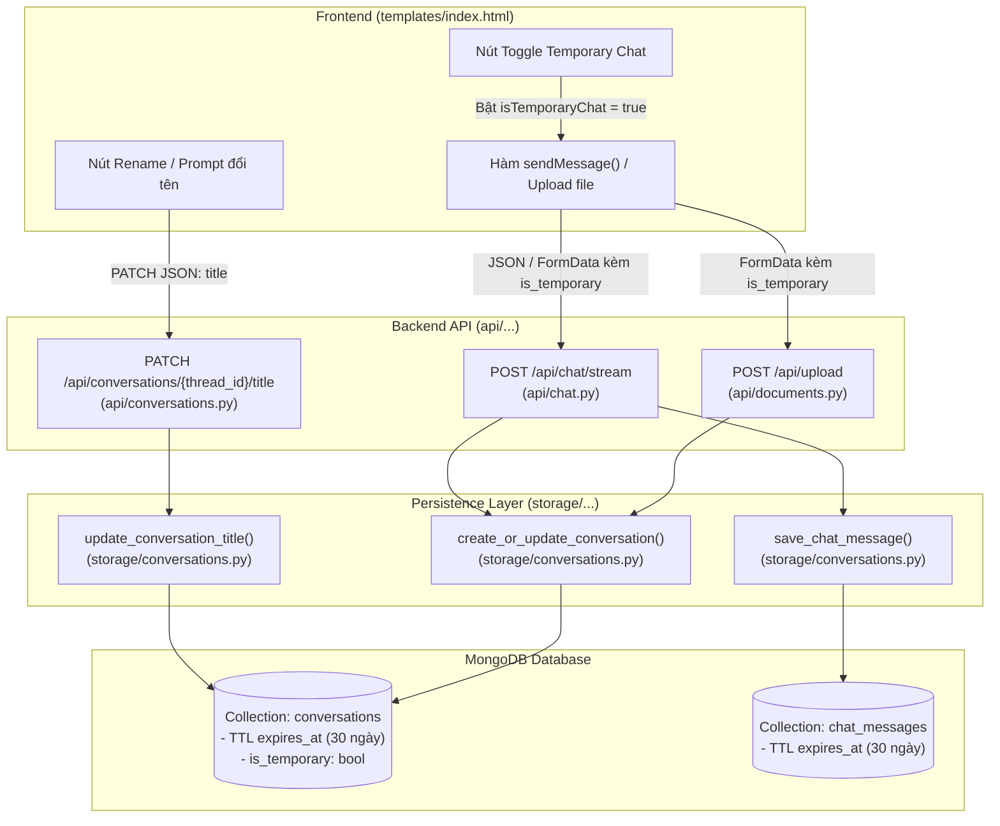

# HƯỚNG DẪN TRIỂN KHAI TÍNH NĂNG: ĐỔI TÊN HỘI THOẠI & CHAT TẠM THỜI (TEMPORARY CHAT)

Tài liệu này hướng dẫn chi tiết từng bước (step-by-step), kèm mã nguồn đầy đủ và địa chỉ file/dòng code cụ thể trong dự án **Tit-Chatbot** để triển khai 2 tính năng:
1. **Đổi tên cuộc trò chuyện (Rename Conversation)**
2. **Trò chuyện tạm thời (Temporary Chat - `temp_chat`)**

---

## MỤC LỤC
- [A. Kiến Trúc & Luồng Dữ Liệu Tổng Quan](#a-kiến-trúc--luồng-dữ-liệu-tổng-quan)
- [B. Tính Năng 1: Đổi Tên Cuộc Trò Chuyện (Rename Conversation)](#b-tính-năng-1-đổi-tên-cuộc-trò-chuyện-rename-conversation)
  - [Bước 1: Tầng Cơ Sở Dữ Liệu (Database / Storage Layer)](#b1-tầng-cơ-sở-dữ-liệu-storageconversationspy)
  - [Bước 2: Tầng API Backend (FastAPI Endpoint)](#b2-tầng-api-backend-apiconversationspy)
  - [Bước 3: Tầng Giao Diện Người Dùng (Frontend JavaScript & HTML)](#b3-tầng-giao-diện-templatesindexhtml)
- [C. Tính Năng 2: Trò Chuyện Tạm Thời (Temporary Chat)](#c-tính-năng-2-trò-chuyện-tạm-thời-temporary-chat)
  - [Bước 1: Cấu hình TTL Index tự hủy trên MongoDB](#c1-cấu-hình-ttl-index-tự-hủy-storagemongo_clientpy)
  - [Bước 2: Logic Lưu Trữ & Lọc Dữ Liệu Tạm Thời](#c2-logic-lưu-trữ--lọc-dữ-liệu-storageconversationspy)
  - [Bước 3: Tầng API Tiếp Nhận & Kế Thừa Cờ is_temporary](#c3-tầng-api-tiếp-nhận-apichatpy--apidocumentspy)
  - [Bước 4: Giao Diện Người Dùng & Quản Lý Trạng Thái UI](#c4-giao-diện-người-dùng--trạng-thái-ui-templatesindexhtml)
- [D. Cơ Chế Dọn Dẹp Tài Liệu & Vector Khi Xóa (Document & Vector Cleanup)](#d-cơ-chế-dọn-dẹp-tài-liệu--vector-khi-xóa-document--vector-cleanup)
  - [1. Khi người dùng xóa cuộc trò chuyện (Delete Conversation)](#d1-khi-người-dùng-xóa-cuộc-trò-chuyện-delete-conversation)
  - [2. Khi Admin xóa tài liệu trong hệ thống (Admin Delete Document)](#d2-khi-admin-xóa-tài-liệu-trong-hệ-thống-admin-delete-document)
  - [3. Khi Admin xóa người dùng (Delete User)](#d3-khi-admin-xóa-người-dùng-delete-user)
  - [4. Phân biệt: Xóa thủ công vs TTL tự hủy của MongoDB](#d4-phân-biệt-xóa-thủ-công-vs-ttl-tự-hủy-của-mongodb)
- [E. Bảng Tổng Hợp Vị Trí Code (Code Reference Map)](#e-bảng-tổng-hợp-vị-trí-code-code-reference-map)
- [F. Hướng Dẫn Kiểm Thử (Testing & Verification)](#f-hướng-dẫn-kiểm-thử-testing--verification)

---

## A. KIẾN TRÚC & LUỒNG DỮ LIỆU TỔNG QUAN



---

## B. TÍNH NĂNG 1: ĐỔI TÊN CUỘC TRÒ CHUYỆN (RENAME CONVERSATION)

### Mục tiêu
Cho phép người dùng chủ động đặt lại tiêu đề của một đoạn chat theo ý muốn để dễ quản lý trong thanh bên (sidebar).

---

### B.1. Tầng Cơ Sở Dữ Liệu (`storage/conversations.py`)
* **Địa chỉ code:** [storage/conversations.py](file:///d:/Tit-Chatbot/storage/conversations.py#L215-L235)
* **Nhiệm vụ:**
  - Kiểm tra đầu vào: `thread_id` và `new_title` không được rỗng.
  - Cắt bớt tiêu đề tối đa 100 ký tự và loại bỏ khoảng trắng thừa.
  - Kiểm tra quyền sở hữu: Nếu có truyền `user_id`, chỉ cập nhật nếu `user_id` khớp với chủ sở hữu bản ghi.
  - Cập nhật `updated_at` về thời điểm hiện tại.

#### Đoạn mã triển khai:
```python
def update_conversation_title(
    thread_id: str,
    new_title: str,
    user_id: str | None = None
) -> bool:
    """Cập nhật tiêu đề cuộc trò chuyện, có kiểm tra quyền sở hữu user_id."""
    if not thread_id or not isinstance(new_title, str) or not new_title.strip():
        return False

    clean_title = new_title.strip()[:100]
    coll = get_collection("conversations")
    query: dict[str, Any] = {"thread_id": thread_id}
    if user_id is not None:
        oid = _to_object_id(user_id)
        query["user_id"] = {"$in": [oid, str(oid)]} if oid else user_id

    res = coll.update_one(
        query,
        {"$set": {"title": clean_title, "updated_at": _now()}}
    )
    return res.matched_count > 0
```

---

### B.2. Tầng API Backend (`api/conversations.py`)
* **Địa chỉ code:** [api/conversations.py](file:///d:/Tit-Chatbot/api/conversations.py#L94-L139)
* **Route:** `PATCH /api/conversations/{thread_id}/title`
* **Nhiệm vụ:**
  1. Lấy thông tin user hiện tại qua `get_current_user(request)`.
  2. Lấy conversation qua `get_conversation(thread_id)` để kiểm tra tồn tại (nếu không có trả về `404`).
  3. Kiểm tra phân quyền qua `_can_access_conversation(conv, user)` (nếu không có quyền trả về `403`).
  4. Đọc body JSON `{"title": "..."}`, validate dữ liệu (nếu rỗng trả về `400`).
  5. Gọi `update_conversation_title(...)` và trả về kết quả JSON chuẩn `{"success": true, ...}`.

#### Đoạn mã triển khai:
```python
@router.patch("/conversations/{thread_id}/title")
async def rename_conversation(thread_id: str, request: Request):
    """Cập nhật tiêu đề cuộc trò chuyện (Rename)."""
    user = get_current_user(request)
    conv = get_conversation(thread_id)
    if not conv:
        return JSONResponse(
            {"success": False, "error": "Cuộc trò chuyện không tồn tại."},
            status_code=404
        )

    if not _can_access_conversation(conv, user):
        return JSONResponse(
            {"success": False, "error": "Bạn không có quyền đổi tên cuộc trò chuyện này."},
            status_code=403
        )

    try:
        data = await request.json()
        new_title = data.get("title", "")
        if not isinstance(new_title, str) or not new_title.strip():
            return JSONResponse(
                {"success": False, "error": "Tiêu đề không được để trống."},
                status_code=400
            )
    except Exception:
        return JSONResponse(
            {"success": False, "error": "Dữ liệu JSON không hợp lệ."},
            status_code=400
        )

    user_id = user["id"] if user else None
    success = update_conversation_title(thread_id, new_title.strip(), user_id=user_id)
    if not success:
        return JSONResponse(
            {"success": False, "error": "Không thể cập nhật tiêu đề."},
            status_code=400
        )

    return {
        "success": True,
        "thread_id": thread_id,
        "title": new_title.strip()[:100],
        "message": "Đã đổi tên cuộc trò chuyện thành công."
    }
```

---

### B.3. Tầng Giao Diện (`templates/index.html`)

#### 1. Nút hành động trên từng Item lịch sử
* **Địa chỉ code:** [templates/index.html](file:///d:/Tit-Chatbot/templates/index.html#L3237-L3246)
* Tạo nút với icon bút chì (`rename-btn`) và gắn sự kiện gọi `renameConversationPrompt(conv.thread_id, conv.title)`.

```javascript
const renameBtn = document.createElement("button");
renameBtn.className = "history-action-btn rename-btn";
renameBtn.title = "Đổi tên cuộc trò chuyện";
renameBtn.innerHTML = `
    <svg width="12" height="12" viewBox="0 0 24 24" fill="none" stroke="currentColor" stroke-width="2">
        <path d="M12 20h9"/>
        <path d="M16.5 3.5a2.121 2.121 0 0 1 3 3L7 19l-4 1 1-4L16.5 3.5z"/>
    </svg>
`;
renameBtn.onclick = (e) => {
    e.stopPropagation();
    renameConversationPrompt(conv.thread_id, conv.title || "Đoạn chat mới");
};
actions.appendChild(renameBtn);
```

#### 2. Hàm xử lý gửi yêu cầu PATCH đổi tên
* **Địa chỉ code:** [templates/index.html](file:///d:/Tit-Chatbot/templates/index.html#L3325-L3345)
* Mở hộp thoại nhập tên mới -> Gọi API `PATCH /api/conversations/${id}/title` -> Cập nhật trực tiếp DOM danh sách mà không cần tải lại toàn bộ trang.

```javascript
async function renameConversationPrompt(id, currentTitle) {
    const newTitle = prompt("Nhập tên mới cho cuộc trò chuyện:", currentTitle);
    if (!newTitle || !newTitle.trim() || newTitle.trim() === currentTitle) return;

    try {
        const res = await fetch(`/api/conversations/${id}/title`, {
            method: "PATCH",
            headers: { "Content-Type": "application/json" },
            body: JSON.stringify({ title: newTitle.trim() })
        });
        const data = await res.json().catch(() => ({}));
        if (res.ok && data.success) {
            // Cập nhật ngay tên hiển thị trên giao diện sidebar
            const titleEl = document.querySelector(`.history-item[data-thread-id="${id}"] .history-item-title`);
            if (titleEl) {
                titleEl.textContent = data.title;
            } else {
                await loadConversations();
            }
        } else {
            alert(data.error || "Không thể đổi tên cuộc trò chuyện.");
        }
    } catch (err) {
        console.error("Failed to rename conversation:", err);
        alert("Lỗi kết nối khi đổi tên cuộc trò chuyện.");
    }
}
```

---

## C. TÍNH NĂNG 2: TRÒ CHUYỆN TẠM THỜI (TEMPORARY CHAT)

### Mục tiêu
1. Cho phép người dùng trò chuyện ở chế độ ẩn danh/tạm thời (tương tự Incognito Mode).
2. **Không xuất hiện** trong danh sách lịch sử hội thoại bên sidebar.
3. Không ghi nhận vào bộ nhớ lâu dài (Long-term memory).
4. Tự động dọn dẹp sau 30 ngày thông qua cơ chế **MongoDB TTL (Time-To-Live) Index**.

---

### C.1. Cấu hình TTL Index tự hủy (`storage/mongo_client.py`)
* **Địa chỉ code:** [storage/mongo_client.py](file:///d:/Tit-Chatbot/storage/mongo_client.py#L127-L144)
* **Cơ chế:** MongoDB background thread sẽ tự động xóa tài liệu ngay khi thời gian hiện tại vượt qua trường `expires_at`.

```python
# TTL index tự động xóa guest / temporary conversations khi đến hạn expires_at
conv = get_collection("conversations")
conv.create_index(
    [("expires_at", ASCENDING)],
    expireAfterSeconds=0,
    background=True,
)

# TTL index tự động xóa tin nhắn tương ứng của cuộc trò chuyện tạm thời
msgs = get_collection("chat_messages")
msgs.create_index(
    [("expires_at", ASCENDING)],
    expireAfterSeconds=0,
    background=True,
)
```

---

### C.2. Logic Lưu Trữ & Lọc Dữ Liệu (`storage/conversations.py`)

#### 1. Tạo cuộc hội thoại tạm thời với TTL 30 ngày
* **Địa chỉ code:** [storage/conversations.py](file:///d:/Tit-Chatbot/storage/conversations.py#L56-L62)
* Khi `is_temporary=True`, gán cờ `is_temporary: True` và tính `expires_at = now + timedelta(days=30)`:

```python
if is_temporary:
    set_on_insert["is_temporary"] = True
    set_fields["is_temporary"] = True
    expiry = now + timedelta(days=30)
    set_on_insert["expires_at"] = expiry
    set_fields["expires_at"] = expiry
```

#### 2. Kế thừa hạn xóa cho tin nhắn chat
* **Địa chỉ code:** [storage/conversations.py](file:///d:/Tit-Chatbot/storage/conversations.py#L310-L314)
* Khi ghi tin nhắn vào `chat_messages`, nếu hội thoại thuộc loại `is_temporary`, tin nhắn cũng nhận cùng `expires_at`:

```python
conv_doc = conv_coll.find_one({"thread_id": thread_id}, {"is_temporary": 1, "expires_at": 1})
if conv_doc and conv_doc.get("is_temporary") and conv_doc.get("expires_at"):
    doc["expires_at"] = conv_doc["expires_at"]

msg_coll.insert_one(doc)
```

#### 3. Ẩn hội thoại tạm thời khỏi sidebar
* **Địa chỉ code:** [storage/conversations.py](file:///d:/Tit-Chatbot/storage/conversations.py#L112-L114)
* Trong hàm `list_conversations`, thêm điều kiện lọc `is_temporary: {"$ne": True}` để không tải các đoạn chat tạm thời vào sidebar:

```python
query = {"user_id": oid, "is_guest": {"$ne": True}, "is_temporary": {"$ne": True}}
```

---

### C.3. Tầng API Tiếp Nhận (`api/chat.py` & `api/documents.py`)

#### 1. Trong API Chat Streaming (`api/chat.py`)
* **Địa chỉ code:** [api/chat.py](file:///d:/Tit-Chatbot/api/chat.py#L271-L278)
* Nhận `is_temporary` từ payload JSON; nếu thread cũ đã là temporary thì tự động giữ nguyên cờ `is_temporary = True`:

```python
is_temporary = bool(data.get("is_temporary", False))
if not is_temporary and conv and conv.get("is_temporary"):
    is_temporary = True

agent = get_agent(selected_model)
create_or_update_conversation(thread_id, user_message, user_id=user_id, is_temporary=is_temporary)
save_chat_message(thread_id, "user", user_message, user_id=user_id)
```

#### 2. Trong API Upload Tài Liệu (`api/documents.py`)
* **Địa chỉ code:** [api/documents.py](file:///d:/Tit-Chatbot/api/documents.py#L46-L51) & [L89-L94](file:///d:/Tit-Chatbot/api/documents.py#L89-L94)
* Nhận `is_temporary: str = Form(default="false")`, chuyển sang boolean và cập nhật conversation:

```python
is_temp_bool = str(is_temporary).strip().lower() in ("true", "1")
conv = get_conversation(thread_id)
if not is_temp_bool and conv and conv.get("is_temporary"):
    is_temp_bool = True
create_or_update_conversation(thread_id, "Uploaded document", user_id=user_id, is_temporary=is_temp_bool)
```

---

### C.4. Giao Diện Người Dùng & Trạng Thái UI (`templates/index.html`)

#### 1. Nút bấm kích hoạt trên Header
* **Địa chỉ code:** [templates/index.html](file:///d:/Tit-Chatbot/templates/index.html#L2490-L2496)
* Đặt nút toggle ở topbar góc phải với icon thám tử/mặt nạ ẩn danh:

```html
<button class="temp-chat-toggle" id="tempChatToggle" onclick="toggleTemporaryChat()" aria-label="Trò chuyện tạm thời" title="Bật/Tắt trò chuyện tạm thời (Temporary chat)">
    <svg class="temp-spy-icon" width="18" height="18" viewBox="0 0 24 24" fill="currentColor">
        <path d="M12 2.5c-3.1 0-5.1 1.2-6.1 3.8l-3.3 1.2c-.4.1-.6.5-.6.9 0 .6.4 1 1 1h18c.6 0 1-.4 1-1 0-.4-.2-.8-.6-.9l-3.3-1.2c-1-2.6-3-3.8-6.1-3.8zm-4.2 4c.6-1.6 1.9-2.3 4.2-2.3s3.6.7 4.2 2.3H7.8z"/>
        <path d="M5.5 12.5a3.5 3.5 0 0 0-3.5 3.5c0 1.9 1.6 3.5 3.5 3.5 1.6 0 3-1.1 3.4-2.6.4-.1.7-.1 1.1-.1.4 0 .7 0 1.1.1.4 1.5 1.8 2.6 3.4 2.6 1.9 0 3.5-1.6 3.5-3.5a3.5 3.5 0 0 0-3.5-3.5c-1.5 0-2.8.9-3.3 2.2-.4 0-.8-.1-1.2-.1s-.8.1-1.2.1c-.5-1.3-1.8-2.2-3.3-2.2z"/>
    </svg>
    <span class="temp-label">Temporary chat</span>
</button>
```

#### 2. Biến trạng thái & Hàm Toggle
* **Địa chỉ code:** [templates/index.html](file:///d:/Tit-Chatbot/templates/index.html#L2763-L2782)
* Khi bấm toggle, đảo trạng thái `isTemporaryChat = !isTemporaryChat`, sinh mới `threadId` và cập nhật lại giao diện:

```javascript
let isTemporaryChat = false;
let threadId = localStorage.getItem("thread_id");

function toggleTemporaryChat() {
    isTemporaryChat = !isTemporaryChat;
    const btn = document.getElementById("tempChatToggle");
    if (btn) {
        btn.classList.toggle("active", isTemporaryChat);
    }
    // Khi bật chat tạm thời, sinh ID thread độc lập
    if (isTemporaryChat) {
        threadId = crypto.randomUUID();
    }
    renderWelcome();
    if (messageInput) messageInput.focus();
}

function updateTemporaryChatVisibility() {
    const tempBtn = document.getElementById("tempChatToggle");
    if (!tempBtn) return;
    // Ẩn nút toggle nếu cuộc trò chuyện đã có tin nhắn trao đổi
    const hasMessages = Boolean(chatContainer && chatContainer.querySelector(".message"));
    tempBtn.style.display = hasMessages ? "none" : "inline-flex";
    tempBtn.classList.toggle("active", isTemporaryChat);
}
```

#### 3. Hiển thị Banner & Thông Báo Chế Độ Tạm Thời
* **Địa chỉ code:** [templates/index.html](file:///d:/Tit-Chatbot/templates/index.html#L3420-L3435) & [L3507-L3515](file:///d:/Tit-Chatbot/templates/index.html#L3507-L3515)
* Khi `isTemporaryChat === true`:
  - Tiêu đề màn hình chính đổi sang **Temporary chat**.
  - Placeholder của ô chat đổi sang `"Ask anything in temporary chat..."`.
  - Dòng cảnh báo bên dưới: `"For safety, we may keep a copy of this chat for up to 30 days."`.

#### 4. Gửi cờ `is_temporary` khi Chat hoặc Upload File
* **Khi upload file:** [templates/index.html L3590](file:///d:/Tit-Chatbot/templates/index.html#L3590)
  ```javascript
  formData.append("is_temporary", isTemporaryChat ? "true" : "false");
  ```
* **Khi chat:** [templates/index.html L3684](file:///d:/Tit-Chatbot/templates/index.html#L3684)
  ```javascript
  const response = await fetch("/api/chat/stream", {
      method: "POST",
      headers: { "Content-Type": "application/json" },
      body: JSON.stringify({
          message: submittedMessage,
          thread_id: threadId,
          model: selectedModel,
          is_temporary: isTemporaryChat
      })
  });
  ```
* **Sau khi hoàn tất tin nhắn:** [templates/index.html L3754-L3761](file:///d:/Tit-Chatbot/templates/index.html#L3754-L3761)
  - Nếu là chat thường: Gọi `await loadConversations()` để cập nhật sidebar.
  - Nếu là chat tạm thời: **Không gọi** `loadConversations()`, và gọi `localStorage.removeItem("thread_id")` để khi F5 không khôi phục nhầm phiên tạm thời.

---
