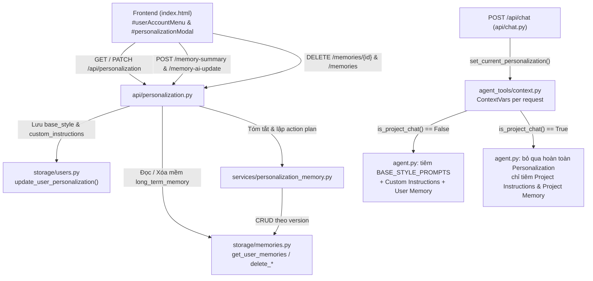

# Kiến trúc User Menu & Personalization (Tit-Chatbot)

Tài liệu này tổng hợp chi tiết thiết kế, luồng dữ liệu, cơ chế cách ly Project, quản lý Memory bằng LLM và code triển khai của tính năng **User Account Menu** và **Personalization**.

---

## 1. Tổng quan tính năng & Sơ đồ luồng hoạt động

### 1.1. Menu tài khoản ở Sidebar (`#userAccountMenu`)
Khi người dùng bấm vào thẻ tài khoản ở góc dưới Sidebar (`.user-profile-card`), popover menu bật lên với 4 mục (mỗi mục đều có icon SVG + nhãn chữ rõ ràng):
1. **Personalization**: Mở modal cài đặt 2 cột (`#personalizationModal`).
2. **Profile**: Mở modal chỉnh sửa hồ sơ & avatar (`openProfileModal()`).
3. **Claim offer**: Gắn badge `Soon`, hiển thị thông báo tính năng đang phát triển (`handleClaimOfferClick()`).
4. **Log out**: Đăng xuất tài khoản (`handleSignOut()`).

### 1.2. Modal Personalization 2 cột (`#personalizationModal`)
- **Tab 1 — Phong cách & Hướng dẫn (`#persTabStyle`)**:
  - **Base style and tone**: 5 thẻ chọn trực quan (`default`, `professional`, `friendly`, `efficient`, `creative`).
  - **Custom Instructions — Hướng dẫn riêng**: Nhập quy tắc cá nhân (tối đa `1500` ký tự), kèm 4 chip điền nhanh mẫu phổ biến và nhãn cảnh báo phạm vi (*Chỉ áp dụng cho chat cá nhân — không ảnh hưởng tới các Project*).
- **Tab 2 — Bộ nhớ (`#persTabMemory`)**:
  - Bộ nhớ cá nhân (`long_term_memory` lọc theo `user_id`) **luôn bật** (không có nút tắt/bật).
  - **Memory Summary**: Gọi LLM đọc toàn bộ bản ghi cá nhân theo `user_id` và tóm tắt thành hồ sơ ngắn gọn.
  - **Cập nhật bộ nhớ bằng AI**: Nhắn lệnh tự nhiên để LLM lập kế hoạch `add` / `update` / `delete` vào `long_term_memory` theo đúng optimistic version, sau đó tự động tóm tắt lại.
  - **Danh sách ghi nhớ gốc**: Xem từng mục và xóa lẻ hoặc xóa toàn bộ.

### 1.3. Luồng dữ liệu End-to-End



---

## 2. Cấu trúc Dữ liệu, Cách ly Project & Chi phí Token

### 2.1. Schema lưu trên MongoDB (`users` collection)
Mỗi user document bổ sung trường `personalization` được chuẩn hóa qua `normalize_personalization()` tại [\_helpers.py](file:///d:/Tit-Chatbot/storage/_helpers.py#L74-L106):
- `VALID_BASE_STYLES = ("default", "professional", "friendly", "efficient", "creative")`
- `MAX_CUSTOM_INSTRUCTIONS_LEN = 1500`
- Cấu trúc mặc định:
  ```json
  {
    "base_style": "default",
    "custom_instructions": ""
  }
  ```
- `_public_user()` luôn trả kèm field `"personalization"` đã chuẩn hóa cho `/api/auth/me` và `/api/personalization`.

### 2.2. Cơ chế cách ly nghiêm ngặt khỏi Project (`agent.py` & `api/chat.py`)
1. Tại [chat.py](file:///d:/Tit-Chatbot/api/chat.py#L258), đầu mỗi request chat, `set_current_personalization(pers.get("base_style"), pers.get("custom_instructions"))` lưu cấu hình cá nhân của user vào `ContextVar` riêng của request ([context.py](file:///d:/Tit-Chatbot/agent_tools/context.py#L82-L92)).
2. Trong `chatbot_node()` của [agent.py](file:///d:/Tit-Chatbot/agent.py#L218-L245):
   - Nhánh `if is_project_chat():` chỉ đọc `get_current_project_instructions()`, `get_current_project_context()` và `get_project_memories()`. **Không đọc** `get_current_personalization()`.
   - Nhánh `else:` (chat cá nhân) mới đọc `get_current_personalization()`, tra cứu `BASE_STYLE_PROMPTS` ([agent.py](file:///d:/Tit-Chatbot/agent.py#L172)), và gắn thêm `custom_instructions` nếu khác rỗng.
   - Do đó, khi chat trong bất kỳ Project nào (kể cả owner hay thành viên), phong cách riêng và Custom Instructions cá nhân của từng user **không bao giờ rò rỉ hoặc ghi đè** `Project Instructions` chung của nhóm.

### 2.3. Kiểm soát chi phí Token cho từng Base Style
- Khi `base_style == "default"` (mặc định) và `custom_instructions == ""`: **+0 extra tokens** được thêm vào system prompt.
- Với 4 phong cách còn lại (`professional`, `friendly`, `efficient`, `creative`), chỉ một chỉ thị ngắn gọn (~15–25 tokens) từ `BASE_STYLE_PROMPTS` được nối vào cuối `system_prompt` ở chat cá nhân; chi phí phần trăm trên tổng prompt rất nhỏ và chỉ tăng thêm khi người dùng chủ động bật style khác `default` hoặc viết `custom_instructions`.

---

## 3. Code triển khai chi tiết theo từng tầng

### 3.1. Tầng Storage & Context
- [\_helpers.py](file:///d:/Tit-Chatbot/storage/_helpers.py#L74-L106): Định nghĩa `VALID_BASE_STYLES`, `MAX_CUSTOM_INSTRUCTIONS_LEN`, `normalize_personalization()`, và nhúng `"personalization"` vào `_public_user()`.
- [users.py](file:///d:/Tit-Chatbot/storage/users.py#L342-L375): Hàm `update_user_personalization(user_id, *, base_style=None, custom_instructions=None)` kiểm tra hợp lệ `base_style` (trả `ValueError` nếu sai), cắt gọn `custom_instructions` tối đa `1500` ký tự, cập nhật `users.update_one(...)` và trả về user mới nhất.
- [memories.py](file:///d:/Tit-Chatbot/storage/memories.py#L320-L347): Bổ sung `delete_user_memory_by_id_for_settings(user_id, memory_id)` và `delete_all_personal_memories(user_id)` để xóa mềm (`is_deleted: True`) đúng bản ghi có `user_id` tương ứng (không chạm tới project memory vì project memory không mang `user_id`).
- [context.py](file:///d:/Tit-Chatbot/agent_tools/context.py#L82-L92): Bổ sung `set_current_personalization()` và `get_current_personalization()`, re-export qua [tools.py](file:///d:/Tit-Chatbot/tools.py) và [dependencies.py](file:///d:/Tit-Chatbot/api/dependencies.py).

### 3.2. Tầng Service: Memory Summary & AI Update ([personalization_memory.py](file:///d:/Tit-Chatbot/services/personalization_memory.py))

```python
def summarize_user_memories(
    user_id: str,
    *,
    memories: list[dict[str, Any]] | None = None,
    llm: Any | None = None,
) -> dict[str, Any]:
    """Lấy toàn bộ long_term_memory cá nhân theo user_id và gọi LLM tóm tắt thành hồ sơ dễ đọc."""
    if memories is None:
        loaded = get_user_memories(user_id=user_id, query="", allow_full_fallback=True)
        memories = loaded.get("memories", [])

    if not memories:
        return {
            "summary": "Chưa có thông tin bộ nhớ cá nhân nào được lưu.",
            "memories": [],
            "count": 0,
        }

    fact_lines = [
        f"- {item.get('memory', '')}"
        for item in memories
        if str(item.get("memory") or "").strip()
    ]
    client = llm or _make_memory_llm(max_tokens=700)
    messages = [
        {"role": "system", "content": _SUMMARY_SYSTEM_PROMPT},
        {"role": "user", "content": "Danh sách bộ nhớ cá nhân:\n" + "\n".join(fact_lines)},
    ]

    response = invoke_with_rate_limit_retry(
        lambda: client.invoke(messages),
        max_retries=2,
        operation="Memory Summary",
    )
    model_name = getattr(client, "model_name", None) or getattr(client, "model", "Groq")
    log_token_usage(str(model_name), "Memory Summary", response)

    summary_text = _extract_text(response) or "\n".join(fact_lines)
    return {
        "summary": summary_text,
        "memories": memories,
        "count": len(memories),
    }


def apply_llm_memory_instruction(
    user_id: str,
    instruction: str,
    *,
    llm: Any | None = None,
) -> dict[str, Any]:
    """Dùng LLM phân tích yêu cầu người dùng để thêm/sửa/xóa long_term_memory theo đúng version."""
    clean_instruction = (instruction or "").strip()
    if not clean_instruction:
        raise ValueError("Vui lòng nhập nội dung yêu cầu cập nhật bộ nhớ.")

    loaded = get_user_memories(user_id=user_id, query="", allow_full_fallback=True)
    current_memories = loaded.get("memories", [])
    valid_versions = {
        str(item.get("memory_id")): int(item.get("version", 1))
        for item in current_memories
        if item.get("memory_id")
    }

    client = llm or _make_memory_llm(max_tokens=800)
    payload = {
        "instruction": clean_instruction,
        "existing_memories": [
            {
                "memory_id": item.get("memory_id"),
                "version": int(item.get("version", 1)),
                "memory": item.get("memory", ""),
            }
            for item in current_memories
        ],
    }
    messages = [
        {"role": "system", "content": _UPDATE_SYSTEM_PROMPT},
        {"role": "user", "content": json.dumps(payload, ensure_ascii=False)},
    ]

    def _invoke_plan() -> MemoryActionPlan:
        if hasattr(client, "with_structured_output"):
            try:
                bound = client.with_structured_output(MemoryActionPlan, method="json_schema", strict=False)
                return _parse_action_plan(bound.invoke(messages))
            except Exception as exc:
                err_msg = str(exc).lower()
                if "json_validate_failed" in err_msg or "badrequesterror" in err_msg or "400" in err_msg:
                    bound_fallback = client.with_structured_output(MemoryActionPlan, method="json_mode")
                    return _parse_action_plan(bound_fallback.invoke(messages))
                raise
        return _parse_action_plan(client.invoke(messages))

    plan = invoke_with_rate_limit_retry(
        _invoke_plan,
        max_retries=2,
        operation="Memory AI Update",
    )

    applied: list[dict[str, str]] = []
    for item in plan.actions:
        if item.action == "add":
            new_text = item.new_memory.strip()
            if not new_text:
                continue
            saved = save_memory_entry("", new_text, user_id=user_id)
            if saved:
                applied.append({"action": "add", "detail": f"Đã thêm: {new_text}"})
        elif item.action == "update":
            mem_id = item.memory_id.strip()
            new_text = item.new_memory.strip()
            if mem_id not in valid_versions or not new_text:
                continue
            ver = valid_versions[mem_id]
            msg = update_memory_by_id(user_id=user_id, memory_id=mem_id, new_memory=new_text, version=ver)
            applied.append({"action": "update", "detail": msg})
        elif item.action == "delete":
            mem_id = item.memory_id.strip()
            if mem_id not in valid_versions:
                continue
            ver = valid_versions[mem_id]
            msg = delete_memory_by_id(user_id=user_id, memory_id=mem_id, version=ver)
            applied.append({"action": "delete", "detail": msg})

    refreshed = summarize_user_memories(user_id, llm=client)
    return {
        "success": True,
        "applied_actions": applied,
        "note": plan.note,
        **refreshed,
    }
```

### 3.3. Tầng API Endpoints ([personalization.py](file:///d:/Tit-Chatbot/api/personalization.py), mount tại [app.py](file:///d:/Tit-Chatbot/app.py#L91-L118))

| Method | Path | Mục đích |
|---|---|---|
| `GET` | `/api/personalization` | Trả về `personalization` hiện tại + danh sách `memories` cá nhân |
| `PATCH` | `/api/personalization` | Lưu `base_style` và `custom_instructions` xuống MongoDB |
| `POST` | `/api/personalization/memory-summary` | Lấy toàn bộ `long_term_memory` theo `user_id` và tóm tắt bằng LLM |
| `POST` | `/api/personalization/memory-ai-update` | Nhận `instruction` để LLM thêm/sửa/xóa bộ nhớ rồi tóm tắt lại |
| `DELETE` | `/api/personalization/memories/{memory_id}` | Xóa mềm một bản ghi bộ nhớ cá nhân |
| `DELETE` | `/api/personalization/memories` | Xóa mềm toàn bộ bộ nhớ cá nhân |

```python
@router.get("/personalization")
async def get_personalization(request: Request):
    """Trả về cài đặt Personalization hiện tại và danh sách bộ nhớ cá nhân đang lưu."""
    user = _require_user(request)
    if isinstance(user, JSONResponse):
        return user

    mem_data = get_user_memories(user_id=str(user["id"]), query="", allow_full_fallback=True)
    return {
        "success": True,
        "personalization": user.get("personalization", {"base_style": "default", "custom_instructions": ""}),
        "memories": mem_data.get("memories", []),
    }


@router.patch("/personalization")
async def patch_personalization(request: Request):
    """Lưu cài đặt Base style & tone và Custom Instructions cá nhân của user."""
    user = _require_user(request)
    if isinstance(user, JSONResponse):
        return user

    try:
        data = await request.json()
    except Exception:
        return JSONResponse({"success": False, "error": "Dữ liệu JSON không hợp lệ."}, status_code=400)

    try:
        updated_user = update_user_personalization(
            str(user["id"]),
            base_style=data.get("base_style"),
            custom_instructions=data.get("custom_instructions"),
        )
        return {
            "success": True,
            "message": "Đã lưu cài đặt Personalization!",
            "personalization": updated_user.get("personalization"),
            "user": _serialize_user(updated_user),
        }
    except ValueError as exc:
        return JSONResponse({"success": False, "error": str(exc)}, status_code=400)
    except Exception as exc:
        logger.exception("Lỗi lưu cài đặt Personalization:")
        return JSONResponse({"success": False, "error": str(exc)}, status_code=500)


@router.post("/personalization/memory-summary")
async def create_memory_summary(request: Request):
    """Gọi LLM tóm tắt toàn bộ long_term_memory cá nhân lọc theo user_id."""
    user = _require_user(request)
    if isinstance(user, JSONResponse):
        return user

    try:
        result = summarize_user_memories(str(user["id"]))
        return {"success": True, **result}
    except Exception as exc:
        logger.exception("Lỗi tóm tắt bộ nhớ cá nhân:")
        return JSONResponse({"success": False, "error": f"Không thể tóm tắt bộ nhớ: {exc}"}, status_code=500)


@router.post("/personalization/memory-ai-update")
async def ai_update_memory(request: Request):
    """Nhận lệnh tự nhiên để LLM thêm/sửa/xóa long_term_memory cá nhân và trả về tóm tắt mới."""
    user = _require_user(request)
    if isinstance(user, JSONResponse):
        return user

    try:
        data = await request.json()
    except Exception:
        return JSONResponse({"success": False, "error": "Dữ liệu JSON không hợp lệ."}, status_code=400)

    instruction = str(data.get("instruction") or "").strip()
    try:
        result = apply_llm_memory_instruction(str(user["id"]), instruction)
        return result
    except ValueError as exc:
        return JSONResponse({"success": False, "error": str(exc)}, status_code=400)
    except Exception as exc:
        logger.exception("Lỗi cập nhật bộ nhớ bằng AI:")
        return JSONResponse({"success": False, "error": f"Không thể cập nhật bộ nhớ: {exc}"}, status_code=500)
```

### 3.4. Tầng Frontend ([index.html](file:///d:/Tit-Chatbot/templates/index.html))
- **CSS**:
  - `.user-account-menu` & `.user-menu-item`: [lines 1659-1718](file:///d:/Tit-Chatbot/templates/index.html#L1659-L1718)
  - `.pers-modal-container`, `.pers-tone-grid`, `.pers-tone-card`, `.pers-preset-chip`, `.pers-summary-card`, `.pers-ai-update-box`, `.pers-facts-list`: [lines 2109-2292](file:///d:/Tit-Chatbot/templates/index.html#L2109-L2292)
- **Popover Menu trong `renderUserUI()`**: [lines 4940-5003](file:///d:/Tit-Chatbot/templates/index.html#L4940-L5003)
- **JavaScript xử lý menu, modal, tone cards, preset chips & API Memory**: [lines 5030-5355](file:///d:/Tit-Chatbot/templates/index.html#L5030-L5355)
- **HTML Modal 2 cột (`#personalizationModal`)**: [lines 6179-6305](file:///d:/Tit-Chatbot/templates/index.html#L6179-L6305)

```javascript
async function savePersonalizationSettings() {
    const btn = document.getElementById("persSaveBtn");
    const textarea = document.getElementById("persCustomInstructions");
    const customInstructions = textarea ? textarea.value : "";

    _setPersBanner(null, "");
    if (btn) btn.disabled = true;
    try {
        const res = await fetch("/api/personalization", {
            method: "PATCH",
            headers: { "Content-Type": "application/json" },
            body: JSON.stringify({
                base_style: persSelectedStyle,
                custom_instructions: customInstructions,
            }),
        });
        const data = await res.json();
        if (!res.ok || !data.success) {
            throw new Error(data.error || "Lưu cài đặt thất bại.");
        }
        if (data.user) {
            currentUser = data.user;
        } else if (currentUser) {
            currentUser.personalization = data.personalization;
        }
        _setPersBanner("success", data.message || "Đã lưu cài đặt Personalization!");
    } catch (err) {
        _setPersBanner("error", err.message || "Không thể lưu cài đặt.");
    } finally {
        if (btn) btn.disabled = false;
    }
}
```

---

## 4. Kết quả kiểm thử (Mocked Unit & Integration Tests)

Đã xác minh bằng `python -B -m py_compile` (toàn bộ 11 file Python biên dịch thành công) và chạy script kiểm thử [verify_personalization.py](file:///C:/Users/Admin/.gemini/antigravity/brain/9e109677-3f82-493d-aa4e-b53019e4ba9d/scratch/verify_personalization.py) với MongoDB, LLM (`ChatGroq` / `_FakeLLM`) và `sentence_transformers` được mock cục bộ:
1. `test_storage_helpers_and_users`: Kiểm tra `VALID_BASE_STYLES`, chuẩn hóa giá trị không hợp lệ, cắt 1500 ký tự, `_public_user()`, `update_user_personalization()`.
2. `test_storage_memories_settings_delete`: Kiểm tra xóa mềm 1 mục và xóa toàn bộ theo `user_id` + `is_deleted=False`.
3. `test_context_and_agent_isolation`: Kiểm tra `build_agent` + `chatbot_node` qua `MemorySaver`:
   - Chat cá nhân với `creative` + custom instructions: có đủ `[Preferred tone:` và `[User Custom Instructions`.
   - Chat cá nhân với `default` + rỗng: không thêm prompt dư thừa.
   - Chat trong Project (`proj-123`): bỏ qua hoàn toàn style và custom instructions cá nhân, chỉ dùng `Project rule only`.
4. `test_personalization_memory_service`: Kiểm tra `summarize_user_memories()` (rỗng & có dữ liệu) và `apply_llm_memory_instruction()` gọi `save_memory_entry`, `update_memory_by_id(version=2)`, `delete_memory_by_id(version=1)`.
5. `test_api_personalization_routes`: Kiểm tra 6 endpoint (`/api/personalization*`) và mã `401` khi chưa đăng nhập.
6. `test_frontend_elements`: Kiểm tra đầy đủ ID, hàm JS và text của `#userAccountMenu` & `#personalizationModal` trong `templates/index.html`.
