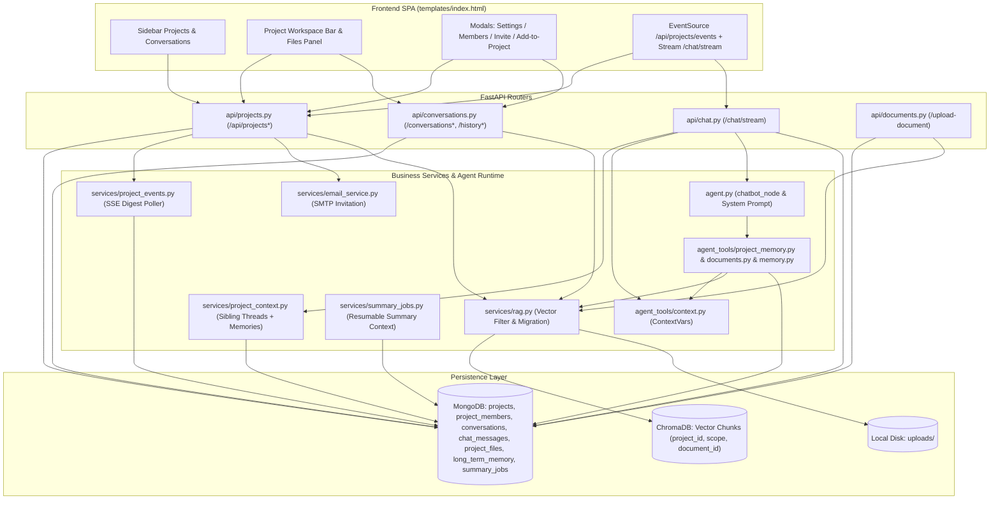
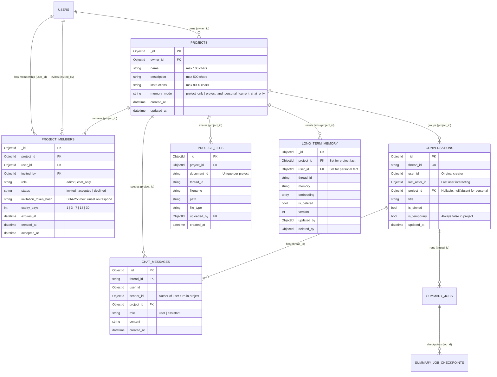
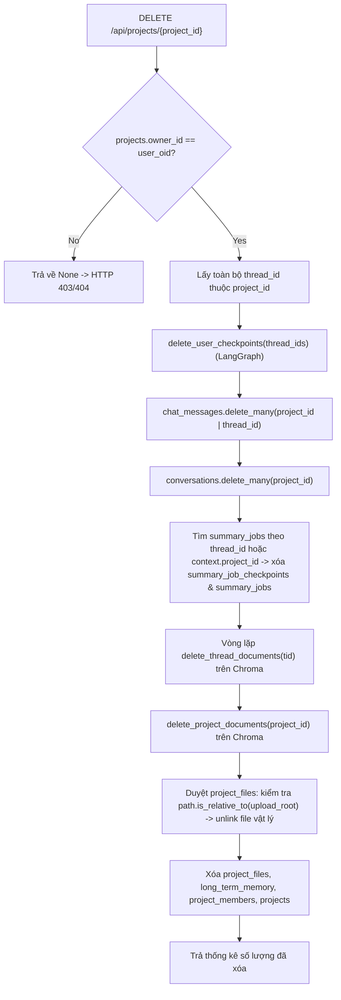
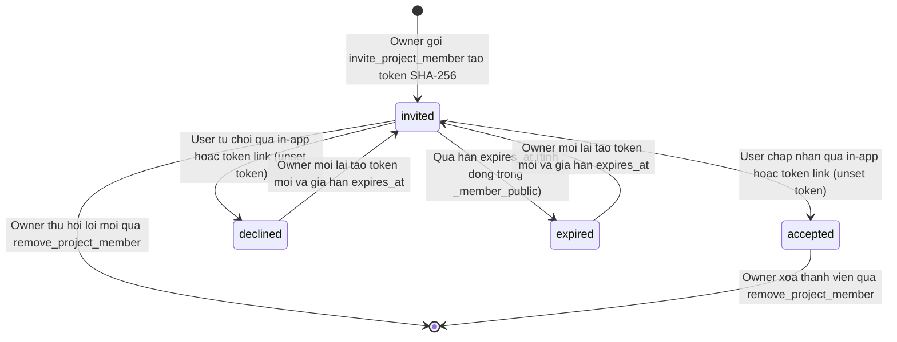
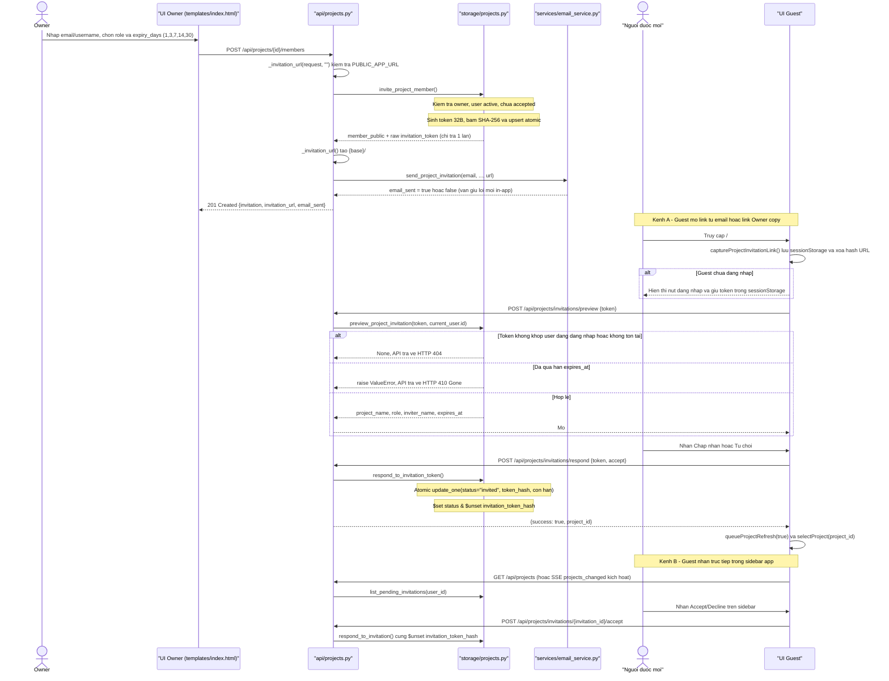
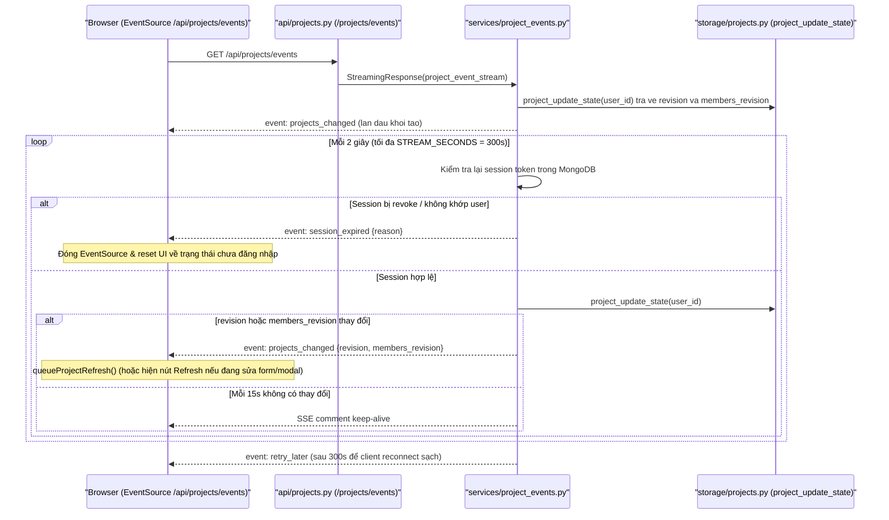
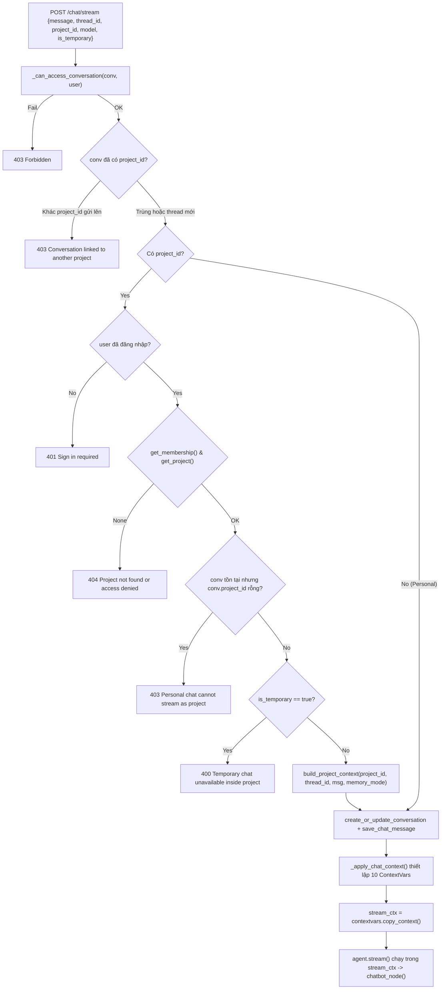
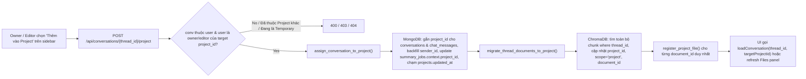

# Thiết kế Chi tiết & Code Reference Hệ thống **Projects** (`projects_updated.md`)

**Tổ chức giao diện hiện tại:** DOM và modal nằm trong [templates/index.html](../templates/index.html); các hàm JavaScript đã chuyển sang [static/js/chat.js](../static/js/chat.js), stylesheet sang [static/css/chat.css](../static/css/chat.css). Các link nguồn bên dưới đã được cập nhật theo vị trí mới sau khi chia khối code. Nghiệp vụ và thứ tự khởi tạo được giữ nguyên.

> Tài liệu này tổng hợp và mô tả chi tiết toàn bộ thiết kế dữ liệu, luồng xử lý, phân quyền, tích hợp RAG/Memory/SSE/UI và code thực tế của tính năng **Projects** đang chạy trên codebase hiện tại. Mọi đường dẫn và số dòng đều đối chiếu trực tiếp tới mã nguồn hiện hành.

---

## 1. Tổng quan Kiến trúc & Những Nâng cấp Trọng tâm

Tính năng **Projects** cho phép nhiều người dùng cộng tác trong một không gian làm việc chung gồm: **hội thoại nhiều thành viên**, **Project Instructions riêng**, **kho tài liệu RAG & hình ảnh dùng chung**, **Project Long-term Memory dùng chung**, và **chế độ cách ly ngữ cảnh**.

So với thiết kế ban đầu, hệ thống hiện tại bổ sung nhiều cơ chế quan trọng:
1. **Đồng bộ Realtime đa worker không cần Redis/Broker ([`services/project_events.py`](../services/project_events.py#L1-L51))**: Endpoint SSE `GET /api/projects/events` tính SHA-256 `revision` / `members_revision` mỗi 2 giây, tự kiểm tra lại session người dùng, phát sự kiện `projects_changed` hoặc `session_expired`, kèm fallback polling 10 giây ở frontend.
2. **Link mời riêng tư bảo mật bằng SHA-256 & Hash Fragment ([`storage/projects.py`](../storage/projects.py#L273-L407), [`api/projects.py`](../api/projects.py#L50-L56))**: Token gốc 32 bytes chỉ trả về một lần hoặc gửi qua URL `/#project-invite=<token>` (hash fragment không lọt vào server access logs / header `Referer`), database chỉ lưu `invitation_token_hash`, hỗ trợ thời hạn `{1, 3, 7, 14, 30}` ngày và gửi email SMTP qua [`services/email_service.py`](../services/email_service.py#L67-L90).
3. **Cách ly hoàn toàn Personalization trong Project Chat ([`agent.py`](../agent.py#L235-L285))**: Khi trò chuyện trong Project, agent bỏ qua `BASE_STYLE_PROMPTS` và `custom_instructions` cá nhân của người gửi để mọi thành viên nhận phản hồi đồng nhất theo `Project Instructions`.
4. **Giữ `ContextVar` xuyên suốt luồng SSE ([`api/chat.py`](../api/chat.py#L275-L340), [`api/chat.py`](../api/chat.py#L504-L529))**: Đóng gói ngữ cảnh request vào `stream_ctx = contextvars.copy_context()` để các agent tools đọc được `project_id`, `project_memory_mode`, `user_id` khi `agent.stream()` chạy qua threadpool.
5. **Chuyển Chat cá nhân sang Project kèm Migration dữ liệu ([`api/conversations.py`](../api/conversations.py#L268-L315), [`storage/conversations.py`](../storage/conversations.py#L341-L419), [`services/rag.py`](../services/rag.py#L830-L884))**: Hỗ trợ đưa một thread cá nhân có sẵn vào Project, backfill `sender_id`, cập nhật `summary_jobs`, gắn lại metadata ChromaDB sang `scope="project"` và đăng ký vào `project_files`.
6. **Tìm kiếm liên Project (`Search Chats`) ([`storage/conversations.py`](../storage/conversations.py#L619))**: Cho phép tìm đồng thời trong hội thoại cá nhân và các Project mà user là `owner` hoặc thành viên `accepted`.

### Sơ đồ Kiến trúc Phân tầng Tổng thể



---

## 2. Bản đồ File Toàn hệ thống

| Tầng | File Path | Vai trò chính trong luồng Projects |
| :--- | :--- | :--- |
| **App Entry** | [`app.py`](../app.py#L136) | Mount routers `projects`, `conversations`, `chat`, `documents` và khởi tạo Mongo indexes. |
| **Storage Core** | [`storage/projects.py`](../storage/projects.py#L1-L567) | CRUD Project, RBAC (`get_membership`, `can_edit_project`), cascade `delete_project`, mời/duyệt token SHA-256, `project_update_state`, `project_files`, `project_memory`. |
| **Storage Indexes** | [`storage/mongo_client.py`](../storage/mongo_client.py#L148-L189) | Định nghĩa toàn bộ indexes cho `projects`, `project_members`, `project_files`, `conversations`, `chat_messages`, `long_term_memory`. |
| **Storage Chat** | [`storage/conversations.py`](../storage/conversations.py#L29-L655) | Phân tách chat cá nhân/Project, giữ `user_id` là creator gốc + `last_actor_id`, gán `sender_id`, `assign_conversation_to_project`, `search_user_conversations`. |
| **Storage Memory** | [`storage/memories.py`](../storage/memories.py#L47-L373) | `_memory_scope_filter` tách biệt `project_id` vs `user_id`; `clear_user_memories` bảo toàn memory của Project. |
| **Storage Users** | [`storage/users.py`](../storage/users.py#L260-L304) | Xóa tài khoản chỉ xóa hội thoại cá nhân, giữ lại hội thoại user đã tạo trong Project của người khác. |
| **API Projects** | [`api/projects.py`](../api/projects.py#L1-L391) | 19 REST + SSE endpoints quản lý Project, lời mời, thành viên và files dùng chung. |
| **API Chat** | [`api/chat.py`](../api/chat.py#L247-L529) | Validate membership, chặn temporary chat trong Project, dựng `project_context`, bind `ContextVar` vào `stream_ctx`. |
| **API Conversations** | [`api/conversations.py`](../api/conversations.py#L49-L315) | Kiểm tra quyền quản lý hội thoại (`_can_manage_project_conversation`), resolve `sender_name` khi tải lịch sử, chuyển chat vào Project, tìm kiếm liên Project. |
| **API Documents** | [`api/documents.py`](../api/documents.py#L57-L170) | Kiểm tra quyền `owner`/`editor` khi upload vào Project, đánh index vector theo `project_id` và ghi `project_files`. |
| **Service SSE** | [`services/project_events.py`](../services/project_events.py#L1-L51) | Stream SSE phát hiện thay đổi quyền/project theo SHA-256 state hash. |
| **Service Context** | [`services/project_context.py`](../services/project_context.py#L1-L79) | Tổng hợp ngữ cảnh tối đa 9,000 ký tự từ các thread cùng Project và top 5 Project Memories. |
| **Service RAG** | [`services/rag.py`](../services/rag.py#L263-L897) | Filter RAG/Image theo `project_id` và `current_chat_only`, xóa file Project, migrate chunks từ chat cá nhân sang Project. |
| **Service Email** | [`services/email_service.py`](../services/email_service.py#L67-L121) | Gửi email HTML + text lời mời Project qua SMTP với link `#project-invite=...`. |
| **Service Summary** | [`services/summary_jobs.py`](../services/summary_jobs.py#L54) | Lưu `project_id` vào context của các tác vụ tóm tắt tài liệu dài (`summary_jobs`). |
| **Agent & Tools** | [`agent.py`](../agent.py#L200-L285) | Inject `[Instructions for this project]` + `[Relevant context from this project only]`, tắt Personalization cá nhân. |
| **Agent Context & Tools** | [`agent_tools/context.py`](../agent_tools/context.py#L1-L113)<br>[`agent_tools/project_memory.py`](../agent_tools/project_memory.py#L1-L155)<br>[`agent_tools/memory.py`](../agent_tools/memory.py#L33-L34)<br>[`agent_tools/documents.py`](../agent_tools/documents.py#L55-L239) | Truyền `ContextVar` xuống tools; cung cấp `remember_project_fact`, `search_project_facts`, `update_project_fact`, `forget_project_fact`; khóa/mở personal memory theo `memory_mode`. |
| **Frontend UI** | [`templates/index.html`](../templates/index.html#L58-L439) | Sidebar Project, Workspace bar, Files panel, SSE client, Invitation banner/modal, Members modal, Add-to-Project modal. |

---

## 3. Thiết kế Dữ liệu (MongoDB, ChromaDB & Local Disk)

### 3.1. Sơ đồ Quan hệ Thực thể (MongoDB ER Diagram)



### 3.2. MongoDB Indexes ([`storage/mongo_client.py#L148-L189`](../storage/mongo_client.py#L148-L189))

| Collection | Key Indexes | Ghi chú thiết kế |
| :--- | :--- | :--- |
| `projects` | `(owner_id ASC, updated_at DESC)` | Truy vấn nhanh danh sách Project do user sở hữu, sắp xếp mới nhất. |
| `project_members` | `(project_id ASC, user_id ASC)` **[UNIQUE]**<br>`(user_id ASC, status ASC)`<br>`(invitation_token_hash ASC)` **[UNIQUE, SPARSE]**<br>`(user_id ASC, status ASC, expires_at ASC)` | **Cố ý KHÔNG tạo TTL index** trên `expires_at` ([L155](../storage/mongo_client.py#L155)) vì thành viên đã `accepted` phải tồn tại vĩnh viễn sau khi hạn lời mời qua đi; `sparse=True` cho phép nhiều row `accepted`/`declined` cùng thiếu `invitation_token_hash` (đã `$unset`). |
| `project_files` | `(project_id ASC, document_id ASC)` **[UNIQUE]**<br>`(project_id ASC, created_at DESC)` | Ngăn trùng `document_id` khi đăng ký file lúc upload hoặc migrate chat cá nhân. |
| `conversations` | `(project_id ASC, updated_at DESC)` | Liệt kê sidebar hội thoại và gom nhóm sibling threads trong `build_project_context`. |
| `chat_messages` | `(project_id ASC, created_at ASC)` | Truy vấn lịch sử tin nhắn thuộc Project theo thời gian. |
| `long_term_memory` | `(user_id ASC, is_deleted ASC, created_at DESC)`<br>`(project_id ASC, is_deleted ASC, created_at DESC)`<br>`(thread_id ASC)`<br>`("memory", "text")` | Tách hoàn toàn truy vấn memory cá nhân và memory Project, kết hợp text + vector search. |

### 3.3. ChromaDB & File hệ thống (`uploads/`)

- **Metadata vector chunks trong [`services/rag.py`](../services/rag.py#L286-L287), [`services/rag.py#L564`](../services/rag.py#L564)**:
  - Khi upload vào Project, mọi chunk tài liệu và ảnh đều gắn `project_id: str(project_id)`, `scope: "project"`, `document_id`, `thread_id`, `file_path` / `image_path`.
  - Khi lọc trong Project ([`services/rag.py#L340-L347`](../services/rag.py#L340-L347), [`services/rag.py#L499-L505`](../services/rag.py#L499-L505)):
    - Nếu `current_chat_only=True`: lọc `$and: [{"project_id": project_id}, {"thread_id": thread_id}]`.
    - Nếu không: lọc theo `{"project_id": project_id}` trên toàn Project.
    - Không fallback về lọc cá nhân `user_id` khi `project_id` tồn tại, tránh rò rỉ tài liệu riêng tư của thành viên vào Project.
- **Bảo vệ Path Traversal khi tải hoặc xóa file vật lý**:
  - Endpoint download [`api/projects.py#L348-L364`](../api/projects.py#L348-L364) và hàm xóa [`storage/projects.py#L247-L259`](../storage/projects.py#L247-L259) luôn `.resolve()` đường dẫn và kiểm tra `file_path.is_relative_to(upload_root)` (nằm trong thư mục `uploads/`).
  - Hàm `delete_project_document` ([`services/rag.py#L712-L730`](../services/rag.py#L712-L730)) xóa file vật lý trên đĩa **trước**, nếu thất bại sẽ raise `RuntimeError` và giữ nguyên vector chunks trong ChromaDB để tránh mất liên kết đồng bộ.

---

## 4. Mô hình Phân quyền (RBAC) & Cô lập Dữ liệu

### 4.1. Ma trận Phân quyền theo Vai trò

Hệ thống định nghĩa 3 vai trò thực tế tại [`storage/projects.py#L19`](../storage/projects.py#L19) và [`storage/projects.py#L163-L182`](../storage/projects.py#L163-L182):
- `owner`: Xác định động bằng `project.owner_id == user_oid` (không lưu trong `project_members`).
- `editor`: Bản ghi `project_members` có `status="accepted"`, `role="editor"`.
- `chat_only`: Bản ghi `project_members` có `status="accepted"`, `role="chat_only"`.

| Hành động / API | `owner` | `editor` | `chat_only` | Người ngoài / `invited` | Ghi chú nguồn |
| :--- | :---: | :---: | :---: | :---: | :--- |
| Xem thông tin Project, danh sách chat, lịch sử chat | Có | Có | Có | Không (`404`) | [`api/projects.py#L189-L252`](../api/projects.py#L189-L252) |
| Xem danh sách thành viên (`GET /members`) | Đầy đủ + pending + expired | Chỉ thành viên `accepted` | Chỉ thành viên `accepted` | Không (`404`) | [`storage/projects.py#L320-L336`](../storage/projects.py#L320-L336) |
| Chỉnh sửa tên, mô tả, Instructions, `memory_mode` | Có | Có | Không (`403`) | Không (`404`) | [`storage/projects.py#L179-L214`](../storage/projects.py#L179-L214) |
| Xóa vĩnh viễn Project (`DELETE /projects/{id}`) | Có | Không (`403`) | Không (`403`) | Không | [`storage/projects.py#L217-L227`](../storage/projects.py#L217-L227) |
| Mời thành viên, đổi role, xóa thành viên | Có | Không (`403`) | Không (`403`) | Không | [`api/projects.py#L266-L324`](../api/projects.py#L266-L324) |
| Gửi tin nhắn chat trong Project (`/chat/stream`) | Có | Có | Có | Không (`404`) | [`api/chat.py#L470-L481`](../api/chat.py#L470-L481) |
| Ghim / Đổi tên / Xóa một conversation trong Project | Mọi chat | Mọi chat | **Chỉ chat do chính mình tạo** (`conv.user_id == user.id`) | Không (`403`) | [`api/conversations.py#L49-L62`](../api/conversations.py#L49-L62) |
| Chuyển chat cá nhân vào Project (`POST /conversations/{id}/project`) | Có | Có | Không (`403`) | Không | [`api/conversations.py#L268-L315`](../api/conversations.py#L268-L315) |
| Upload file vào Project / Xóa file Project | Có | Có | Không (`403`) | Không | [`api/documents.py#L57-L170`](../api/documents.py#L57-L170), [`api/projects.py#L367-L390`](../api/projects.py#L367-L390) |
| Tải xuống & Hỏi đáp RAG trên Project files | Có | Có | Có | Không | [`api/projects.py#L348-L365`](../api/projects.py#L348-L365) |
| Tìm kiếm (`search_project_facts`) | Có | Có | Có | Không | [`agent_tools/project_memory.py#L81-L92`](../agent_tools/project_memory.py#L81-L92) |
| Lưu / Sửa / Xóa Project fact (`remember`/`update`/`forget`) | Có | Có | Không (trả thông báo từ chối) | Không | [`agent_tools/project_memory.py#L58-L155`](../agent_tools/project_memory.py#L58-L155) |

Code kiểm tra quyền thao tác conversation tại [`api/conversations.py#L49-L62`](../api/conversations.py#L49-L62):
```python
def _can_manage_project_conversation(conv: dict, user: dict | None) -> bool:
    """Allow the creator, project owner, or project editor to modify/delete a project chat."""
    if not conv or not user:
        return False
    if str(conv.get("user_id") or "") == str(user.get("id") or ""):
        return True
    project_id = conv.get("project_id")
    if not project_id:
        return False
    return can_edit_project(str(project_id), user["id"])
```

### 4.2. Bảo toàn dữ liệu chung khi User xóa dữ liệu cá nhân

- **Khi user xóa toàn bộ bộ nhớ cá nhân (`clear_user_memories`)**: [`storage/memories.py#L365-L372`](../storage/memories.py#L365-L372) chỉ đánh dấu `is_deleted=True` cho các bản ghi thỏa mãn `{"$or": [{"project_id": {"$exists": False}}, {"project_id": None}]}` -> Project memories vẫn nguyên vẹn.
- **Khi user xóa tài khoản (`delete_user_account`)**: [`storage/users.py#L264-L275`](../storage/users.py#L264-L275) chỉ xóa các `conversations` và `chat_messages` cá nhân (`project_id` rỗng hoặc không tồn tại) để không làm mất lịch sử thảo luận chung trong Project của người khác.

---

## 5. Luồng 1: Vòng đời Project (Tạo, Cập nhật & Cascade Delete)

1. **Tạo Project ([`storage/projects.py#L103-L123`](../storage/projects.py#L103-L123))**: Giới hạn `name[:100]` (bắt buộc không rỗng), `description[:500]`, mặc định `instructions=""` và `memory_mode="project_only"`.
2. **Cập nhật Project ([`storage/projects.py#L190-L214`](../storage/projects.py#L190-L214))**: Kiểm tra `can_edit_project(project_id, user_id)`. Chỉ chấp nhận `name[:100]`, `description[:500]`, `instructions[:8000]`, `memory_mode` thuộc `{"project_only", "project_and_personal", "current_chat_only"}`.
3. **Xóa Project Cascade ([`storage/projects.py#L217-L265`](../storage/projects.py#L217-L265))**: Chỉ `owner` mới được phép xóa. Hệ thống dọn sạch đồng bộ toàn bộ 9 loại tài nguyên liên quan theo trình tự:



---

## 6. Luồng 2: Mời Thành viên khác vào Nhóm & Vòng đời Token Lời mời

### 6.1. Máy trạng thái Thành viên (`project_members`)

Trạng thái thực tế trong DB chỉ lưu 3 giá trị (`invited`, `accepted`, `declined`). Riêng trạng thái `expired` không lưu cứng trong DB mà được [`_member_public()`](../storage/projects.py#L58-L65) tính động khi đọc nếu `status == "invited"` và `expires_at <= now` (giúp membership đã `accepted` không bao giờ bị xóa nhầm bởi TTL index).



### 6.2. Sơ đồ Tuần tự Toàn bộ Quá trình Mời & Tiếp nhận (Link + In-app)



### 6.3. Diễn giải Từng Bước & Code Chi tiết

#### Bước 1: Owner gửi lời mời từ Modal Thành viên ([`static/js/chat.js#L1132-L1187`](../static/js/chat.js#L1132-L1187))
- Khi Owner mở `#projectMembersModal` và submit form `#projectInviteForm`, hàm `submitProjectInvitation()` đọc `identifier` (email hoặc username), `role` (`"editor"` hoặc `"chat_only"`), và `expiry_days` (`1`, `3`, `7`, `14`, `30`).
- Hàm gọi `runProjectMemberAction(state, "", "POST", {identifier, role, expiry_days}, ...)` gửi tới `POST /api/projects/{project_id}/members`.
- Sau khi thành công:
  - Reset form và bật khung `#projectInvitationLinkBox` chứa `data.invitation_url` kèm nút **Sao chép** (`copyProjectInvitationLink()`).
  - Hiển thị phản hồi rõ gửi email thành công hay thất bại (nếu SMTP lỗi vẫn báo Owner copy link hoặc nhắc Guest xem trong app).
  - Tự động nhắc: *"Gửi lại sẽ vô hiệu hóa link cũ"* vì mỗi lần mời mới sẽ ghi đè `invitation_token_hash`.

#### Bước 2: Route API validate URL & gửi Email fallback ([`api/projects.py#L50-L56`](../api/projects.py#L50-L56), [`api/projects.py#L268-L300`](../api/projects.py#L268-L300))
1. **Kiểm tra cấu hình URL trước khi ghi DB**: Gọi `_invitation_url(request, "")` ngay đầu request để đảm bảo `PUBLIC_APP_URL` hợp lệ (`http`/`https`, không chứa query/fragment/userinfo) trước khi tạo token.
2. **Đưa token vào URL Hash Fragment (`#project-invite=`)**:
```python
def _invitation_url(request: Request, token: str) -> str:
    base = (os.getenv("PUBLIC_APP_URL") or str(request.base_url)).rstrip("/")
    parsed = urlsplit(base)
    if parsed.scheme not in {"http", "https"} or not parsed.netloc or parsed.query or parsed.fragment or parsed.username:
        raise ValueError("PUBLIC_APP_URL must be an absolute HTTP(S) application URL without query or fragment.")
    # Fragments are kept out of server access logs and Referer headers.
    return f"{base}/#project-invite={token}"
```
3. **Tách biệt tạo lời mời DB và gửi email SMTP**: Nếu `send_project_invitation()` ([`services/email_service.py#L67-L90`](../services/email_service.py#L67-L90)) ném exception (do chưa cấu hình SMTP hoặc lỗi mạng), API chỉ log warning và **vẫn trả `201 Created`** kèm `invitation_url` và `email_sent: False` để lời mời không bị mất.

#### Bước 3: Lưu DB an toàn, băm SHA-256 & chống Race Condition ([`storage/projects.py#L52-L65`](../storage/projects.py#L52-L65), [`storage/projects.py#L273-L317`](../storage/projects.py#L273-L317))
- Validate theo thứ tự: Project tồn tại & `owner_id == inviter_oid` -> `role in {"editor", "chat_only"}` -> `expiry_days in {1, 3, 7, 14, 30}` -> tìm user active theo `email` hoặc `username` (lowercase) -> chặn tự mời chính mình -> chặn người đã là `accepted`.
- Sinh `token = secrets.token_urlsafe(32)` (256-bit entropy) nhưng **chỉ lưu bản băm SHA-256** (`invitation_token_hash`) qua `_token_hash()`, token gốc chỉ trả về một lần trong dictionary kết quả rồi bị `member.pop("invitation_token")` ở tầng API.
- Dùng `find_one_and_update(..., filter={"project_id": project_oid, "user_id": target_oid, "status": {"$ne": "accepted"}}, upsert=True)`:
  - Cho phép Owner **gửi lại/mời lại** nếu lời mời trước đang `invited`, `declined`, hoặc `expired`, tự động ghi đè token hash mới và `expires_at` mới.
  - Nếu có race condition (Guest vừa bấm Accept đúng tích tắc Owner bấm Invite) làm đụng unique index `(project_id, user_id)` và ném `DuplicateKeyError`, code bắt ngoại lệ và báo lỗi user đã là thành viên ([`storage/projects.py#L301-L317`](../storage/projects.py#L301-L317)):
```python
    token = secrets.token_urlsafe(32)
    try:
        doc = members.find_one_and_update(
            {"project_id": project_oid, "user_id": target_oid, "status": {"$ne": "accepted"}},
            {"$set": {"role": role, "status": "invited", "invited_by": inviter_oid,
                      "created_at": now, "expires_at": now + timedelta(days=expiry_days),
                      "accepted_at": None, "invitation_token_hash": _token_hash(token)},
             "$setOnInsert": {"project_id": project_oid, "user_id": target_oid}},
            upsert=True, return_document=ReturnDocument.AFTER,
        )
    except DuplicateKeyError as exc:
        # An invitation may have been accepted between the read and the write.
        raise ValueError("This user is already a project member.") from exc
```

#### Bước 4: Guest mở Link Mời & Xác thực Preview ([`static/js/chat.js#L1234-L1279`](../static/js/chat.js#L1234-L1279), [`api/projects.py#L129-L146`](../api/projects.py#L129-L146), [`storage/projects.py#L377-L393`](../storage/projects.py#L377-L393))
1. Ngay khi load trang, `captureProjectInvitationLink()` đọc `project-invite` từ `location.hash`, cất vào `pendingProjectInvitationToken` và `sessionStorage("pending_project_invitation")`, rồi xóa tham số này khỏi URL bằng `history.replaceState` để không lộ token trên thanh địa chỉ hoặc khi reload.
2. `showProjectInvitationLink()` mở `#projectInvitationModal`:
   - Nếu chưa đăng nhập: giữ token trong `sessionStorage`, yêu cầu đăng nhập đúng tài khoản được mời.
   - Sau khi có `currentUser`: gọi `POST /api/projects/invitations/preview`.
3. Backend [`preview_project_invitation()`](../storage/projects.py#L377-L393) băm SHA-256 token gửi lên và truy vấn **ràng buộc theo cả `invitation_token_hash` lẫn `user_id == current_user` và `status == "invited"`**:
   - Nếu người đăng nhập là tài khoản khác -> trả `None` -> API trả `404` (không để lộ tên Project hay bất kỳ thông tin nào cho tài khoản sai).
   - Nếu đã quá hạn `_invitation_expiry(row) <= _now()` -> `raise ValueError` -> API trả `410 Gone`.

#### Bước 5: Chấp nhận / Từ chối & Hủy Token Atomic ([`storage/projects.py#L360-L407`](../storage/projects.py#L360-L407), [`api/projects.py#L149-L188`](../api/projects.py#L149-L188))
- **Qua Link (`respond_to_invitation_token`)** ([`storage/projects.py#L396-L407`](../storage/projects.py#L396-L407)):
```python
def respond_to_invitation_token(token: str, user_id: str, accept: bool) -> str | None:
    invitation = preview_project_invitation(token, user_id)
    if not invitation:
        return None
    now = _now()
    result = get_collection("project_members").update_one(
        {"_id": _oid(invitation["_id"]), "user_id": _oid(user_id), "status": "invited",
         "invitation_token_hash": _token_hash(token), **_valid_invitation(now)},
        {"$set": {"status": "accepted" if accept else "declined", "accepted_at": now if accept else None},
         "$unset": {"invitation_token_hash": ""}},
    )
    return invitation["project_id"] if result.modified_count == 1 else None
```
- **Qua danh sách chờ trong ứng dụng (`respond_to_invitation`)** ([`storage/projects.py#L360-L374`](../storage/projects.py#L360-L374)):
  - Khi user đang mở sẵn app, [`list_pending_invitations()`](../storage/projects.py#L339-L352) trả về các lời mời còn hạn; user bấm Accept/Decline ngay trên sidebar (`respondProjectInvite()` tại [`static/js/chat.js#L1207-L1231`](../static/js/chat.js#L1207-L1231)) gọi `POST /api/projects/invitations/{invitation_id}/accept` hoặc `/decline`.
  - Cả hai hàm `respond_to_invitation` và `respond_to_invitation_token` đều dùng bộ lọc `status == "invited"` + `**_valid_invitation(now)` và thực hiện **`$unset: {"invitation_token_hash": ""}`** trong cùng một lệnh `update_one` -> đảm bảo token chỉ dùng được **đúng 1 lần**, không thể replay link email sau khi đã xử lý trong app hoặc ngược lại.
- Sau khi `respondProjectInvitationLink(accept)` thành công ([`static/js/chat.js#L1301-L1326`](../static/js/chat.js#L1301-L1326)), UI đóng modal, xóa `sessionStorage`, gọi `queueProjectRefresh(true)`, và nếu `accept == true` thì gọi `selectProject(data.project_id)` mở thẳng vào Project mới.

#### Bước 6: Quản lý Thành viên sau khi mời ([`static/js/chat.js#L1045-L1130`](../static/js/chat.js#L1045-L1130), [`api/projects.py#L303-L325`](../api/projects.py#L303-L325))
- **Danh sách hiển thị**: `GET /api/projects/{project_id}/members` trả danh sách owner + toàn bộ `project_members`.
- **Đổi quyền (`PATCH /members/{member_id}`)**: Chỉ `owner` được phép chuyển giữa `chat_only` <-> `editor` khi thành viên đang ở trạng thái `accepted`.
- **Gửi lại / Mời lại**: Nút **Gửi lại** (`invited`) hoặc **Mời lại** (`declined`/`expired`) trên UI tự điền sẵn email/username và role lên form để Owner phát sinh token mới.
- **Thu hồi lời mời / Xóa thành viên (`DELETE /members/{member_id}`)**: Gọi `remove_project_member()`, xóa bản ghi trong `project_members`; qua luồng SSE (Mục 7), tab của người bị xóa sẽ nhận `projects_changed` và tự thoát khỏi Project nếu đang mở.

---

## 7. Luồng 3: Đồng bộ Realtime đa Worker qua SSE (`/api/projects/events`)

Để mọi tab/trình duyệt của Owner và các Member cập nhật ngay lập tức khi có lời mời mới, đổi quyền (`editor` <-> `chat_only`), bị xóa khỏi Project, hoặc hết phiên đăng nhập mà không cần cài Redis Pub/Sub:



- **Tính toán State Digest ([`storage/projects.py#L415-L437`](../storage/projects.py#L415-L437))**:
  - `project_update_state(user_id)` hash SHA-256 danh sách các Project mà user sở hữu hoặc từng được mời (`_id`, `name`, `owner_id`, `updated_at`) cùng các bản ghi `project_members` liên quan (`_id`, `project_id`, `user_id`, `role`, `status`, `created_at`, `expires_at` sau khi qua `_member_public()`, tức tự đổi sang `"expired"` nếu quá hạn).
  - Nhờ tách riêng `revision` (toàn cục) và `members_revision`, frontend biết chính xác khi nào cần reload danh sách Project hay reload danh sách Members.
- **Chống mất dữ liệu form đang thao tác trên UI ([`static/js/chat.js#L781-L854`](../static/js/chat.js#L781-L854))**:
  - Khi nhận `projects_changed`, `refreshProjectMembersWhenSafe()` kiểm tra `state.busy || !state.loaded || list.querySelector('[data-save-role]:not(:disabled), .project-member-confirm')`: nếu Owner đang chọn `<select>` đổi role (nút Lưu đã sáng) hoặc đang mở xác nhận xóa, frontend **không tự render đè DOM** mà bật nút `#projectMembersRefreshBtn` ("Có thay đổi mới · Tải lại").
  - Khi tab bị ẩn (`document.hidden`) hoặc `EventSource` lỗi, frontend tự chuyển sang polling dự phòng mỗi 10 giây và kết nối lại SSE khi tab được bật lại.

---

## 8. Luồng 4: Chat trong Project, 3 Chế độ `memory_mode` & Cách ly Personalization

### 8.1. Sơ đồ Luồng Xử lý Request `/chat/stream`



### 8.2. Ma trận hành vi của 3 `memory_mode`

| Thành phần bị chi phối | `project_only` *(Mặc định)* | `project_and_personal` | `current_chat_only` | Nguồn kiểm tra |
| :--- | :--- | :--- | :--- | :--- |
| **Lịch sử chat anh em (`sibling threads`)** | Đọc tối đa 12 thread khác trong Project, 24 message mới nhất | Giống `project_only` | **Tắt hoàn toàn** (trả về `""`) | [`services/project_context.py#L26-L73`](../services/project_context.py#L26-L73) |
| **Project Long-term Memory** (`remember/search/update/forget_project_fact`) | Bật (tự chèn top 5 vào prompt + agent gọi tool) | Bật | **Tắt hoàn toàn** (`_project_memory_enabled() == False`) | [`services/project_context.py#L74-L78`](../services/project_context.py#L74-L78), [`agent_tools/project_memory.py#L30-L32`](../agent_tools/project_memory.py#L30-L32) |
| **Personal Long-term Memory** (`agent_tools/memory.py`) | **Khóa hoàn toàn** | **Mở** (`_allow_personal_memory() == True`) | **Khóa hoàn toàn** | [`agent_tools/memory.py#L33-L34`](../agent_tools/memory.py#L33-L34) |
| **Phạm vi RAG & Hình ảnh** | Toàn bộ tài liệu/ảnh của Project | Toàn bộ tài liệu/ảnh của Project | **Chỉ tài liệu/ảnh thuộc `thread_id` hiện tại** | [`agent_tools/documents.py#L55-L239`](../agent_tools/documents.py#L55-L239), [`services/rag.py#L340-L347`](../services/rag.py#L340-L347) |
| **Personalization (Style & Custom Instructions)** | **Tắt hoàn toàn** | **Tắt hoàn toàn** | **Tắt hoàn toàn** | [`agent.py`](../agent.py#L235-L285) |

### 8.3. Chi tiết Context Builder, Prompt Isolation & Quyền sở hữu Tin nhắn

1. **Giới hạn ngữ cảnh Project ([`services/project_context.py#L11-L79`](../services/project_context.py#L11-L79))**:
   - `MAX_PROJECT_CONTEXT_CHARS = 9000`.
   - Truy vấn tối đa 12 `conversations` khác trong Project (`thread_id != current_thread_id`, sắp xếp `updated_at DESC`), lấy tối đa 24 `chat_messages` mới nhất trên các thread đó rồi đảo ngược về đúng thứ tự thời gian.
   - Ánh xạ `sender_id || user_id` sang tên thành viên để LLM biết ai nói câu nào (`"User (<tên>): ..."`), nối thêm top 5 `search_project_memories(project_id, query, limit=5)`, và cắt giữ **9,000 ký tự cuối cùng** (`text[-MAX_PROJECT_CONTEXT_CHARS:]`) nếu vượt ngưỡng.

2. **Cách ly Personalization trong [`agent.py`](../agent.py#L200-L285)**:
   - Hàm `chatbot_node()` kiểm tra `if is_project_chat():` (dựa vào `get_current_project_chat_enabled()` & `get_current_project_id()`):
     - **Trong Project**: chỉ ghép `[Instructions for this project]` và `[Relevant context from this project only]`, tuyệt đối không gọi `build_personalization_prompt_suffix`.
     - **Chat cá nhân**: mới áp dụng style và custom instructions từ `user.personalization`.

3. **Turn Guard cho Project Memory Tools ([`agent_tools/project_memory.py#L35-L155`](../agent_tools/project_memory.py#L35-L155))**:
   - `_current_turn_project_memory_results(state)` duyệt ngược `state["messages"]` tới `HumanMessage` gần nhất để kiểm tra LLM đã gọi `search_project_facts` trong chính lượt hiện tại chưa.
   - `update_project_fact` và `forget_project_fact` chỉ chấp nhận `memory_id` nằm trong danh sách vừa tìm được ở lượt đó (tránh LLM bịa ID hoặc xóa nhầm fact cũ) và kiểm tra `can_edit_project(project_id, user_id)` (từ chối `chat_only`).

4. **Theo dõi Tác giả Tin nhắn & Người tạo Hội thoại ([`storage/conversations.py#L29-L475`](../storage/conversations.py#L29-L475), [`api/conversations.py#L203-L234`](../api/conversations.py#L203-L234))**:
   - Trong `create_or_update_conversation`: khi cuộc trò chuyện thuộc Project, trường `user_id` của bản ghi `conversations` **luôn giữ nguyên là người tạo ban đầu** (giúp `chat_only` vẫn giữ quyền sửa/xóa thread mình mở), còn `last_actor_id` ghi nhận người vừa nhắn tin mới nhất.
   - Trong `save_chat_message`: mọi message vai trò `"user"` trong Project đều lưu thêm `sender_id` và `project_id`, đồng thời chạm `projects.updated_at`. Khi load lại lịch sử (`GET /history/{thread_id}`), API resolve `sender_id || user_id` sang `sender_name` để UI hiển thị tên thành viên trên bong bóng chat.

5. **Giữ `ContextVar` qua `StreamingResponse` ([`api/chat.py#L275-L340`](../api/chat.py#L275-L340))**:
   - Vì FastAPI/Starlette chạy generator đồng bộ bên trong `iterate_in_threadpool`, việc set `ContextVar` ở coroutine ngoài sẽ không tự truyền sang từng bước `next()` nếu chỉ gọi trực tiếp. Do đó `_chat_event_generator()` sao chép `stream_ctx = contextvars.copy_context()` sau `_apply_chat_context(...)` và chạy từng bước `stream_ctx.run(next, iterator, ...)` để mọi tool call (`project_memory`, `documents`, `memory`) đọc đúng ngữ cảnh Project đang chat.

---

## 9. Luồng 5: Tài liệu dùng chung (RAG), Summary Jobs & Chuyển Chat Cá nhân vào Project

### 9.1. Upload & Khai thác Tài liệu / Ảnh trong Project

- **Upload ([`api/documents.py#L57-L170`](../api/documents.py#L57-L170))**:
  - Khi request `/upload-document` có `project_id`, API kiểm tra đăng nhập (`401`), sự tồn tại Project (`404`) và quyền chỉnh sửa `can_edit_project(project_id, user_id)` (`403` nếu là `chat_only`).
  - Vector chunks (tài liệu qua `add_document_to_rag` hoặc ảnh qua `add_image_to_rag`) được gắn `project_id`, `scope="project"`, `document_id`.
  - Đồng thời lưu metadata bản ghi vào Mongo collection `project_files` qua `register_project_file()` ([`storage/projects.py#L542-L550`](../storage/projects.py#L542-L550)).
- **Truy vấn RAG & Tóm tắt ([`agent_tools/documents.py#L55-L239`](../agent_tools/documents.py#L55-L239), [`services/summary_jobs.py#L54`](../services/summary_jobs.py#L54))**:
  - Cả 3 tools `search_uploaded_documents`, `summarize_uploaded_document`, và `analyze_uploaded_image` đều đọc `project_id = get_current_project_id() or None` và `current_chat_only = get_current_project_memory_mode() == "current_chat_only"` rồi chuyển xuống [`services/rag.py`](../services/rag.py#L314-L929).
  - Với tài liệu dài cần tóm tắt nhiều bước (`summary_jobs`), `project_id` được lưu vào `job["context"]["project_id"]` ([`services/summary_jobs.py#L54`](../services/summary_jobs.py#L54)) để khi xóa Project hay chuyển thread vào Project, các checkpoint tóm tắt được dọn dẹp hoặc gán đúng ngữ cảnh.

### 9.2. Chuyển Chat Cá nhân vào Project (`Add to Project`)



Code API điều phối quá trình migrate tại [`api/conversations.py#L268-L315`](../api/conversations.py#L268-L315) và hàm migrate Chroma tại [`services/rag.py#L830-L884`](../services/rag.py#L830-L884). Lưu ý đặc thù thiết kế:
- Một cuộc trò chuyện **đã thuộc Project khác** (`conv.project_id` đã có giá trị khác) hoặc là **Temporary Chat** (`is_temporary=True`) đều bị từ chối chuyển để tránh trộn chéo dữ liệu giữa hai Project.

---

## 10. Luồng 6: Tìm kiếm Liên Project (`Search Chats`) & Kiến trúc Giao diện

### 10.1. Tìm kiếm hội thoại (`GET /api/conversations/search`)

- API [`api/conversations.py#L94-L103`](../api/conversations.py#L94-L103) gọi `search_user_conversations()` ([`storage/conversations.py#L619`](../storage/conversations.py#L619)):
  - Gom ID mọi Project user sở hữu (`projects.owner_id == user_oid`) hoặc đã chấp nhận (`project_members.status == "accepted"`).
  - Truy vấn `conversations` theo phạm vi `(cá nhân của user) HOẶC (project_id thuộc tập Project hợp lệ)`, khớp từ khóa trên `title` và nội dung tin nhắn, trả kèm `project_id` và `project_name` để giao diện hiển thị badge Project và chuyển ngữ cảnh đúng khi click mở kết quả.

### 10.2. Bản đồ UI & State Frontend (`templates/index.html`)

| Thành phần UI / State | Vị trí Code | Chức năng chính |
| :--- | :--- | :--- |
| **State toàn cục JS** | [`static/js/chat.js#L678-L1010`](../static/js/chat.js#L678-L1010) | `activeProjectId`, `activeProject`, `cachedProjects`, `projectMembersState`, `pendingProjectInvitationToken`, `pendingAddThreadId`. |
| **Sidebar Project Section** | [`templates/index.html#L58`](../templates/index.html#L58), [`L3863`](../static/js/chat.js#L682) | `loadProjects()`: render danh sách Project + lời mời đang chờ, lọc cuộc trò chuyện Project ở sidebar riêng khi đang vào một Project. |
| **Workspace Bar & Files Panel** | [`templates/index.html#L106-L115`](../templates/index.html#L106-L115), [`L3413`](../static/js/chat.js#L226), [`L4495-L4525`](../static/js/chat.js#L1319-L1350) | `updateProjectWorkspace()` cập nhật tiêu đề, mô tả, ẩn nút Cài đặt/Xóa nếu không đủ quyền; `toggleProjectFiles()` mở danh sách file có nút tải xuống & xóa (nếu `owner`/`editor`). |
| **SSE Sync Client** | [`static/js/chat.js#L780-L838`](../static/js/chat.js#L780-L838) | `syncProjectEvents()` mở `EventSource("/api/projects/events")`, fallback polling 10s, xử lý `session_expired` và guard `projectMembersRefreshBtn`. |
| **Cài đặt & Xóa Project** | [`static/js/chat.js#L891`](../static/js/chat.js#L891), [`L4369-L4382`](../static/js/chat.js#L1191-L1205) | `editProjectSettings()` chỉnh tên/mô tả/instructions/`memory_mode`; `deleteActiveProject()` xác nhận & xóa sạch Project, đưa UI về `newChat()`. |
| **Modal Thành viên & Lời mời** | [`static/js/chat.js#L924-L1317`](../static/js/chat.js#L924-L1317), [`L7091-L7172`](../templates/index.html#L333-L414) | `#projectMembersModal` (mời user, chọn role/expiry, copy link, đổi role/kick member) và `#projectInvitationModal` (preview & accept/decline link `#project-invite=`). |
| **Modal Chuyển Chat vào Project** | [`static/js/chat.js#L1514-L1601`](../static/js/chat.js#L1514-L1601), [`L7175-L7197`](../templates/index.html#L417-L439) | `openAddToProjectModal()` lọc danh sách Project user có quyền `owner`/`editor`; `submitAddToProject()` gọi API migrate và chuyển context sang Project đích. |

---

## 11. Bảng Tổng hợp API Endpoints (`/api/projects*` & Liên quan)

| Method & Path | Quyền yêu cầu | Trạng thái / Output chính | Định nghĩa tại |
| :--- | :--- | :--- | :--- |
| `GET /api/projects` | User đăng nhập | `{projects, invitations}` | [`api/projects.py#L81-L87`](../api/projects.py#L81-L87) |
| `POST /api/projects` | User đăng nhập | `201 Created` `{project}` | [`api/projects.py#L90-L101`](../api/projects.py#L90-L101) |
| `GET /api/projects/invitations` | User đăng nhập | `{invitations}` (chỉ lời mời còn hạn) | [`api/projects.py#L109-L115`](../api/projects.py#L109-L115) |
| `GET /api/projects/events` | User đăng nhập | `text/event-stream` (`projects_changed`, `session_expired`, `retry_later`) | [`api/projects.py#L118-L124`](../api/projects.py#L118-L124) |
| `POST /api/projects/invitations/preview` | Đúng user được mời | `{invitation}` / `404` / `410 Gone` | [`api/projects.py#L127-L144`](../api/projects.py#L127-L144) |
| `POST /api/projects/invitations/respond` | Đúng user được mời | `{success, accepted, project_id}` / `410` | [`api/projects.py#L147-L164`](../api/projects.py#L147-L164) |
| `POST /api/projects/invitations/{id}/accept` | Đúng user được mời | `{success: true}` | [`api/projects.py#L167-L175`](../api/projects.py#L167-L175) |
| `POST /api/projects/invitations/{id}/decline` | Đúng user được mời | `{success: true}` | [`api/projects.py#L178-L186`](../api/projects.py#L178-L186) |
| `GET /api/projects/{project_id}` | Member `accepted` | `{project}` | [`api/projects.py#L189-L203`](../api/projects.py#L189-L203) |
| `PATCH /api/projects/{project_id}` | `owner` hoặc `editor` | `{project}` / `400` / `403` | [`api/projects.py#L206-L219`](../api/projects.py#L206-L219) |
| `DELETE /api/projects/{project_id}` | Chỉ `owner` | `{success, deleted}` | [`api/projects.py#L222-L234`](../api/projects.py#L222-L234) |
| `GET /api/projects/{project_id}/conversations` | Member `accepted` | `{conversations}` | [`api/projects.py#L237-L251`](../api/projects.py#L237-L251) |
| `GET /api/projects/{project_id}/members` | Member `accepted` | `{members}` (lọc ẩn `invited`/`declined` với non-owner) | [`api/projects.py#L254-L263`](../api/projects.py#L254-L263) |
| `POST /api/projects/{project_id}/members` | Chỉ `owner` | `201` `{member, invitation_url, email_sent, delivery_warning}` | [`api/projects.py#L266-L298`](../api/projects.py#L266-L298) |
| `PATCH /api/projects/{project_id}/members/{member_id}` | Chỉ `owner` | `{success: true}` | [`api/projects.py#L301-L312`](../api/projects.py#L301-L312) |
| `DELETE /api/projects/{project_id}/members/{member_id}` | Chỉ `owner` | `{success: true}` | [`api/projects.py#L315-L323`](../api/projects.py#L315-L323) |
| `GET /api/projects/{project_id}/files` | Member `accepted` | `{files}` | [`api/projects.py#L326-L345`](../api/projects.py#L326-L345) |
| `GET /api/projects/{project_id}/files/{doc_id}/download` | Member `accepted` | `FileResponse` (kiểm tra `is_relative_to(uploads)`) | [`api/projects.py#L348-L364`](../api/projects.py#L348-L364) |
| `DELETE /api/projects/{project_id}/files/{doc_id}` | `owner` hoặc `editor` | `{success, deleted}` (disk + Chroma + Mongo) | [`api/projects.py#L367-L390`](../api/projects.py#L367-L390) |
| `POST /api/conversations/{thread_id}/project` | `owner` hoặc `editor` của Project đích + sở hữu chat nguồn | `{success, conversation, migrated_files}` | [`api/conversations.py#L268-L315`](../api/conversations.py#L268-L315) |
| `GET /api/conversations/search` | User đăng nhập | `{conversations, ...}` (cá nhân + Project) | [`api/conversations.py#L94-L103`](../api/conversations.py#L94-L103) |
| `POST /chat/stream` | Member `accepted` (nếu có `project_id`) | SSE stream câu trả lời | [`api/chat.py#L425-L529`](../api/chat.py#L425-L529) |
| `POST /upload-document` | `owner` hoặc `editor` (nếu có `project_id`) | Chunk & vectorize vào scope Project | [`api/documents.py#L57-L170`](../api/documents.py#L57-L170) |

---

## 12. Ràng buộc Kỹ thuật & Lưu ý Vận hành

1. **Multi-worker SSE Polling Load**: [`services/project_events.py`](../services/project_events.py#L13-L51) giữ kết nối mở tối đa 300 giây và query MongoDB mỗi 2 giây cho mỗi client đang mở tab. Khi số lượng user đồng thời tăng lớn (hàng nghìn kết nối), nên thay vòng polling này bằng MongoDB Change Streams hoặc Redis Pub/Sub.
2. **Kiểm tra Quyền theo Request (Per-request Authorization)**: Quyền thành viên (`get_membership`) được kiểm tra ở đầu mỗi HTTP request/SSE turn. Nếu Owner thu hồi quyền hoặc xóa một thành viên **trong khi** phiên `/chat/stream` của người đó đang chạy dở, stream hiện tại sẽ hoàn tất nốt lượt đó và request tiếp theo mới bị chặn `404`.
3. **Tính nguyên tử giữa MongoDB, ChromaDB & Disk**: Vì ba hệ lưu trữ tách rời, `delete_project` và `migrate_thread_documents_to_project` không nằm trong một distributed transaction duy nhất; hệ thống ưu tiên xóa/cập nhật file vật lý và Chroma trước hoặc theo thứ tự an toàn để hạn chế bản ghi mồ côi.
4. **Giới hạn ngữ cảnh tĩnh 9,000 ký tự**: `build_project_context()` ([`services/project_context.py#L11-L79`](../services/project_context.py#L11-L79)) ghép tối đa 24 tin nhắn mới nhất từ tối đa 12 thread anh em thay vì semantic search trên toàn bộ lịch sử chat Project; các hội thoại cũ hơn vẫn có thể được lưu dưới dạng Project Facts thông qua `remember_project_fact` để duy trì dài hạn.
