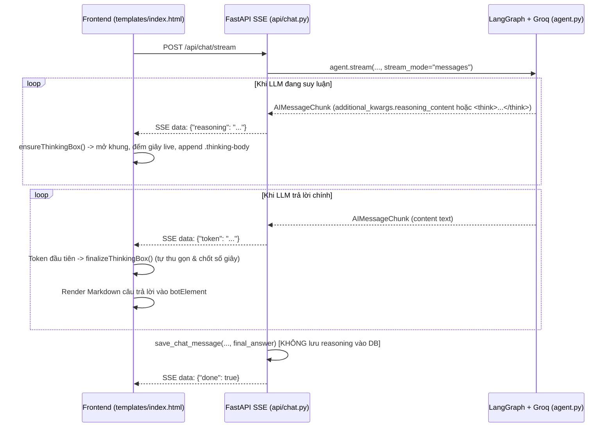

# TÍNH NĂNG STREAMING LLM REASONING (LIVE THINKING BOX)

Tài liệu này mô tả thiết kế, luồng xử lý và chi tiết mã nguồn của tính năng **Stream quá trình suy luận của LLM (Live Reasoning Streaming)** trong dự án **Tit-Chatbot**.

---

## 1. Mục tiêu & Nguyên tắc thiết kế

1. **Hiển thị trực tiếp theo thời gian thực (Live-only):** Toàn bộ token suy luận (`reasoning`) được stream qua SSE (`data: {"reasoning": "..."}`) trong lúc chat và **không lưu vào MongoDB** (`chat_messages` chỉ lưu câu trả lời chính `final_answer`, giúp giữ nhẹ database và sạch ngữ cảnh cho các lượt chat sau).
2. **Khối suy luận tự thu gọn (Auto-collapse):**
   - Trong lúc AI đang suy luận: hộp `.thinking-box` (`
`) tự mở, hiển thị chấm pulse đỏ, bộ đếm giây trực tiếp (`Đang suy luận... (1.2s)`) và cuộn tự động theo luồng chữ suy luận.
   - Ngay khi bắt đầu có chữ trả lời chính (`data.token`), kết thúc stream (`data.done`), hoặc gặp lỗi (`data.error`): hộp suy luận **tự động thu gọn** lại thành dòng tóm tắt gọn gàng **`Đã suy luận trong X.X giây ▾`**, người dùng vẫn có thể bấm mở ra xem lại trong phiên chat hiện tại.
3. **Tương thích đa dạng model Groq:** Hỗ trợ cả 2 kiểu trả reasoning của Groq:
   - **Dạng tách trường (`parsed` / `delta.reasoning`):** Đọc trực tiếp từ `additional_kwargs["reasoning_content"]` của `AIMessageChunk`.
   - **Dạng thẻ thô (`<think>...</think>`):** Tách sạch thẻ ngay trong luồng stream qua `_ReasoningTagSplitter` (kể cả khi thẻ bị cắt đôi giữa 2 chunks), đảm bảo `<think>` không bao giờ lọt ra câu trả lời chính.

---

## 2. Kiến trúc luồng xử lý End-to-End

---

## 3. Chi tiết triển khai theo từng lớp

### 3.1. Lớp Agent & LLM Provider ([agent.py](file:///d:/Tit-Chatbot/agent.py))

1. **Cấu hình tham số reasoning theo dòng model — `_build_reasoning_kwargs()` ([agent.py L153-L164](file:///d:/Tit-Chatbot/agent.py#L153-L164)):**
   * Với nhóm `openai/gpt-oss-*`: Groq tự stream `delta.reasoning` vào `additional_kwargs["reasoning_content"]` và hỗ trợ `GROQ_REASONING_EFFORT` (`low` | `medium` | `high`). Không truyền `reasoning_format` để tránh lỗi `400` từ Groq API.
   * Với nhóm `qwen/*`: Gắn `reasoning_format="parsed"` (tùy chỉnh qua `GROQ_REASONING_FORMAT`) để tách phần suy luận ra khỏi `content`.

2. **Chống lặp stream khi retry — `_OutputStartedTracker` ([agent.py L45-L58](file:///d:/Tit-Chatbot/agent.py#L45-L58)):**
   * Ngoài việc kiểm tra `token` trả lời chính, callback `on_llm_new_token` kiểm tra thêm `chunk.message.additional_kwargs` xem đã phát `reasoning_content` hoặc `reasoning` chưa.
   * Nhờ đó nếu có lỗi mạng/rate limit muộn sau khi người dùng đã thấy khối suy luận trên màn hình, `invoke_with_rate_limit_retry` (`can_retry=lambda: not output_tracker.output_started`) sẽ **không** thử lại từ đầu gây lặp khối thinking.

---

### 3.2. Lớp Streaming API ([api/chat.py](file:///d:/Tit-Chatbot/api/chat.py))

1. **`extract_reasoning_from_chunk(chunk)` ([api/chat.py L117-L133](file:///d:/Tit-Chatbot/api/chat.py#L117-L133)):**
   * Đọc `chunk.additional_kwargs.get("reasoning_content") or additional_kwargs.get("reasoning")`.
   * Hỗ trợ thêm cấu trúc content block dạng list (`item.get("type") in {"thinking", "reasoning"}`).

2. **`_ReasoningTagSplitter` ([api/chat.py L136-L202](file:///d:/Tit-Chatbot/api/chat.py#L136-L202)):**
   * Máy trạng thái (state machine) nhẹ tách cặp thẻ `<think>` và `</think>` trong `chunk.content`.
   * Dùng `_hold_partial_suffix()` để giữ lại phần đuôi nếu một chunk kết thúc đúng vào tiền tố dở dang của thẻ (ví dụ `"<thi"` hoặc `"</th"`), tránh làm lộ ký tự tag vỡ ra giao diện, và gọi `.flush()` khi kết thúc vòng lặp stream.

3. **`_chat_event_generator()` ([api/chat.py L234-L295](file:///d:/Tit-Chatbot/api/chat.py#L234-L295)):**
   * Kết hợp `parsed_reasoning` và `tag_reasoning` $\rightarrow$ phát sự kiện `sse_data({"reasoning": reasoning_token})`.
   * Chỉ cộng dồn `token` câu trả lời chính vào `final_answer` và lưu `final_answer` vào MongoDB qua `save_chat_message()`.

---

### 3.3. Lớp Giao Diện Người Dùng ([templates/index.html](file:///d:/Tit-Chatbot/templates/index.html))

1. **CSS khối suy luận ([index.html L1150-L1228](file:///d:/Tit-Chatbot/templates/index.html#L1150-L1228) & [L1514](file:///d:/Tit-Chatbot/templates/index.html#L1514)):**
   * `.thinking-box` canh lề thẳng hàng với nội dung trả lời của bot (`max-width: 840px; padding-left: 50px` trên desktop, `0` trên mobile).
   * `.thinking-card` (`
`) có viền trái nhấn màu đỏ thương hiệu, `.thinking-dot` nhấp nháy khi đang suy luận (`thinkingPulse`) và chuyển xám tĩnh khi `.done`.
   * `.thinking-body` giới hạn chiều cao `220px` có thanh cuộn dọc riêng để suy luận dài không đẩy trôi toàn bộ màn hình chat.

2. **Tách DOM độc lập với `renderMarkdown` ([index.html L4250-L4348](file:///d:/Tit-Chatbot/templates/index.html#L4250-L4348)):**
   * `ensureThinkingBox()` chèn `.thinking-box` ngay **trước** phần tử `.message.assistant` (`beforebegin`), giúp `renderMarkdown(botElement, ...)` chỉ ghi lại phần trả lời chính mà không bao giờ ghi đè mất hộp suy luận (và vẫn giữ nguyên vị trí gắn `followup-suggestions` phía sau `.message.assistant`).
   * `finalizeThinkingBox()` được gọi ngay khi nhận `data.token` đầu tiên, `data.error`, `data.done`, hoặc trong khối `finally` của `sendMessage()` ([index.html L4435](file:///d:/Tit-Chatbot/templates/index.html#L4435)) để dừng interval timer, đặt `thinkingCard.open = false` và hiển thị thời gian suy luận thực tế (`Đã suy luận trong X.X giây`).

---

## 4. Biến môi trường cấu hình (`.env`)

| Biến môi trường | Giá trị ví dụ | Mô tả |
| :--- | :--- | :--- |
| `GROQ_REASONING_EFFORT` | `low` / `medium` / `high` | Điều chỉnh mức độ suy luận cho nhóm model `openai/gpt-oss-*` (mặc định để Groq tự chọn nếu bỏ trống). |
| `GROQ_REASONING_FORMAT` | `parsed` | Định dạng tách reasoning cho nhóm model `qwen/*` (mặc định `parsed`). |

---

## 5. Kiểm thử xác minh

Unit tests cho luồng backend & UI tokens nằm tại script kiểm thử `verify_reasoning_streaming.py`:
- Kiểm tra `_build_reasoning_kwargs` cho `openai/gpt-oss-20b` và `qwen/qwen3.8-27b`.
- Kiểm tra `_OutputStartedTracker` nhận diện `reasoning_content` khi `token == ""`.
- Kiểm tra `extract_reasoning_from_chunk` và `_ReasoningTagSplitter` cắt thẻ `<think>...</think>` bị chia ngang qua nhiều chunk.
- Kiểm tra `_chat_event_generator` phát riêng event `{"reasoning": ...}` và `{"token": ...}`, đồng thời chỉ lưu `final_answer` (không lưu `reasoning`) vào `save_chat_message`.
