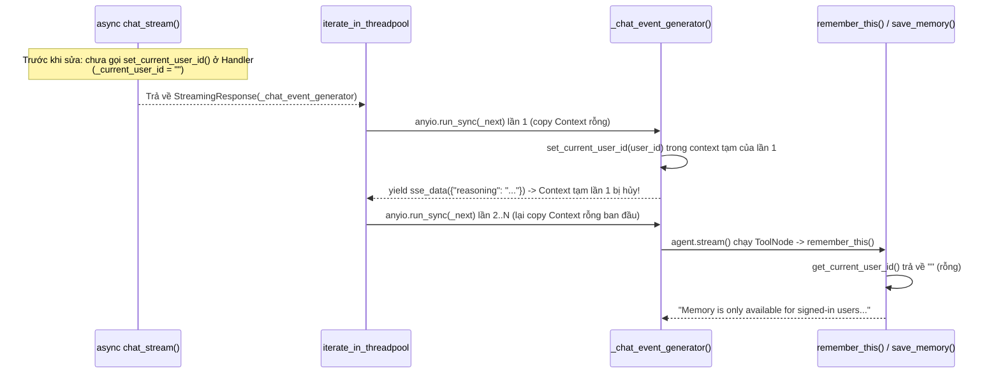

# Phân tích & Khắc phục lỗi mất `ContextVar` khi Stream SSE (`StreamingResponse`)

Tài liệu này mô tả chi tiết nguyên nhân vì sao người dùng đã đăng nhập nhưng khi nhắn yêu cầu lưu bộ nhớ (ví dụ: *"hãy nhớ tên tôi là Tít"* với model có reasoning như GPT-OSS 20B) lại nhận phản hồi *"hiện tại tôi chưa được đăng nhập nên không thể lưu thông tin vào bộ nhớ lâu dài"*, kèm giải pháp triệt để và kết quả kiểm chứng.

---

## 1. Triệu chứng thực tế

- Người dùng đã đăng nhập hợp lệ trên giao diện web (hiển thị tên tài khoản, quyền `Admin`, danh sách `PROJECTS` và `CHAT CÁ NHÂN`).
- Chọn model **GPT-OSS 20B** (có phát token suy luận *reasoning*) và gửi tin nhắn: `"hãy nhớ tên tôi là Tít"`.
- Hệ thống stream khối suy luận (*"Đã suy luận trong 1.3 giây"*), sau đó bot gọi tool `remember_this` nhưng lại trả lời:
  > *"Xin lỗi, hiện tại tôi chưa được đăng nhập nên không thể lưu thông tin vào bộ nhớ lâu dài..."*

---

## 2. Nguyên nhân gốc rễ (Root Cause)

### 2.1. Cách Starlette / FastAPI xử lý `StreamingResponse` với sync generator
Trong [chat.py](file:///d:/Tit-Chatbot/api/chat.py), endpoint `/api/chat/stream` trả về `StreamingResponse(_chat_event_generator(...))` trong đó `_chat_event_generator` là một **synchronous generator** (`def ... -> Iterator[str]`).

Khi trả về sync iterator, Starlette chạy vòng lặp `starlette.concurrency.iterate_in_threadpool`:

```python
async def iterate_in_threadpool(
    iterator: Iterable[T],
) -> AsyncIterator[T]:
    as_iterator = iter(iterator)
    while True:
        try:
            yield await anyio.to_thread.run_sync(_next, as_iterator)
        except _StopIteration:
            break
```

Mỗi lần gọi `anyio.to_thread.run_sync(_next, as_iterator)`, AnyIO gọi `contextvars.copy_context()` từ **coroutine của event loop** (request handler `chat_stream`) sang worker thread để thực thi đến câu lệnh `yield` tiếp theo. **Mọi thay đổi `ContextVar.set(...)` diễn ra bên trong worker thread không được ghi ngược lại vào context của coroutine gốc**, nên sẽ bị hủy ngay sau khi `next()` trả về ở lệnh `yield`.

### 2.2. Chuỗi sự kiện gây mất `user_id` sau khi có Reasoning Streaming



1. Trước đây, `set_current_thread_id`, `set_current_user_id`, `set_current_project`, `set_current_personalization` chỉ nằm bên trong `_chat_event_generator`, còn trong `async def chat_stream` trước `return StreamingResponse(...)` chỉ mới gọi `set_current_language(user_lang)`.
2. **Trước khi thêm Reasoning Streaming**: Khi LLM gọi `remember_this`, `should_stream_chunk()` lọc bỏ tool-call chunk nên **không có lệnh `yield` nào xảy ra trước khi tool chạy**. Vì vậy toàn bộ bước `chatbot` + `tools` đều nằm gọn trong lần `next()` đầu tiên, vô tình không lộ lỗi.
3. **Sau khi thêm Reasoning Streaming**: Model phát token suy luận trước khi gọi tool -> dòng `yield sse_data({"reasoning": reasoning_token})` kết thúc lần `next()` thứ nhất. Từ lần `next()` thứ hai trở đi, worker thread dùng bản sao mới của outer context (với `_current_user_id == ""`), khiến:
   - [memory.py](file:///d:/Tit-Chatbot/agent_tools/memory.py#L52-L53): `get_current_user_id()` trả về `""`.
   - [memories.py](file:///d:/Tit-Chatbot/storage/memories.py#L95-L96): `not project_id and not _to_object_id(user_id)` đúng -> trả thông báo yêu cầu đăng nhập.
4. Không chỉ `remember_this`, mọi `ContextVar` khác (`_current_thread_id`, `_current_project_id`, `_current_personalization_style`, `_current_personalization_instructions`) cũng có nguy cơ reset về mặc định sau bất kỳ lần `yield` nào trong suốt phiên stream.

---

## 3. Giải pháp khắc phục ([chat.py](file:///d:/Tit-Chatbot/api/chat.py))

Áp dụng đồng thời 2 lớp bảo vệ để đảm bảo `ContextVar` luôn tồn tại ở cả request coroutine lẫn bên trong mọi bước `next()` qua threadpool:

1. **Tách hàm `_apply_chat_context(...)`** ([chat.py](file:///d:/Tit-Chatbot/api/chat.py#L237-L257)) và **gọi trực tiếp trong `chat_stream()` trước khi `return StreamingResponse(...)`** ([chat.py](file:///d:/Tit-Chatbot/api/chat.py#L471-L481)).
2. **Gắn một `stream_ctx = contextvars.copy_context()` cố định trong `_chat_event_generator()`** ([chat.py](file:///d:/Tit-Chatbot/api/chat.py#L277-L309)):
   - Nạp đủ `ContextVar` vào `stream_ctx` một lần bằng `stream_ctx.run(_apply_chat_context, ...)`.
   - Khởi tạo iterator `agent.stream(...)` và đọc từng phần tử bằng `stream_ctx.run(next, stream_iter, stream_sentinel)` (và chạy `handle_partial_stream` trong `stream_ctx.run(...)`).
   - Nhờ vậy, dù Starlette có chuyển bước `next()` qua nhiều thread khác nhau sau mỗi lần `yield`, cả `chatbot_node` lẫn `ToolNode` vẫn luôn thực thi trong đúng `stream_ctx` chứa đầy đủ `user_id`, `thread_id`, `project_id` và `personalization`, đồng thời giữ tương thích nếu unit test gọi trực tiếp `_chat_event_generator()` không qua FastAPI.

### Code triển khai tại [chat.py](file:///d:/Tit-Chatbot/api/chat.py#L237-L309)

```python
def _apply_chat_context(
    *,
    thread_id: str,
    user_id: str | None,
    selected_model: str,
    user_lang: str,
    project_id: str | None,
    project_memory_mode: str,
    project_instructions: str,
    project_context: str,
    personalization: dict[str, Any] | None,
) -> None:
    """Thiết lập toàn bộ ContextVar cho request chat hiện tại."""
    set_current_thread_id(thread_id)
    set_current_user_id(user_id or "")
    set_current_model_name(selected_model)
    set_current_language(user_lang)
    set_current_project(project_id, project_memory_mode)
    set_project_prompt_context(project_instructions, project_context)
    pers = personalization or {}
    set_current_personalization(pers.get("base_style"), pers.get("custom_instructions"))


def _chat_event_generator(
    agent: Any,
    thread_id: str,
    user_id: str | None,
    user_message: str,
    selected_model: str,
    config: dict[str, Any],
    user_lang: str = "vi",
    project_id: str | None = None,
    project_memory_mode: str = "",
    project_instructions: str = "",
    project_context: str = "",
    personalization: dict[str, Any] | None = None,
) -> Iterator[str]:
    """Stream câu trả lời và giữ ContextVar xuyên suốt mọi lần yield qua threadpool."""
    # Starlette iterate_in_threadpool chạy mỗi bước next() qua anyio.to_thread.run_sync (copy context mới mỗi lần).
    # Gói agent.stream vào một stream_ctx cố định để user_id/project/personalization không bị reset sau yield đầu tiên.
    stream_ctx = contextvars.copy_context()
    stream_ctx.run(
        _apply_chat_context,
        thread_id=thread_id,
        user_id=user_id,
        selected_model=selected_model,
        user_lang=user_lang,
        project_id=project_id,
        project_memory_mode=project_memory_mode,
        project_instructions=project_instructions,
        project_context=project_context,
        personalization=personalization,
    )

    final_answer = ""
    reasoning_splitter = _ReasoningTagSplitter()
    stream_sentinel = object()

    try:
        inputs = {
            "messages": [
                HumanMessage(content=user_message)
            ]
        }

        stream_iter = stream_ctx.run(
            lambda: iter(agent.stream(inputs, config=config, stream_mode="messages"))
        )
        while True:
            item = stream_ctx.run(next, stream_iter, stream_sentinel)
            if item is stream_sentinel:
                break
            chunk, metadata = item
```

---

## 4. Kiểm chứng

1. **Biên dịch cú pháp**: `python -B -m py_compile api/chat.py` thành công (`exit code 0`).
2. **Kiểm thử mô phỏng ranh giới `yield` của Starlette**:
   - Thiết lập outer context rỗng (`_current_user_id == ""`).
   - Mock `_FakeAgent` phát chunk `reasoning_content` (buộc `_chat_event_generator` thực hiện `yield` đầu tiên), sau đó ở bước tiếp theo mới đọc `get_current_user_id()`, `get_current_thread_id()`, và `get_current_personalization()`.
   - Lặp qua generator bằng `empty_outer_ctx.copy().run(next, gen)` để mô phỏng chính xác hành vi `anyio.to_thread.run_sync` của Starlette.
   - Kết quả:
     `[PASS] ContextVars preserved across Starlette-style yield boundaries: {'user_id': '65f123456789abcdef012345', 'thread_id': 'thread-abc', 'personalization': {'base_style': 'friendly', 'custom_instructions': 'Rule 1'}}`.
